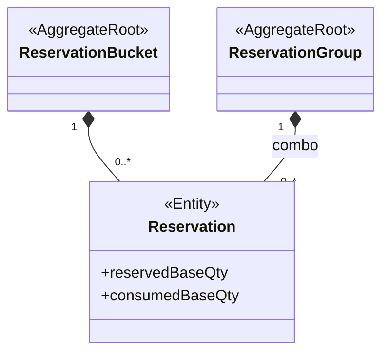
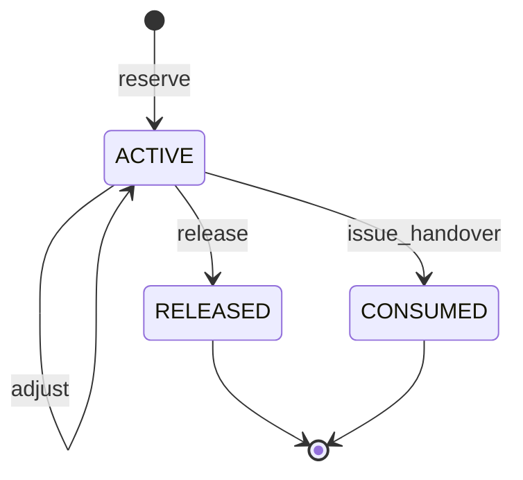

# ENT-IO-05 — Reservation

## 1. Định vị nghiệp vụ & ranh giới Aggregate

Cam kết giữ hàng theo dòng nguồn (order line / component). **Không** trừ tồn vật lý — chỉ giảm ATP qua `ReservationBucket`.

| Thuộc tính | Giá trị |
|---|---|
| Vai trò DDD | `CHILD_ENTITY` |
| Aggregate Root | `ReservationBucket` (`ENT-IO-08`); nhóm combo → `ReservationGroup` (`ENT-IO-14`) |
| Domain sở hữu | `DOM-IO` |
| Domain không sở hữu | Sales order line → Sales |

### 1.1 Ranh giới Aggregate (Visual)

## 2. Identity

| Loại | Định danh | Ghi chú |
|---|---|---|
| Surrogate | `reservationId` | Stable |
| Business key | source document/line/component + version rules | Theo contract nguồn |

## 3. Thuộc tính nghiệp vụ thuần túy

| Thuộc tính | Ý nghĩa | Bắt buộc | Ghi chú |
|---|---|---:|---|
| `reservationId` | Định danh giữ hàng | Có | |
| `warehouseScope` | Kho giữ | Có | |
| `productId` | Sản phẩm (component nếu combo) | Có | |
| `sourceRef` | Document/line/version | Có | |
| `requestedBaseQuantity` | Nhu cầu chuẩn hóa | Có | |
| `reservedBaseQuantity` | Đang giữ (chưa consume) | Có | Góp vào bucket |
| `consumedBaseQuantity` | Đã xuất/bàn giao | Có | Không nằm trong bucket |
| `reservationPolicy` | ALL_OR_NOTHING / PARTIAL | Có | |
| `reservationGroupId` | Nhóm combo | Khi combo | `ENT-IO-14` |
| `status` | ACTIVE / RELEASED / … | Có | |

## 4. Hành vi nghiệp vụ cốt lõi

Qua Root `ReservationBucket` (và Group khi combo):

| Hành vi | Điều kiện / Invariant | Hệ quả / Domain Event |
|---|---|---|
| Reserve | ATP đủ (online); policy | Tăng reserved; `StockReserved` |
| Adjust / release | Source version hợp lệ | Giảm reserved; `StockReleased` |
| Consume on issue | GoodsIssue complete | reserved → consumed; không tăng physical |

## 5. Vòng đời & chuyển dịch trạng thái

## 6. Domain Events phát sinh

Gói trong thay đổi bucket / group (`StockReserved`, `StockReleased`) — xem Root.

## 7. Liên kết truy vết

| Loại | ID |
|---|---|
| Domain Foundation | `DOM-IO` |
| Root | `ENT-IO-08`, `ENT-IO-14` |
| BC / UC | `BC-IO-03`, `BC-IO-06`, `UC-04-*` |
| Quyết định | T7-DR-029, INV-IO-07/10 |
