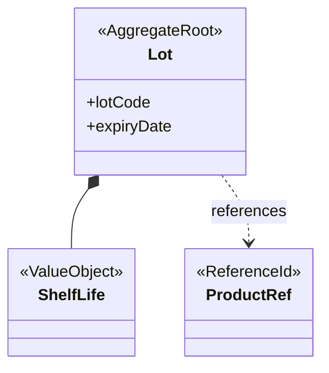
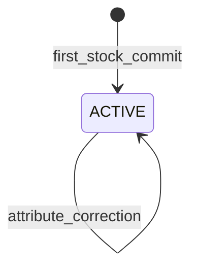

# ENT-IO-06 — Lot

## 1. Định vị nghiệp vụ & ranh giới Aggregate

Hồ sơ **lô sản xuất** trong tenant: mã NSX/đóng gói chuẩn hóa, hạn dùng, thuộc tính manufacture. Dùng chung mọi kho/phiếu nhận hàng của cùng product.

| Thuộc tính | Giá trị |
|---|---|
| Vai trò DDD | `AGGREGATE_ROOT` |
| Aggregate Root | `Lot` (tự thân) |
| Domain sở hữu | `DOM-IO` |
| Domain không sở hữu | Tracking policy master → Catalog |

### 1.1 Ranh giới Aggregate (Visual)

## 2. Identity

| Loại | Định danh | Ghi chú |
|---|---|---|
| Surrogate | `lotId` | |
| Business key | `(tenantId, productId, normalizedLotCode)` | Unique toàn tenant+product |

## 3. Thuộc tính nghiệp vụ thuần túy

| Thuộc tính | Ý nghĩa | Bắt buộc | Ghi chú |
|---|---|---:|---|
| `lotId` | Định danh lô | Có | |
| `productId` | Sản phẩm LOT | Có | |
| `lotCode` | Mã NSX/đóng gói | Có | |
| `normalizedLotCode` | Mã chuẩn hóa | Có | Business key |
| `manufactureDate` | Ngày SX | Không | Kèm precision |
| `expiryDate` | Hạn dùng | Theo policy | Bắt buộc nếu `expiry_required` |
| `status` | ACTIVE / … | Có | Không thay stock_state trên balance |
| `originIntentRef` | Intent đầu tiên phát sinh tồn | Có | Chính thức khi movement đầu commit |

## 4. Hành vi nghiệp vụ cốt lõi

| Hành vi | Điều kiện / Invariant | Hệ quả / Domain Event |
|---|---|---|
| `openOrAttach(...)` | tracking=LOT; mã hợp lệ | Tạo/gắn lot; conflict manufacture/expiry **chặn** commit |
| `correctAttributes(...)` | Có lịch sử/reason | Cập nhật có audit; không xóa lot đã có tồn |
| — | tracking=NONE | **KHÔNG ĐƯỢC** tạo lot |

## 5. Vòng đời & chuyển dịch trạng thái

Lot record **CHỈ** chính thức khi operation đầu phát sinh tồn commit (INV-LOT-05).

## 6. Domain Events phát sinh

| Event | Khi nào | Ý nghĩa |
|---|---|---|
| `LotOpened` | Lần đầu gắn tồn | Hồ sơ lô có hiệu lực |
| `LotAttributesCorrected` | Sửa có lịch sử | Thuộc tính đổi có audit |

## 7. Liên kết truy vết

| Loại | ID |
|---|---|
| Domain Foundation | `DOM-IO` |
| Quyết định | INV-LOT-01…08, G02 |
