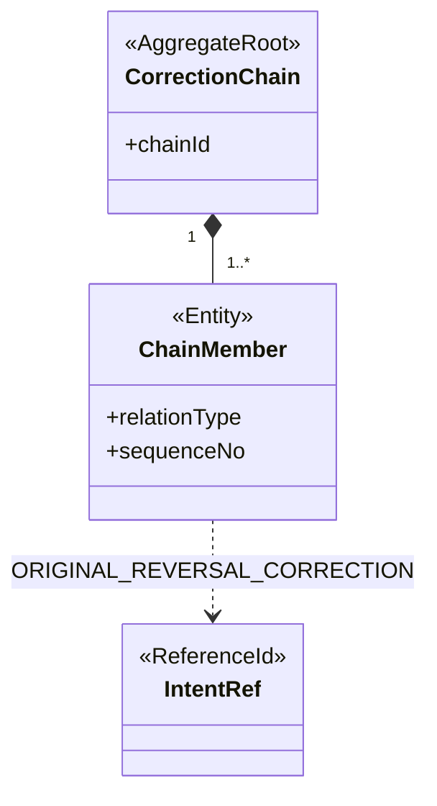

# ENT-IO-07 — CorrectionChain

## 1. Định vị nghiệp vụ & ranh giới Aggregate

Chuỗi liên kết **gốc → đảo → điều chỉnh** sau khi intent đã `COMPLETED`. Bảo vệ tính bất biến của movement: không UPDATE/DELETE ledger cũ.

| Thuộc tính | Giá trị |
|---|---|
| Vai trò DDD | `AGGREGATE_ROOT` |
| Aggregate Root | `CorrectionChain` |
| Domain sở hữu | `DOM-IO` |
| Domain không sở hữu | Nội dung chứng từ nguồn ngoài |

### 1.1 Ranh giới Aggregate (Visual)

## 2. Identity

| Loại | Định danh | Ghi chú |
|---|---|---|
| Surrogate | `chainId` (+ `chainEntryId` cho member) | |
| Business rule | Mỗi intent member **unique** trong bảng membership | Không trùng chain |

## 3. Thuộc tính nghiệp vụ thuần túy

| Thuộc tính | Ý nghĩa | Bắt buộc | Ghi chú |
|---|---|---:|---|
| `chainId` | Nhóm chuỗi | Có | |
| `rootIntentRef` | Intent gốc | Có | ORIGINAL |
| `memberIntentRef` | Intent thành viên | Có | Unique |
| `relationType` | ORIGINAL / REVERSAL / CORRECTION / REPLACEMENT | Có | |
| `predecessorIntentRef` | Intent trước | Không với root | |
| `sequenceNo` | Thứ tự trong chain | Có | |
| `reason` | Lý do sửa sai | Có | |

## 4. Hành vi nghiệp vụ cốt lõi

| Hành vi | Điều kiện / Invariant | Hệ quả / Domain Event |
|---|---|---|
| `openChain(root)` | Root đã COMPLETED | Tạo chain + ORIGINAL member |
| `appendReversal(...)` | Có pair builder | Member REVERSAL + intent đảo append movement |
| `appendCorrection(...)` | Sau reversal hợp lệ | Member CORRECTION; `CorrectionChainExtended` |

## 5. Vòng đời & chuyển dịch trạng thái

Chuỗi append-only về membership — không “đóng” bắt buộc Phase 1; mỗi entry bất biến sau ghi.

## 6. Domain Events phát sinh

| Event | Khi nào | Ý nghĩa |
|---|---|---|
| `CorrectionChainOpened` | openChain | Bắt đầu sửa sai có truy vết |
| `CorrectionChainExtended` | append member | Thêm reversal/correction |

## 7. Liên kết truy vết

| Loại | ID |
|---|---|
| Domain Foundation | `DOM-IO` |
| BC / UC | `BC-IO-13`, `UC-11-*` |
| Quyết định | G08, INV-IO-04 |
