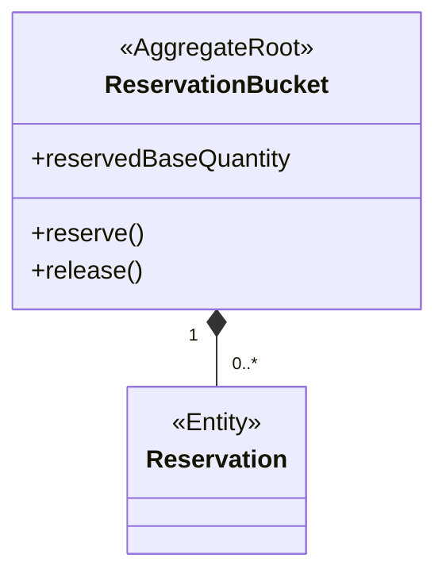

# ENT-IO-08 — ReservationBucket

## 1. Định vị nghiệp vụ & ranh giới Aggregate

Hạn ngạch **tổng lượng đang giữ** theo `(tenant, product, warehouse)` — concurrency boundary cho reserve/release. Độc lập lô; **không** trừ Physical On-Hand.

| Thuộc tính | Giá trị |
|---|---|
| Vai trò DDD | `AGGREGATE_ROOT` |
| Aggregate Root | `ReservationBucket` |
| Domain sở hữu | `DOM-IO` |
| Domain không sở hữu | Order nguồn → Sales |

### 1.1 Ranh giới Aggregate (Visual)

## 2. Identity

| Loại | Định danh | Ghi chú |
|---|---|---|
| Surrogate | `reservationBucketId` | |
| Business key | `(tenantId, productId, warehouseId)` | Unique |

## 3. Thuộc tính nghiệp vụ thuần túy

| Thuộc tính | Ý nghĩa | Bắt buộc | Ghi chú |
|---|---|---:|---|
| `reservationBucketId` | Định danh bucket | Có | |
| `productId` | Sản phẩm | Có | Key |
| `warehouseId` | Kho | Có | Key |
| `reservedBaseQuantity` | Tổng đang giữ | Có | ≥ 0; = tổng Reservation còn hiệu lực |
| `reservations` | Tập Reservation con | Có | Child `ENT-IO-05` |

## 4. Hành vi nghiệp vụ cốt lõi

| Hành vi | Điều kiện / Invariant | Hệ quả / Domain Event |
|---|---|---|
| `reserve(...)` | ATP đủ; concurrency thắng | Tăng bucket + tạo/cập nhật Reservation; `StockReserved` |
| `releaseOrAdjust(...)` | Source version hợp lệ | Giảm reserved; `StockReleased` |
| `consumeOnIssue(...)` | GoodsIssue complete | reserved → consumed trên child; giảm bucket |

Tổng bucket **PHẢI** bằng tổng `reservedBaseQuantity` các Reservation còn hiệu lực (INV-IO-10).

## 5. Vòng đời & chuyển dịch trạng thái

Bucket tồn tại dài hạn theo key — không DRAFT/COMPLETED; số dư reserved thay đổi theo hành vi.

## 6. Domain Events phát sinh

| Event | Khi nào | Ý nghĩa |
|---|---|---|
| `StockReserved` | reserve thành công | ATP giảm |
| `StockReleased` | release/adjust | ATP tăng lại |

## 7. Liên kết truy vết

| Loại | ID |
|---|---|
| Domain Foundation | `DOM-IO` |
| Child | `ENT-IO-05` |
| BC / UC | `BC-IO-03`, `BC-IO-06`, `UC-04-*` |
| Quyết định | T7-DR-029, INV-IO-07/10 |
