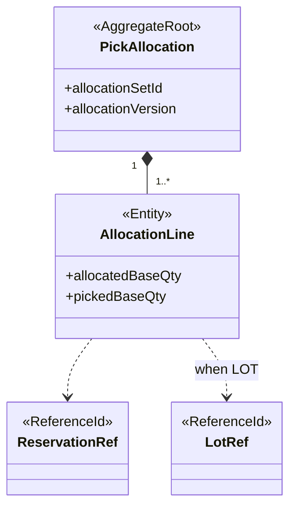
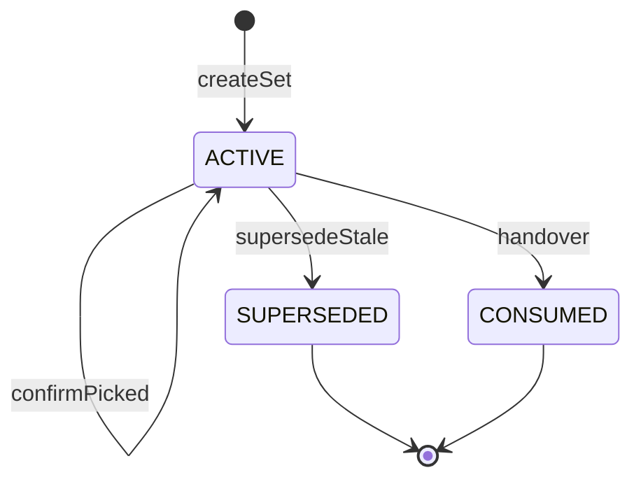

# ENT-IO-09 — PickAllocation

## 1. Định vị nghiệp vụ & ranh giới Aggregate

Tập phân bổ lô/lượng đã **pick** nhưng **chưa** xuất vật lý. Một active allocation set/version; handover chỉ consume version còn hiệu lực sau kiểm eligibility.

| Thuộc tính | Giá trị |
|---|---|
| Vai trò DDD | `AGGREGATE_ROOT` |
| Aggregate Root | `PickAllocation` (allocation set) |
| Domain sở hữu | `DOM-IO` — kết quả `FefoPickAllocator` |
| Domain không sở hữu | Fulfillment master → Sales |

### 1.1 Ranh giới Aggregate (Visual)

## 2. Identity

| Loại | Định danh | Ghi chú |
|---|---|---|
| Surrogate | `allocationId` (line) / `allocationSetId` | |
| Business key | `(allocationSetId, allocationVersion, lineNo)` | Một active version |

## 3. Thuộc tính nghiệp vụ thuần túy

| Thuộc tính | Ý nghĩa | Bắt buộc | Ghi chú |
|---|---|---:|---|
| `allocationSetId` | Tập phân bổ | Có | |
| `allocationVersion` | Version tập | Có | Chỉ một active |
| `fulfillmentRef` | Nguồn fulfillment | Có | |
| `reservationId` | Reservation gắn | Có | |
| `productId` / `warehouseId` | Khớp reservation | Có | |
| `lotId` | Lô pick | Khi LOT | |
| `allocatedBaseQuantity` | Lượng phân bổ | Có | > 0; ≤ chưa consume |
| `pickedBaseQuantity` | Đã lấy cộng dồn | Có | ≤ allocated |
| `status` | ACTIVE / SUPERSEDED / CONSUMED | Có | |

## 4. Hành vi nghiệp vụ cốt lõi

| Hành vi | Điều kiện / Invariant | Hệ quả / Domain Event |
|---|---|---|
| `createSet(...)` | FEFO/FIFO hợp lệ | Active set; **không** đổi physical |
| `confirmPicked(...)` | Trong allocated | Tăng picked |
| `supersedeStale(...)` | Eligibility đổi | Version mới; version cũ SUPERSEDED |
| `consumeOnHandover(...)` | GoodsIssue + evidence | CONSUMED; physical giảm ở Issue |

**KHÔNG ĐƯỢC** đổi physical chỉ vì tạo allocation (INV-IO-11).

## 5. Vòng đời & chuyển dịch trạng thái

## 6. Domain Events phát sinh

| Event | Khi nào | Ý nghĩa |
|---|---|---|
| `PickAllocationCreated` | createSet | Có tập pick active |
| `PickAllocationSuperseded` | stale recovery | Version cũ hết hiệu lực |
| `PickAllocationConsumed` | handover | Đã gắn với issue hoàn tất |

## 7. Liên kết truy vết

| Loại | ID |
|---|---|
| Domain Foundation | `DOM-IO` |
| BC / UC | `BC-IO-15`, `UC-05-01`…`UC-05-04` |
| Quyết định | T7-DR-030, INV-IO-11 |
