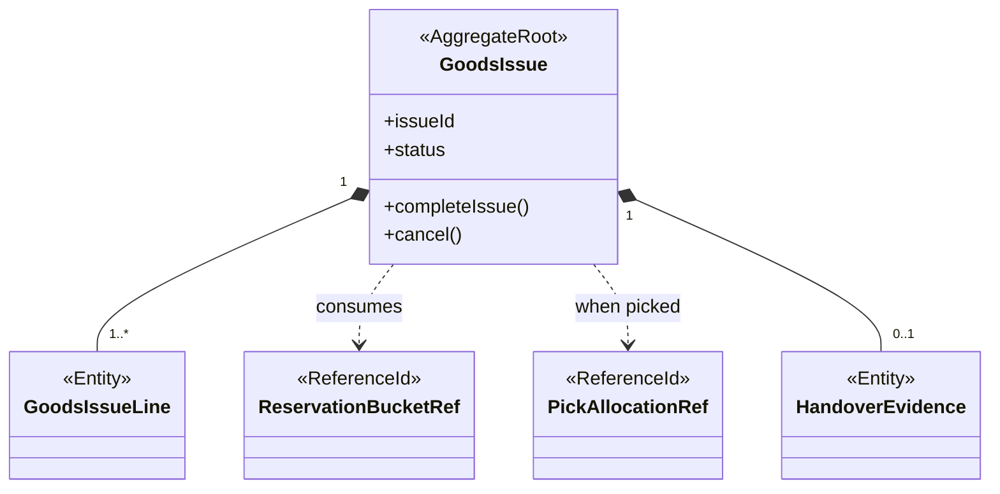
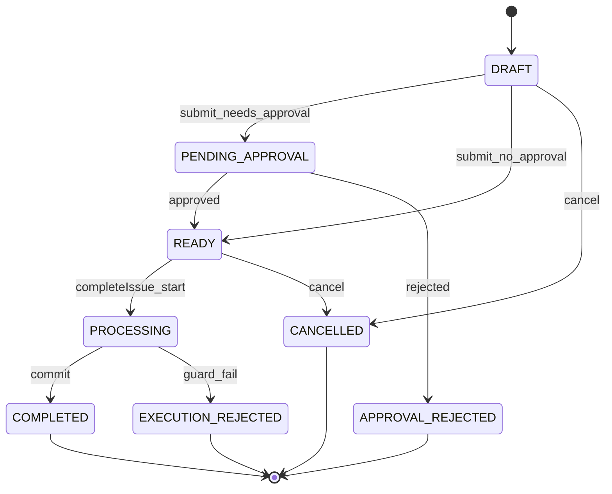

# ENT-IO-10 — GoodsIssue

## 1. Định vị nghiệp vụ & ranh giới Aggregate

Lệnh **xuất kho** theo intent (POS / fulfillment handover / trả NCC vật lý). Tiêu thụ reservation khi có; `COMPLETED` mới giảm tồn vật lý và append `InventoryMovement`.

| Thuộc tính | Giá trị |
|---|---|
| Vai trò DDD | `AGGREGATE_ROOT` |
| Aggregate Root | `GoodsIssue` (tự thân) |
| Domain sở hữu | `DOM-IO` |
| Domain không sở hữu | Order/fulfillment → Sales; ApprovalCase → `DOM-IC`; COGS value → `DOM-IV` |

### 1.1 Ranh giới Aggregate (Visual)

## 2. Identity

| Loại | Định danh | Ghi chú |
|---|---|---|
| Surrogate | `issueId` | Ổn định suốt vòng đời |
| Business key | `(tenantId, sourceType, operationRequestId)` | Unique theo yêu cầu xuất |

## 3. Thuộc tính nghiệp vụ thuần túy

| Thuộc tính | Ý nghĩa | Bắt buộc | Ghi chú |
|---|---|---:|---|
| `issueId` | Định danh lệnh xuất | Có | Surrogate |
| `operationRequestId` | ID yêu cầu nguồn | Có | Business key |
| `sourceType` | POS / fulfillment / RTV / … | Có | |
| `warehouseScope` | Kho xuất | Có | Phase 1 mặc định |
| `businessDate` | Ngày nghiệp vụ xuất | Có | |
| `status` | Vòng đời intent | Có | Bắt đầu `DRAFT` hoặc từ nguồn READY |
| `lines` | Dòng xuất | Có (≥1 khi thực thi) | Child lines |
| `reservationRefs` | Reservation tiêu thụ | Khi có giữ hàng | Không trừ vật lý chỉ vì reserve |
| `pickAllocationRef` | Allocation set/version | Khi đã pick | Chỉ consume version còn hiệu lực |

## 4. Hành vi nghiệp vụ cốt lõi

| Hành vi | Điều kiện / Invariant | Hệ quả / Domain Event |
|---|---|---|
| `createDraft(...)` | Scope/ATP đủ điều kiện (khi online) | `DRAFT`; chưa movement |
| `submitForApproval()` | Theo policy IC | Khóa payload; có thể `PENDING_APPROVAL` |
| `completeIssue()` | `READY`; all-or-nothing; không âm Sellable/ATP | `COMPLETED`; consume reservation; append movement; `GoodsIssued` |
| `attachHandoverEvidence(...)` | Trước/cùng complete khi policy yêu cầu | Evidence bất biến `ENT-IO-12` |
| `cancel()` | Chưa `COMPLETED` | `CANCELLED`; không tăng tồn giả |

## 5. Vòng đời & chuyển dịch trạng thái

`UNKNOWN` kỹ thuật: xem `DOM-IO` — không auto-cancel.

## 6. Domain Events phát sinh

| Event | Khi nào | Ý nghĩa |
|---|---|---|
| `GoodsIssueSubmitted` | Submit khóa payload | Chờ duyệt / sẵn sàng |
| `GoodsIssued` | `completeIssue` commit | Vật lý đã giảm; movement tồn tại |
| `GoodsIssueCancelled` | `cancel` | Hủy trước hoàn tất |

## 7. Liên kết truy vết

| Loại | ID |
|---|---|
| Domain Foundation | `DOM-IO` |
| Behavioral Contract | `BC-IO-04`, `BC-IO-05`, `BC-IO-09` |
| Use Case | `UC-05-03`, `UC-05-05`, `UC-07-04` |
| Evidence | `ENT-IO-12` |
| Quyết định | G04, G06, G10 |
