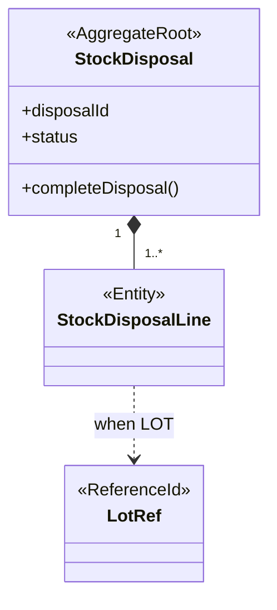
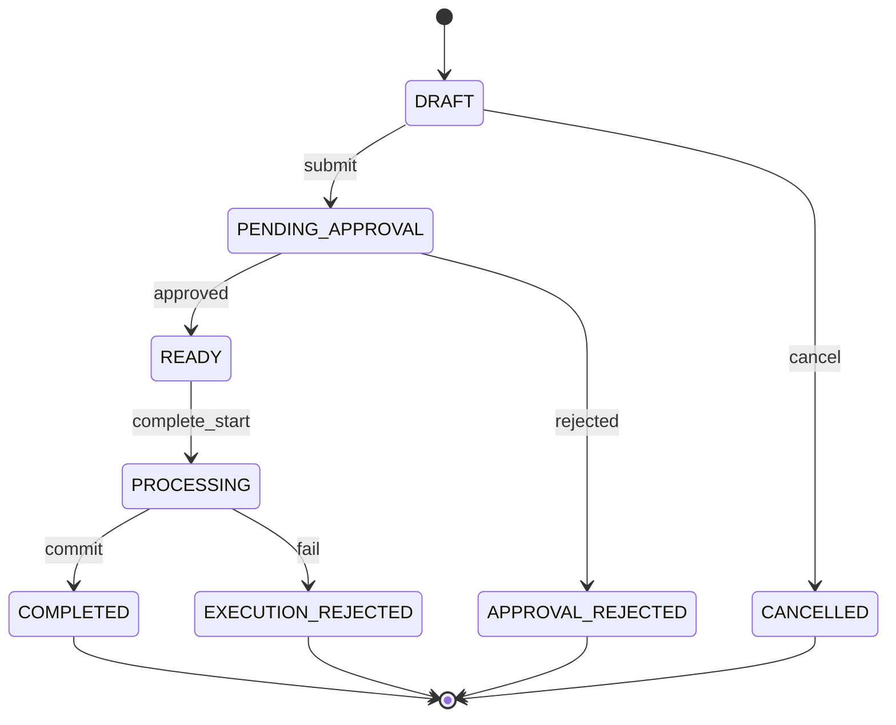

# ENT-IO-11 — StockDisposal

## 1. Định vị nghiệp vụ & ranh giới Aggregate

Lệnh **xuất hủy / hao hụt** — giảm tồn vật lý khi đã xác nhận tiêu hủy; không phải bán hàng và không tự tạo correction.

| Thuộc tính | Giá trị |
|---|---|
| Vai trò DDD | `AGGREGATE_ROOT` |
| Aggregate Root | `StockDisposal` (tự thân) |
| Domain sở hữu | `DOM-IO` |
| Domain không sở hữu | ApprovalCase → `DOM-IC`; value write-off accounting → `DOM-IV` / Accounting |

### 1.1 Ranh giới Aggregate (Visual)

## 2. Identity

| Loại | Định danh | Ghi chú |
|---|---|---|
| Surrogate | `disposalId` | Ổn định |
| Business key | `(tenantId, sourceType, operationRequestId)` | Unique yêu cầu tiêu hủy |

## 3. Thuộc tính nghiệp vụ thuần túy

| Thuộc tính | Ý nghĩa | Bắt buộc | Ghi chú |
|---|---|---:|---|
| `disposalId` | Định danh lệnh | Có | |
| `operationRequestId` | ID yêu cầu | Có | Business key |
| `warehouseScope` | Kho tiêu hủy | Có | |
| `businessDate` | Ngày nghiệp vụ | Có | |
| `reasonCode` | Lý do tiêu hủy | Có | Policy / audit |
| `status` | Vòng đời | Có | |
| `lines` | Dòng hàng hủy | Có | product/qty/lot/state nguồn |

## 4. Hành vi nghiệp vụ cốt lõi

| Hành vi | Điều kiện / Invariant | Hệ quả / Domain Event |
|---|---|---|
| `createDraft(...)` | Scope hợp lệ; qty ≤ tồn trạng thái nguồn | `DRAFT` |
| `submitForApproval()` | Theo risk/policy IC | Khóa payload; thường cần duyệt |
| `completeDisposal()` | `READY`; all-or-nothing | `COMPLETED`; append movement giảm vật lý; `StockDisposed` |
| `cancel()` | Chưa `COMPLETED` | `CANCELLED` |

## 5. Vòng đời & chuyển dịch trạng thái

## 6. Domain Events phát sinh

| Event | Khi nào | Ý nghĩa |
|---|---|---|
| `StockDisposalSubmitted` | Submit | Chờ duyệt |
| `StockDisposed` | Complete commit | Đã giảm vật lý |
| `StockDisposalCancelled` | Cancel | Hủy trước hoàn tất |

## 7. Liên kết truy vết

| Loại | ID |
|---|---|
| Domain Foundation | `DOM-IO` |
| Behavioral Contract | `BC-IO-11` |
| Use Case | `UC-10-01`…`UC-10-04` |
| Quyết định | G06 |
