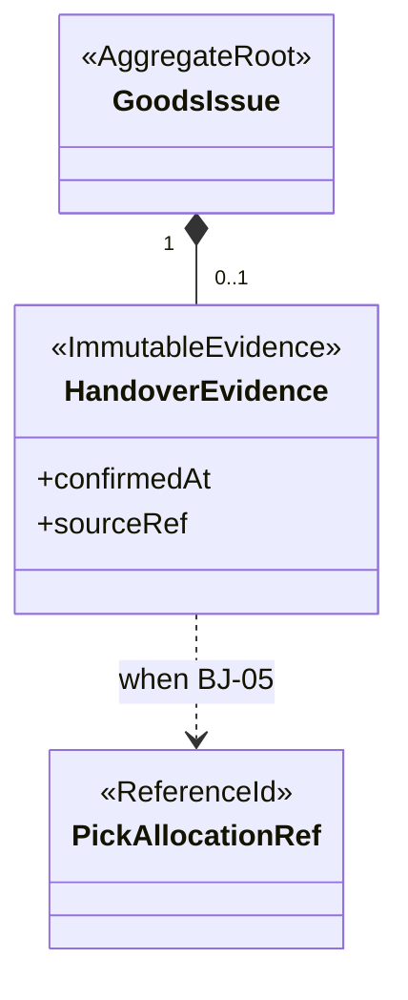

# ENT-IO-12 — HandoverEvidence

## 1. Định vị nghiệp vụ & ranh giới Aggregate

Bằng chứng **bất biến** cho một lần bàn giao / issue thực tế (fulfillment hoặc supplier-return). Gắn với `GoodsIssue`; không tự tạo movement ngoài Root.

| Thuộc tính | Giá trị |
|---|---|
| Vai trò DDD | `IMMUTABLE_EVIDENCE` |
| Aggregate Root | Thuộc `GoodsIssue` (`ENT-IO-10`) khi bàn giao |
| Domain sở hữu | `DOM-IO` |
| Domain không sở hữu | Fulfillment/RTV request → Sales / Purchasing |

### 1.1 Ranh giới Aggregate (Visual)

## 2. Identity

| Loại | Định danh | Ghi chú |
|---|---|---|
| Surrogate | `handoverEvidenceId` | Immutable |
| Correlation | `issueId` + source document/version | Cùng identity finality |

## 3. Thuộc tính nghiệp vụ thuần túy

| Thuộc tính | Ý nghĩa | Bắt buộc | Ghi chú |
|---|---|---:|---|
| `handoverEvidenceId` | Định danh bằng chứng | Có | |
| `issueId` | Lệnh xuất/bàn giao | Có | `ENT-IO-10` |
| `warehouseScope` | Kho bàn giao | Có | |
| `sourceType` | FULFILLMENT / SUPPLIER_RETURN / … | Có | |
| `sourceDocumentId` / `sourceVersion` | Chứng từ nguồn | Có | Recheck khi commit |
| `fulfillmentId` | Fulfillment (BJ-05) | Không | |
| `allocationSetId` / `allocationVersion` | Pick đã dùng | Khi đã pick | |
| `sourceContext` | Lineage nguồn | Có | |
| `actorId` | Actor xác nhận | Có | |
| `confirmedAt` | Thời điểm xác nhận | Có | |

## 4. Hành vi nghiệp vụ cốt lõi

| Hành vi | Điều kiện / Invariant | Hệ quả / Domain Event |
|---|---|---|
| `record(...)` | Qua GoodsIssue trước/cùng complete | Evidence bất biến; `HandoverEvidenceRecorded` |
| — | **KHÔNG ĐƯỢC** sửa sau record | Chỉ issue mới / correction chain |

## 5. Vòng đời & chuyển dịch trạng thái

Không state machine mutable — ghi một lần, bất biến.

## 6. Domain Events phát sinh

| Event | Khi nào | Ý nghĩa |
|---|---|---|
| `HandoverEvidenceRecorded` | record | Có bằng chứng bàn giao |

## 7. Liên kết truy vết

| Loại | ID |
|---|---|
| Domain Foundation | `DOM-IO` |
| Root | `ENT-IO-10` |
| BC / UC | `BC-IO-05`, `BC-IO-09`, `UC-05-03`, `UC-07-04` |
