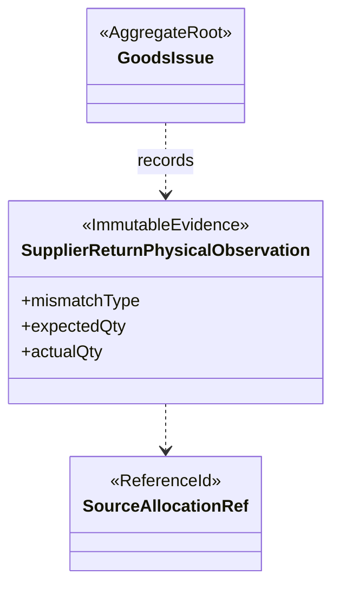
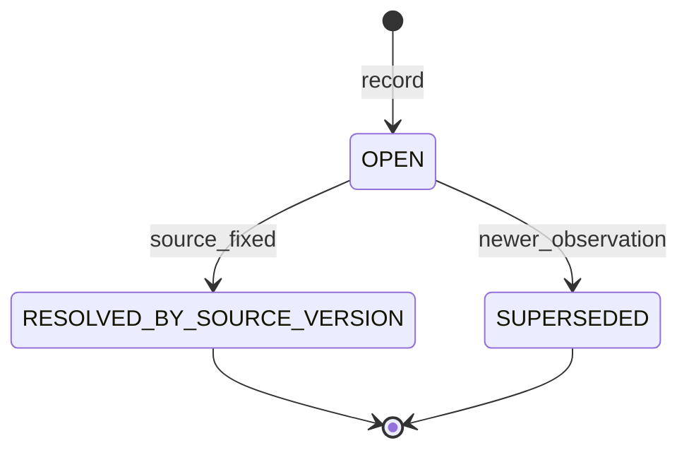

# ENT-IO-13 — SupplierReturnPhysicalObservation

## 1. Định vị nghiệp vụ & ranh giới Aggregate

Quan sát **chênh lệch vật lý** khi kiểm hàng trả NCC (BJ-07), gửi về source owner. **Bất biến**; **không** tự đổi tồn / substitute lot.

| Thuộc tính | Giá trị |
|---|---|
| Vai trò DDD | `IMMUTABLE_EVIDENCE` |
| Aggregate Root | Gắn intent supplier-return / `GoodsIssue` RTV — không tự Root vận hành tồn |
| Domain sở hữu | `DOM-IO` (ghi nhận quan sát) |
| Domain không sở hữu | Xử lý chứng từ NCC → Purchasing |

### 1.1 Ranh giới Aggregate (Visual)

## 2. Identity

| Loại | Định danh | Ghi chú |
|---|---|---|
| Surrogate | `observationId` | Immutable |
| Correlation | intent + source allocation + source version | |

## 3. Thuộc tính nghiệp vụ thuần túy

| Thuộc tính | Ý nghĩa | Bắt buộc | Ghi chú |
|---|---|---:|---|
| `observationId` | Định danh quan sát | Có | |
| `intentRef` | Lệnh trả / kiểm hàng | Có | |
| `sourceRequestRef` | Yêu cầu trả NCC | Có | + version |
| `sourceAllocationId` | Allocation bị lệch | Có | |
| `mismatchType` | QUANTITY / LOT / ITEM_NOT_FOUND / OTHER | Có | |
| `expectedQuantity` | Snapshot nguồn | Có | |
| `actualQuantity` | Thực tế | Theo type | |
| `expectedLotId` / `actualLotCode` | Lệch lô | Theo type | Không tự resolve stock lot |
| `note` | Ghi chú | Khi OTHER | |
| `actorId` | Người kiểm | Có | |
| `observedAt` | Thời điểm quan sát | Có | |
| `status` | OPEN / RESOLVED_BY_SOURCE_VERSION / SUPERSEDED | Có | |

## 4. Hành vi nghiệp vụ cốt lõi

| Hành vi | Điều kiện / Invariant | Hệ quả / Domain Event |
|---|---|---|
| `recordObservation(...)` | Đang kiểm RTV | Tạo evidence bất biến; **không** stock effect |
| `markResolvedBySource(...)` | Source version mới xử lý | status → RESOLVED… |
| — | **KHÔNG ĐƯỢC** mutate payload sau record | Chỉ supersede bằng observation mới |

## 5. Vòng đời & chuyển dịch trạng thái

## 6. Domain Events phát sinh

| Event | Khi nào | Ý nghĩa |
|---|---|---|
| `SupplierReturnMismatchObserved` | record | Source owner cần xử lý |
| `SupplierReturnObservationResolved` | markResolved | Đã khớp version nguồn |

## 7. Liên kết truy vết

| Loại | ID |
|---|---|
| Domain Foundation | `DOM-IO` |
| BC / UC | `BC-IO-09`, `UC-07-*` |
| Quyết định | G06 |
