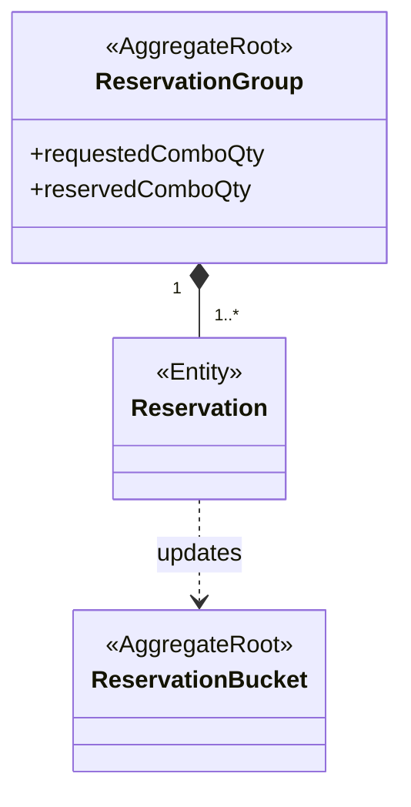
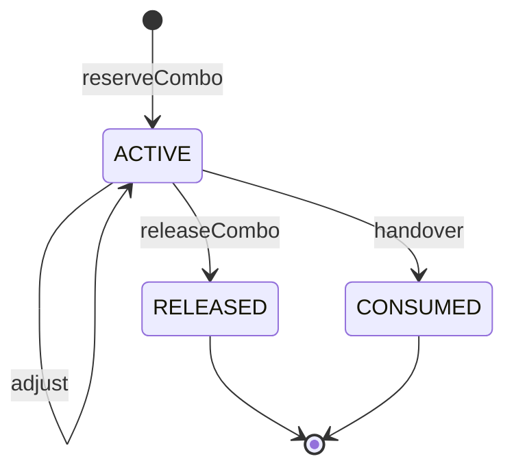

# ENT-IO-14 — ReservationGroup

## 1. Định vị nghiệp vụ & ranh giới Aggregate

Phạm vi giữ hàng **nguyên tử theo combo source line**: đảm bảo các Reservation component cùng policy ALL_OR_NOTHING / PARTIAL ở mức combo count.

| Thuộc tính | Giá trị |
|---|---|
| Vai trò DDD | `AGGREGATE_ROOT` |
| Aggregate Root | `ReservationGroup` |
| Domain sở hữu | `DOM-IO` |
| Domain không sở hữu | Combo definition master → Catalog |

### 1.1 Ranh giới Aggregate (Visual)

## 2. Identity

| Loại | Định danh | Ghi chú |
|---|---|---|
| Surrogate | `reservationGroupId` | |
| Business key | source document/line/version + combo definition | Stable combo line |

## 3. Thuộc tính nghiệp vụ thuần túy

| Thuộc tính | Ý nghĩa | Bắt buộc | Ghi chú |
|---|---|---:|---|
| `reservationGroupId` | Định danh nhóm | Có | |
| `warehouseScope` | Kho | Có | |
| `sourceRef` | Document/line/version | Có | Combo source line |
| `comboDefinitionRef` | Định nghĩa combo + version | Có | Snapshot phải còn hiệu lực khi command |
| `requestedComboQuantity` | Số combo yêu cầu | Có | Phase 1: số nguyên |
| `reservedComboQuantity` | Số combo đang giữ đủ | Có | |
| `consumedComboQuantity` | Số combo đã bàn giao | Có | |
| `reservationPolicy` | ALL_OR_NOTHING / PARTIAL | Có | |
| `status` | ACTIVE / … | Có | Suy từ child/lifecycle nhóm |
| `componentReservations` | Các Reservation con | Có | `ENT-IO-05` |

## 4. Hành vi nghiệp vụ cốt lõi

| Hành vi | Điều kiện / Invariant | Hệ quả / Domain Event |
|---|---|---|
| `reserveCombo(...)` | Policy + ATP từng component | Tạo group + children; cập nhật buckets |
| `releaseCombo(...)` | Source đổi/hủy | Giải phóng đồng bộ theo policy |
| `consumeOnHandover(...)` | Issue complete | Tăng consumed combo count |

ALL_OR_NOTHING: thiếu một component → **KHÔNG ĐƯỢC** tăng `reservedComboQuantity`.

## 5. Vòng đời & chuyển dịch trạng thái

## 6. Domain Events phát sinh

| Event | Khi nào | Ý nghĩa |
|---|---|---|
| `ReservationGroupReserved` | reserveCombo | Combo giữ đủ theo policy |
| `ReservationGroupReleased` | release | Giải phóng nhóm |
| `ReservationGroupConsumed` | handover | Combo đã xuất |

## 7. Liên kết truy vết

| Loại | ID |
|---|---|
| Domain Foundation | `DOM-IO` |
| Children | `ENT-IO-05` |
| Bucket | `ENT-IO-08` |
| Quyết định | G04, G13 (combo), INV-IO-13 |
