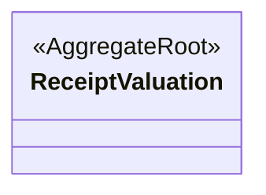

# ENT-IV-01 — ReceiptValuation

## 1. Định vị nghiệp vụ & ranh giới Aggregate

Hồ sơ bất biến xác lập **giá trị nhập ban đầu** cho exact quantity của một mục hàng nhận mà căn cứ hợp lệ thực sự bao phủ. ReceiptValuation giữ provenance và value; không tạo Official Cost.

| Thuộc tính | Giá trị |
|---|---|
| Vai trò DDD | `AGGREGATE_ROOT` |
| Aggregate Root | `ReceiptValuation` |
| Domain sở hữu | `DOM-IV` |
| Domain không sở hữu | Phiếu nhận hàng physical facts → DOM-IO; PO/invoice/commercial dispute → Theme 10; OfficialCostVersion → BJ14/CostCalculationRun |

### 1.1 Ranh giới Aggregate (Visual)

## 2. Identity

| Loại | Định danh | Ghi chú |
|---|---|---|
| Surrogate | `receiptValuationId` | Ổn định suốt vòng đời hồ sơ |
| Business key | `(tenantId, valuationBasisKey, coveredScopeIdentity)` | Dùng để nhận diện cùng một sự thật nghiệp vụ, không dùng version kỹ thuật để tạo bản ghi trùng |

## 3. Thuộc tính nghiệp vụ thuần túy

| Thuộc tính | Ý nghĩa | Bắt buộc | Ghi chú |
|---|---|---:|---|
| `receiptItemRef` | Dòng hàng thực nhận/commercial mục hàng nhận | Có | UI mental object; backend map xuống technical scope |
| `valuationBasisKey` | Stable identity của bộ căn cứ | Có | Không đồng nhất Product+UOM |
| `basisVersion` | Phiên bản căn cứ tại commit | Có | Freshness guard |
| `coveredScope` | Exact quantity/lot/state được căn cứ chứng minh | Có | Partial chỉ do source coverage |
| `transactionQuantity` | Quantity + transaction UOM | Có | Theo phiếu nhận hàng source |
| `baseQuantity` | Quantity chuẩn hóa base UOM | Có | Dùng downstream costing |
| `componentSnapshot` | Giá mua, giảm giá trị mua, tax treatment, known direct cost, FX/allocation provenance | Có | Internal basis; không phải UI jargon |
| `confirmedValueAmount` | Giá trị VND authoritative của covered scope | Có | Server allocated/rounded |
| `sourceProvenance` | Source identity/version/effective date và evidence refs | Có | Source và evidence tách biệt |
| `confirmedBy/At` | Ai xác nhận và thời điểm commit | Có | Audit |

## 4. Hành vi nghiệp vụ cốt lõi

| Hành vi | Điều kiện / Invariant | Hệ quả / Domain Event |
|---|---|---|
| `confirmInitialValue()` | Quantity còn VALUATION_PENDING; basis/scope current; conflict đã được owner giải quyết | ReceiptValuationConfirmed |

## 5. Vòng đời & chuyển dịch trạng thái

Thực thể không có lifecycle mutable riêng sau khi được ghi nhận. Bản ghi đã commit là bất biến; thay đổi nghiệp vụ tạo fact/version/adjustment mới.

## 6. Domain Events phát sinh

| Event | Khi nào | Ý nghĩa |
|---|---|---|
| `ReceiptValuationConfirmed` | confirmInitialValue() | Initial value đã commit; exact quantity được chuyển valuation state và dirty cost scope được tạo |

## 7. Liên kết truy vết

| Loại | ID |
|---|---|
| Domain Foundation | `DOM-IV` |
| Behavioral Contract | `BC-IV-01`, `BC-IV-05` |
| Use Case | `UC-03-01` |
| Quyết định | `T7-DR-185`, `T7-DR-186`, `T7-DR-187`, `T7-DR-188`, `T7-DR-189`, `T7-DR-190`, `T7-DR-150`, `T7-DR-152`, `T7-DR-153` |
