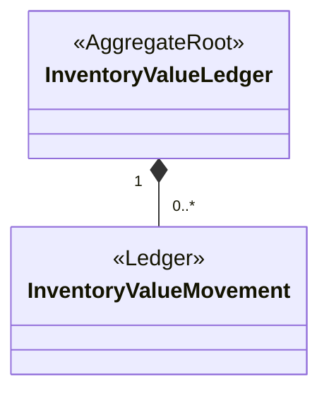

# ENT-IV-02 — InventoryValueMovement

## 1. Định vị nghiệp vụ & ranh giới Aggregate

Bút ghi giá trị append-only cho một thay đổi carrying value có nguồn. Movement là sự thật giá trị; mọi correction/true-up tạo movement mới thay vì sửa movement cũ.

| Thuộc tính | Giá trị |
|---|---|
| Vai trò DDD | `LEDGER` |
| Aggregate Root | `InventoryValueLedger` |
| Domain sở hữu | `DOM-IV` |
| Domain không sở hữu | Quantity movement → DOM-IO; GL posting → Theme 9 |

### 1.1 Ranh giới Aggregate (Visual)

## 2. Identity

| Loại | Định danh | Ghi chú |
|---|---|---|
| Surrogate | `valueMovementId` | Ổn định suốt vòng đời hồ sơ |
| Business key | `(tenantId, valueSequence)` | Dùng để nhận diện cùng một sự thật nghiệp vụ, không dùng version kỹ thuật để tạo bản ghi trùng |

## 3. Thuộc tính nghiệp vụ thuần túy

| Thuộc tính | Ý nghĩa | Bắt buộc | Ghi chú |
|---|---|---:|---|
| `productId` | Sản phẩm chịu tác động giá trị | Có | Authority scope tenant+product |
| `sourceRef` | ReceiptValuation/adjustment/issue/correction gây ra movement | Có | Có source identity |
| `valueType` | Loại tăng/giảm giá trị | Có | Initial phiếu nhận hàng, issue COGS, adjustment, true-up… |
| `amountVnd` | Số tiền có dấu | Có | VND |
| `businessDate` | Ngày nghiệp vụ | Có | Không đồng nhất recordedAt |
| `postingPeriod` | Kỳ ghi nhận | Có | Giữ original period khi cần |
| `originalPeriod` | Kỳ nguồn nếu posting khác kỳ gốc | Khi cần | Late/locked-period trace |
| `reversalOf` | Movement bị đảo nếu đây là reversal | Khi correction | Không update movement gốc |

## 4. Hành vi nghiệp vụ cốt lõi

| Hành vi | Điều kiện / Invariant | Hệ quả / Domain Event |
|---|---|---|
| `append()` | Source committed và amount/period valid | InventoryValueMovementAppended |

## 5. Vòng đời & chuyển dịch trạng thái

Thực thể không có lifecycle mutable riêng sau khi được ghi nhận. Bản ghi đã commit là bất biến; thay đổi nghiệp vụ tạo fact/version/adjustment mới.

## 6. Domain Events phát sinh

| Event | Khi nào | Ý nghĩa |
|---|---|---|
| `InventoryValueMovementAppended` | append() | Carrying value thay đổi bằng một fact mới |

## 7. Liên kết truy vết

| Loại | ID |
|---|---|
| Domain Foundation | `DOM-IV` |
| Behavioral Contract | `BC-IV-01`, `BC-IV-03`, `BC-IV-04` |
| Use Case | `UC-03-01`, `UC-13-01`, `UC-14-04` |
| Quyết định | `T7-DR-055`, `T7-DR-156`, `T7-DR-192` |
