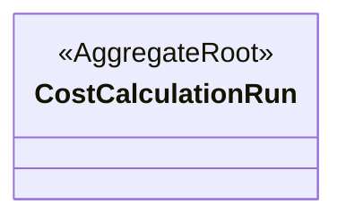
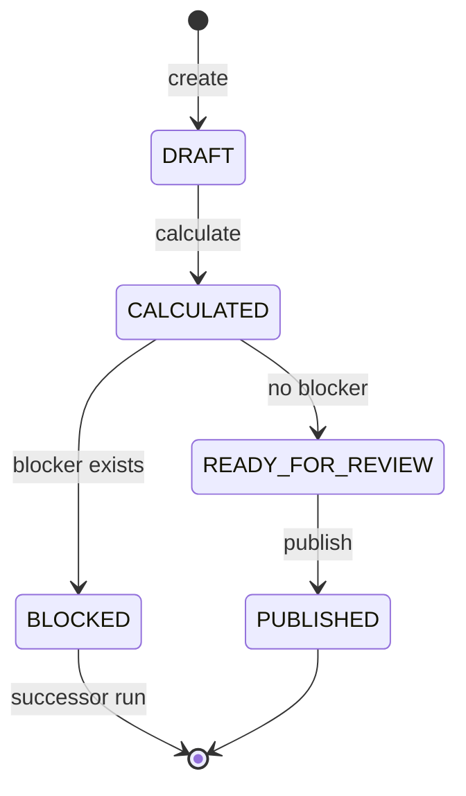

# ENT-IV-03 — CostCalculationRun

## 1. Định vị nghiệp vụ & ranh giới Aggregate

Một lần **tính và rà soát giá vốn** trên scope/cut-off/fact set đã khóa. Run snapshot phương pháp tenant dùng để công bố; người dùng không chọn lại phương pháp cho từng run.

| Thuộc tính | Giá trị |
|---|---|
| Vai trò DDD | `AGGREGATE_ROOT` |
| Aggregate Root | `CostCalculationRun` |
| Domain sở hữu | `DOM-IV` |
| Domain không sở hữu | Tenant costing policy → policy owner; value facts nguồn → ReceiptValuation/ValueAdjustment/ledger |

### 1.1 Ranh giới Aggregate (Visual)

## 2. Identity

| Loại | Định danh | Ghi chú |
|---|---|---|
| Surrogate | `runId` | Ổn định suốt vòng đời hồ sơ |
| Business key | `(tenantId, runType, calculationPeriod, scopeHash, cutoffValuationSequence)` | Dùng để nhận diện cùng một sự thật nghiệp vụ, không dùng version kỹ thuật để tạo bản ghi trùng |

## 3. Thuộc tính nghiệp vụ thuần túy

| Thuộc tính | Ý nghĩa | Bắt buộc | Ghi chú |
|---|---|---:|---|
| `runType` | PERIOD_CLOSE hoặc IN_PERIOD_UPDATE | Có | Quyết định scope logic |
| `calculationPeriod` | Kỳ dữ liệu cần tính | Có | Theo accounting calendar |
| `postingPeriod` | Kỳ ghi adjustment nếu publish | Có | Có thể khác original period theo policy |
| `scope` | Product scope được hệ thống/policy xác định | Có | Dirty scope không cho user tự bỏ Product |
| `cutoff` | Các ledger/value sequence tại snapshot | Có | Fact set bất biến cho run |
| `selectedMethodSnapshot` | Phương pháp nguồn từ tenant policy | Có | Read-only với user |
| `blockersSnapshot` | Các blocker còn mở | Có | BLOCKED nếu tồn tại blocker |
| `resultSetRef` | Tập ProductCostResult của run | Sau calculate | Immutable theo run |
| `supersedesRunRef` | Run trước nếu rerun | Nếu rerun | Không sửa run cũ |
| `status` | DRAFT/CALCULATED/BLOCKED/READY_FOR_REVIEW/PUBLISHED | Có | Lifecycle |

## 4. Hành vi nghiệp vụ cốt lõi

| Hành vi | Điều kiện / Invariant | Hệ quả / Domain Event |
|---|---|---|
| `create()` | Run type/period/scope hợp lệ; policy snapshot current | CostCalculationRunCreated |
| `calculate()` | Cut-off/fact set khóa thành công | CostCalculationCompleted |
| `markBlocked()` | Có blocker ảnh hưởng result | CostCalculationBlocked |
| `markReadyForReview()` | Không còn blocker | CostCalculationReadyForReview |
| `publish()` | READY_FOR_REVIEW; actor có quyền; result/policy current | CostCalculationPublished |
| `createSuccessor()` | Cần tính lại sau khi fact/blocker đổi | CostCalculationRunSuperseded |

## 5. Vòng đời & chuyển dịch trạng thái

## 6. Domain Events phát sinh

| Event | Khi nào | Ý nghĩa |
|---|---|---|
| `CostCalculationCompleted` | calculate() | Hai phương pháp đã được tính trên cùng fact set |
| `CostCalculationReadyForReview` | markReadyForReview() | Run đủ điều kiện xem xét công bố |
| `CostCalculationPublished` | publish() | Official cost/adjustment publication đã commit |

## 7. Liên kết truy vết

| Loại | ID |
|---|---|
| Domain Foundation | `DOM-IV` |
| Behavioral Contract | `BC-IV-02`, `BC-IV-03` |
| Use Case | `UC-14-01`, `UC-14-04` |
| Quyết định | `T7-DR-051`, `T7-DR-164`, `T7-DR-165`, `T7-DR-166`, `T7-DR-168`, `T7-DR-169`, `T7-DR-194`, `T7-DR-195` |
