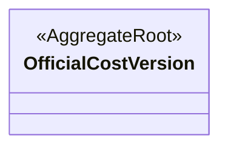

# ENT-IV-04 — OfficialCostVersion

## 1. Định vị nghiệp vụ & ranh giới Aggregate

Phiên bản đơn giá vốn chính thức cho một Product. **Chỉ BJ14 publication** được tạo/cập nhật version; BJ03 không bootstrap Official Cost.

| Thuộc tính | Giá trị |
|---|---|
| Vai trò DDD | `AGGREGATE_ROOT` |
| Aggregate Root | `OfficialCostVersion` |
| Domain sở hữu | `DOM-IV` |
| Domain không sở hữu | Receipt value → ReceiptValuation; tenant costing method policy → policy owner; pricing basis → Theme 4 |

### 1.1 Ranh giới Aggregate (Visual)

## 2. Identity

| Loại | Định danh | Ghi chú |
|---|---|---|
| Surrogate | `officialCostVersionId` | Ổn định suốt vòng đời hồ sơ |
| Business key | `(tenantId, productId, effectiveFrom)` | Dùng để nhận diện cùng một sự thật nghiệp vụ, không dùng version kỹ thuật để tạo bản ghi trùng |

## 3. Thuộc tính nghiệp vụ thuần túy

| Thuộc tính | Ý nghĩa | Bắt buộc | Ghi chú |
|---|---|---:|---|
| `productId` | Sản phẩm áp dụng | Có | Authority tenant+product |
| `unitCostVnd` | Đơn giá chính thức theo base UOM | Có | VND/base UOM |
| `baseUomSnapshot` | Base UOM/version tại publication | Có | Không đổi theo warehouse/lot |
| `sourceRunRef` | CostCalculationRun đã publish version | Có | Không nguồn trực tiếp từ BJ03 |
| `selectedMethod` | Method snapshot từ tenant policy | Có | Không phải lựa chọn reviewer |
| `effectiveInterval` | Khoảng hiệu lực | Có | Không overlap cùng product |
| `publishedBy/At` | Actor và commit time | Có | effectiveFrom không backdate trước commit theo policy |
| `predecessorRef` | Version trước | Nếu có | Version chain |

## 4. Hành vi nghiệp vụ cốt lõi

| Hành vi | Điều kiện / Invariant | Hệ quả / Domain Event |
|---|---|---|
| `publishFromRun()` | Run READY_FOR_REVIEW/PUBLISH commit; method/fact set current | OfficialCostPublished |
| `closeInterval()` | Version kế nhiệm bắt đầu hiệu lực | OfficialCostSuperseded |

## 5. Vòng đời & chuyển dịch trạng thái

Thực thể không có lifecycle mutable riêng sau khi được ghi nhận. Bản ghi đã commit là bất biến; thay đổi nghiệp vụ tạo fact/version/adjustment mới.

## 6. Domain Events phát sinh

| Event | Khi nào | Ý nghĩa |
|---|---|---|
| `OfficialCostPublished` | publishFromRun() | Đơn giá mới trở thành official theo effective time |
| `OfficialCostSuperseded` | closeInterval() | Version cũ kết thúc hiệu lực |

## 7. Liên kết truy vết

| Loại | ID |
|---|---|
| Domain Foundation | `DOM-IV` |
| Behavioral Contract | `BC-IV-03` |
| Use Case | `UC-14-04` |
| Quyết định | `T7-DR-050`, `T7-DR-155`, `T7-DR-167`, `T7-DR-194`, `T7-DR-195` |
