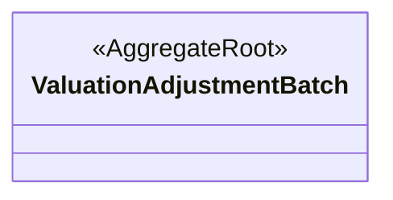

# ENT-IV-05 — ValuationAdjustmentBatch

## 1. Định vị nghiệp vụ & ranh giới Aggregate

Batch gom các dòng **delta giá trị** được commit cùng một posting period/cause. Batch có thể do BJ13 hoặc BJ14 tạo; nó không sửa movement nguồn.

| Thuộc tính | Giá trị |
|---|---|
| Vai trò DDD | `AGGREGATE_ROOT` |
| Aggregate Root | `ValuationAdjustmentBatch` |
| Domain sở hữu | `DOM-IV` |
| Domain không sở hữu | Source economic component → ValueAdjustmentSource; cost run result → CostCalculationRun |

### 1.1 Ranh giới Aggregate (Visual)

## 2. Identity

| Loại | Định danh | Ghi chú |
|---|---|---|
| Surrogate | `adjustmentBatchId` | Ổn định suốt vòng đời hồ sơ |
| Business key | `(tenantId, batchType, sourceRef, postingPeriod, baselineHash)` | Dùng để nhận diện cùng một sự thật nghiệp vụ, không dùng version kỹ thuật để tạo bản ghi trùng |

## 3. Thuộc tính nghiệp vụ thuần túy

| Thuộc tính | Ý nghĩa | Bắt buộc | Ghi chú |
|---|---|---:|---|
| `batchType` | RECEIPT_VALUE_ADJUSTMENT/COGS_TRUE_UP/ENDING_INVENTORY… | Có | Nêu rõ mục đích |
| `sourceRef` | ValueAdjustmentSource hoặc CostCalculationRun | Có | Trace cause |
| `postingPeriod` | Kỳ ghi nhận batch | Có | Theo policy |
| `cutoffSnapshot` | Mốc ledger/value nếu do cost run | Theo type | Bất biến |
| `reconciliationBaseline` | Baseline hash dùng tính delta | Theo type | Ngăn publish stale |
| `totalAmountVnd` | Tổng signed delta của batch | Có | Bằng tổng lines |
| `status` | COMMITTED/PUBLISHED theo cause | Có | Không sửa lines sau commit |
| `publishedBy/At` | Actor/time nếu batch đi cùng publication | Theo type | Audit |

## 4. Hành vi nghiệp vụ cốt lõi

| Hành vi | Điều kiện / Invariant | Hệ quả / Domain Event |
|---|---|---|
| `commitAdjustment()` | Source/allocations current; totals balanced | ValuationAdjustmentCommitted |
| `publishWithCostRun()` | Run publication current; all lines reconcile | ValuationAdjustmentPublished |

## 5. Vòng đời & chuyển dịch trạng thái

Thực thể không có lifecycle mutable riêng sau khi được ghi nhận. Bản ghi đã commit là bất biến; thay đổi nghiệp vụ tạo fact/version/adjustment mới.

## 6. Domain Events phát sinh

| Event | Khi nào | Ý nghĩa |
|---|---|---|
| `ValuationAdjustmentCommitted` | commitAdjustment() | Signed value deltas đã ghi |
| `ValuationAdjustmentPublished` | publishWithCostRun() | Batch thuộc publication đã final |

## 7. Liên kết truy vết

| Loại | ID |
|---|---|
| Domain Foundation | `DOM-IV` |
| Behavioral Contract | `BC-IV-03`, `BC-IV-04` |
| Use Case | `UC-13-01`, `UC-14-04` |
| Quyết định | `T7-DR-159`, `T7-DR-162`, `T7-DR-192`, `T7-DR-194` |
