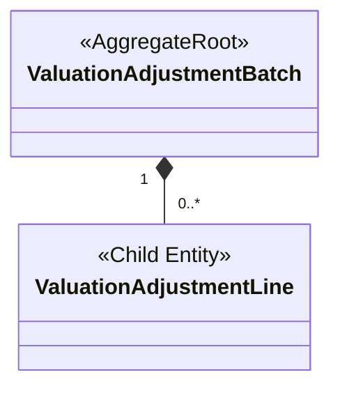

# ENT-IV-06 — ValuationAdjustmentLine

## 1. Định vị nghiệp vụ & ranh giới Aggregate

Dòng delta giá trị có dấu trong `ValuationAdjustmentBatch`, liên kết Product/source exposure/original period để giải thích vì sao carrying value hoặc COGS thay đổi.

| Thuộc tính | Giá trị |
|---|---|
| Vai trò DDD | `CHILD_ENTITY` |
| Aggregate Root | `ValuationAdjustmentBatch` |
| Domain sở hữu | `DOM-IV` |
| Domain không sở hữu | Source economic identity → ValueAdjustmentSource; quantity movement → DOM-IO |

### 1.1 Ranh giới Aggregate (Visual)

## 2. Identity

| Loại | Định danh | Ghi chú |
|---|---|---|
| Surrogate | `adjustmentLineId` | Ổn định suốt vòng đời hồ sơ |
| Business key | `(adjustmentBatchId, lineNo)` | Dùng để nhận diện cùng một sự thật nghiệp vụ, không dùng version kỹ thuật để tạo bản ghi trùng |

## 3. Thuộc tính nghiệp vụ thuần túy

| Thuộc tính | Ý nghĩa | Bắt buộc | Ghi chú |
|---|---|---:|---|
| `productId` | Sản phẩm chịu điều chỉnh | Có | Authority scope |
| `adjustmentType` | Loại delta | Có | Receipt adjustment / COGS true-up / ending value… |
| `sourceExposureRef` | Receipt/issue/value movement liên quan | Có khi relevant | Trace origin |
| `quantityBasis` | Quantity dùng để tính delta | Theo type | Không tạo quantity movement |
| `old/newUnitCost` | Các mốc cost để giải thích true-up | Theo type | Không cần cho mọi adjustment |
| `deltaAmountVnd` | Số tiền tăng/giảm | Có | Signed |
| `businessDate` | Ngày nghiệp vụ của adjustment | Có | Theo contract |
| `originalPeriod` | Kỳ nguồn | Theo type | Giữ trace |
| `postingPeriod` | Kỳ ghi adjustment | Có | Policy quyết định |

## 4. Hành vi nghiệp vụ cốt lõi

| Hành vi | Điều kiện / Invariant | Hệ quả / Domain Event |
|---|---|---|
| `createLine()` | Amount/source/period hợp lệ và batch còn đang build | LineAddedToAdjustmentBatch |

## 5. Vòng đời & chuyển dịch trạng thái

Thực thể không có lifecycle mutable riêng sau khi được ghi nhận. Bản ghi đã commit là bất biến; thay đổi nghiệp vụ tạo fact/version/adjustment mới.

## 6. Domain Events phát sinh

| Event | Khi nào | Ý nghĩa |
|---|---|---|
| — | Không phát event riêng | Event được phát bởi Aggregate Root sở hữu hoặc Technical Contract mapping từ commit set |

## 7. Liên kết truy vết

| Loại | ID |
|---|---|
| Domain Foundation | `DOM-IV` |
| Behavioral Contract | `BC-IV-03`, `BC-IV-04` |
| Use Case | `UC-13-01`, `UC-14-04` |
| Quyết định | `T7-DR-159`, `T7-DR-192` |
