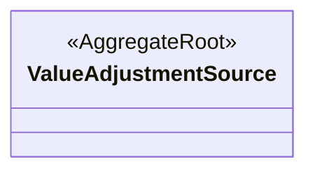
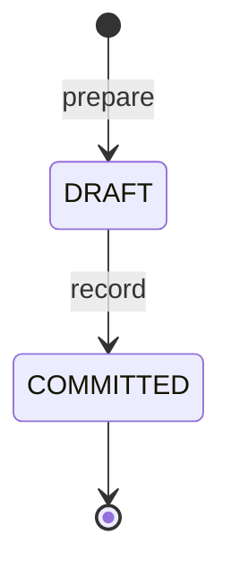

# ENT-IV-07 — ValueAdjustmentSource

## 1. Định vị nghiệp vụ & ranh giới Aggregate

Economic component có dấu làm **tăng hoặc giảm giá trị hàng nhập sau BJ03**. Đây là canonical semantic thay cho tên hẹp `LateLandedCost`; vận chuyển chỉ là một trường hợp con.

| Thuộc tính | Giá trị |
|---|---|
| Vai trò DDD | `AGGREGATE_ROOT` |
| Aggregate Root | `ValueAdjustmentSource` |
| Domain sở hữu | `DOM-IV` |
| Domain không sở hữu | PO/invoice/credit note source document → Theme 10 hoặc owner nguồn; correction của dữ liệu nhập sai → BJ11 |

### 1.1 Ranh giới Aggregate (Visual)

## 2. Identity

| Loại | Định danh | Ghi chú |
|---|---|---|
| Surrogate | `valueAdjustmentSourceId` | Ổn định suốt vòng đời hồ sơ |
| Business key | `(tenantId, sourceComponentKey)` | Dùng để nhận diện cùng một sự thật nghiệp vụ, không dùng version kỹ thuật để tạo bản ghi trùng |

## 3. Thuộc tính nghiệp vụ thuần túy

| Thuộc tính | Ý nghĩa | Bắt buộc | Ghi chú |
|---|---|---:|---|
| `sourceComponentKey` | Stable economic identity của component | Có | Revision không nằm trong business uniqueness |
| `sourceComponentType` | Loại component: freight, insurance, price true-up, discount, rebate, tax/fee… | Có | Không giới hạn positive cost |
| `sourceRevision` | Phiên bản nguồn dùng tại commit | Có | Freshness/provenance |
| `sourceIdentity` | Định danh document/line/source system | Có | Không copy ownership về IV |
| `evidenceRefs` | Bằng chứng hỗ trợ source | Theo source | Tách khỏi source authority |
| `signedSourceAmount` | Số tiền nguồn có dấu và tiền tệ | Có | Dương hoặc âm |
| `normalizedAmountVnd` | Số tiền authoritative sau tax/FX treatment | Có | Bằng tổng allocation |
| `taxFxProvenance` | Treatment/rate/version dùng chuẩn hóa | Theo component | Không cho user tự chọn recoverability |
| `allocationPolicy` | Method/version dùng phân bổ | Có | Allowed by policy |
| `targetScope` | Receipt valuation exposures được source/policy bao phủ | Có | User không tùy ý bỏ target |
| `status` | DRAFT/COMMITTED | Có | Committed immutable |

## 4. Hành vi nghiệp vụ cốt lõi

| Hành vi | Điều kiện / Invariant | Hệ quả / Domain Event |
|---|---|---|
| `record()` | Component đã phát sinh/được xác lập; route ADJUSTMENT; target initial-valued; allocation balanced | ValueAdjustmentRecorded |

## 5. Vòng đời & chuyển dịch trạng thái

## 6. Domain Events phát sinh

| Event | Khi nào | Ý nghĩa |
|---|---|---|
| `ValueAdjustmentRecorded` | record() | Signed source + allocations + value movement đã commit |

## 7. Liên kết truy vết

| Loại | ID |
|---|---|
| Domain Foundation | `DOM-IV` |
| Behavioral Contract | `BC-IV-04`, `BC-IV-06` |
| Use Case | `UC-13-01` |
| Quyết định | `T7-DR-157`, `T7-DR-158`, `T7-DR-159`, `T7-DR-160`, `T7-DR-161`, `T7-DR-162`, `T7-DR-191`, `T7-DR-192` |
