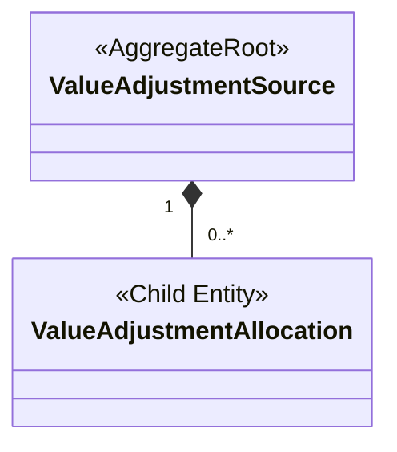

# ENT-IV-08 — ValueAdjustmentAllocation

## 1. Định vị nghiệp vụ & ranh giới Aggregate

Dòng phân bổ bất biến của `ValueAdjustmentSource` tới một valuation exposure cụ thể, giữ metric snapshot và mapping original/posting period để truy vết delta.

| Thuộc tính | Giá trị |
|---|---|
| Vai trò DDD | `CHILD_ENTITY` |
| Aggregate Root | `ValueAdjustmentSource` |
| Domain sở hữu | `DOM-IV` |
| Domain không sở hữu | Receipt quantity/value gốc → ReceiptValuation/DOM-IO; allocation policy master → policy owner |

### 1.1 Ranh giới Aggregate (Visual)

## 2. Identity

| Loại | Định danh | Ghi chú |
|---|---|---|
| Surrogate | `valueAdjustmentAllocationId` | Ổn định suốt vòng đời hồ sơ |
| Business key | `(valueAdjustmentSourceId, valuationExposureKey)` | Dùng để nhận diện cùng một sự thật nghiệp vụ, không dùng version kỹ thuật để tạo bản ghi trùng |

## 3. Thuộc tính nghiệp vụ thuần túy

| Thuộc tính | Ý nghĩa | Bắt buộc | Ghi chú |
|---|---|---:|---|
| `valuationExposureKey` | Exact initial-valued exposure được target | Có | Stable identity |
| `receiptItemRef` | Dòng receipt/commercial item liên quan | Có | Trace source |
| `receiptValuationRefs` | Các initial valuation records tạo exposure | Có | Không overwrite |
| `productId` | Sản phẩm chịu allocation | Có | Dirty cost scope |
| `initialValuedBaseQuantity` | Quantity đã initial-valued | Có | Metric input |
| `initialDirectValueVnd` | Initial value trước adjustment | Có | Dùng value-based metric nếu policy chọn |
| `allocationMetricSnapshot` | Metric/version/hash dùng phân bổ | Có | Bất biến |
| `allocatedAmountVnd` | Signed amount phân bổ | Có | Tổng lines = normalized source amount |
| `roundingAdjustmentVnd` | Residual deterministic | Có thể 0 | Theo stable exposure order |
| `originalPeriod` | Kỳ receipt gốc | Có | Trace economic origin |
| `postingPeriod` | Kỳ ghi adjustment | Có | Theo open/locked policy |
| `dirtyCostScope` | Product + posting period cần BJ14 tính lại | Có | System-owned |

## 4. Hành vi nghiệp vụ cốt lõi

| Hành vi | Điều kiện / Invariant | Hệ quả / Domain Event |
|---|---|---|
| `allocate()` | Exposure current; metric/policy current; source amount cân bằng | ValueAdjustmentAllocated |

## 5. Vòng đời & chuyển dịch trạng thái

Thực thể không có lifecycle mutable riêng sau khi được ghi nhận. Bản ghi đã commit là bất biến; thay đổi nghiệp vụ tạo fact/version/adjustment mới.

## 6. Domain Events phát sinh

| Event | Khi nào | Ý nghĩa |
|---|---|---|
| — | Không phát event riêng | Event được phát bởi Aggregate Root sở hữu hoặc Technical Contract mapping từ commit set |

## 7. Liên kết truy vết

| Loại | ID |
|---|---|
| Domain Foundation | `DOM-IV` |
| Behavioral Contract | `BC-IV-04`, `BC-IV-06` |
| Use Case | `UC-13-01` |
| Quyết định | `T7-DR-158`, `T7-DR-159`, `T7-DR-160`, `T7-DR-192`, `T7-DR-193` |
