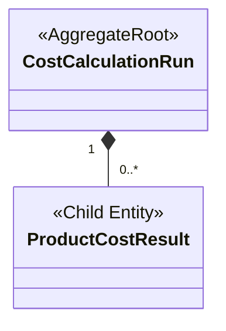

# ENT-IV-09 — ProductCostResult

## 1. Định vị nghiệp vụ & ranh giới Aggregate

Kết quả bất biến của một Product trong `CostCalculationRun`, gồm hai phép tính song song, method tenant áp dụng và các delta cần reconcile nếu publish.

| Thuộc tính | Giá trị |
|---|---|
| Vai trò DDD | `CHILD_ENTITY` |
| Aggregate Root | `CostCalculationRun` |
| Domain sở hữu | `DOM-IV` |
| Domain không sở hữu | Tenant costing policy → policy owner; OfficialCostVersion → publication của CostCalculationRun |

### 1.1 Ranh giới Aggregate (Visual)

## 2. Identity

| Loại | Định danh | Ghi chú |
|---|---|---|
| Surrogate | `productCostResultId` | Ổn định suốt vòng đời hồ sơ |
| Business key | `(runId, productId)` | Dùng để nhận diện cùng một sự thật nghiệp vụ, không dùng version kỹ thuật để tạo bản ghi trùng |

## 3. Thuộc tính nghiệp vụ thuần túy

| Thuộc tính | Ý nghĩa | Bắt buộc | Ghi chú |
|---|---|---:|---|
| `productId` | Sản phẩm được tính | Có | Một result/Product/run |
| `baseUomRef` | Base UOM dùng cho unit cost | Có | Snapshot |
| `valuationFactSet` | Range/hash của valuation facts đã dùng | Có | Cùng fact set cho hai method |
| `openingQuantityValue` | Quantity/value đầu kỳ/cut-off đầu | Có | Input |
| `endingQuantity` | Quantity cuối cut-off | Có | Negative là blocker nếu không có policy ngoại lệ |
| `movingAverageResult` | Kết quả bình quân liên hoàn | Có | Đối chiếu hoặc method selected |
| `periodicAverageResult` | Kết quả bình quân cuối kỳ | Có | Đối chiếu hoặc method selected |
| `selectedMethod` | Snapshot từ tenant policy | Có | Không phải reviewer choice |
| `proposedOfficialUnitCost` | Đơn giá đề xuất để publish | Khi có basis | Null nếu NO_NEW_COST_BASIS |
| `cogsReconciliationDelta` | Delta COGS cần ghi | Có thể 0 | Target − authoritative baseline |
| `endingInventoryDelta` | Delta carrying value tồn cuối | Có thể 0 | Target − authoritative carrying value |
| `resultState` | READY/BLOCKED/NO_NEW_COST_BASIS | Có | Blocker list đi kèm |

## 4. Hành vi nghiệp vụ cốt lõi

| Hành vi | Điều kiện / Invariant | Hệ quả / Domain Event |
|---|---|---|
| `calculate()` | Fact set/cut-off/policy snapshot current | ProductCostCalculated |

## 5. Vòng đời & chuyển dịch trạng thái

Thực thể không có lifecycle mutable riêng sau khi được ghi nhận. Bản ghi đã commit là bất biến; thay đổi nghiệp vụ tạo fact/version/adjustment mới.

## 6. Domain Events phát sinh

| Event | Khi nào | Ý nghĩa |
|---|---|---|
| — | Không phát event riêng | Event được phát bởi Aggregate Root sở hữu hoặc Technical Contract mapping từ commit set |

## 7. Liên kết truy vết

| Loại | ID |
|---|---|
| Domain Foundation | `DOM-IV` |
| Behavioral Contract | `BC-IV-02`, `BC-IV-03` |
| Use Case | `UC-14-01`, `UC-14-04` |
| Quyết định | `T7-DR-164`, `T7-DR-165`, `T7-DR-168`, `T7-DR-169`, `T7-DR-194`, `T7-DR-195` |
