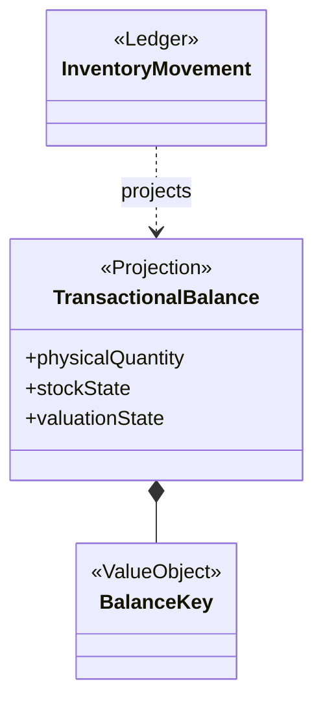

# PRJ-IO-01 — TransactionalBalance

> **Không** Domain Entity. Projection / read model thuộc `DOM-IO` — cập nhật nguyên tử cùng ledger, phục vụ query/ATP. Đặc tả nằm ngoài catalog `entities/`.

## 1. Định vị nghiệp vụ

Bản chiếu tồn giao dịch theo `BalanceKey` (6 thành phần). Rebuild được từ `InventoryMovement`; **không** Aggregate Root và **không** sửa tay.

| Thuộc tính | Giá trị |
|---|---|
| Vai trò DDD | `PROJECTION` |
| Aggregate Root | Không |
| Domain sở hữu | `DOM-IO` |
| Domain không sở hữu | Reserved qty → `ReservationBucket`; value → `DOM-IV` |

### 1.1 Ranh giới (Visual)

## 2. Identity

| Loại | Định danh | Ghi chú |
|---|---|---|
| Surrogate | `balanceId` | |
| Business key | `BalanceKey` = tenant + product + warehouse + stockState + valuationState + lotKey | Unique |

## 3. Thuộc tính nghiệp vụ thuần túy

| Thuộc tính | Ý nghĩa | Bắt buộc | Ghi chú |
|---|---|---:|---|
| `balanceId` | Định danh projection | Có | |
| `productId` | Sản phẩm | Có | Thành phần key |
| `warehouseId` | Kho | Có | |
| `stockState` | Trạng thái vật lý | Có | |
| `valuationState` | PENDING / CONFIRMED | Có | Two-axis |
| `lotKey` | Khóa lô (sentinel nếu NONE) | Có | |
| `physicalQuantity` | Tồn vật lý | Có | **Không** chứa reserved |
| `lastLedgerSequence` | Movement cuối đã áp | Có | Rebuild checkpoint |

## 4. Cập nhật & bất biến

| Thao tác | Điều kiện / Invariant | Hệ quả |
|---|---|---|
| Apply movement (cùng txn) | Sequence liền mạch | Cập nhật physical qty / state |
| Rebuild from ledger | IC unlock / reconcile | Projection khớp ledger |
| — | **KHÔNG ĐƯỢC** sửa tay / API trực tiếp | Drift → ReconciliationCase |

## 5. Vòng đời

Không lifecycle hồ sơ — chỉ thay đổi số dư theo movement. `valuationState` đổi khi IV confirm (trục giá), không qua sửa tay balance.

## 6. Domain Events

Không phát domain event riêng; đọc model phục vụ query/ATP.

## 7. Liên kết truy vết

| Loại | ID |
|---|---|
| Domain Foundation | `DOM-IO` |
| Ledger | `ENT-IO-03` |
| ID cũ (retired) | `ENT-IO-04` |
| Quyết định | INV-IO-04, INV-IO-05, T7-DR-020 |
