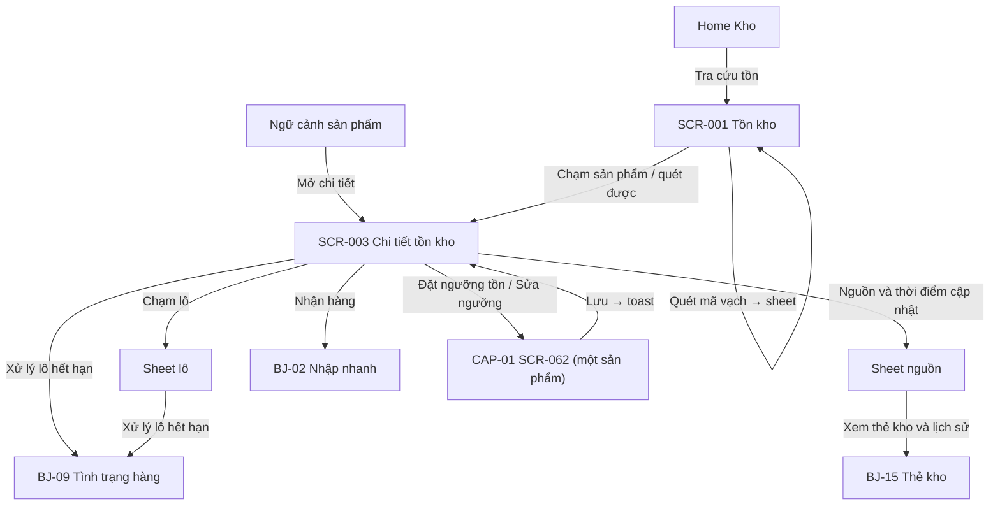

# UIF-01 — Theo dõi tồn, khả dụng và chỉ báo vận hành

## 1. Việc thật

- Nhân viên, giữa lúc có khách: "Còn bao nhiêu? Bán được bao nhiêu?" — tìm nhanh một sản phẩm, nhìn một con số.
- Chủ cửa hàng, đầu ngày hoặc trước khi đặt hàng: "Cái gì hết hoặc sắp hết? Lô nào cận hạn, hết hạn?" — lọc theo vấn đề rồi làm việc tiếp: nhập thêm (BJ-02) hoặc xử lý lô (BJ-09).

Dùng nhiều lần mỗi ngày. Thiết bị: iPhone và web đều là thiết bị chính. Web là danh sách – chi tiết (SCR-001), iPhone là danh sách thẻ rồi sang SCR-003.

- BJ: [BJ-01 — Theo dõi tồn, khả dụng và chỉ báo vận hành](../../02.specification/behavior/journeys/BJ-01-theo-doi-ton-kha-dung-va-chi-bao-van-hanh.md)
- UC: [UC-01-01](../../02.specification/behavior/use-cases/UC-01-01-xac-dinh-ngu-canh-va-san-pham.md), [UC-01-02](../../02.specification/behavior/use-cases/UC-01-02-xem-ton-va-kha-dung.md), [UC-01-03](../../02.specification/behavior/use-cases/UC-01-03-xem-trace-summary.md), [UC-01-04](../../02.specification/behavior/use-cases/UC-01-04-xem-ton-thap-va-luong-goi-y.md), [UC-01-05](../../02.specification/behavior/use-cases/UC-01-05-xem-hang-can-han-va-het-han.md)

Quy tắc nghiệp vụ lấy từ BJ / UC; nội dung từng màn lấy từ Screen Contract.

## 2. Lối vào và lối ra

| Hướng | Từ / đến | Điều kiện |
|---|---|---|
| Vào | Home Kho → "Tra cứu tồn" hoặc "Tồn kho & khả dụng" | Có quyền xem tồn |
| Vào | Ngữ cảnh sản phẩm / tồn kho → SCR-003 | Có quyền xem sản phẩm và kho |
| Vào | Kết quả khởi tạo tồn kho (BJ-12) → "Xem tồn kho" | Kho đã kích hoạt |
| Ra | BJ-02 nhập nhanh | "Nhận hàng" ở sản phẩm hết hàng / tồn thấp |
| Ra | BJ-09 (lọc "Hết hạn", đúng lô) | "Xử lý lô hết hạn" |
| Ra | CAP-01 SCR-062 (một sản phẩm) | "Đặt ngưỡng tồn" (chưa có ngưỡng) / "Sửa ngưỡng" (Hết hàng, Tồn thấp); lưu xong về SCR-003 |
| Ra | BJ-15 thẻ kho | "Xem thẻ kho và lịch sử" ở sheet nguồn |
| Ra | Home Kho | "Về Kho" khi không có quyền |

## 3. Sơ đồ luồng

## 4. Chuyển màn

| Từ | Hành động | Đến | Ghi chú |
|---|---|---|---|
| Home Kho | "Tra cứu tồn" | SCR-001 | Không có quyền → K1 "Bạn chưa có quyền xem tồn kho" + "Về Kho" |
| SCR-001 | Gõ tìm / chọn chip | SCR-001 | Chỉ đọc; số trên chip không đổi theo ô tìm; "Tất cả" sắp hàng có vấn đề lên đầu |
| SCR-001 | Nút quét mã vạch | Sheet "Quét mã vạch" | Prototype mô phỏng; chạm nền để đóng; máy quét USB trên web gõ vào ô tìm |
| Sheet quét | Quét được | SCR-003 | Sản phẩm khớp mã vạch |
| SCR-001 | Chạm một dòng | SCR-003 | Quay lại giữ tìm / lọc |
| SCR-001, 003 `STALE` | "Làm mới" | Cùng màn | "Dữ liệu đến" lấy từ máy chủ |
| SCR-003 | Chạm một lô | Sheet lô | Cùng màn |
| SCR-003 | "Nguồn và thời điểm cập nhật" | Sheet nguồn | Cùng màn |
| Sheet nguồn | "Xem thẻ kho và lịch sử" | BJ-15 | BJ-01 không có màn lịch sử riêng |
| SCR-003 `OUT` / `LOW` | "Nhận hàng" | BJ-02 SCR-008 (nhập nhanh) | Chưa điền sẵn sản phẩm vào phiếu |
| SCR-003 / sheet lô hết hạn | "Xử lý lô hết hạn" | BJ-09 SCR-036 | Lọc "Hết hạn", ô tìm là mã lô |

SCR-003 có Sheet lô (thay SCR-004 cũ) và Sheet nguồn số liệu (thay SCR-005 cũ), không phải bước riêng. Khả dụng hiện ngay trên dòng sản phẩm SCR-001 (thay SCR-002 cũ). Chỉ báo tồn kho và chi tiết chỉ báo nằm ở bộ lọc SCR-001 và khối cảnh báo SCR-003 (SCR-060, SCR-061 đã bỏ từ v5.27.0): xem [RETIRED](../screens/RETIRED.md) và [INDEX](../screens/INDEX.md).

## 5. Khuôn dùng chung áp dụng

K1 (`app/shared-patterns.js`): `k1Loading` (khung xương đúng bố cục: ô tìm + dòng / thẻ + dòng), `k1Stale` ("Dữ liệu có thể đã cũ" + "Làm mới" ngay dưới dòng ngữ cảnh), `k1Denied` ("Bạn chưa có quyền xem tồn kho" + "Về Kho"; không có dữ liệu sản phẩm trong màn). Trạng thái rỗng và rỗng sau lọc dùng `ds24EmptyState` của BJ-01.

Thành phần mới dùng chung: `VStockRow`, chip có số, nút quét trong ô tìm (`app/core.js`).

## 6. Liên kết với BJ khác

| Sang / từ BJ | Ở màn | Cách |
|---|---|---|
| Từ BJ-12 | Kết quả khởi tạo tồn kho | "Xem tồn kho" → SCR-001 |
| Sang BJ-02 | SCR-003 | "Nhận hàng" → nhập nhanh |
| Sang BJ-09 | SCR-003, sheet lô | "Xử lý lô hết hạn" → danh sách đã lọc đúng lô (lô TY2408 Tylosin 20% có trong cả hai bộ dữ liệu mẫu) |
| Sang BJ-15 | Sheet nguồn | "Xem thẻ kho và lịch sử" |
| Sang CAP-01 | SCR-003 | "Đặt ngưỡng tồn" (chưa có ngưỡng) / "Sửa ngưỡng" (Hết hàng, Tồn thấp) → SCR-062 một sản phẩm; lưu xong về SCR-003, chỉ báo đã đổi |

## 7. Truy vết

BJ-01 · UC-01-01…05 · [SCR-001](../screens/SCR-001.md), [SCR-003](../screens/SCR-003.md) · golden: `UIF-01_*`, `SC_bj01_*`, `SC_search_*`, `SC_quick_UIF-01_*`.
