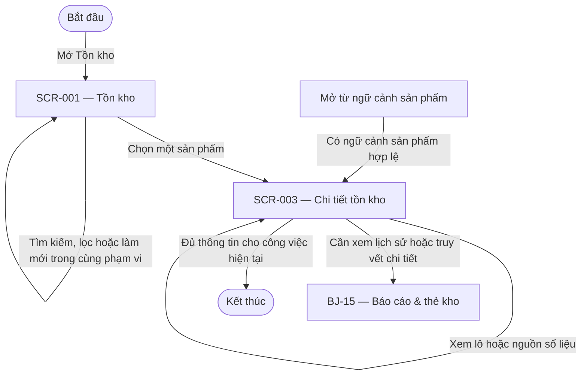

# UIF-01 — Theo dõi tồn, khả dụng và chỉ báo vận hành

## 1. Mục đích và phạm vi

Mô tả cách người dùng tra cứu tồn kho, xem khả dụng và các chỉ báo cần chú ý; khi cần lịch sử chi tiết, luồng chuyển sang hành trình báo cáo thay vì tạo thêm màn hình trong hành trình này.

- **Hành trình nghiệp vụ:** [BJ-01 — Theo dõi tồn, khả dụng và chỉ báo vận hành](../../02.specification/behavior/journeys/BJ-01-theo-doi-ton-kha-dung-va-chi-bao-van-hanh.md)
- **Trường hợp sử dụng liên quan:**
  - [UC-01-01 — Xác định ngữ cảnh và sản phẩm](../../02.specification/behavior/use-cases/UC-01-01-xac-dinh-ngu-canh-va-san-pham.md)
  - [UC-01-02 — Xem tồn và khả dụng](../../02.specification/behavior/use-cases/UC-01-02-xem-ton-va-kha-dung.md)
  - [UC-01-03 — Xem tóm tắt truy vết](../../02.specification/behavior/use-cases/UC-01-03-xem-trace-summary.md)
  - [UC-01-04 — Xem tồn thấp và lượng gợi ý](../../02.specification/behavior/use-cases/UC-01-04-xem-ton-thap-va-luong-goi-y.md)
  - [UC-01-05 — Xem hàng cận hạn và hết hạn](../../02.specification/behavior/use-cases/UC-01-05-xem-hang-can-han-va-het-han.md)

**Ranh giới:** UIF chỉ mô tả cách người dùng đi qua các màn hình, điều kiện chuyển bước và cách xử lý khi không thể tiếp tục. Quy tắc nghiệp vụ vẫn lấy từ BJ/UC/Behavioral Contract; nội dung và thành phần của từng màn hình vẫn lấy từ Screen Contract.

## 2. Người dùng bắt đầu và kết thúc ở đâu

| Cách vào luồng | Màn hình | Người thực hiện | Đi từ đâu |
|---|---|---|---|
| Vào từ chức năng | `SCR-001` | Người xem tồn | Kho > Tồn kho |
| Mở từ ngữ cảnh liên quan | `SCR-003` | Người xem tồn | Ngữ cảnh sản phẩm hoặc tồn kho |

Luồng kết thúc khi người dùng đã nhận được kết quả cuối cùng hoặc công việc được chuyển rõ sang một hành trình khác.

## 3. Luồng màn hình

> Sơ đồ trên để đọc nhanh. Phần “Các bước chuyển màn hình” giải thích điều kiện và cách xử lý; phần “Truy vết kỹ thuật” giữ các mã phục vụ Dev/QA/Harness.

## 4. Các bước chuyển màn hình

| Bước | Từ đâu | Người dùng / hệ thống làm gì | Điều kiện cần | Đi đến | Nếu không thể tiếp tục |
|---|---|---|---|---|---|
| `UIF-01-T01` | Bắt đầu | Mở Tồn kho | Có quyền xem tồn | `SCR-001` — Tồn kho | Không có quyền truy cập → kết thúc |
| `UIF-01-T02` | Mở từ ngữ cảnh sản phẩm | Có ngữ cảnh sản phẩm hợp lệ | Có quyền xem sản phẩm và kho | `SCR-003` — Chi tiết tồn kho | Ngữ cảnh không hợp lệ → kết thúc |
| `UIF-01-T03` | `SCR-001` — Tồn kho | Chọn một sản phẩm | Có quyền xem | `SCR-003` — Chi tiết tồn kho | Giữ bộ lọc khi quay lại |
| `UIF-01-T04` | `SCR-001` — Tồn kho | Tìm kiếm, lọc hoặc làm mới trong cùng phạm vi | Có quyền xem | `SCR-001` — Tồn kho | Dữ liệu đã thay đổi → thông báo và làm mới; giữ nguyên phạm vi |
| `UIF-01-T05` | `SCR-003` — Chi tiết tồn kho | Xem lô hoặc nguồn số liệu | Có quyền xem | `SCR-003` — Chi tiết tồn kho | Hiển thị ngay trên cùng màn hình; SCR-004 và SCR-005 chỉ giữ để tương thích |
| `UIF-01-T06` | `SCR-003` — Chi tiết tồn kho | Cần xem lịch sử hoặc truy vết chi tiết | Có quyền báo cáo | BJ-15 — hành trình liên quan | BJ-01 không tự mở màn hình lịch sử riêng |
| `UIF-01-T07` | `SCR-003` — Chi tiết tồn kho | Đủ thông tin cho công việc hiện tại | — | Kết thúc | — |

## 5. Các tình huống cần chú ý

Các quy tắc chung về quyền, quay lại, dữ liệu thay đổi và chống ghi nhận lặp vẫn lấy từ UC/Behavioral Contract/Screen Contract. UIF chỉ nhắc lại những điểm ảnh hưởng trực tiếp đến cách đi qua màn hình.

- Nếu dữ liệu nguồn đã thay đổi, phải nạp lại dữ liệu hiện hành và rà soát lại trước khi tiếp tục. Phần người dùng đã nhập chỉ được giữ lại khi còn an toàn.
- Các màn hình đã hợp nhất hoặc chỉ dùng cho tương thích không được xem là một bước điều hướng độc lập của luồng hiện hành.

## 6. Màn hình và Trường hợp sử dụng liên quan

| Trường hợp sử dụng | Màn hình sử dụng |
|---|---|
| [UC-01-01](../../02.specification/behavior/use-cases/UC-01-01-xac-dinh-ngu-canh-va-san-pham.md) — Xác định ngữ cảnh và sản phẩm | `SCR-001` |
| [UC-01-02](../../02.specification/behavior/use-cases/UC-01-02-xem-ton-va-kha-dung.md) — Xem tồn và khả dụng | `SCR-003` |
| [UC-01-03](../../02.specification/behavior/use-cases/UC-01-03-xem-trace-summary.md) — Xem tóm tắt truy vết | `SCR-003` |
| [UC-01-04](../../02.specification/behavior/use-cases/UC-01-04-xem-ton-thap-va-luong-goi-y.md) — Xem tồn thấp và lượng gợi ý | `SCR-001`, `SCR-003` |
| [UC-01-05](../../02.specification/behavior/use-cases/UC-01-05-xem-hang-can-han-va-het-han.md) — Xem hàng cận hạn và hết hạn | `SCR-001`, `SCR-003` |

### Màn hình dùng trong luồng

| Màn hình | Tên | Vai trò trong luồng |
|---|---|---|
| [SCR-001](../screens/SCR-001.md) | Tồn kho | Màn hình chính trong luồng |
| [SCR-003](../screens/SCR-003.md) | Chi tiết tồn kho | Màn hình chính trong luồng |

### Màn hình liên quan nhưng không phải một bước riêng

- `SCR-004` — Chi tiết lô — hiển thị phụ tương thích: giữ để truy vết/tương thích; không được tự suy thành bước điều hướng riêng của UIF-01.
- `SCR-005` — Nguồn số liệu — hiển thị phụ tương thích: giữ để truy vết/tương thích; không được tự suy thành bước điều hướng riêng của UIF-01.
- `SCR-060` — Chỉ báo tồn kho: giữ để truy vết/tương thích; không được tự suy thành bước điều hướng riêng của UIF-01.
- `SCR-061` — Chi tiết chỉ báo sản phẩm: giữ để truy vết/tương thích; không được tự suy thành bước điều hướng riêng của UIF-01.

## 7. Truy vết kỹ thuật

> Phần này dành cho Dev/QA/Harness. Các mã kỹ thuật được giữ nguyên để Dev/QA/Harness đối chiếu tự động.

| Transition | From | To | Loại | Action | UC / BC |
|---|---|---|---|---|---|
| `UIF-01-T01` | `BEGIN` | `SCR-001` | `NAVIGATION` | `—` | UC-01-01 / BC-IO-01 |
| `UIF-01-T02` | `CONTEXT_PRODUCT` | `SCR-003` | `NAVIGATION` | `—` | UC-01-01, UC-01-02 |
| `UIF-01-T03` | `SCR-001` | `SCR-003` | `NAVIGATION` | `—` | UC-01-02 |
| `UIF-01-T04` | `SCR-001` | `SCR-001` | `QUERY` | `—` | UC-01-01, UC-01-04, UC-01-05 / BC-IO-01 |
| `UIF-01-T05` | `SCR-003` | `SCR-003` | `QUERY` | `—` | UC-01-02, UC-01-03, UC-01-05 |
| `UIF-01-T06` | `SCR-003` | `BJ-15` | `HANDOFF` | `—` | UC-01-03 → BJ-15 |
| `UIF-01-T07` | `SCR-003` | `END` | `TERMINAL` | `—` | UC-01-02…UC-01-05 |

## 8. Kiểm tra tính đầy đủ và liên kết

- [x] Tất cả Trường hợp sử dụng liên quan đều được liên kết từ UIF.
- [x] Mỗi màn hình đang dùng trong luồng có Screen Contract tương ứng.
- [x] Các bước do hệ thống thực hiện không bị mô tả thành thao tác của người dùng.
- [x] Nếu có phê duyệt hoặc chuyển vai trò, người gửi và người nhận có điểm vào riêng.
- [x] Trạng thái kết thúc và trường hợp `UNKNOWN` có hướng xử lý rõ khi áp dụng.
- [x] Bảng đọc chính và bảng truy vết kỹ thuật dùng cùng một tập transition ID; không đổi topology hoặc hành vi.
- [x] Liên kết BJ ↔ UIF ↔ UC/SCR dùng đường dẫn tương đối và mở đúng tài liệu đích.

**Trạng thái đối chiếu thiết kế:** `ALIGNED_TO_CURRENT_SCREEN_CONTRACTS` — UIF đã được viết lại theo Plain BA Language; cấu trúc luồng, ID, mã Action, liên kết UC/BC và trạng thái đối chiếu của v4.1.0 được giữ nguyên. HTML và Screen Contract không thay đổi trong lượt này.

### Liên kết

- [Business Journey](../../02.specification/behavior/journeys/BJ-01-theo-doi-ton-kha-dung-va-chi-bao-van-hanh.md)
- [Business Journey Map](../../02.specification/behavior/journeys/00-business-journey-map.md)
- [Use Case Map](../../02.specification/behavior/use-cases/00-use-case-map.md)
- [Prototype manifest](../prototype/README.md)
