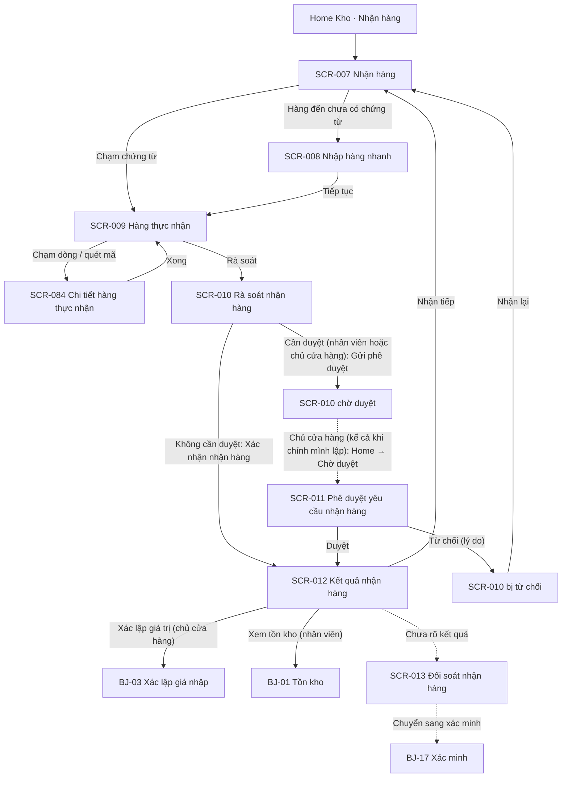

# UIF-02 — Nhận hàng mua

## 1. Việc thật

Nhà cung cấp giao hàng tới. Nhân viên đứng ở kho, cầm iPhone: đối chiếu phiếu giao với chứng từ mua, đếm, đọc mã lô và hạn dùng trên bao bì, tách ngay hàng hỏng / cần cách ly / trả lại tài xế. Thường 2–10 mặt hàng một lần, vài lần mỗi tuần; **đa số nhận đủ, không lỗi**. Hàng đến chưa có chứng từ mua (Owner mua miệng, nhà cung cấp giao bù): nhân viên vẫn nhận được bằng nhập hàng nhanh, chụp phiếu giao làm bằng chứng; luôn cần chủ cửa hàng duyệt. Chủ cửa hàng duyệt khi nhận vượt chứng từ hoặc nhập nhanh, thường trên máy tính cuối buổi; chủ cửa hàng lập phiếu cũng phải gửi duyệt rồi tự vào duyệt một lần nữa để kiểm lại (cửa hàng chỉ có một chủ). Nhận xong hàng vào tồn vật lý ngay nhưng chưa có giá → chủ cửa hàng xác lập giá (BJ-03).

Thiết bị: iPhone và web đều là thiết bị chính ở mọi màn. Web gộp SCR-009 và SCR-084 thành một màn hai cột; iPhone giữ hai màn.

- BJ: [BJ-02 — Nhận hàng mua](../../02.specification/behavior/journeys/BJ-02-nhan-hang-mua.md)
- UC: [UC-02-01](../../02.specification/behavior/use-cases/UC-02-01-chuan-bi-nhan-theo-chung-tu.md), [UC-02-02](../../02.specification/behavior/use-cases/UC-02-02-chuan-bi-nhap-hang-nhanh.md), [UC-02-03](../../02.specification/behavior/use-cases/UC-02-03-phe-duyet-yeu-cau-nhan-hang.md), [UC-02-04](../../02.specification/behavior/use-cases/UC-02-04-ghi-nhan-hang-vao-ton-vat-ly.md), [UC-02-05](../../02.specification/behavior/use-cases/UC-02-05-truy-van-va-phuc-hoi-ngan-ket-qua-nhan-hang.md)

## 2. Lối vào và lối ra

| Hướng | Từ / đến | Điều kiện |
|---|---|---|
| Vào | Home Kho → nút nhanh "Nhận hàng"; Quản lý kho → Nhập, xuất & hoàn trả → "Nhận hàng" | Có quyền nhận hàng → SCR-007 |
| Vào | BJ-01 SCR-003 → "Nhận hàng" | Sản phẩm Hết hàng / Tồn thấp → SCR-007, ô tìm điền sẵn tên sản phẩm |
| Vào | Home Kho → Cần chú ý → "Chờ duyệt" → "Nhận hàng" | Có phiếu chờ duyệt; vào thẳng SCR-011 với vai người duyệt (prototype: ba dòng mở cùng một phiếu của Minh Dũng) |
| Vào | Chứng từ mua → "Nhận hàng" (deep link) | `entry=document-context` → SCR-009 |
| Vào (chỉ prototype) | `entry=owner` | Chỉ để xem màn kết quả với nút của chủ cửa hàng; luồng lập và duyệt không phụ thuộc vai nhập vào |
| Ra | BJ-03 SCR-015 | "Xác lập giá trị" ở kết quả (chủ cửa hàng) |
| Ra | BJ-01 SCR-001 | "Xem tồn kho" ở kết quả (nhân viên) |
| Ra | BJ-17 | Chưa rõ kết quả → "Chuyển sang xác minh" |
| Ra | Home Kho | "Về Kho" ở chờ duyệt, bị từ chối, chưa rõ kết quả, không có quyền |

SCR-006 (chọn cách nhận) đã gộp vào SCR-007: link cũ mở SCR-007 ở trạng thái mặc định ([RETIRED](../screens/RETIRED.md)).

## 3. Sơ đồ luồng

Hai đường: **nhận đủ, không cần duyệt** (đa số); **lập → gửi duyệt → chủ cửa hàng duyệt** khi vượt chứng từ hoặc nhập nhanh. Người lập là nhân viên hay chính chủ cửa hàng thì đường như nhau: chủ cũng gửi, rồi tự mở "Chờ duyệt" để duyệt một lần nữa.

## 4. Chuyển màn

| Từ | Hành động | Đến | Ghi chú |
|---|---|---|---|
| SCR-007 | Chạm chứng từ | SCR-009 | Nạp mọi dòng chứng từ; lượng còn được nhận do chứng từ cấp |
| SCR-007 | "Hàng đến chưa có chứng từ" | SCR-008 | Ẩn khi không có quyền nhập nhanh; tắt kèm lý do khi bị chặn |
| SCR-008 | "Tiếp tục" | SCR-009 | Cần nhà cung cấp, chứng từ giao nhận, tick quyền sở hữu; không có bản nháp |
| SCR-009 | Chạm dòng; gõ / quét đúng một mặt hàng | SCR-084 | Nhập nhanh: tìm hoặc quét để thêm dòng |
| SCR-084 | "Nhận đủ {n} {ĐVT}" → "Xong" | SCR-009 | Nhận đủ chỉ điền số; vẫn phải bấm "Xong" |
| SCR-084 | "Chưa nhận lần này" / "Xóa khỏi lần nhận" | SCR-009 | Hỏi khi đã có dữ liệu |
| SCR-009 | "Rà soát" | SCR-010 | Mọi dòng đã xử lý |
| SCR-010 | "Xác nhận nhận hàng" | SCR-012 | Không cần duyệt |
| SCR-010 | "Gửi phê duyệt" | SCR-010 `PENDING_APPROVAL` | Khoá dữ liệu; người lập không sang người duyệt, "Về Kho" |
| SCR-011 | "Duyệt" | SCR-012 | "Duyệt" chỉ là quyết định; ghi nhận do hệ thống |
| SCR-011 | "Từ chối" → lý do → "Xác nhận từ chối" | SCR-010 `REJECTED` (người lập) | Người duyệt thấy "Đã từ chối nhận hàng" → "Về danh sách" |
| SCR-010 `REJECTED` | "Nhận lại" | SCR-007 | Nhập nhanh không có nháp nên nhập lại |
| SCR-012 `COMPLETED` | "Xác lập giá trị" / "Xem tồn kho" / "Nhận tiếp" | BJ-03 / BJ-01 / SCR-007 | Theo vai |
| SCR-012 `UNKNOWN` | — | SCR-013 | Một màn phục hồi ngắn; không làm lại lần nhận |
| SCR-013 | "Chuyển sang xác minh" | BJ-17 | Đúng lần xử lý này |

## 5. Khuôn dùng chung áp dụng

K1 trạng thái chung (đang tải, không có quyền, dữ liệu cũ, khoá, rỗng); K2 lập → duyệt → kết quả (gồm "Cần chú ý", sheet từ chối, danh sách "Chờ duyệt" ở Home); K3 kết quả chưa rõ (SCR-013, thêm tiêu đề và khối chi tiết); K4 kết quả xong (SCR-012); K7 bố cục web (SCR-007 bảng, SCR-011 hai cột).

## 6. Liên kết với BJ khác

| Sang / từ BJ | Ở màn | Cách |
|---|---|---|
| Từ BJ-01 | SCR-003 | "Nhận hàng" mở SCR-007 với ô tìm điền sẵn tên sản phẩm |
| Sang BJ-01 | SCR-012 | Ghi nhận xong, tồn sản phẩm cùng mã tăng (Đạt vào khả dụng; Đạt + Cách ly + Hỏng vào tồn vật lý); "Xem tồn kho" thấy số mới |
| Sang BJ-03 | SCR-012 | "Xác lập giá trị" mở đúng phiếu vừa nhận (chặng 2: nhận hàng → xác lập giá → điều chỉnh giá trị) |
| Sang BJ-17 | SCR-013 | "Chuyển sang xác minh" |
| Từ Hub | Home Kho | Dòng "Chờ duyệt" gom mọi BJ; mở với vai người duyệt |

Fixture chung chặng 2: Nobivac DHPPi (SP-000184), Oxytetracycline LA (SP-000147), phiếu PN-260816-04 — cùng một bộ với BJ-01, BJ-03, BJ-13.

## 7. Truy vết

BJ-02 · UC-02-01…05 · [SCR-007](../screens/SCR-007.md), [SCR-008](../screens/SCR-008.md), [SCR-009](../screens/SCR-009.md), [SCR-084](../screens/SCR-084.md), [SCR-010](../screens/SCR-010.md), [SCR-011](../screens/SCR-011.md), [SCR-012](../screens/SCR-012.md), [SCR-013](../screens/SCR-013.md) (SCR-006 đã bỏ: [RETIRED](../screens/RETIRED.md)) · hành động `ACT-02-SUBMIT` (BC-IC-07), `ACT-02-DECIDE` (BC-IC-06), `ACT-02-RECEIVE` (hệ thống) · golden: `SC_bj02_doc_full`, `SC_bj02_over_staff`, `SC_bj02_owner_flow`, `SC_bj02_approve`, `SC_bj02_reject`, `SC_bj02_quick`, `SC_bj02_scan`, `SC_bj02_unknown`, `SC_bj02_from_bj01`.
