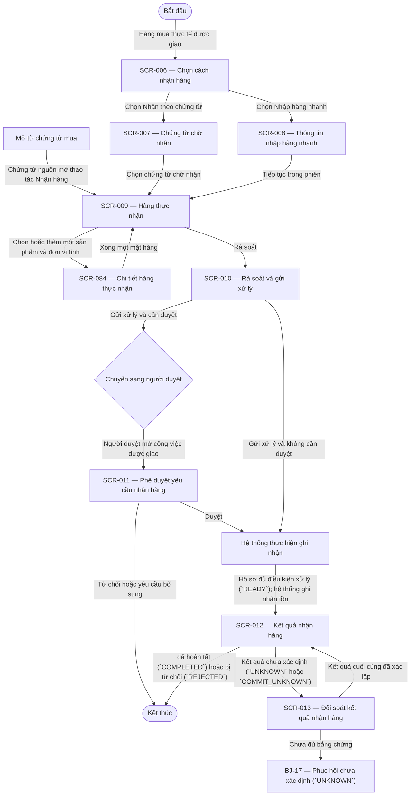

# UIF-02 — Nhận hàng mua

## 1. Mục đích và phạm vi

Mô tả toàn bộ luồng nhận hàng mua: chọn cách nhận, ghi nhận hàng thực tế, rà soát, phê duyệt khi cần, ghi nhận tồn và xử lý trường hợp kết quả chưa xác định.

- **Hành trình nghiệp vụ:** [BJ-02 — Nhận hàng mua](../../02.specification/behavior/journeys/BJ-02-nhan-hang-mua.md)
- **Trường hợp sử dụng liên quan:**
  - [UC-02-01 — Chuẩn bị nhận theo chứng từ](../../02.specification/behavior/use-cases/UC-02-01-chuan-bi-nhan-theo-chung-tu.md)
  - [UC-02-02 — Chuẩn bị nhập hàng nhanh](../../02.specification/behavior/use-cases/UC-02-02-chuan-bi-nhap-hang-nhanh.md)
  - [UC-02-03 — Phê duyệt yêu cầu nhận hàng](../../02.specification/behavior/use-cases/UC-02-03-phe-duyet-yeu-cau-nhan-hang.md)
  - [UC-02-04 — Ghi nhận hàng vào tồn vật lý](../../02.specification/behavior/use-cases/UC-02-04-ghi-nhan-hang-vao-ton-vat-ly.md)
  - [UC-02-05 — Truy vấn và phục hồi ngắn kết quả nhận hàng](../../02.specification/behavior/use-cases/UC-02-05-truy-van-va-phuc-hoi-ngan-ket-qua-nhan-hang.md)

**Ranh giới:** UIF chỉ mô tả cách người dùng đi qua các màn hình, điều kiện chuyển bước và cách xử lý khi không thể tiếp tục. Quy tắc nghiệp vụ vẫn lấy từ BJ/UC/Behavioral Contract; nội dung và thành phần của từng màn hình vẫn lấy từ Screen Contract.

## 2. Người dùng bắt đầu và kết thúc ở đâu

| Cách vào luồng | Màn hình | Người thực hiện | Đi từ đâu |
|---|---|---|---|
| Vào từ chức năng | `SCR-006` | Thủ kho | Kho > Nhận hàng |
| Mở từ ngữ cảnh liên quan | `SCR-009` | Thủ kho | Chứng từ mua > Nhận hàng |
| Công việc được giao | `SCR-011` | Người duyệt nhận hàng | Kho > Cần chú ý > Nhận hàng chờ phê duyệt, notification hoặc deep-link được giao |
| Tiếp tục để xác minh kết quả | `SCR-013` | Thủ kho | Chỉ từ kết quả nhận hàng chưa xác định (`UNKNOWN`) |

Luồng kết thúc khi người dùng đã nhận được kết quả cuối cùng hoặc công việc được chuyển rõ sang một hành trình khác. Trạng thái `UNKNOWN` không được coi là thành công; phải tiếp tục xác minh với đúng thao tác gốc.

## 3. Luồng màn hình

> Sơ đồ trên để đọc nhanh. Phần “Các bước chuyển màn hình” giải thích điều kiện và cách xử lý; phần “Truy vết kỹ thuật” giữ các mã phục vụ Dev/QA/Harness.

## 4. Các bước chuyển màn hình

| Bước | Từ đâu | Người dùng / hệ thống làm gì | Điều kiện cần | Đi đến | Nếu không thể tiếp tục |
|---|---|---|---|---|---|
| `UIF-02-T01` | Bắt đầu | Hàng mua thực tế được giao | Có quyền nhận hàng | `SCR-006` — Chọn cách nhận hàng | Không đủ quyền → kết thúc |
| `UIF-02-T02` | Mở từ chứng từ mua | Chứng từ nguồn mở thao tác Nhận hàng | Có quyền nhận và nguồn dữ liệu hợp lệ | `SCR-009` — Hàng thực nhận | Nguồn dữ liệu đã thay đổi → yêu cầu nạp nguồn dữ liệu mới |
| `UIF-02-T03` | `SCR-006` — Chọn cách nhận hàng | Chọn Nhận theo chứng từ | Có quyền nhận theo chứng từ | `SCR-007` — Chứng từ chờ nhận | — |
| `UIF-02-T04` | `SCR-006` — Chọn cách nhận hàng | Chọn Nhập hàng nhanh | Có quyền dùng Nhập hàng nhanh | `SCR-008` — Thông tin nhập hàng nhanh | chưa được phép dùng chức năng → giữ tại SCR-006 |
| `UIF-02-T05` | `SCR-007` — Chứng từ chờ nhận | Chọn chứng từ chờ nhận | Nguồn dữ liệu và phiên bản còn hợp lệ | `SCR-009` — Hàng thực nhận | Dữ liệu đã thay đổi → SCR-007 |
| `UIF-02-T06` | `SCR-008` — Thông tin nhập hàng nhanh | Tiếp tục trong phiên | thông tin nhập nhanh hợp lệ | `SCR-009` — Hàng thực nhận | Validation lỗi → giữ dữ liệu **chỉ trong phiên hiện tại**; không có server/local draft |
| `UIF-02-T07` | `SCR-009` — Hàng thực nhận | Chọn hoặc thêm một sản phẩm và đơn vị tính | Mặt hàng có thể chỉnh sửa | `SCR-084` — Chi tiết hàng thực nhận | — |
| `UIF-02-T08` | `SCR-084` — Chi tiết hàng thực nhận | Xong một mặt hàng | Dữ liệu mặt hàng hợp lệ | `SCR-009` — Hàng thực nhận | Báo lỗi ngay tại trường nhập; Quick giữ dữ liệu **chỉ trong memory phiên UI** |
| `UIF-02-T09` | `SCR-009` — Hàng thực nhận | Rà soát | Có ít nhất một mặt hàng hợp lệ | `SCR-010` — Rà soát và gửi xử lý | Thiếu dữ liệu → ở SCR-009 |
| `UIF-02-T10` | `SCR-010` — Rà soát và gửi xử lý | Gửi xử lý và cần duyệt | Người lập có quyền gửi; không tự duyệt | Chuyển sang người duyệt | Người lập kết thúc task ở `PENDING_APPROVAL`; có thể **Về Kho**, không quay lại editor |
| `UIF-02-T11` | Chuyển sang người duyệt | Người duyệt mở công việc được giao | Người duyệt hợp lệ và khác người lập | `SCR-011` — Phê duyệt yêu cầu nhận hàng | Có thể vào từ Hub > Cần chú ý > Nhận hàng chờ phê duyệt; không giả lập phiên làm việc người lập |
| `UIF-02-T12` | `SCR-011` — Phê duyệt yêu cầu nhận hàng | Từ chối hoặc yêu cầu bổ sung | Người duyệt hợp lệ | Kết thúc | Lý do từ chối bắt buộc |
| `UIF-02-T13` | `SCR-011` — Phê duyệt yêu cầu nhận hàng | Duyệt | Người duyệt hợp lệ | Hệ thống thực hiện ghi nhận | Phê duyệt chỉ cấp quyền thực thi |
| `UIF-02-T14` | `SCR-010` — Rà soát và gửi xử lý | Gửi xử lý và không cần duyệt | Chính sách xác định không cần duyệt | Hệ thống thực hiện ghi nhận | Không yêu cầu người dùng xác nhận thêm một lần nữa |
| `UIF-02-T15` | Hệ thống thực hiện ghi nhận | Hồ sơ đủ điều kiện xử lý (`READY`); hệ thống ghi nhận tồn | Hệ thống kiểm tra lại nguồn dữ liệu, phiên bản và quyền | `SCR-012` — Kết quả nhận hàng | Không ghi nhận lặp; không biến động tồn thứ hai |
| `UIF-02-T16` | `SCR-012` — Kết quả nhận hàng | đã hoàn tất (`COMPLETED`) hoặc bị từ chối (`REJECTED`) | — | Kết thúc | Màn hình hiển thị kết quả chính thức |
| `UIF-02-T17` | `SCR-012` — Kết quả nhận hàng | Kết quả chưa xác định (`UNKNOWN` hoặc `COMMIT_UNKNOWN`) | Cùng mã thao tác gốc | `SCR-013` — Đối soát kết quả nhận hàng | Không thực hiện lại khi chưa biết kết quả lần trước |
| `UIF-02-T18` | `SCR-013` — Đối soát kết quả nhận hàng | Kết quả cuối cùng đã xác lập | Cùng mã thao tác gốc | `SCR-012` — Kết quả nhận hàng | Hiển thị kết quả chính thức |
| `UIF-02-T19` | `SCR-013` — Đối soát kết quả nhận hàng | Chưa đủ bằng chứng | Giữ phạm vi bảo vệ và mã thao tác | BJ-17 — hành trình liên quan | Chuyển sang BJ-17 để tiếp tục xác minh và phục hồi |

## 5. Các tình huống cần chú ý

Các quy tắc chung về quyền, quay lại, dữ liệu thay đổi và chống ghi nhận lặp vẫn lấy từ UC/Behavioral Contract/Screen Contract. UIF chỉ nhắc lại những điểm ảnh hưởng trực tiếp đến cách đi qua màn hình.

- **nhập hàng nhanh không có draft persistence:** `SCR-008 → SCR-009 → SCR-084 → SCR-010` chỉ dùng state trong phiên UI. Điều hướng nội bộ giữ state memory; rời Quick flow, refresh hoặc đóng app thì mất. Không có autosave server, local storage hoặc `ACT-02-SAVE-DRAFT` cho UC-02-02.
- Submit nhập hàng nhanh ở `SCR-010` gửi full payload một lần qua `BC-IC-07/API-C-26`; success mới có `receiptId` và `PENDING_APPROVAL`; rejection không tạo goods receipt. **Payload BJ02 không yêu cầu price/FX basis; thiếu price/FX không tạo state/error trong BJ02.**
- Khi công việc chuyển sang người duyệt hoặc một vai trò khác, phiên làm việc của người hiện tại kết thúc tại trạng thái chờ. Người lập có thể **Về Kho** và theo dõi từ `Cần chú ý > Nhận hàng chờ phê duyệt`; không quay lại editor của submitted revision. Người tiếp theo mở đúng record từ worklist/notification/deep-link; hệ thống không tự chuyển sang phiên của họ.
- Nếu kết quả chưa xác định (`UNKNOWN`), không thực hiện lại bằng một thao tác mới. Hệ thống giữ nguyên mã thao tác gốc để xác minh; khi chưa đủ bằng chứng, chuyển sang `BJ-17`.
- Nếu dữ liệu nguồn đã thay đổi, phải nạp lại dữ liệu hiện hành và rà soát lại trước khi tiếp tục. Phần người dùng đã nhập chỉ được giữ lại khi còn an toàn.

## 6. Màn hình và Trường hợp sử dụng liên quan

| Trường hợp sử dụng | Màn hình sử dụng |
|---|---|
| [UC-02-01](../../02.specification/behavior/use-cases/UC-02-01-chuan-bi-nhan-theo-chung-tu.md) — Chuẩn bị nhận theo chứng từ | `SCR-006`, `SCR-007`, `SCR-009`, `SCR-084`, `SCR-010` |
| [UC-02-02](../../02.specification/behavior/use-cases/UC-02-02-chuan-bi-nhap-hang-nhanh.md) — Chuẩn bị nhập hàng nhanh | `SCR-006`, `SCR-008`, `SCR-009`, `SCR-084`, `SCR-010` |
| [UC-02-03](../../02.specification/behavior/use-cases/UC-02-03-phe-duyet-yeu-cau-nhan-hang.md) — Phê duyệt yêu cầu nhận hàng | `SCR-010`, `SCR-011` |
| [UC-02-04](../../02.specification/behavior/use-cases/UC-02-04-ghi-nhan-hang-vao-ton-vat-ly.md) — Ghi nhận hàng vào tồn vật lý | `SCR-012` |
| [UC-02-05](../../02.specification/behavior/use-cases/UC-02-05-truy-van-va-phuc-hoi-ngan-ket-qua-nhan-hang.md) — Truy vấn và phục hồi ngắn kết quả nhận hàng | `SCR-012`, `SCR-013` |

### Màn hình dùng trong luồng

| Màn hình | Tên | Vai trò trong luồng |
|---|---|---|
| [SCR-006](../screens/SCR-006.md) | Chọn cách nhận hàng | Màn hình chính trong luồng |
| [SCR-007](../screens/SCR-007.md) | Chứng từ chờ nhận | Màn hình chính trong luồng |
| [SCR-008](../screens/SCR-008.md) | Thông tin nhập hàng nhanh | Màn hình chính trong luồng |
| [SCR-009](../screens/SCR-009.md) | Hàng thực nhận | Màn hình chính trong luồng |
| [SCR-084](../screens/SCR-084.md) | Chi tiết hàng thực nhận | Màn hình chính trong luồng |
| [SCR-010](../screens/SCR-010.md) | Rà soát và gửi xử lý | Màn hình chính trong luồng |
| [SCR-011](../screens/SCR-011.md) | Phê duyệt yêu cầu nhận hàng | Màn hình chính trong luồng |
| [SCR-012](../screens/SCR-012.md) | Kết quả nhận hàng | Màn hình chính trong luồng |
| [SCR-013](../screens/SCR-013.md) | Đối soát kết quả nhận hàng | Màn hình chính trong luồng |

## 7. Truy vết kỹ thuật

> Phần này dành cho Dev/QA/Harness. Các mã kỹ thuật được giữ nguyên để Dev/QA/Harness đối chiếu tự động.

| Transition | From | To | Loại | Action | UC / BC |
|---|---|---|---|---|---|
| `UIF-02-T01` | `BEGIN` | `SCR-006` | `NAVIGATION` | `—` | BJ-02 / UC-02-01, UC-02-02 |
| `UIF-02-T02` | `CONTEXT_PURCHASE` | `SCR-009` | `NAVIGATION` | `—` | UC-02-01 |
| `UIF-02-T03` | `SCR-006` | `SCR-007` | `NAVIGATION` | `—` | UC-02-01 |
| `UIF-02-T04` | `SCR-006` | `SCR-008` | `NAVIGATION` | `—` | UC-02-02 |
| `UIF-02-T05` | `SCR-007` | `SCR-009` | `NAVIGATION` | `—` | UC-02-01 |
| `UIF-02-T06` | `SCR-008` | `SCR-009` | `NAVIGATION` | `—` | UC-02-02 |
| `UIF-02-T07` | `SCR-009` | `SCR-084` | `NAVIGATION` | `—` | UC-02-01, UC-02-02 |
| `UIF-02-T08` | `SCR-084` | `SCR-009` | `NAVIGATION` | `—` | UC-02-01, UC-02-02 |
| `UIF-02-T09` | `SCR-009` | `SCR-010` | `NAVIGATION` | `—` | UC-02-01, UC-02-02 |
| `UIF-02-T10` | `SCR-010` | `HANDOFF_APPROVAL` | `HANDOFF` | `ACT-02-SUBMIT` | UC-02-01/02/03 / BC-IC-07 |
| `UIF-02-T11` | `HANDOFF_APPROVAL` | `SCR-011` | `HANDOFF` | `—` | UC-02-03 / BC-IC-06 |
| `UIF-02-T12` | `SCR-011` | `END` | `MUTATION` | `ACT-02-DECIDE` | UC-02-03 / BC-IC-06 |
| `UIF-02-T13` | `SCR-011` | `SYSTEM_EXECUTE` | `MUTATION` | `ACT-02-DECIDE` | UC-02-03 / BC-IC-06 |
| `UIF-02-T14` | `SCR-010` | `SYSTEM_EXECUTE` | `SYSTEM` | `ACT-02-SUBMIT` | UC-02-01 / BC-IC-07 |
| `UIF-02-T15` | `SYSTEM_EXECUTE` | `SCR-012` | `SYSTEM` | `ACT-02-RECEIVE` | UC-02-04 / BC-IO-02 |
| `UIF-02-T16` | `SCR-012` | `END` | `TERMINAL` | `—` | UC-02-04 |
| `UIF-02-T17` | `SCR-012` | `SCR-013` | `SYSTEM` | `—` | UC-02-05 / BC-IO-02 |
| `UIF-02-T18` | `SCR-013` | `SCR-012` | `SYSTEM` | `—` | UC-02-05 |
| `UIF-02-T19` | `SCR-013` | `BJ-17` | `HANDOFF` | `—` | UC-02-05 → BJ-17 |

## 8. Kiểm tra tính đầy đủ và liên kết

- [x] Tất cả Trường hợp sử dụng liên quan đều được liên kết từ UIF.
- [x] Mỗi màn hình đang dùng trong luồng có Screen Contract tương ứng.
- [x] Các bước do hệ thống thực hiện không bị mô tả thành thao tác của người dùng.
- [x] Nếu có phê duyệt hoặc chuyển vai trò, người gửi và người nhận có điểm vào riêng.
- [x] Trạng thái kết thúc và trường hợp `UNKNOWN` có hướng xử lý rõ khi áp dụng.
- [x] Bảng đọc chính và bảng truy vết kỹ thuật dùng cùng một tập transition ID; không đổi topology hoặc hành vi.
- [x] Liên kết BJ ↔ UIF ↔ UC/SCR dùng đường dẫn tương đối và mở đúng tài liệu đích.

**Trạng thái đối chiếu thiết kế:** `ALIGNED_TO_CURRENT_SCREEN_CONTRACTS` — UIF đã được viết lại theo Plain BA Language; cấu trúc luồng, ID, mã Action, liên kết UC/BC và trạng thái đối chiếu của v4.1.0 được giữ nguyên. HTML và Screen Contract không thay đổi trong lượt này.

### Liên kết

- [Business Journey](../../02.specification/behavior/journeys/BJ-02-nhan-hang-mua.md)
- [Business Journey Map](../../02.specification/behavior/journeys/00-business-journey-map.md)
- [Use Case Map](../../02.specification/behavior/use-cases/00-use-case-map.md)
- [Prototype manifest](../prototype/README.md)

### v4.6.4 — Continuity khi chờ phê duyệt

- Hub Kho tổng hợp các goods receipt `PENDING_APPROVAL` dưới mục **Nhận hàng chờ phê duyệt** trong `Cần chú ý`.
- Đây là entry/aggregation của task đang tồn tại, không tạo thêm business mutation và không thay đổi topology nghiệp vụ của `UIF-02`.
- `SCR-010/PENDING_APPROVAL` có CTA **Về Kho**; Back cũng về Hub Kho.
- Từ collection pending, destination phụ thuộc capability: chỉ xem → goods receipt đã gửi read-only; có quyền duyệt → `SCR-011`.
