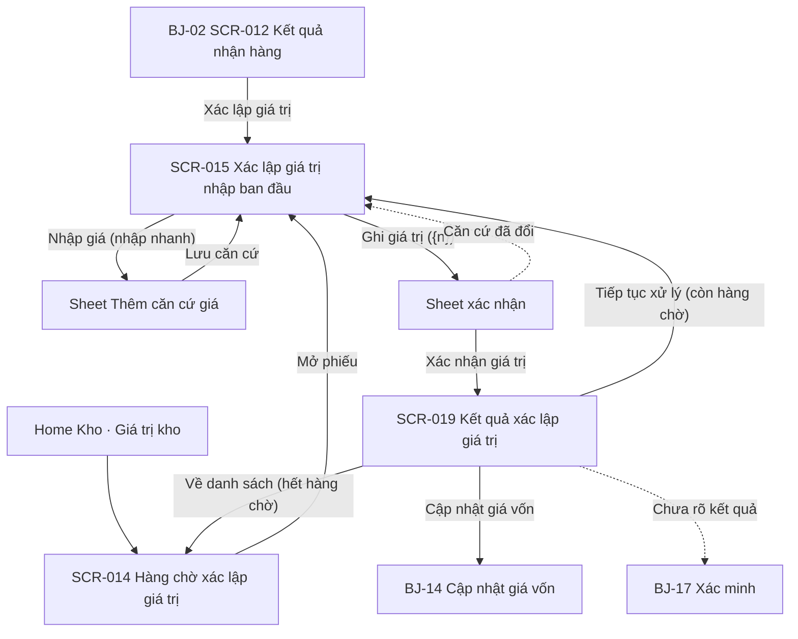

# UIF-03 — Xác lập giá trị nhập ban đầu

## 1. Việc thật

Hàng vừa nhận xong đã vào tồn nhưng chưa có giá. Chủ cửa hàng (cửa hàng không có kế toán riêng — "kế toán kho" trong đặc tả là chủ cửa hàng) ghi một lần: hàng giá bao nhiêu một đơn vị, lấy từ đâu, tổng bao nhiêu; để tồn có giá trị và giá vốn được tính lại sau đó. Thường 1–5 sản phẩm một phiếu, đa số đủ căn cứ; thỉnh thoảng giá đơn mua và xác nhận của nhà cung cấp lệch nhau, phải thống nhất ở Mua hàng trước. Nhận theo chứng từ: giá đã có ở chứng từ mua, chỉ xem và xác nhận. Nhập nhanh (chưa có chứng từ): chủ tự nhập giá bằng VND kèm nguồn và lý do.

Thiết bị: iPhone và web đều là thiết bị chính (chủ có thể gom vài phiếu cuối tuần ở máy tính, hoặc ghi ngay trên iPhone).

- BJ: [BJ-03 — Xác lập giá trị ban đầu của hàng nhận](../../02.specification/behavior/journeys/BJ-03-xac-lap-gia-tri-ban-dau-cua-hang-nhan.md)
- UC: [UC-03-01](../../02.specification/behavior/use-cases/UC-03-01-xac-lap-gia-tri-nhap-ban-dau.md)

## 2. Lối vào và lối ra

| Hướng | Từ / đến | Điều kiện |
|---|---|---|
| Vào | BJ-02 SCR-012 → "Xác lập giá trị" | Chủ cửa hàng, vừa nhận hàng → SCR-015 đúng phiếu vừa nhận; nút quay lại về SCR-012 |
| Vào | Home Kho → Quản lý kho → Giá trị kho → "Hàng chờ xác lập giá trị" | Chủ cửa hàng → SCR-014 |
| Vào (chỉ prototype) | `entry=receipt-task` | SCR-015 phiếu mặc định |
| Vào (chỉ prototype) | `entry=staff` | SCR-014 với vai nhân viên: thấy "Bạn chưa có quyền xác lập giá trị" |
| Ra | BJ-14 | "Cập nhật giá vốn" ở kết quả (mở màn hiện có; BJ-14 thiết kế lại ở chặng 6) |
| Ra | BJ-13 | Chi phí / khoản phát sinh đến sau khi đã ghi → điều chỉnh giá trị |
| Ra | BJ-17 | Chưa rõ kết quả → "Chuyển sang xác minh" |
| Ra | Home Kho | "Về Kho" (không có quyền, bị từ chối, chưa rõ kết quả) |

SCR-016, SCR-017, SCR-018 đã bỏ: link cũ mở SCR-015 (016, 017) hoặc BJ-13 (018) — xem [RETIRED](../screens/RETIRED.md). Home Kho không có dòng "Cần chú ý" riêng cho luồng này (Home dùng chung với nhân viên).

## 3. Sơ đồ luồng

Một đường chính: mở phiếu → ghi một lần (dòng đủ căn cứ đã tick sẵn) → kết quả. Không có bước duyệt (UC-03-01 không có người duyệt) và không có màn rà soát riêng.

## 4. Chuyển màn

| Từ | Hành động | Đến | Ghi chú |
|---|---|---|---|
| SCR-012 (BJ-02) | "Xác lập giá trị" | SCR-015 | Phiếu vừa nhận; số lượng, lô theo hàng thực nhận; dòng đủ căn cứ tick sẵn |
| SCR-014 | Mở phiếu | SCR-015 | Phiếu "Cần đối chiếu" / "Chờ căn cứ" vẫn mở được để xem lý do |
| SCR-015 | "Cách tính" | Sheet "Cách tính" | Chỉ đọc |
| SCR-015 | "Nhập giá" → "Lưu căn cứ" | SCR-015 | Nhập nhanh; chưa ghi sổ, dòng thành "Đủ căn cứ" và được tick |
| SCR-015 | "Ghi giá trị ({n})" | Sheet xác nhận | Bật khi có ít nhất một sản phẩm đủ căn cứ được chọn |
| Sheet xác nhận | "Xác nhận giá trị" | SCR-019 | Căn cứ chưa đổi kể từ lúc mở sheet |
| Sheet xác nhận | "Xác nhận giá trị" khi căn cứ đã đổi | SCR-015 `SOURCE_CHANGED` | Từ chối cả lệnh; banner "Căn cứ đã thay đổi" + "Kiểm tra lại"; tick giữ nguyên |
| SCR-019 | "Tiếp tục xử lý" / "Về danh sách" | SCR-015 / SCR-014 | Còn hàng chờ / hết |
| SCR-019 | "Cập nhật giá vốn" | BJ-14 | Sản phẩm + kỳ cần cập nhật |
| SCR-019 `UNKNOWN` | "Chuyển sang xác minh" | BJ-17 | Đúng lần xử lý này, không gửi lại lệnh |
| SCR-015 | Quay lại | SCR-012 (vào từ nhận hàng) / SCR-014 | — |

## 5. Khuôn dùng chung áp dụng

K1 trạng thái chung (đang tải, không có quyền, khoá "Phiếu này đã được xác lập giá trị", dữ liệu cũ, rỗng); K3 kết quả chưa rõ (SCR-019 `UNKNOWN`); K4 kết quả xong (SCR-019); K7 bố cục web (SCR-014 bảng, SCR-015 bảng có ô tick + khối "Tóm tắt"); thanh chọn `dsSegmented` ("Cách hiểu giá").

## 6. Liên kết với BJ khác

| Sang / từ BJ | Ở màn | Cách |
|---|---|---|
| Từ BJ-02 | SCR-012 | "Xác lập giá trị" mở đúng phiếu vừa nhận (chặng 2: nhận hàng → xác lập giá → điều chỉnh giá trị) |
| Sang BJ-14 | SCR-019 | "Cập nhật giá vốn": ghi xong chỉ đánh dấu sản phẩm + kỳ cần cập nhật, không tạo giá vốn chính thức |
| Sang BJ-13 | — | Fact đến sau khi đã ghi (chi phí mua bổ sung…) dùng điều chỉnh giá trị; không sửa trực tiếp |
| Sang BJ-11 | — | Nhập sai số lượng / hàng → sửa tồn |
| Sang BJ-17 | SCR-019 | "Chuyển sang xác minh" |

Nguồn mua (PO, hoá đơn, xác nhận nhà cung cấp) thuộc Theme 10, chỉ đọc: mâu thuẫn thương mại không được chọn tuỳ ý một giá — quay về Mua hàng. Fixture chung chặng 2: Nobivac DHPPi (SP-000184), Oxytetracycline LA (SP-000147), phiếu PN-260816-04 — cùng bộ với BJ-01, BJ-02, BJ-13.

## 7. Truy vết

BJ-03 · UC-03-01 · [SCR-014](../screens/SCR-014.md), [SCR-015](../screens/SCR-015.md), [SCR-019](../screens/SCR-019.md) (SCR-016, SCR-017, SCR-018 đã bỏ: [RETIRED](../screens/RETIRED.md)) · hành động `ACT-03-CONFIRM-COST` (BC-IV-01, API-C-20) · golden: `SC_bj03_from_receipt`, `SC_bj03_direct`, `SC_bj03_list`, `SC_bj03_confirm`, `SC_bj03_untick`, `SC_bj03_stale`, `SC_bj03_result`, `SC_bj03_staff`, `SC_bj03_unknown`.
