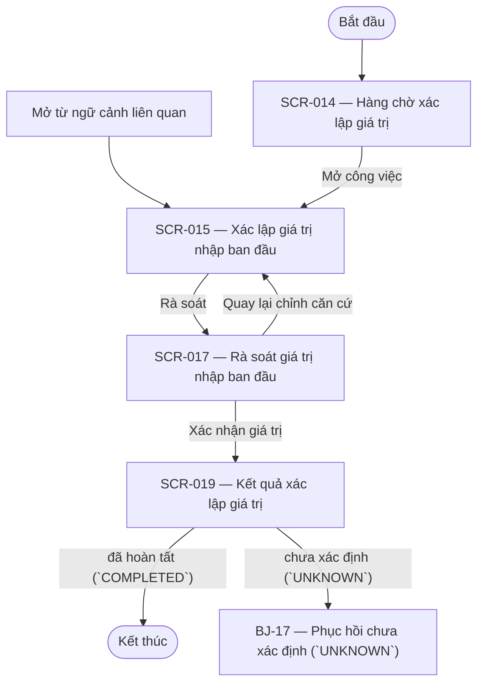

# UIF-03 — Xác lập giá trị ban đầu của hàng nhận

## 1. Mục đích và phạm vi

Mô tả cách kế toán xác lập giá trị ban đầu cho hàng đã nhận, từ danh sách hàng chờ xử lý đến rà soát và kết quả xác nhận.

- **Hành trình nghiệp vụ:** [BJ-03 — Xác lập giá trị ban đầu của hàng nhận](../../02.specification/behavior/journeys/BJ-03-xac-lap-gia-tri-ban-dau-cua-hang-nhan.md)
- **Trường hợp sử dụng liên quan:**
  - [UC-03-01 — Xác lập giá trị nhập ban đầu](../../02.specification/behavior/use-cases/UC-03-01-xac-lap-gia-tri-nhap-ban-dau.md)

**Ranh giới:** UIF chỉ mô tả cách người dùng đi qua các màn hình, điều kiện chuyển bước và cách xử lý khi không thể tiếp tục. Quy tắc nghiệp vụ vẫn lấy từ BJ/UC/Behavioral Contract; nội dung và thành phần của từng màn hình vẫn lấy từ Screen Contract.

## 2. Người dùng bắt đầu và kết thúc ở đâu

| Cách vào luồng | Màn hình | Người thực hiện | Đi từ đâu |
|---|---|---|---|
| Vào từ chức năng | `SCR-014` | Kế toán hoặc người có quyền tài chính | Giá trị & giá vốn > Hàng chờ xác lập giá trị |
| Mở từ ngữ cảnh liên quan | `SCR-015` | Kế toán hoặc người có quyền tài chính | Phiếu nhận cần xác lập giá trị |

Luồng kết thúc khi người dùng đã nhận được kết quả cuối cùng hoặc công việc được chuyển rõ sang một hành trình khác. Trạng thái `UNKNOWN` không được coi là thành công; phải tiếp tục xác minh với đúng thao tác gốc.

## 3. Luồng màn hình

`SCR-016` đã được hợp nhất và không còn là một bước riêng. Căn cứ và nguồn gốc số liệu nằm ngay trong `SCR-015`; thao tác nhập nhanh mở trên cùng màn hình và không tạo bước điều hướng riêng.

> Sơ đồ trên để đọc nhanh. Phần “Các bước chuyển màn hình” giải thích điều kiện và cách xử lý; phần “Truy vết kỹ thuật” giữ các mã phục vụ Dev/QA/Harness.

## 4. Các bước chuyển màn hình

| Bước | Từ đâu | Người dùng / hệ thống làm gì | Điều kiện cần | Đi đến | Nếu không thể tiếp tục |
|---|---|---|---|---|---|
| `UIF-03-T01` | Bắt đầu | Có công việc xác lập giá trị | Có quyền xem giá trị | `SCR-014` — Hàng chờ xác lập giá trị | — |
| `UIF-03-T02` | Mở từ ngữ cảnh liên quan | Mở đúng phiếu nhận hoặc công việc | xác định đúng tổ chức và phiếu nhận | `SCR-015` — Xác lập giá trị nhập ban đầu | Dữ liệu đã thay đổi → xác định lại |
| `UIF-03-T03` | `SCR-014` — Hàng chờ xác lập giá trị | Mở công việc | Mặt hàng trên phiếu nhận vẫn đang chờ xác lập giá trị | `SCR-015` — Xác lập giá trị nhập ban đầu | Công việc vẫn mở được để xem lý do đang bị chặn |
| `UIF-03-T04` | `SCR-015` — Xác lập giá trị nhập ban đầu | Chuyển sang rà soát khi có ít nhất một mặt hàng đủ điều kiện xử lý | Nguồn dữ liệu còn hợp lệ và không còn vướng mắc về chứng từ mua trong phạm vi đang xử lý | `SCR-017` — Rà soát giá trị nhập ban đầu | Thiếu căn cứ hoặc còn vướng mắc → ở lại SCR-015 |
| `UIF-03-T05` | `SCR-017` — Rà soát giá trị nhập ban đầu | Quay lại chỉnh căn cứ | Chưa ghi nhận chính thức | `SCR-015` — Xác lập giá trị nhập ban đầu | Giữ bản nháp khi an toàn |
| `UIF-03-T06` | `SCR-017` — Rà soát giá trị nhập ban đầu | Xác nhận giá trị nhập ban đầu | Kết quả xem trước và phiên bản nguồn dữ liệu còn hợp lệ | `SCR-019` — Kết quả xác lập giá trị | Nếu bị từ chối (`REJECTED`), không ghi thay đổi giá trị |
| `UIF-03-T07` | `SCR-019` — Kết quả xác lập giá trị | đã hoàn tất (`COMPLETED`) | — | Kết thúc | Sản phẩm và kỳ liên quan có thể được đánh dấu cần tính lại cho BJ-14 |
| `UIF-03-T08` | `SCR-019` — Kết quả xác lập giá trị | chưa xác định (`UNKNOWN`) | Giữ mã thao tác gốc | BJ-17 — hành trình liên quan | Không xác nhận lại khi chưa biết kết quả lần trước |

## 5. Các tình huống cần chú ý

Các quy tắc chung về quyền, quay lại, dữ liệu thay đổi và chống ghi nhận lặp vẫn lấy từ UC/Behavioral Contract/Screen Contract. UIF chỉ nhắc lại những điểm ảnh hưởng trực tiếp đến cách đi qua màn hình.

- Theo chứng từ: Nếu có vướng mắc về chứng từ mua thuộc Theme 10, chỉ cho xem và chuyển xử lý; không cho tự chọn giá để bỏ qua vướng mắc.
- Nhập nhanh: mở bảng nhập nhanh ngay trên `SCR-015`; đóng bảng vẫn ở cùng màn hình và không tạo bước điều hướng mới.
- Khi nguồn dữ liệu thay đổi (`SOURCE_CHANGED`), phải làm mới và rà soát lại trước khi xác nhận.
- Nếu kết quả chưa xác định (`UNKNOWN`), không thực hiện lại bằng một thao tác mới. Hệ thống giữ nguyên mã thao tác gốc để xác minh; khi chưa đủ bằng chứng, chuyển sang `BJ-17`.
- Dữ liệu tài chính chỉ hiển thị cho người có quyền phù hợp. UIF mô tả luồng người dùng; cách che dữ liệu chi tiết được quy định tại Screen Contract. Contract thực thi thuộc work slice lúc review để implement.
- Các màn hình đã hợp nhất hoặc chỉ dùng cho tương thích không được xem là một bước điều hướng độc lập của luồng hiện hành.

## 6. Màn hình và Trường hợp sử dụng liên quan

| Trường hợp sử dụng | Màn hình sử dụng |
|---|---|
| [UC-03-01](../../02.specification/behavior/use-cases/UC-03-01-xac-lap-gia-tri-nhap-ban-dau.md) | `SCR-014`, `SCR-015`, `SCR-017`, `SCR-019` |

### Màn hình dùng trong luồng

| Màn hình | Tên | Vai trò trong luồng |
|---|---|---|
| [SCR-014](../screens/SCR-014.md) | Hàng chờ xác lập giá trị | Danh sách công việc |
| [SCR-015](../screens/SCR-015.md) | Xác lập giá trị nhập ban đầu | Căn cứ và thành phần giá trị; mở bảng nhập nhanh khi cần |
| [SCR-017](../screens/SCR-017.md) | Rà soát giá trị nhập ban đầu | Rà soát cuối trước khi xác nhận |
| [SCR-019](../screens/SCR-019.md) | Kết quả xác lập giá trị | Kết quả chính thức |

### Màn hình đã được hợp nhất hoặc ngừng dùng

- `SCR-016` — đã hợp nhất vào `SCR-015`.
- `SCR-018` — không thuộc active UIF-03; màn hình cũ được thay bởi BJ13 `SCR-085`.

## 7. Truy vết kỹ thuật

> Phần này dành cho Dev/QA/Harness. Các mã kỹ thuật được giữ nguyên để Dev/QA/Harness đối chiếu tự động.

| Transition | From | To | Loại | Action | UC / BC |
|---|---|---|---|---|---|
| `UIF-03-T01` | `BEGIN` | `SCR-014` | `NAVIGATION` | `—` | UC-03-01 |
| `UIF-03-T02` | `CONTEXT` | `SCR-015` | `NAVIGATION` | `—` | UC-03-01 |
| `UIF-03-T03` | `SCR-014` | `SCR-015` | `NAVIGATION` | `—` | UC-03-01 |
| `UIF-03-T04` | `SCR-015` | `SCR-017` | `NAVIGATION` | `—` | UC-03-01 / BF-05 |
| `UIF-03-T05` | `SCR-017` | `SCR-015` | `NAVIGATION` | `—` | UC-03-01 |
| `UIF-03-T06` | `SCR-017` | `SCR-019` | `MUTATION` | `ACT-03-CONFIRM-COST` | UC-03-01 / BC-IV-01 |
| `UIF-03-T07` | `SCR-019` | `END` | `TERMINAL` | `—` | UC-03-01 |
| `UIF-03-T08` | `SCR-019` | `BJ-17` | `HANDOFF` | `—` | UC-03-01 → BJ-17 |

## 8. Kiểm tra tính đầy đủ và liên kết

- [x] Tất cả Trường hợp sử dụng liên quan đều được liên kết từ UIF.
- [x] Mỗi màn hình đang dùng trong luồng có Screen Contract tương ứng.
- [x] Các bước do hệ thống thực hiện không bị mô tả thành thao tác của người dùng.
- [x] Nếu có phê duyệt hoặc chuyển vai trò, người gửi và người nhận có điểm vào riêng.
- [x] Trạng thái kết thúc và trường hợp `UNKNOWN` có hướng xử lý rõ khi áp dụng.
- [x] Bảng đọc chính và bảng truy vết kỹ thuật dùng cùng một tập transition ID; không đổi topology hoặc hành vi.
- [x] Liên kết BJ ↔ UIF ↔ UC/SCR dùng đường dẫn tương đối và mở đúng tài liệu đích.

**Trạng thái đối chiếu thiết kế:** `DESIGN_HTML_PARITY_VALIDATED` — UIF đã được viết lại theo Plain BA Language; cấu trúc luồng, ID, mã Action, liên kết UC/BC và trạng thái đối chiếu của v4.1.0 được giữ nguyên. HTML và Screen Contract không thay đổi trong lượt này.

### Liên kết

- [Business Journey](../../02.specification/behavior/journeys/BJ-03-xac-lap-gia-tri-ban-dau-cua-hang-nhan.md)
- [Business Journey Map](../../02.specification/behavior/journeys/00-business-journey-map.md)
- [Use Case Map](../../02.specification/behavior/use-cases/00-use-case-map.md)
- [Prototype manifest](../prototype/README.md)
