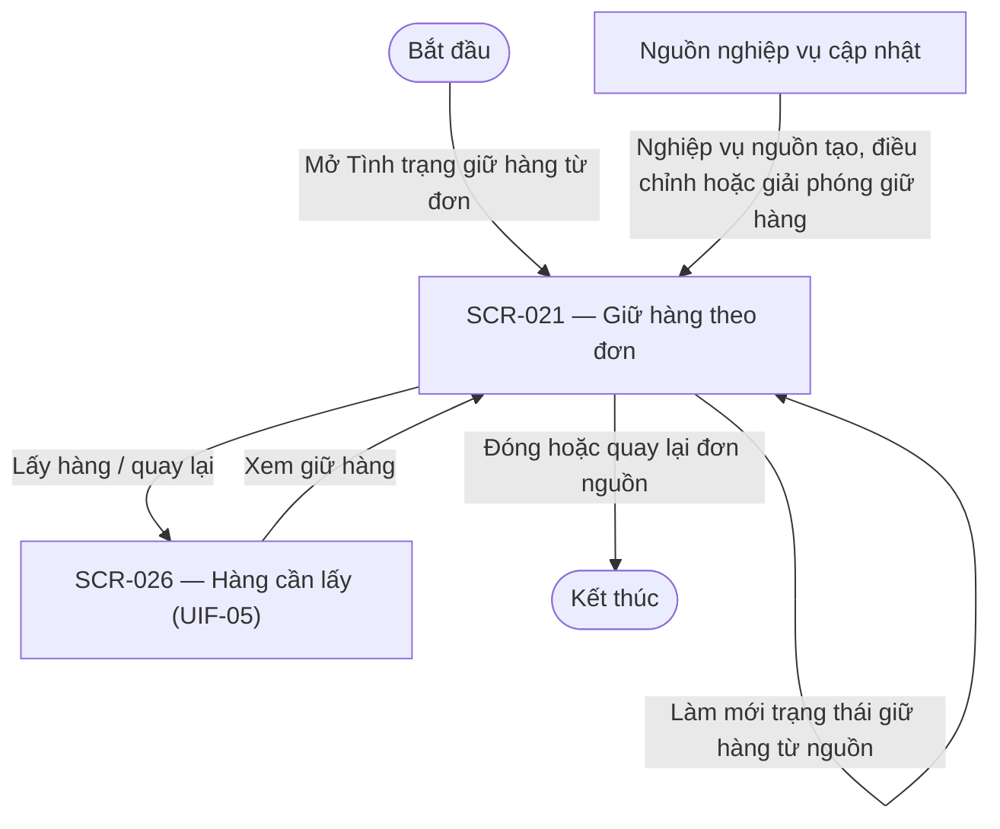

# UIF-04 — Quản lý vòng đời giữ hàng

## 1. Mục đích và phạm vi

Mô tả cách người dùng xem tình trạng giữ hàng ngay trong ngữ cảnh đơn. Luồng này chủ yếu để theo dõi; việc tạo, điều chỉnh hoặc giải phóng giữ hàng do nghiệp vụ nguồn thực hiện.

- **Hành trình nghiệp vụ:** [BJ-04 — Quản lý vòng đời giữ hàng](../../02.specification/behavior/journeys/BJ-04-quan-ly-vong-oi-giu-hang.md)
- **Trường hợp sử dụng liên quan:**
  - [UC-04-01 — Tạo giữ hàng](../../02.specification/behavior/use-cases/UC-04-01-tao-reservation.md)
  - [UC-04-02 — Điều chỉnh giữ hàng](../../02.specification/behavior/use-cases/UC-04-02-dieu-chinh-reservation.md)
  - [UC-04-03 — Kết thúc và giải phóng](../../02.specification/behavior/use-cases/UC-04-03-ket-thuc-va-giai-phong.md)
  - [UC-04-04 — Đánh giá lại và xử lý thiếu](../../02.specification/behavior/use-cases/UC-04-04-danh-gia-lai-va-xu-ly-thieu.md)

**Ranh giới:** UIF chỉ mô tả cách người dùng đi qua các màn hình, điều kiện chuyển bước và cách xử lý khi không thể tiếp tục. Quy tắc nghiệp vụ vẫn lấy từ BJ/UC/Behavioral Contract; nội dung và thành phần của từng màn hình vẫn lấy từ Screen Contract.

## 2. Người dùng bắt đầu và kết thúc ở đâu

Giữ hàng do đơn bán tạo / sửa / giải phóng; Kho chỉ có SCR-021 để xem (SCR-020, 022–024 đã bỏ từ v5.27.0).

| Cách vào luồng | Màn hình | Người thực hiện | Đi từ đâu |
|---|---|---|---|
| Chỉ mở trong ngữ cảnh liên quan | `SCR-021` | Người có quyền xem đơn và kho | Chi tiết đơn > Tình trạng giữ hàng |
| Mở từ lúc lấy hàng | `SCR-021` | Nhân viên kho | `SCR-026` (UIF-05) > "Xem giữ hàng" |

Luồng kết thúc khi người dùng đã nhận được kết quả cuối cùng hoặc công việc được chuyển rõ sang một hành trình khác.

## 3. Luồng màn hình

> Sơ đồ trên để đọc nhanh. Phần “Các bước chuyển màn hình” giải thích điều kiện và cách xử lý; phần “Truy vết kỹ thuật” giữ các mã phục vụ Dev/QA/Harness.

## 4. Các bước chuyển màn hình

| Bước | Từ đâu | Người dùng / hệ thống làm gì | Điều kiện cần | Đi đến | Nếu không thể tiếp tục |
|---|---|---|---|---|---|
| `UIF-04-T01` | Bắt đầu | Mở Tình trạng giữ hàng từ ngữ cảnh đơn | Có quyền xem đơn và tồn kho | `SCR-021` — Giữ hàng theo đơn | Màn hình chỉ phản ánh trạng thái; không thực hiện thay đổi giữ hàng tại đây |
| `UIF-04-T02` | `SCR-021` — Giữ hàng theo đơn | Làm mới trạng thái giữ hàng từ nguồn | Có quyền xem | `SCR-021` — Giữ hàng theo đơn | Nguồn dữ liệu đã thay đổi → giữ ngữ cảnh và làm mới |
| `UIF-04-T03` | Nguồn nghiệp vụ cập nhật | Nghiệp vụ nguồn tạo, điều chỉnh hoặc giải phóng giữ hàng | Trạng thái chính thức do nghiệp vụ nguồn cung cấp | `SCR-021` — Giữ hàng theo đơn | Màn hình chỉ phản ánh trạng thái chính thức |
| `UIF-04-T04` | `SCR-021` — Giữ hàng theo đơn | Đóng hoặc quay lại đơn nguồn | Mở từ ngữ cảnh đơn | Kết thúc | — |
| `UIF-04-T05` | `SCR-026` (UIF-05) | Xem giữ hàng của đơn đang lấy | — | `SCR-021` | — |
| `UIF-04-T06` | `SCR-021` — Giữ hàng theo đơn | "Lấy hàng" (đơn "Cần lấy" / "Chờ bàn giao") hoặc quay lại | Đơn có trong hàng đợi lấy hàng | `SCR-026` (UIF-05) | Đơn không còn trong hàng đợi → không có nút "Lấy hàng" |

## 5. Các tình huống cần chú ý

Các quy tắc chung về quyền, quay lại, dữ liệu thay đổi và chống ghi nhận lặp vẫn lấy từ UC/Behavioral Contract/Screen Contract. UIF chỉ nhắc lại những điểm ảnh hưởng trực tiếp đến cách đi qua màn hình.

- Nếu dữ liệu nguồn đã thay đổi, phải nạp lại dữ liệu hiện hành và rà soát lại trước khi tiếp tục. Phần người dùng đã nhập chỉ được giữ lại khi còn an toàn.
- Các màn hình đã hợp nhất hoặc chỉ dùng cho tương thích không được xem là một bước điều hướng độc lập của luồng hiện hành.

## 6. Màn hình và Trường hợp sử dụng liên quan

| Trường hợp sử dụng | Màn hình sử dụng |
|---|---|
| [UC-04-01](../../02.specification/behavior/use-cases/UC-04-01-tao-reservation.md) — Tạo giữ hàng | `SCR-021` |
| [UC-04-02](../../02.specification/behavior/use-cases/UC-04-02-dieu-chinh-reservation.md) — Điều chỉnh giữ hàng | `SCR-021` |
| [UC-04-03](../../02.specification/behavior/use-cases/UC-04-03-ket-thuc-va-giai-phong.md) — Kết thúc và giải phóng | `SCR-021` |
| [UC-04-04](../../02.specification/behavior/use-cases/UC-04-04-danh-gia-lai-va-xu-ly-thieu.md) — Đánh giá lại và xử lý thiếu | `SCR-021` |

### Màn hình dùng trong luồng

| Màn hình | Tên | Vai trò trong luồng |
|---|---|---|
| [SCR-021](../screens/SCR-021.md) | Giữ hàng theo đơn | Màn hình chính trong luồng |

### Màn hình đã bỏ

SCR-020, SCR-022, SCR-023, SCR-024 đã bỏ từ v5.27.0 (xem [RETIRED](../screens/RETIRED.md)).

## 7. Truy vết kỹ thuật

> Phần này dành cho Dev/QA/Harness. Các mã kỹ thuật được giữ nguyên để Dev/QA/Harness đối chiếu tự động.

| Transition | From | To | Loại | Action | UC / BC |
|---|---|---|---|---|---|
| `UIF-04-T01` | `BEGIN` | `SCR-021` | `QUERY` | `—` | UC-04-01…UC-04-04 |
| `UIF-04-T02` | `SCR-021` | `SCR-021` | `QUERY` | `—` | UC-04-01…UC-04-04 / BC-IO-03, BC-IO-06 |
| `UIF-04-T03` | `SYSTEM_SOURCE` | `SCR-021` | `SYSTEM` | `—` | UC-04-01…UC-04-04 |
| `UIF-04-T04` | `SCR-021` | `END` | `TERMINAL` | `—` | BJ-04 |
| `UIF-04-T05` | `SCR-026` | `SCR-021` | `NAVIGATION` | `—` | UC-04-04 |
| `UIF-04-T06` | `SCR-021` | `SCR-026` | `NAVIGATION` | `—` | UC-04-04 |

## 8. Kiểm tra tính đầy đủ và liên kết

- [x] Tất cả Trường hợp sử dụng liên quan đều được liên kết từ UIF.
- [x] Mỗi màn hình đang dùng trong luồng có Screen Contract tương ứng.
- [x] Các bước do hệ thống thực hiện không bị mô tả thành thao tác của người dùng.
- [x] Nếu có phê duyệt hoặc chuyển vai trò, người gửi và người nhận có điểm vào riêng.
- [x] Trạng thái kết thúc và trường hợp `UNKNOWN` có hướng xử lý rõ khi áp dụng.
- [x] Bảng đọc chính và bảng truy vết kỹ thuật dùng cùng một tập transition ID; không đổi topology hoặc hành vi.
- [x] Liên kết BJ ↔ UIF ↔ UC/SCR dùng đường dẫn tương đối và mở đúng tài liệu đích.

**Trạng thái đối chiếu thiết kế:** `REDESIGNED_v5.11.0` — thêm lối vào từ SCR-026 ("Xem giữ hàng") và lối ra "Lấy hàng" (hết ngõ cụt); màn vẫn chỉ xem, không có thao tác thay đổi giữ hàng. Transition T01…T04 giữ nguyên.

### Liên kết

- [Business Journey](../../02.specification/behavior/journeys/BJ-04-quan-ly-vong-oi-giu-hang.md)
- [Business Journey Map](../../02.specification/behavior/journeys/00-business-journey-map.md)
- [Use Case Map](../../02.specification/behavior/use-cases/00-use-case-map.md)
- [Prototype manifest](../prototype/README.md)
