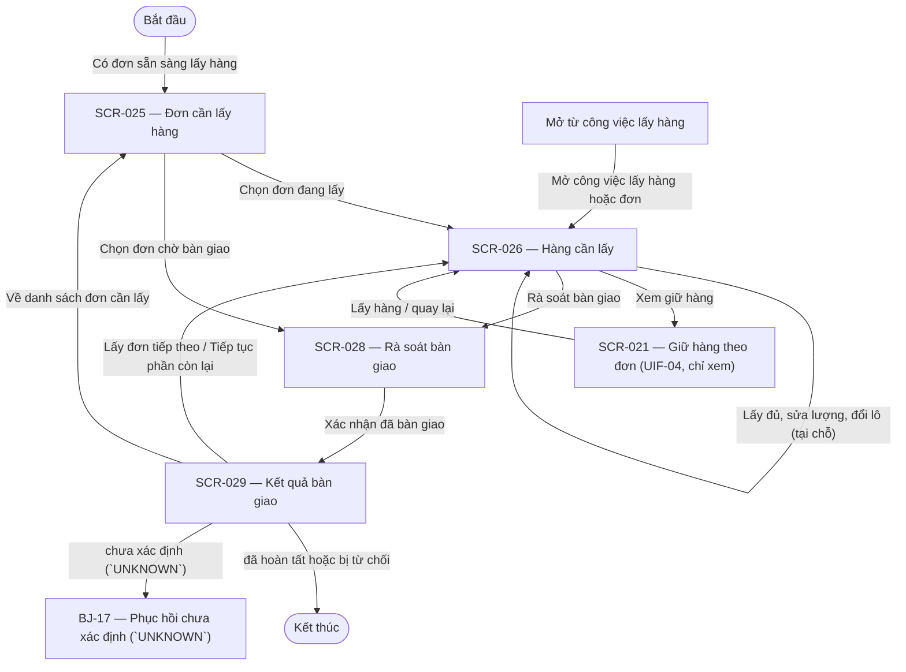

# UIF-05 — Lấy hàng và bàn giao đơn

## 1. Mục đích và phạm vi

Mô tả cách nhân viên kho nhận công việc lấy hàng, ghi nhận số lượng đã lấy và xác nhận bàn giao để hệ thống ghi xuất kho.

- **Hành trình nghiệp vụ:** [BJ-05 — Lấy hàng và bàn giao đơn](../../02.specification/behavior/journeys/BJ-05-lay-hang-va-ban-giao-on.md)
- **Trường hợp sử dụng liên quan:**
  - [UC-05-01 — Lập phân bổ lấy hàng](../../02.specification/behavior/use-cases/UC-05-01-lap-allocation.md)
  - [UC-05-02 — Xác nhận hàng đã lấy](../../02.specification/behavior/use-cases/UC-05-02-xac-nhan-hang-da-lay.md)
  - [UC-05-03 — Bàn giao hàng](../../02.specification/behavior/use-cases/UC-05-03-ban-giao-hang.md)
  - [UC-05-04 — Phục hồi khi phân bổ lấy hàng đã cũ](../../02.specification/behavior/use-cases/UC-05-04-phuc-hoi-allocation-stale.md)
  - [UC-05-05 — Ghi xuất kho nguyên tử](../../02.specification/behavior/use-cases/UC-05-05-ghi-xuat-kho-nguyen-tu.md)

**Ranh giới:** UIF chỉ mô tả cách người dùng đi qua các màn hình, điều kiện chuyển bước và cách xử lý khi không thể tiếp tục. Quy tắc nghiệp vụ vẫn lấy từ BJ/UC/Behavioral Contract; nội dung và thành phần của từng màn hình vẫn lấy từ Screen Contract.

## 2. Người dùng bắt đầu và kết thúc ở đâu

| Cách vào luồng | Màn hình | Người thực hiện | Đi từ đâu |
|---|---|---|---|
| Vào từ chức năng | `SCR-025` | Nhân viên lấy hàng | Kho > Lấy hàng |
| Mở từ ngữ cảnh liên quan | `SCR-026` | Nhân viên lấy hàng | Công việc lấy hàng hoặc đơn được giao; từ SCR-021 "Lấy hàng" |

Luồng kết thúc khi người dùng đã nhận được kết quả cuối cùng hoặc công việc được chuyển rõ sang một hành trình khác. Trạng thái `UNKNOWN` không được coi là thành công; phải tiếp tục xác minh với đúng thao tác gốc.

## 3. Luồng màn hình

> Sơ đồ trên để đọc nhanh. Phần "Các bước chuyển màn hình" giải thích điều kiện và cách xử lý; phần "Truy vết kỹ thuật" giữ các mã phục vụ Dev/QA/Harness. Màn "Chi tiết lấy hàng" (SCR-027) đã gộp vào SCR-026 từ v5.11.0.

## 4. Các bước chuyển màn hình

| Bước | Từ đâu | Người dùng / hệ thống làm gì | Điều kiện cần | Đi đến | Nếu không thể tiếp tục |
|---|---|---|---|---|---|
| `UIF-05-T01` | Bắt đầu | Có đơn sẵn sàng lấy hàng | Có quyền lấy hàng | `SCR-025` — Đơn cần lấy hàng | — |
| `UIF-05-T02` | Mở từ công việc lấy hàng | Mở công việc lấy hàng hoặc đơn | Công việc được giao đúng người và đúng phạm vi | `SCR-026` — Hàng cần lấy | — |
| `UIF-05-T03` | `SCR-025` | Chọn đơn "Cần lấy" / "Đang lấy hàng" | Đơn vẫn đủ điều kiện lấy hàng | `SCR-026` | Dữ liệu đã thay đổi → làm mới; đơn chờ đơn bán / đang xác minh là dòng tắt |
| `UIF-05-T04` | `SCR-025` | Chọn đơn "Chờ bàn giao" (đã lấy đủ phần cần giao) | — | `SCR-028` — mở đúng bước đang dở; quay lại về `SCR-026` | — |
| `UIF-05-T05` | `SCR-026` | Lấy đủ một lô, sửa lượng đã lấy, đổi lô có lý do, xác nhận điều chỉnh hàng | Không vượt số lượng đã phân bổ; lô thay thế đủ điều kiện | `SCR-026` | Giữ dữ liệu đang nhập; chưa giảm tồn vật lý |
| `UIF-05-T06` | `SCR-026` | Phân bổ đã cũ (danh sách lô đổi) | Nguồn hoặc phiên bản phân bổ đã thay đổi | `SCR-026` (`STALE_RECOVERED`) | Không ghi đè lên phân bổ cũ; đã cầm hàng lô cũ → trả và lấy lại trước khi bàn giao |
| `UIF-05-T07` | `SCR-026` | Xem giữ hàng của đơn | — | `SCR-021` (chỉ xem; quay lại về `SCR-026`) | — |
| `UIF-05-T08` | `SCR-026` | Rà soát bàn giao | Có hàng đã lấy; đơn không cho giao một phần thì đã lấy đủ; không còn điều chỉnh lô chờ | `SCR-028` — Rà soát bàn giao | Chân tắt kèm lý do |
| `UIF-05-T09` | `SCR-028` | Chọn "Giao cho", xác nhận lượng thực bàn giao | Có quyền bàn giao | `SCR-029` — Kết quả bàn giao | Hệ thống ghi xuất kho và trừ phần giữ hàng tương ứng; nếu kết quả chưa xác định (`UNKNOWN`), chuyển sang BJ-17 |
| `UIF-05-T10` | `SCR-029` | Lấy đơn tiếp theo / tiếp tục phần còn lại | Còn đơn "Cần lấy" / còn phần chưa giao | `SCR-026` | — |
| `UIF-05-T11` | `SCR-029` | Về danh sách đơn cần lấy | — | `SCR-025` | — |
| `UIF-05-T12` | `SCR-029` | đã hoàn tất (`COMPLETED`) hoặc bị từ chối (`REJECTED`) | — | Kết thúc | — |
| `UIF-05-T13` | `SCR-029` | chưa xác định (`UNKNOWN`) | Giữ mã thao tác gốc | BJ-17 — hành trình liên quan | Không gửi lại bàn giao |

## 5. Các tình huống cần chú ý

Các quy tắc chung về quyền, quay lại, dữ liệu thay đổi và chống ghi nhận lặp vẫn lấy từ UC/Behavioral Contract/Screen Contract. UIF chỉ nhắc lại những điểm ảnh hưởng trực tiếp đến cách đi qua màn hình.

- Nếu kết quả chưa xác định (`UNKNOWN`), không thực hiện lại bằng một thao tác mới. Hệ thống giữ nguyên mã thao tác gốc để xác minh; khi chưa đủ bằng chứng, chuyển sang `BJ-17`.
- Nếu dữ liệu nguồn đã thay đổi, phải nạp lại dữ liệu hiện hành và rà soát lại trước khi tiếp tục. Phần người dùng đã nhập chỉ được giữ lại khi còn an toàn.

## 6. Màn hình và Trường hợp sử dụng liên quan

| Trường hợp sử dụng | Màn hình sử dụng |
|---|---|
| [UC-05-01](../../02.specification/behavior/use-cases/UC-05-01-lap-allocation.md) — Lập phân bổ lấy hàng | `SCR-025`, `SCR-026` |
| [UC-05-02](../../02.specification/behavior/use-cases/UC-05-02-xac-nhan-hang-da-lay.md) — Xác nhận hàng đã lấy | `SCR-026` (từng lô; trước đây `SCR-027`) |
| [UC-05-03](../../02.specification/behavior/use-cases/UC-05-03-ban-giao-hang.md) — Bàn giao hàng | `SCR-028`, `SCR-029` |
| [UC-05-04](../../02.specification/behavior/use-cases/UC-05-04-phuc-hoi-allocation-stale.md) — Phục hồi khi phân bổ lấy hàng đã cũ | `SCR-026` |
| [UC-05-05](../../02.specification/behavior/use-cases/UC-05-05-ghi-xuat-kho-nguyen-tu.md) — Ghi xuất kho nguyên tử | `SCR-028`, `SCR-029` |

### Màn hình dùng trong luồng

| Màn hình | Tên | Vai trò trong luồng |
|---|---|---|
| [SCR-025](../screens/SCR-025.md) | Đơn cần lấy hàng | Danh sách công việc (K6) |
| [SCR-026](../screens/SCR-026.md) | Hàng cần lấy | Lấy hàng theo lô, "Lấy đủ", đổi lô (gộp SCR-027) |
| [SCR-028](../screens/SCR-028.md) | Rà soát bàn giao | "Giao cho", lượng thực giao |
| [SCR-029](../screens/SCR-029.md) | Kết quả bàn giao | Kết quả, bước tiếp, `UNKNOWN` |
| [SCR-021](../screens/SCR-021.md) | Giữ hàng theo đơn | Màn của UIF-04, mở từ SCR-026 để xem giữ hàng |

## 7. Truy vết kỹ thuật

> Phần này dành cho Dev/QA/Harness. Các mã kỹ thuật được giữ nguyên để Dev/QA/Harness đối chiếu tự động.

| Transition | From | To | Loại | Action | UC / BC |
|---|---|---|---|---|---|
| `UIF-05-T01` | `BEGIN` | `SCR-025` | `NAVIGATION` | `—` | UC-05-01 |
| `UIF-05-T02` | `CONTEXT_PICK` | `SCR-026` | `NAVIGATION` | `—` | UC-05-01 |
| `UIF-05-T03` | `SCR-025` | `SCR-026` | `NAVIGATION` | `—` | UC-05-01 |
| `UIF-05-T04` | `SCR-025` | `SCR-028` | `NAVIGATION` | `—` | UC-05-03 |
| `UIF-05-T05` | `SCR-026` | `SCR-026` | `MUTATION` | `ACT-06-SAVE-PICK` | UC-05-02 / BC-IO-15 |
| `UIF-05-T06` | `SCR-026` | `SCR-026` | `SYSTEM` | `—` | UC-05-04 |
| `UIF-05-T07` | `SCR-026` | `SCR-021` | `NAVIGATION` | `—` | UC-04-04 |
| `UIF-05-T08` | `SCR-026` | `SCR-028` | `NAVIGATION` | `—` | UC-05-03 |
| `UIF-05-T09` | `SCR-028` | `SCR-029` | `MUTATION` | `ACT-06-HANDOVER` | UC-05-03, UC-05-05 / BC-IO-05 |
| `UIF-05-T10` | `SCR-029` | `SCR-026` | `NAVIGATION` | `—` | UC-05-03 |
| `UIF-05-T11` | `SCR-029` | `SCR-025` | `NAVIGATION` | `—` | UC-05-05 |
| `UIF-05-T12` | `SCR-029` | `END` | `TERMINAL` | `—` | UC-05-05 |
| `UIF-05-T13` | `SCR-029` | `BJ-17` | `HANDOFF` | `—` | UC-05-05 → BJ-17 |

## 8. Kiểm tra tính đầy đủ và liên kết

- [x] Tất cả Trường hợp sử dụng liên quan đều được liên kết từ UIF.
- [x] Mỗi màn hình đang dùng trong luồng có Screen Contract tương ứng.
- [x] Các bước do hệ thống thực hiện không bị mô tả thành thao tác của người dùng.
- [x] Nếu có phê duyệt hoặc chuyển vai trò, người gửi và người nhận có điểm vào riêng.
- [x] Trạng thái kết thúc và trường hợp `UNKNOWN` có hướng xử lý rõ khi áp dụng.
- [x] Bảng đọc chính và bảng truy vết kỹ thuật dùng cùng một tập transition ID; không đổi topology hoặc hành vi.
- [x] Liên kết BJ ↔ UIF ↔ UC/SCR dùng đường dẫn tương đối và mở đúng tài liệu đích.

**Trạng thái đối chiếu thiết kế:** `REDESIGNED_v5.11.0` — luồng thiết kế lại ở T7-P BJ-04 / BJ-05 (2026-10-24): bỏ SCR-027 (gộp vào SCR-026), thêm lối SCR-026 ↔ SCR-021, đơn "Chờ bàn giao" mở thẳng SCR-028, "Giao cho" ở SCR-028, "Lấy đơn tiếp theo" ở SCR-029. Transition ID cũ T05…T11 được đánh số lại; quy tắc nghiệp vụ, mã Action và liên kết UC/BC giữ nguyên.

### Liên kết

- [Business Journey](../../02.specification/behavior/journeys/BJ-05-lay-hang-va-ban-giao-on.md)
- [Business Journey Map](../../02.specification/behavior/journeys/00-business-journey-map.md)
- [Use Case Map](../../02.specification/behavior/use-cases/00-use-case-map.md)
- [Prototype manifest](../prototype/README.md)
