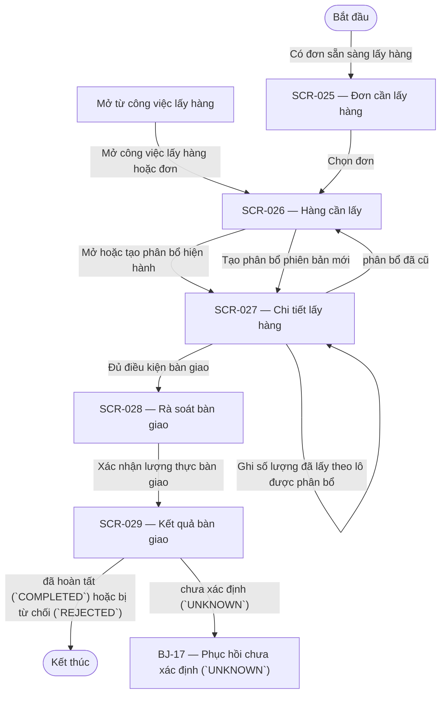

# UIF-05 — Lấy hàng và bàn giao đơn

## 1. Mục đích và phạm vi

Mô tả cách nhân viên kho nhận công việc lấy hàng, ghi nhận số lượng đã lấy và xác nhận bàn giao để hệ thống ghi xuất kho.

- **Hành trình nghiệp vụ:** [BJ-05 — Lấy hàng và bàn giao đơn](../../02.specification/behavior/journeys/BJ-05-lay-hang-va-ban-giao-on.md)
- **Trường hợp sử dụng liên quan:**
  - [UC-05-01 — Lập phân bổ lấy hàng](../../02.specification/behavior/use-cases/UC-05-01-lap-allocation.md)
  - [UC-05-02 — Xác nhận hàng đã lấy](../../02.specification/behavior/use-cases/UC-05-02-xac-nhan-hang-da-lay.md)
  - [UC-05-03 — Bàn giao hàng](../../02.specification/behavior/use-cases/UC-05-03-ban-giao-hang.md)
  - [UC-05-04 — Phục hồi khi phân bổ lấy hàng đã cũ](../../02.specification/behavior/use-cases/UC-05-04-phuc-hoi-allocation-stale.md)
  - [UC-05-05 — Ghi xuất kho nguyên tử](../../02.specification/behavior/use-cases/UC-05-05-ghi-xuat-kho-nguyen-tu.md)

**Ranh giới:** UIF chỉ mô tả cách người dùng đi qua các màn hình, điều kiện chuyển bước và cách xử lý khi không thể tiếp tục. Quy tắc nghiệp vụ vẫn lấy từ BJ/UC/Behavioral Contract; nội dung và thành phần của từng màn hình vẫn lấy từ Screen Contract.

## 2. Người dùng bắt đầu và kết thúc ở đâu

| Cách vào luồng | Màn hình | Người thực hiện | Đi từ đâu |
|---|---|---|---|
| Vào từ chức năng | `SCR-025` | Nhân viên lấy hàng | Kho > Lấy hàng |
| Mở từ ngữ cảnh liên quan | `SCR-026` | Nhân viên lấy hàng | Công việc lấy hàng hoặc đơn được giao |

Luồng kết thúc khi người dùng đã nhận được kết quả cuối cùng hoặc công việc được chuyển rõ sang một hành trình khác. Trạng thái `UNKNOWN` không được coi là thành công; phải tiếp tục xác minh với đúng thao tác gốc.

## 3. Luồng màn hình

> Sơ đồ trên để đọc nhanh. Phần “Các bước chuyển màn hình” giải thích điều kiện và cách xử lý; phần “Truy vết kỹ thuật” giữ các mã phục vụ Dev/QA/Harness.

## 4. Các bước chuyển màn hình

| Bước | Từ đâu | Người dùng / hệ thống làm gì | Điều kiện cần | Đi đến | Nếu không thể tiếp tục |
|---|---|---|---|---|---|
| `UIF-05-T01` | Bắt đầu | Có đơn sẵn sàng lấy hàng | Có quyền lấy hàng | `SCR-025` — Đơn cần lấy hàng | — |
| `UIF-05-T02` | Mở từ công việc lấy hàng | Mở công việc lấy hàng hoặc đơn | Công việc được giao đúng người và đúng phạm vi | `SCR-026` — Hàng cần lấy | — |
| `UIF-05-T03` | `SCR-025` — Đơn cần lấy hàng | Chọn đơn | Đơn vẫn đủ điều kiện lấy hàng | `SCR-026` — Hàng cần lấy | Dữ liệu đã thay đổi → làm mới |
| `UIF-05-T04` | `SCR-026` — Hàng cần lấy | Mở hoặc tạo phân bổ hiện hành | Phiên bản phân bổ còn hợp lệ | `SCR-027` — Chi tiết lấy hàng | Không đủ hàng có thể lấy → hiển thị phần còn thiếu |
| `UIF-05-T05` | `SCR-027` — Chi tiết lấy hàng | Ghi số lượng đã lấy theo lô được phân bổ | Không vượt số lượng đã phân bổ | `SCR-027` — Chi tiết lấy hàng | Giữ dữ liệu đang nhập; chưa giảm tồn vật lý |
| `UIF-05-T06` | `SCR-027` — Chi tiết lấy hàng | phân bổ đã cũ | Nguồn dữ liệu hoặc phiên bản phân bổ đã thay đổi | `SCR-026` — Hàng cần lấy | Không ghi đè lên phân bổ cũ |
| `UIF-05-T07` | `SCR-026` — Hàng cần lấy | Tạo phân bổ phiên bản mới | Nguồn dữ liệu vẫn hợp lệ | `SCR-027` — Chi tiết lấy hàng | — |
| `UIF-05-T08` | `SCR-027` — Chi tiết lấy hàng | Đủ điều kiện bàn giao | Số lượng đã lấy hợp lệ | `SCR-028` — Rà soát bàn giao | Không đủ và chính sách không cho một phần → kết thúc |
| `UIF-05-T09` | `SCR-028` — Rà soát bàn giao | Xác nhận lượng thực bàn giao | Có quyền bàn giao | `SCR-029` — Kết quả bàn giao | Hệ thống ghi xuất kho và trừ phần giữ hàng tương ứng; nếu kết quả chưa xác định (`UNKNOWN`), chuyển sang BJ-17 |
| `UIF-05-T10` | `SCR-029` — Kết quả bàn giao | đã hoàn tất (`COMPLETED`) hoặc bị từ chối (`REJECTED`) | — | Kết thúc | — |
| `UIF-05-T11` | `SCR-029` — Kết quả bàn giao | chưa xác định (`UNKNOWN`) | Giữ mã thao tác gốc | BJ-17 — hành trình liên quan | — |

## 5. Các tình huống cần chú ý

Các quy tắc chung về quyền, quay lại, dữ liệu thay đổi và chống ghi nhận lặp vẫn lấy từ UC/Behavioral Contract/Screen Contract. UIF chỉ nhắc lại những điểm ảnh hưởng trực tiếp đến cách đi qua màn hình.

- Nếu kết quả chưa xác định (`UNKNOWN`), không thực hiện lại bằng một thao tác mới. Hệ thống giữ nguyên mã thao tác gốc để xác minh; khi chưa đủ bằng chứng, chuyển sang `BJ-17`.
- Nếu dữ liệu nguồn đã thay đổi, phải nạp lại dữ liệu hiện hành và rà soát lại trước khi tiếp tục. Phần người dùng đã nhập chỉ được giữ lại khi còn an toàn.

## 6. Màn hình và Trường hợp sử dụng liên quan

| Trường hợp sử dụng | Màn hình sử dụng |
|---|---|
| [UC-05-01](../../02.specification/behavior/use-cases/UC-05-01-lap-allocation.md) — Lập phân bổ lấy hàng | `SCR-025`, `SCR-026` |
| [UC-05-02](../../02.specification/behavior/use-cases/UC-05-02-xac-nhan-hang-da-lay.md) — Xác nhận hàng đã lấy | `SCR-027` |
| [UC-05-03](../../02.specification/behavior/use-cases/UC-05-03-ban-giao-hang.md) — Bàn giao hàng | `SCR-028`, `SCR-029` |
| [UC-05-04](../../02.specification/behavior/use-cases/UC-05-04-phuc-hoi-allocation-stale.md) — Phục hồi khi phân bổ lấy hàng đã cũ | `SCR-026`, `SCR-027` |
| [UC-05-05](../../02.specification/behavior/use-cases/UC-05-05-ghi-xuat-kho-nguyen-tu.md) — Ghi xuất kho nguyên tử | `SCR-028`, `SCR-029` |

### Màn hình dùng trong luồng

| Màn hình | Tên | Vai trò trong luồng |
|---|---|---|
| [SCR-025](../screens/SCR-025.md) | Đơn cần lấy hàng | Màn hình chính trong luồng |
| [SCR-026](../screens/SCR-026.md) | Hàng cần lấy | Màn hình chính trong luồng |
| [SCR-027](../screens/SCR-027.md) | Chi tiết lấy hàng | Màn hình chính trong luồng |
| [SCR-028](../screens/SCR-028.md) | Rà soát bàn giao | Màn hình chính trong luồng |
| [SCR-029](../screens/SCR-029.md) | Kết quả bàn giao | Màn hình chính trong luồng |

## 7. Truy vết kỹ thuật

> Phần này dành cho Dev/QA/Harness. Các mã kỹ thuật được giữ nguyên để Dev/QA/Harness đối chiếu tự động.

| Transition | From | To | Loại | Action | UC / BC |
|---|---|---|---|---|---|
| `UIF-05-T01` | `BEGIN` | `SCR-025` | `NAVIGATION` | `—` | UC-05-01 |
| `UIF-05-T02` | `CONTEXT_PICK` | `SCR-026` | `NAVIGATION` | `—` | UC-05-01 |
| `UIF-05-T03` | `SCR-025` | `SCR-026` | `NAVIGATION` | `—` | UC-05-01 |
| `UIF-05-T04` | `SCR-026` | `SCR-027` | `NAVIGATION` | `—` | UC-05-01 |
| `UIF-05-T05` | `SCR-027` | `SCR-027` | `MUTATION` | `ACT-06-SAVE-PICK` | UC-05-02 / BC-IO-15 |
| `UIF-05-T06` | `SCR-027` | `SCR-026` | `SYSTEM` | `—` | UC-05-04 |
| `UIF-05-T07` | `SCR-026` | `SCR-027` | `NAVIGATION` | `—` | UC-05-04 |
| `UIF-05-T08` | `SCR-027` | `SCR-028` | `NAVIGATION` | `—` | UC-05-03 |
| `UIF-05-T09` | `SCR-028` | `SCR-029` | `MUTATION` | `ACT-06-HANDOVER` | UC-05-03, UC-05-05 / BC-IO-05 |
| `UIF-05-T10` | `SCR-029` | `END` | `TERMINAL` | `—` | UC-05-05 |
| `UIF-05-T11` | `SCR-029` | `BJ-17` | `HANDOFF` | `—` | UC-05-05 → BJ-17 |

## 8. Kiểm tra tính đầy đủ và liên kết

- [x] Tất cả Trường hợp sử dụng liên quan đều được liên kết từ UIF.
- [x] Mỗi màn hình đang dùng trong luồng có Screen Contract tương ứng.
- [x] Các bước do hệ thống thực hiện không bị mô tả thành thao tác của người dùng.
- [x] Nếu có phê duyệt hoặc chuyển vai trò, người gửi và người nhận có điểm vào riêng.
- [x] Trạng thái kết thúc và trường hợp `UNKNOWN` có hướng xử lý rõ khi áp dụng.
- [x] Bảng đọc chính và bảng truy vết kỹ thuật dùng cùng một tập transition ID; không đổi topology hoặc hành vi.
- [x] Liên kết BJ ↔ UIF ↔ UC/SCR dùng đường dẫn tương đối và mở đúng tài liệu đích.

**Trạng thái đối chiếu thiết kế:** `ALIGNED_TO_CURRENT_SCREEN_CONTRACTS` — UIF đã được viết lại theo Plain BA Language; cấu trúc luồng, ID, mã Action, liên kết UC/BC và trạng thái đối chiếu của v4.1.0 được giữ nguyên. HTML và Screen Contract không thay đổi trong lượt này.

### Liên kết

- [Business Journey](../../02.specification/behavior/journeys/BJ-05-lay-hang-va-ban-giao-on.md)
- [Business Journey Map](../../02.specification/behavior/journeys/00-business-journey-map.md)
- [Use Case Map](../../02.specification/behavior/use-cases/00-use-case-map.md)
- [Prototype manifest](../prototype/README.md)
