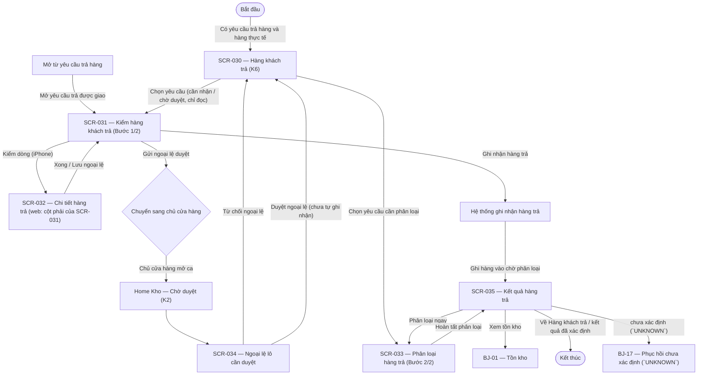

# UIF-06 — Tiếp nhận và phân loại hàng khách trả

## 1. Mục đích và phạm vi

Mô tả cách kho tiếp nhận hàng khách trả, xử lý ngoại lệ về truy vết hoặc lô, ghi nhận hàng thực nhận và phân loại trạng thái sử dụng tiếp.

- **Hành trình nghiệp vụ:** [BJ-06 — Tiếp nhận và phân loại hàng khách trả](../../02.specification/behavior/journeys/BJ-06-tiep-nhan-va-phan-loai-hang-khach-tra.md)
- **Trường hợp sử dụng liên quan:**
  - [UC-06-01 — Xác minh hàng được phép nhận trả](../../02.specification/behavior/use-cases/UC-06-01-xac-minh-hang-duoc-phep-nhan-tra.md)
  - [UC-06-02 — Xử lý ngoại lệ truy vết](../../02.specification/behavior/use-cases/UC-06-02-xu-ly-ngoai-le-truy-vet.md)
  - [UC-06-03 — Ghi nhận hàng khách trả](../../02.specification/behavior/use-cases/UC-06-03-ghi-nhan-hang-khach-tra.md)
  - [UC-06-04 — Phân loại hàng thực nhận](../../02.specification/behavior/use-cases/UC-06-04-phan-loai-hang-thuc-nhan.md)

**Ranh giới:** UIF chỉ mô tả cách người dùng đi qua các màn hình, điều kiện chuyển bước và cách xử lý khi không thể tiếp tục. Quy tắc nghiệp vụ vẫn lấy từ BJ/UC/Behavioral Contract; nội dung và thành phần của từng màn hình vẫn lấy từ Screen Contract.

## 2. Người dùng bắt đầu và kết thúc ở đâu

| Cách vào luồng | Màn hình | Người thực hiện | Đi từ đâu |
|---|---|---|---|
| Vào từ chức năng | `SCR-030` | Thủ kho nhận trả | Home Kho → Quản lý kho → Nhập, xuất & hoàn trả → Hàng khách trả |
| Mở từ ngữ cảnh liên quan | `SCR-031` | Thủ kho nhận trả | Yêu cầu trả hàng được giao |
| Duyệt ngoại lệ lô | `SCR-034` | Chủ cửa hàng (người duyệt) | **Home Kho → "Cần chú ý · Chờ duyệt" → dòng "{sản phẩm} · Lô {lô}"** (K2). Danh sách riêng chỉ còn cho `entry=approver` ở chế độ xem theo BJ |

Luồng kết thúc khi người dùng đã nhận được kết quả cuối cùng hoặc công việc được chuyển rõ sang một hành trình khác. Trạng thái `UNKNOWN` không được coi là thành công; phải tiếp tục xác minh với đúng thao tác gốc.

## 3. Luồng màn hình

> Sơ đồ trên để đọc nhanh. Phần "Các bước chuyển màn hình" giải thích điều kiện và cách xử lý; phần "Truy vết kỹ thuật" giữ các mã phục vụ Dev/QA/Harness. Hàng cách ly / hỏng sau phân loại chờ xử lý ở "Hàng cần xử lý" (BJ-09, nối ở chặng 4).

## 4. Các bước chuyển màn hình

| Bước | Từ đâu | Người dùng / hệ thống làm gì | Điều kiện cần | Đi đến | Nếu không thể tiếp tục |
|---|---|---|---|---|---|
| `UIF-06-T01` | Bắt đầu | Có yêu cầu trả hàng và hàng thực tế | Có quyền nhận trả | `SCR-030` — Hàng khách trả | — |
| `UIF-06-T02` | Mở từ yêu cầu trả hàng | Mở yêu cầu trả được giao | Nguồn dữ liệu return hợp lệ | `SCR-031` — Kiểm hàng khách trả | — |
| `UIF-06-T03` | `SCR-030` | Chọn yêu cầu trả | Còn trong trần được nhận; dòng "Chờ duyệt lô" mở chỉ đọc | `SCR-031` (hoặc `SCR-033` khi "Cần phân loại") | Nguồn hoặc giới hạn nhận trả không hợp lệ → kết thúc |
| `UIF-06-T04` | `SCR-031` | Kiểm một dòng (có ngoại lệ lô: chọn "Lô khác", lý do, ảnh nhãn lô) | Dòng chưa khoá | `SCR-032` (iPhone) / cột phải (web) | — |
| `UIF-06-T05` | `SCR-032` / `SCR-031` | "Gửi ngoại lệ duyệt" | Mọi dòng hợp lệ, có dòng sai lô đủ bằng chứng | Chuyển sang chủ cửa hàng | Người lập quay lại chờ (yêu cầu "Chờ duyệt lô") |
| `UIF-06-T06` | Chuyển sang chủ cửa hàng | Chủ cửa hàng mở ca từ Home "Chờ duyệt" | Người duyệt là `is_owner` / `store_owner`; chủ lập cũng gửi rồi tự duyệt (K2); vai khác → "Không thể tự duyệt" | `SCR-034` | — |
| `UIF-06-T07` | `SCR-034` | Từ chối ngoại lệ | Có lý do | Về danh sách "Chờ duyệt"; thủ kho sửa dòng bị từ chối | Không nhận vật lý |
| `UIF-06-T08` | `SCR-034` | Duyệt ngoại lệ | Người duyệt hợp lệ | Về danh sách "Chờ duyệt"; thủ kho vào lại `SCR-031` và bấm ghi nhận | Duyệt chưa tự ghi quantity |
| `UIF-06-T09` | `SCR-031` | Hàng đủ điều kiện (đúng lô hoặc ngoại lệ đã duyệt) | Hệ thống xác minh lại nguồn dữ liệu và giới hạn cho phép | Hệ thống ghi nhận hàng trả | — |
| `UIF-06-T10` | Hệ thống ghi nhận hàng trả | Ghi hàng vào chờ phân loại (`RETURN_PENDING`), cả yêu cầu cùng lúc hoặc không gì | Hệ thống kiểm tra lại | `SCR-035` — Kết quả hàng trả | chưa xác định (`UNKNOWN`) → BJ-17 |
| `UIF-06-T11` | `SCR-035` | "Phân loại ngay" | Có quantity chờ phân loại (`RETURN_PENDING`) | `SCR-033` — Phân loại hàng trả | — |
| `UIF-06-T12` | `SCR-033` | "Hoàn tất phân loại" | Mọi dòng hợp lệ; lô hết hạn tự "Hết hạn" | `SCR-035` | Không ghi lại số lượng hoặc giá trị lần hai |
| `UIF-06-T13` | `SCR-035` | Kết quả đã xác định ("Xem tồn kho" / "Về Hàng khách trả") | — | BJ-01 / `SCR-030` / Kết thúc | Nếu kết quả ghi nhận vẫn chưa xác định (`UNKNOWN`), chuyển sang BJ-17 |

## 5. Các tình huống cần chú ý

Các quy tắc chung về quyền, quay lại, dữ liệu thay đổi và chống ghi nhận lặp vẫn lấy từ UC/Behavioral Contract/Screen Contract. UIF chỉ nhắc lại những điểm ảnh hưởng trực tiếp đến cách đi qua màn hình.

- Khi công việc chuyển sang người duyệt hoặc một vai trò khác, phiên làm việc của người hiện tại kết thúc tại trạng thái chờ. Người tiếp theo mở công việc từ danh sách được giao; hệ thống không tự chuyển sang phiên của họ.
- Nếu kết quả chưa xác định (`UNKNOWN`), không thực hiện lại bằng một thao tác mới. Hệ thống giữ nguyên mã thao tác gốc để xác minh; khi chưa đủ bằng chứng, chuyển sang `BJ-17`.

## 6. Màn hình và Trường hợp sử dụng liên quan

| Trường hợp sử dụng | Màn hình sử dụng |
|---|---|
| [UC-06-01](../../02.specification/behavior/use-cases/UC-06-01-xac-minh-hang-duoc-phep-nhan-tra.md) — Xác minh hàng được phép nhận trả | `SCR-030`, `SCR-031` |
| [UC-06-02](../../02.specification/behavior/use-cases/UC-06-02-xu-ly-ngoai-le-truy-vet.md) — Xử lý ngoại lệ truy vết | `SCR-031`, `SCR-032`, `SCR-034` |
| [UC-06-03](../../02.specification/behavior/use-cases/UC-06-03-ghi-nhan-hang-khach-tra.md) — Ghi nhận hàng khách trả | `SCR-031`, `SCR-032`, `SCR-035` |
| [UC-06-04](../../02.specification/behavior/use-cases/UC-06-04-phan-loai-hang-thuc-nhan.md) — Phân loại hàng thực nhận | `SCR-033`, `SCR-035` |

### Màn hình dùng trong luồng

| Màn hình | Tên | Vai trò trong luồng |
|---|---|---|
| [SCR-030](../screens/SCR-030.md) | Hàng khách trả | Danh sách yêu cầu (K6) |
| [SCR-031](../screens/SCR-031.md) | Kiểm hàng khách trả | Bước 1/2 — nhận hàng |
| [SCR-032](../screens/SCR-032.md) | Chi tiết hàng trả | Chi tiết một dòng (web: cột phải SCR-031) |
| [SCR-034](../screens/SCR-034.md) | Ngoại lệ lô cần duyệt | Chủ cửa hàng duyệt (K2) |
| [SCR-035](../screens/SCR-035.md) | Kết quả hàng trả | Kết quả (K4 / K3) |
| [SCR-033](../screens/SCR-033.md) | Phân loại hàng trả | Bước 2/2 — phân loại |

## 7. Truy vết kỹ thuật

> Phần này dành cho Dev/QA/Harness. Các mã kỹ thuật được giữ nguyên để Dev/QA/Harness đối chiếu tự động.

| Transition | From | To | Loại | Action | UC / BC |
|---|---|---|---|---|---|
| `UIF-06-T01` | `BEGIN` | `SCR-030` | `NAVIGATION` | `—` | UC-06-01 |
| `UIF-06-T02` | `CONTEXT_RETURN` | `SCR-031` | `NAVIGATION` | `—` | UC-06-01 |
| `UIF-06-T03` | `SCR-030` | `SCR-031` | `NAVIGATION` | `—` | UC-06-01 |
| `UIF-06-T04` | `SCR-031` | `SCR-032` | `NAVIGATION` | `—` | UC-06-02 |
| `UIF-06-T05` | `SCR-032` | `HANDOFF_APPROVAL` | `HANDOFF` | `ACT-07-SUBMIT-LOT-EXCEPTIONS` | UC-06-02 / BC-IC-07 |
| `UIF-06-T06` | `HANDOFF_APPROVAL` | `SCR-034` | `HANDOFF` | `—` (Home "Chờ duyệt", K2) | UC-06-02 / BC-IC-06 |
| `UIF-06-T07` | `SCR-034` | `SCR-030` | `MUTATION` | `ACT-07-DECIDE-LOT-EXCEPTION` | UC-06-02 / BC-IC-06 |
| `UIF-06-T08` | `SCR-034` | `SCR-030` | `MUTATION` | `ACT-07-DECIDE-LOT-EXCEPTION` | UC-06-02 / BC-IC-06 |
| `UIF-06-T09` | `SCR-031` | `SYSTEM_RECEIVE` | `SYSTEM` | `—` | UC-06-01 |
| `UIF-06-T10` | `SYSTEM_RECEIVE` | `SCR-035` | `SYSTEM` | `ACT-07-RECEIVE-RETURN` | UC-06-03 / BC-IO-07 |
| `UIF-06-T11` | `SCR-035` | `SCR-033` | `NAVIGATION` | `—` | UC-06-04 |
| `UIF-06-T12` | `SCR-033` | `SCR-035` | `MUTATION` | `ACT-07-CLASSIFY` | UC-06-04 / BC-IO-08 |
| `UIF-06-T13` | `SCR-035` | `END` | `TERMINAL` | `—` | UC-06-03, UC-06-04 |

## 8. Kiểm tra tính đầy đủ và liên kết

- [x] Tất cả Trường hợp sử dụng liên quan đều được liên kết từ UIF.
- [x] Mỗi màn hình đang dùng trong luồng có Screen Contract tương ứng.
- [x] Các bước do hệ thống thực hiện không bị mô tả thành thao tác của người dùng.
- [x] Nếu có phê duyệt hoặc chuyển vai trò, người gửi và người nhận có điểm vào riêng.
- [x] Trạng thái kết thúc và trường hợp `UNKNOWN` có hướng xử lý rõ khi áp dụng.
- [x] Bảng đọc chính và bảng truy vết kỹ thuật dùng cùng một tập transition ID; không đổi topology hoặc hành vi.
- [x] Liên kết BJ ↔ UIF ↔ UC/SCR dùng đường dẫn tương đối và mở đúng tài liệu đích.

**Trạng thái đối chiếu thiết kế:** `REDESIGNED_v5.12.0` — luồng thiết kế lại trên prototype HTML (T7-P BJ-06): hai mốc "Bước 1/2 · Nhận hàng" / "Bước 2/2 · Phân loại", web SCR-031 + SCR-032 một trang hai cột, duyệt ngoại lệ lô đi qua Home "Chờ duyệt" (K2). ID, mã Action, liên kết UC/BC giữ nguyên; T07 / T08 kết thúc ở `SCR-030` (thủ kho vào lại ghi nhận), không còn `END` / `SYSTEM_RECEIVE`.

### Liên kết

- [Business Journey](../../02.specification/behavior/journeys/BJ-06-tiep-nhan-va-phan-loai-hang-khach-tra.md)
- [Business Journey Map](../../02.specification/behavior/journeys/00-business-journey-map.md)
- [Use Case Map](../../02.specification/behavior/use-cases/00-use-case-map.md)
- [Prototype manifest](../prototype/README.md)
