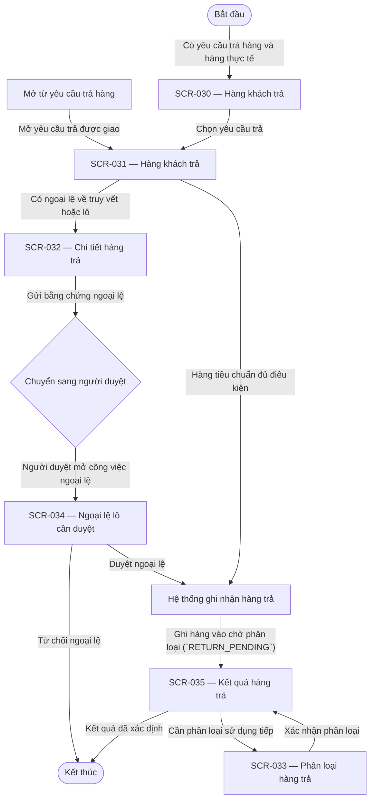

# UIF-06 — Tiếp nhận và phân loại hàng khách trả

## 1. Mục đích và phạm vi

Mô tả cách kho tiếp nhận hàng khách trả, xử lý ngoại lệ về truy vết hoặc lô, ghi nhận hàng thực nhận và phân loại trạng thái sử dụng tiếp.

- **Hành trình nghiệp vụ:** [BJ-06 — Tiếp nhận và phân loại hàng khách trả](../../02.specification/behavior/journeys/BJ-06-tiep-nhan-va-phan-loai-hang-khach-tra.md)
- **Trường hợp sử dụng liên quan:**
  - [UC-06-01 — Xác minh hàng được phép nhận trả](../../02.specification/behavior/use-cases/UC-06-01-xac-minh-hang-duoc-phep-nhan-tra.md)
  - [UC-06-02 — Xử lý ngoại lệ truy vết](../../02.specification/behavior/use-cases/UC-06-02-xu-ly-ngoai-le-truy-vet.md)
  - [UC-06-03 — Ghi nhận hàng khách trả](../../02.specification/behavior/use-cases/UC-06-03-ghi-nhan-hang-khach-tra.md)
  - [UC-06-04 — Phân loại hàng thực nhận](../../02.specification/behavior/use-cases/UC-06-04-phan-loai-hang-thuc-nhan.md)

**Ranh giới:** UIF chỉ mô tả cách người dùng đi qua các màn hình, điều kiện chuyển bước và cách xử lý khi không thể tiếp tục. Quy tắc nghiệp vụ vẫn lấy từ BJ/UC/Behavioral Contract; nội dung và thành phần của từng màn hình vẫn lấy từ Screen Contract.

## 2. Người dùng bắt đầu và kết thúc ở đâu

| Cách vào luồng | Màn hình | Người thực hiện | Đi từ đâu |
|---|---|---|---|
| Vào từ chức năng | `SCR-030` | Thủ kho nhận trả | Kho > Hàng khách trả |
| Mở từ ngữ cảnh liên quan | `SCR-031` | Thủ kho nhận trả | Yêu cầu trả hàng được giao |
| Công việc được giao | `SCR-034` | Người duyệt ngoại lệ lô | Công việc duyệt ngoại lệ được giao |

Luồng kết thúc khi người dùng đã nhận được kết quả cuối cùng hoặc công việc được chuyển rõ sang một hành trình khác. Trạng thái `UNKNOWN` không được coi là thành công; phải tiếp tục xác minh với đúng thao tác gốc.

## 3. Luồng màn hình

> Sơ đồ trên để đọc nhanh. Phần “Các bước chuyển màn hình” giải thích điều kiện và cách xử lý; phần “Truy vết kỹ thuật” giữ các mã phục vụ Dev/QA/Harness.

## 4. Các bước chuyển màn hình

| Bước | Từ đâu | Người dùng / hệ thống làm gì | Điều kiện cần | Đi đến | Nếu không thể tiếp tục |
|---|---|---|---|---|---|
| `UIF-06-T01` | Bắt đầu | Có yêu cầu trả hàng và hàng thực tế | Có quyền nhận trả | `SCR-030` — Hàng khách trả | — |
| `UIF-06-T02` | Mở từ yêu cầu trả hàng | Mở yêu cầu trả được giao | Nguồn dữ liệu return hợp lệ | `SCR-031` — Hàng khách trả | — |
| `UIF-06-T03` | `SCR-030` — Hàng khách trả | Chọn yêu cầu trả | Còn trong trần được nhận | `SCR-031` — Hàng khách trả | Nguồn hoặc giới hạn nhận trả không hợp lệ → kết thúc |
| `UIF-06-T04` | `SCR-031` — Hàng khách trả | Có ngoại lệ về truy vết hoặc lô | Cho phép lập ngoại lệ | `SCR-032` — Chi tiết hàng trả | — |
| `UIF-06-T05` | `SCR-032` — Chi tiết hàng trả | Gửi bằng chứng ngoại lệ | Người lập có quyền gửi | Chuyển sang người duyệt | Người lập công việc kết thúc |
| `UIF-06-T06` | Chuyển sang người duyệt | Người duyệt mở công việc ngoại lệ | Người duyệt hợp lệ, không self-approve | `SCR-034` — Ngoại lệ lô cần duyệt | — |
| `UIF-06-T07` | `SCR-034` — Ngoại lệ lô cần duyệt | Từ chối ngoại lệ | Người duyệt hợp lệ | Kết thúc | Không nhận vật lý |
| `UIF-06-T08` | `SCR-034` — Ngoại lệ lô cần duyệt | Duyệt ngoại lệ | Người duyệt hợp lệ | Hệ thống ghi nhận hàng trả | Phê duyệt chưa tự ghi quantity |
| `UIF-06-T09` | `SCR-031` — Hàng khách trả | Hàng tiêu chuẩn đủ điều kiện | Hệ thống xác minh lại nguồn dữ liệu và giới hạn cho phép | Hệ thống ghi nhận hàng trả | — |
| `UIF-06-T10` | Hệ thống ghi nhận hàng trả | Ghi hàng vào chờ phân loại (`RETURN_PENDING`) | Hệ thống kiểm tra lại | `SCR-035` — Kết quả hàng trả | chưa xác định (`UNKNOWN`) → BJ-17 |
| `UIF-06-T11` | `SCR-035` — Kết quả hàng trả | Cần phân loại sử dụng tiếp | Có quantity chờ phân loại (`RETURN_PENDING`) | `SCR-033` — Phân loại hàng trả | — |
| `UIF-06-T12` | `SCR-033` — Phân loại hàng trả | Xác nhận phân loại | Trạng thái phân loại đích hợp lệ | `SCR-035` — Kết quả hàng trả | Không ghi lại số lượng hoặc giá trị lần hai |
| `UIF-06-T13` | `SCR-035` — Kết quả hàng trả | Kết quả đã xác định | — | Kết thúc | Nếu kết quả ghi nhận vẫn chưa xác định (`UNKNOWN`), chuyển sang BJ-17 |

## 5. Các tình huống cần chú ý

Các quy tắc chung về quyền, quay lại, dữ liệu thay đổi và chống ghi nhận lặp vẫn lấy từ UC/Behavioral Contract/Screen Contract. UIF chỉ nhắc lại những điểm ảnh hưởng trực tiếp đến cách đi qua màn hình.

- Khi công việc chuyển sang người duyệt hoặc một vai trò khác, phiên làm việc của người hiện tại kết thúc tại trạng thái chờ. Người tiếp theo mở công việc từ danh sách được giao; hệ thống không tự chuyển sang phiên của họ.
- Nếu kết quả chưa xác định (`UNKNOWN`), không thực hiện lại bằng một thao tác mới. Hệ thống giữ nguyên mã thao tác gốc để xác minh; khi chưa đủ bằng chứng, chuyển sang `BJ-17`.

## 6. Màn hình và Trường hợp sử dụng liên quan

| Trường hợp sử dụng | Màn hình sử dụng |
|---|---|
| [UC-06-01](../../02.specification/behavior/use-cases/UC-06-01-xac-minh-hang-duoc-phep-nhan-tra.md) — Xác minh hàng được phép nhận trả | `SCR-030`, `SCR-031` |
| [UC-06-02](../../02.specification/behavior/use-cases/UC-06-02-xu-ly-ngoai-le-truy-vet.md) — Xử lý ngoại lệ truy vết | `SCR-031`, `SCR-032`, `SCR-034` |
| [UC-06-03](../../02.specification/behavior/use-cases/UC-06-03-ghi-nhan-hang-khach-tra.md) — Ghi nhận hàng khách trả | `SCR-031`, `SCR-032`, `SCR-035` |
| [UC-06-04](../../02.specification/behavior/use-cases/UC-06-04-phan-loai-hang-thuc-nhan.md) — Phân loại hàng thực nhận | `SCR-033`, `SCR-035` |

### Màn hình dùng trong luồng

| Màn hình | Tên | Vai trò trong luồng |
|---|---|---|
| [SCR-030](../screens/SCR-030.md) | Hàng khách trả | Màn hình chính trong luồng |
| [SCR-031](../screens/SCR-031.md) | Hàng khách trả | Màn hình chính trong luồng |
| [SCR-032](../screens/SCR-032.md) | Chi tiết hàng trả | Màn hình chính trong luồng |
| [SCR-034](../screens/SCR-034.md) | Ngoại lệ lô cần duyệt | Màn hình chính trong luồng |
| [SCR-035](../screens/SCR-035.md) | Kết quả hàng trả | Màn hình chính trong luồng |
| [SCR-033](../screens/SCR-033.md) | Phân loại hàng trả | Màn hình chính trong luồng |

## 7. Truy vết kỹ thuật

> Phần này dành cho Dev/QA/Harness. Các mã kỹ thuật được giữ nguyên để Dev/QA/Harness đối chiếu tự động.

| Transition | From | To | Loại | Action | UC / BC |
|---|---|---|---|---|---|
| `UIF-06-T01` | `BEGIN` | `SCR-030` | `NAVIGATION` | `—` | UC-06-01 |
| `UIF-06-T02` | `CONTEXT_RETURN` | `SCR-031` | `NAVIGATION` | `—` | UC-06-01 |
| `UIF-06-T03` | `SCR-030` | `SCR-031` | `NAVIGATION` | `—` | UC-06-01 |
| `UIF-06-T04` | `SCR-031` | `SCR-032` | `NAVIGATION` | `—` | UC-06-02 |
| `UIF-06-T05` | `SCR-032` | `HANDOFF_APPROVAL` | `HANDOFF` | `ACT-07-SUBMIT-LOT-EXCEPTIONS` | UC-06-02 / BC-IC-07 |
| `UIF-06-T06` | `HANDOFF_APPROVAL` | `SCR-034` | `HANDOFF` | `—` | UC-06-02 / BC-IC-06 |
| `UIF-06-T07` | `SCR-034` | `END` | `MUTATION` | `ACT-07-DECIDE-LOT-EXCEPTION` | UC-06-02 / BC-IC-06 |
| `UIF-06-T08` | `SCR-034` | `SYSTEM_RECEIVE` | `MUTATION` | `ACT-07-DECIDE-LOT-EXCEPTION` | UC-06-02 / BC-IC-06 |
| `UIF-06-T09` | `SCR-031` | `SYSTEM_RECEIVE` | `SYSTEM` | `—` | UC-06-01 |
| `UIF-06-T10` | `SYSTEM_RECEIVE` | `SCR-035` | `SYSTEM` | `ACT-07-RECEIVE-RETURN` | UC-06-03 / BC-IO-07 |
| `UIF-06-T11` | `SCR-035` | `SCR-033` | `NAVIGATION` | `—` | UC-06-04 |
| `UIF-06-T12` | `SCR-033` | `SCR-035` | `MUTATION` | `ACT-07-CLASSIFY` | UC-06-04 / BC-IO-08 |
| `UIF-06-T13` | `SCR-035` | `END` | `TERMINAL` | `—` | UC-06-03, UC-06-04 |

## 8. Kiểm tra tính đầy đủ và liên kết

- [x] Tất cả Trường hợp sử dụng liên quan đều được liên kết từ UIF.
- [x] Mỗi màn hình đang dùng trong luồng có Screen Contract tương ứng.
- [x] Các bước do hệ thống thực hiện không bị mô tả thành thao tác của người dùng.
- [x] Nếu có phê duyệt hoặc chuyển vai trò, người gửi và người nhận có điểm vào riêng.
- [x] Trạng thái kết thúc và trường hợp `UNKNOWN` có hướng xử lý rõ khi áp dụng.
- [x] Bảng đọc chính và bảng truy vết kỹ thuật dùng cùng một tập transition ID; không đổi topology hoặc hành vi.
- [x] Liên kết BJ ↔ UIF ↔ UC/SCR dùng đường dẫn tương đối và mở đúng tài liệu đích.

**Trạng thái đối chiếu thiết kế:** `ALIGNED_TO_CURRENT_SCREEN_CONTRACTS` — UIF đã được viết lại theo Plain BA Language; cấu trúc luồng, ID, mã Action, liên kết UC/BC và trạng thái đối chiếu của v4.1.0 được giữ nguyên. HTML và Screen Contract không thay đổi trong lượt này.

### Liên kết

- [Business Journey](../../02.specification/behavior/journeys/BJ-06-tiep-nhan-va-phan-loai-hang-khach-tra.md)
- [Business Journey Map](../../02.specification/behavior/journeys/00-business-journey-map.md)
- [Use Case Map](../../02.specification/behavior/use-cases/00-use-case-map.md)
- [Prototype manifest](../prototype/README.md)
