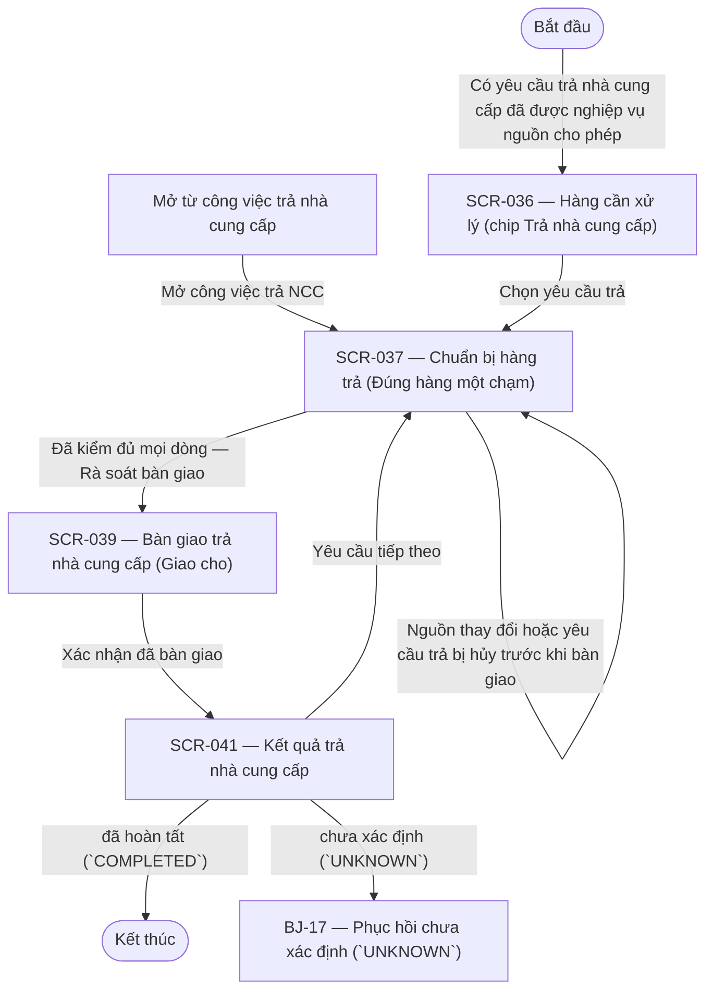

# UIF-07 — Thực hiện trả hàng cho nhà cung cấp

## 1. Mục đích và phạm vi

Mô tả cách kho chuẩn bị và thực hiện trả hàng cho nhà cung cấp, từ yêu cầu trả do Mua hàng chuyển sang đến bàn giao và ghi nhận kết quả. `SCR-036` là danh sách chung "Hàng cần xử lý" (khuôn K5, chung với BJ-09 / BJ-10): yêu cầu trả hiện ở chip "Trả nhà cung cấp". Kho **kiểm hàng đúng như yêu cầu** (một chạm "Đúng hàng" trên từng dòng); không quyết trả hay không, không sửa yêu cầu.

- **Hành trình nghiệp vụ:** [BJ-07 — Thực hiện trả hàng cho nhà cung cấp](../../02.specification/behavior/journeys/BJ-07-thuc-hien-tra-hang-cho-nha-cung-cap.md)
- **Trường hợp sử dụng liên quan:**
  - [UC-07-01 — Xác minh phạm vi trả](../../02.specification/behavior/use-cases/UC-07-01-xac-minh-pham-vi-tra.md)
  - [UC-07-02 — Đồng bộ hàng vào chờ trả](../../02.specification/behavior/use-cases/UC-07-02-dua-hang-vao-cho-tra.md)
  - [UC-07-03 — Điều chỉnh hoặc hủy trước bàn giao](../../02.specification/behavior/use-cases/UC-07-03-dieu-chinh-hoac-huy-truoc-ban-giao.md)
  - [UC-07-04 — Ghi nhận bàn giao trả nhà cung cấp](../../02.specification/behavior/use-cases/UC-07-04-ghi-nhan-ban-giao-tra-nha-cung-cap.md)

**Ranh giới:** UIF chỉ mô tả cách người dùng đi qua các màn hình, điều kiện chuyển bước và cách xử lý khi không thể tiếp tục. Quy tắc nghiệp vụ vẫn lấy từ BJ/UC/Behavioral Contract; nội dung và thành phần của từng màn hình vẫn lấy từ Screen Contract.

## 2. Người dùng bắt đầu và kết thúc ở đâu

| Cách vào luồng | Màn hình | Người thực hiện | Đi từ đâu |
|---|---|---|---|
| Vào từ chức năng | `SCR-036` (danh sách chung, chip "Trả nhà cung cấp") | Thủ kho | Home Kho → Quản lý kho → Nhập, xuất & hoàn trả → Trả nhà cung cấp |
| Mở từ danh sách | `SCR-037` | Thủ kho | Chạm một dòng yêu cầu trả ở `SCR-036` (dòng "Đang chờ" bị tắt, chỉ xem) |
| Mở lại sau khi nguồn đổi | `SCR-037` | Thủ kho | Yêu cầu có banner "Yêu cầu đã cập nhật"; chỉ dòng bị ảnh hưởng cần kiểm lại |
| Việc kế tiếp | `SCR-037` | Thủ kho | `SCR-041` → "Yêu cầu tiếp theo" (khi còn yêu cầu khác) |

Luồng kết thúc khi người dùng đã nhận được kết quả cuối cùng hoặc công việc được chuyển rõ sang một hành trình khác. Trạng thái `UNKNOWN` không được coi là thành công; phải tiếp tục xác minh với đúng thao tác gốc.

## 3. Luồng màn hình

> Sơ đồ trên để đọc nhanh. Phần “Các bước chuyển màn hình” giải thích điều kiện và cách xử lý; phần “Truy vết kỹ thuật” giữ các mã phục vụ Dev/QA/Harness.

## 4. Các bước chuyển màn hình

| Bước | Từ đâu | Người dùng / hệ thống làm gì | Điều kiện cần | Đi đến | Nếu không thể tiếp tục |
|---|---|---|---|---|---|
| `UIF-07-T01` | Bắt đầu | Có yêu cầu trả nhà cung cấp đã được nghiệp vụ nguồn cho phép | Có quyền trả NCC | `SCR-036` — Hàng cần xử lý | Không có quyền → "Bạn chưa có quyền trả hàng nhà cung cấp" |
| `UIF-07-T02` | Mở từ công việc trả nhà cung cấp | Mở công việc trả NCC | Nguồn dữ liệu và phiên bản hợp lệ | `SCR-037` — Chuẩn bị hàng trả | — |
| `UIF-07-T03` | `SCR-036` — Hàng cần xử lý | Chọn yêu cầu trả | Yêu cầu không ở trạng thái "Đang chờ" / đang xác minh | `SCR-037` — Chuẩn bị hàng trả | Dòng bị tắt: chỉ xem |
| `UIF-07-T04` | `SCR-037` — Chuẩn bị hàng trả | "Đúng hàng" cho từng dòng (hoặc kiểm trong sheet: lô thực tế, chia phần hàng), rồi "Rà soát bàn giao" | Mọi dòng đã kiểm, không dòng nào "Không khớp" | `SCR-039` — Bàn giao trả nhà cung cấp | Nút tắt kèm lý do "Còn {n} dòng chưa kiểm" / "Có dòng không khớp · chờ Mua hàng cập nhật" |
| `UIF-07-T05` | `SCR-037` — Chuẩn bị hàng trả | Nguồn thay đổi hoặc yêu cầu trả bị hủy trước khi bàn giao | Nguồn dữ liệu mới chính thức | `SCR-037` — Chuẩn bị hàng trả | Giảm hoặc giải phóng phần hàng không còn trả; chỉ dòng bị ảnh hưởng phải kiểm lại; yêu cầu bị hủy → "Yêu cầu đã được hủy" |
| `UIF-07-T06` | `SCR-037` — Chuẩn bị hàng trả | "Không khớp" → ghi nhận chênh lệch thực tế | Có chênh lệch (số lượng, lô, không thấy hàng, khác) | `SCR-037` — Chuẩn bị hàng trả (chờ cập nhật, chỉ đọc) | Kho không tự sửa yêu cầu hay thay lô; Mua hàng cập nhật rồi yêu cầu quay lại "Cần kiểm lại" |
| `UIF-07-T07` | `SCR-039` — Bàn giao trả nhà cung cấp | Chọn "Giao cho" rồi "Xác nhận đã bàn giao" | Nguồn không đổi từ lúc rà soát; không vượt phạm vi được cho phép | `SCR-041` — Kết quả trả nhà cung cấp | Nguồn đổi → "Cần kiểm lại trước khi bàn giao"; chưa xác định (`UNKNOWN`) → BJ-17 |
| `UIF-07-T08` | `SCR-041` — Kết quả trả nhà cung cấp | Đã hoàn tất (`COMPLETED`) | — | Kết thúc | Tồn vật lý và giá trị chỉ giảm ở bước này |
| `UIF-07-T09` | `SCR-041` — Kết quả trả nhà cung cấp | Chưa xác định (`UNKNOWN`) | Giữ mã thao tác gốc | BJ-17 — hành trình liên quan | — |
| `UIF-07-T10` | `SCR-041` — Kết quả trả nhà cung cấp | "Yêu cầu tiếp theo" | Còn yêu cầu trả khác đang chờ Kho | `SCR-037` — Chuẩn bị hàng trả | Không còn → chỉ "Về hàng cần xử lý" |

## 5. Các tình huống cần chú ý

Các quy tắc chung về quyền, quay lại, dữ liệu thay đổi và chống ghi nhận lặp vẫn lấy từ UC/Behavioral Contract/Screen Contract. UIF chỉ nhắc lại những điểm ảnh hưởng trực tiếp đến cách đi qua màn hình.

- Nếu kết quả chưa xác định (`UNKNOWN`), không thực hiện lại bằng một thao tác mới. Hệ thống giữ nguyên mã thao tác gốc để xác minh; khi chưa đủ bằng chứng, chuyển sang `BJ-17`.
- Các màn hình đã hợp nhất hoặc chỉ dùng cho tương thích không được xem là một bước điều hướng độc lập của luồng hiện hành.

## 6. Màn hình và Trường hợp sử dụng liên quan

| Trường hợp sử dụng | Màn hình sử dụng |
|---|---|
| [UC-07-01](../../02.specification/behavior/use-cases/UC-07-01-xac-minh-pham-vi-tra.md) — Xác minh phạm vi trả | `SCR-036`, `SCR-037` |
| [UC-07-02](../../02.specification/behavior/use-cases/UC-07-02-dua-hang-vao-cho-tra.md) — Đồng bộ hàng vào chờ trả | `SCR-036`, `SCR-037` |
| [UC-07-03](../../02.specification/behavior/use-cases/UC-07-03-dieu-chinh-hoac-huy-truoc-ban-giao.md) — Điều chỉnh hoặc hủy trước bàn giao | `SCR-036`, `SCR-037` |
| [UC-07-04](../../02.specification/behavior/use-cases/UC-07-04-ghi-nhan-ban-giao-tra-nha-cung-cap.md) — Ghi nhận bàn giao trả nhà cung cấp | `SCR-039`, `SCR-041` |

### Màn hình dùng trong luồng

| Màn hình | Tên | Vai trò trong luồng |
|---|---|---|
| [SCR-036](../screens/SCR-036.md) | Hàng cần xử lý | Danh sách chung (chip Trả nhà cung cấp) |
| [SCR-037](../screens/SCR-037.md) | Chuẩn bị hàng trả | Kiểm hàng một chạm |
| [SCR-039](../screens/SCR-039.md) | Bàn giao trả nhà cung cấp | Màn hình chính trong luồng |
| [SCR-041](../screens/SCR-041.md) | Kết quả xử lý | Màn hình chính trong luồng |

### Màn hình liên quan nhưng không phải một bước riêng

- `SCR-038` — Chuyển trạng thái: giữ để truy vết/tương thích; không được tự suy thành bước điều hướng riêng của UIF-07.

## 7. Truy vết kỹ thuật

> Phần này dành cho Dev/QA/Harness. Các mã kỹ thuật được giữ nguyên để Dev/QA/Harness đối chiếu tự động.

| Transition | From | To | Loại | Action | UC / BC |
|---|---|---|---|---|---|
| `UIF-07-T01` | `BEGIN` | `SCR-036` | `NAVIGATION` | `—` | UC-07-01 |
| `UIF-07-T02` | `CONTEXT_RTV` | `SCR-037` | `NAVIGATION` | `—` | UC-07-01 |
| `UIF-07-T03` | `SCR-036` | `SCR-037` | `NAVIGATION` | `—` | UC-07-01 |
| `UIF-07-T04` | `SCR-037` | `SCR-039` | `NAVIGATION` | `—` | UC-07-01, UC-07-04 |
| `UIF-07-T05` | `SCR-037` | `SCR-037` | `SYSTEM` | `—` | UC-07-03 / BC-IO-17 |
| `UIF-07-T06` | `SCR-037` | `SCR-037` | `MUTATION` | `—` | UC-07-01, UC-07-03 (ghi chênh lệch, không tác động tồn) |
| `UIF-07-T07` | `SCR-039` | `SCR-041` | `MUTATION` | `ACT-08-RTV` | UC-07-04 / BC-IO-09 |
| `UIF-07-T08` | `SCR-041` | `END` | `TERMINAL` | `—` | UC-07-04 |
| `UIF-07-T09` | `SCR-041` | `BJ-17` | `HANDOFF` | `—` | UC-07-04 → BJ-17 |
| `UIF-07-T10` | `SCR-041` | `SCR-037` | `NAVIGATION` | `—` | UC-07-01 |

## 8. Kiểm tra tính đầy đủ và liên kết

- [x] Tất cả Trường hợp sử dụng liên quan đều được liên kết từ UIF.
- [x] Mỗi màn hình đang dùng trong luồng có Screen Contract tương ứng.
- [x] Các bước do hệ thống thực hiện không bị mô tả thành thao tác của người dùng.
- [x] Nếu có phê duyệt hoặc chuyển vai trò, người gửi và người nhận có điểm vào riêng.
- [x] Trạng thái kết thúc và trường hợp `UNKNOWN` có hướng xử lý rõ khi áp dụng.
- [x] Bảng đọc chính và bảng truy vết kỹ thuật dùng cùng một tập transition ID; không đổi topology hoặc hành vi.
- [x] Liên kết BJ ↔ UIF ↔ UC/SCR dùng đường dẫn tương đối và mở đúng tài liệu đích.

**Trạng thái đối chiếu thiết kế:** `REDESIGNED_v5.14.0` — luồng được thiết kế lại theo plan T7-P BJ-07 + BJ-10: danh sách chung "Hàng cần xử lý" (K5), kiểm hàng "Đúng hàng" một chạm, "Giao cho" ở bàn giao, kết quả K4 / K3 và "Yêu cầu tiếp theo". ID transition v4.2.0 giữ; `UIF-07-T04` đổi từ "hệ thống đưa hàng vào chờ trả" sang "Rà soát bàn giao" (việc đưa hàng vào chờ trả — UC-07-02 — do hệ thống làm khi nguồn tạo yêu cầu, thể hiện bằng dòng yêu cầu ở `SCR-036`), thêm `UIF-07-T06` (ghi chênh lệch) và `UIF-07-T10` (yêu cầu tiếp theo).

### Liên kết

- [Business Journey](../../02.specification/behavior/journeys/BJ-07-thuc-hien-tra-hang-cho-nha-cung-cap.md)
- [Business Journey Map](../../02.specification/behavior/journeys/00-business-journey-map.md)
- [Use Case Map](../../02.specification/behavior/use-cases/00-use-case-map.md)
- [Prototype manifest](../prototype/README.md)
