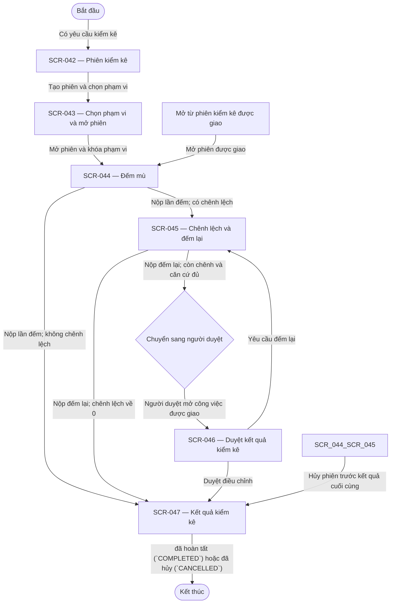

# UIF-08 — Kiểm kê và điều chỉnh chênh lệch

## 1. Mục đích và phạm vi

Mô tả cách mở phiên kiểm kê, đếm mù, xử lý chênh lệch và đếm lại, phê duyệt và ghi nhận điều chỉnh tồn kho.

- **Hành trình nghiệp vụ:** [BJ-08 — Kiểm kê và điều chỉnh chênh lệch](../../02.specification/behavior/journeys/BJ-08-kiem-ke-va-ieu-chinh-chenh-lech.md)
- **Trường hợp sử dụng liên quan:**
  - [UC-08-01 — Mở và khóa phạm vi](../../02.specification/behavior/use-cases/UC-08-01-mo-va-khoa-pham-vi.md)
  - [UC-08-02 — Ghi nhận lần đếm mù](../../02.specification/behavior/use-cases/UC-08-02-ghi-nhan-lan-dem-mu.md)
  - [UC-08-03 — Đếm lại và hoàn thiện căn cứ](../../02.specification/behavior/use-cases/UC-08-03-dem-lai-va-hoan-thien-bang-chung.md)
  - [UC-08-04 — Duyệt và điều chỉnh](../../02.specification/behavior/use-cases/UC-08-04-duyet-va-dieu-chinh.md)
  - [UC-08-05 — Hủy phiên kiểm kê](../../02.specification/behavior/use-cases/UC-08-05-huy-phien-kiem-ke.md)

**Ranh giới:** UIF chỉ mô tả cách người dùng đi qua các màn hình, điều kiện chuyển bước và cách xử lý khi không thể tiếp tục. Quy tắc nghiệp vụ vẫn lấy từ BJ/UC/Behavioral Contract; nội dung và thành phần của từng màn hình vẫn lấy từ Screen Contract.

## 2. Người dùng bắt đầu và kết thúc ở đâu

| Cách vào luồng | Màn hình | Người thực hiện | Đi từ đâu |
|---|---|---|---|
| Vào từ chức năng | `SCR-042` | Người lập kiểm kê | Kho > Kiểm kê |
| Mở từ ngữ cảnh liên quan | `SCR-044` | Người đếm được giao | Phiên kiểm kê được giao |
| Công việc được giao | `SCR-046` | Người duyệt độc lập | Công việc duyệt kiểm kê được giao |

Luồng kết thúc khi người dùng đã nhận được kết quả cuối cùng hoặc công việc được chuyển rõ sang một hành trình khác. Trạng thái `UNKNOWN` không được coi là thành công; phải tiếp tục xác minh với đúng thao tác gốc.

## 3. Luồng màn hình

> Sơ đồ trên để đọc nhanh. Phần “Các bước chuyển màn hình” giải thích điều kiện và cách xử lý; phần “Truy vết kỹ thuật” giữ các mã phục vụ Dev/QA/Harness.

## 4. Các bước chuyển màn hình

| Bước | Từ đâu | Người dùng / hệ thống làm gì | Điều kiện cần | Đi đến | Nếu không thể tiếp tục |
|---|---|---|---|---|---|
| `UIF-08-T01` | Bắt đầu | Có yêu cầu kiểm kê | Có quyền kiểm kê | `SCR-042` — Phiên kiểm kê | — |
| `UIF-08-T02` | `SCR-042` — Phiên kiểm kê | Tạo phiên và chọn phạm vi | Có quyền mở phiên | `SCR-043` — Chọn phạm vi và mở phiên | — |
| `UIF-08-T03` | `SCR-043` — Chọn phạm vi và mở phiên | Mở phiên và khóa phạm vi | Phạm vi hợp lệ và không xung đột với phiên kiểm kê khác | `SCR-044` — Đếm mù | Có xung đột → không mở phiên kiểm kê |
| `UIF-08-T04` | Mở từ phiên kiểm kê được giao | Mở phiên được giao | Người đếm được phân công | `SCR-044` — Đếm mù | — |
| `UIF-08-T05` | `SCR-044` — Đếm mù | Nộp lần đếm; không chênh lệch | Lần đếm đầu hợp lệ | `SCR-047` — Kết quả kiểm kê | Hệ thống tự hoàn tất và mở khóa phạm vi; không cần phê duyệt |
| `UIF-08-T06` | `SCR-044` — Đếm mù | Nộp lần đếm; có chênh lệch | Lần đếm đầu hợp lệ | `SCR-045` — Chênh lệch và đếm lại | — |
| `UIF-08-T07` | `SCR-045` — Chênh lệch và đếm lại | Nộp đếm lại; chênh lệch về 0 | Lần đếm lại hợp lệ | `SCR-047` — Kết quả kiểm kê | Không phê duyệt |
| `UIF-08-T08` | `SCR-045` — Chênh lệch và đếm lại | Nộp đếm lại; còn chênh và căn cứ đủ | Người lập hoặc người đếm có quyền gửi | Chuyển sang người duyệt | Chưa đủ căn cứ → giữ SCR-045 |
| `UIF-08-T09` | Chuyển sang người duyệt | Người duyệt mở công việc được giao | Người duyệt độc lập | `SCR-046` — Duyệt kết quả kiểm kê | — |
| `UIF-08-T10` | `SCR-046` — Duyệt kết quả kiểm kê | Yêu cầu đếm lại | Người duyệt hợp lệ | `SCR-045` — Chênh lệch và đếm lại | Không ghi điều chỉnh tồn |
| `UIF-08-T11` | `SCR-046` — Duyệt kết quả kiểm kê | Duyệt điều chỉnh | Người duyệt hợp lệ; căn cứ chưa thay đổi | `SCR-047` — Kết quả kiểm kê | Hệ thống ghi nhận điều chỉnh theo quyết định duyệt |
| `UIF-08-T12` | `SCR-044` hoặc `SCR-045` | Hủy phiên trước kết quả cuối cùng | Người lập có quyền hủy; không cho hủy tại màn duyệt | `SCR-047` — Kết quả kiểm kê | Không ghi điều chỉnh tồn |
| `UIF-08-T13` | `SCR-047` — Kết quả kiểm kê | đã hoàn tất (`COMPLETED`) hoặc đã hủy (`CANCELLED`) | — | Kết thúc | chưa xác định (`UNKNOWN`) → BJ-17 |

## 5. Các tình huống cần chú ý

Các quy tắc chung về quyền, quay lại, dữ liệu thay đổi và chống ghi nhận lặp vẫn lấy từ UC/Behavioral Contract/Screen Contract. UIF chỉ nhắc lại những điểm ảnh hưởng trực tiếp đến cách đi qua màn hình.

- Khi công việc chuyển sang người duyệt hoặc một vai trò khác, phiên làm việc của người hiện tại kết thúc tại trạng thái chờ. Người tiếp theo mở công việc từ danh sách được giao; hệ thống không tự chuyển sang phiên của họ.
- Nếu kết quả chưa xác định (`UNKNOWN`), không thực hiện lại bằng một thao tác mới. Hệ thống giữ nguyên mã thao tác gốc để xác minh; khi chưa đủ bằng chứng, chuyển sang `BJ-17`.
- Nếu dữ liệu nguồn đã thay đổi, phải nạp lại dữ liệu hiện hành và rà soát lại trước khi tiếp tục. Phần người dùng đã nhập chỉ được giữ lại khi còn an toàn.

## 6. Màn hình và Trường hợp sử dụng liên quan

| Trường hợp sử dụng | Màn hình sử dụng |
|---|---|
| [UC-08-01](../../02.specification/behavior/use-cases/UC-08-01-mo-va-khoa-pham-vi.md) — Mở và khóa phạm vi | `SCR-042`, `SCR-043` |
| [UC-08-02](../../02.specification/behavior/use-cases/UC-08-02-ghi-nhan-lan-dem-mu.md) — Ghi nhận lần đếm mù | `SCR-044` |
| [UC-08-03](../../02.specification/behavior/use-cases/UC-08-03-dem-lai-va-hoan-thien-bang-chung.md) — Đếm lại và hoàn thiện căn cứ | `SCR-045` |
| [UC-08-04](../../02.specification/behavior/use-cases/UC-08-04-duyet-va-dieu-chinh.md) — Duyệt và điều chỉnh | `SCR-046`, `SCR-047` |
| [UC-08-05](../../02.specification/behavior/use-cases/UC-08-05-huy-phien-kiem-ke.md) — Hủy phiên kiểm kê | `SCR-044`, `SCR-045`, `SCR-047` |

### Màn hình dùng trong luồng

| Màn hình | Tên | Vai trò trong luồng |
|---|---|---|
| [SCR-042](../screens/SCR-042.md) | Phiên kiểm kê | Màn hình chính trong luồng |
| [SCR-043](../screens/SCR-043.md) | Chọn phạm vi và mở phiên | Màn hình chính trong luồng |
| [SCR-044](../screens/SCR-044.md) | Đếm mù | Màn hình chính trong luồng |
| [SCR-045](../screens/SCR-045.md) | Chênh lệch và đếm lại | Màn hình chính trong luồng |
| [SCR-046](../screens/SCR-046.md) | Duyệt kết quả kiểm kê | Màn hình chính trong luồng |
| [SCR-047](../screens/SCR-047.md) | Kết quả kiểm kê | Màn hình chính trong luồng |

## 7. Truy vết kỹ thuật

> Phần này dành cho Dev/QA/Harness. Các mã kỹ thuật được giữ nguyên để Dev/QA/Harness đối chiếu tự động.

| Transition | From | To | Loại | Action | UC / BC |
|---|---|---|---|---|---|
| `UIF-08-T01` | `BEGIN` | `SCR-042` | `NAVIGATION` | `—` | UC-08-01 |
| `UIF-08-T02` | `SCR-042` | `SCR-043` | `NAVIGATION` | `—` | UC-08-01 |
| `UIF-08-T03` | `SCR-043` | `SCR-044` | `MUTATION` | `ACT-09-OPEN` | UC-08-01 / BC-IC-01 |
| `UIF-08-T04` | `CONTEXT_COUNT` | `SCR-044` | `NAVIGATION` | `—` | UC-08-02 |
| `UIF-08-T05` | `SCR-044` | `SCR-047` | `MUTATION` | `ACT-09-SUBMIT` | UC-08-02 / BC-IC-02 |
| `UIF-08-T06` | `SCR-044` | `SCR-045` | `MUTATION` | `ACT-09-SUBMIT` | UC-08-02 / BC-IC-02 |
| `UIF-08-T07` | `SCR-045` | `SCR-047` | `MUTATION` | `ACT-09-SUBMIT` | UC-08-03 / BC-IC-02 |
| `UIF-08-T08` | `SCR-045` | `HANDOFF_APPROVAL` | `HANDOFF` | `ACT-09-SUBMIT` | UC-08-03, UC-08-04 |
| `UIF-08-T09` | `HANDOFF_APPROVAL` | `SCR-046` | `HANDOFF` | `—` | UC-08-04 / BC-IC-03 |
| `UIF-08-T10` | `SCR-046` | `SCR-045` | `MUTATION` | `ACT-09-APPROVE` | UC-08-04 / BC-IC-03 |
| `UIF-08-T11` | `SCR-046` | `SCR-047` | `MUTATION` | `ACT-09-APPROVE` | UC-08-04 / BC-IC-03 |
| `UIF-08-T12` | `SCR-044/SCR-045` | `SCR-047` | `MUTATION` | `ACT-09-CANCEL` | UC-08-05 / BC-IC-08 |
| `UIF-08-T13` | `SCR-047` | `END` | `TERMINAL` | `—` | UC-08-04, UC-08-05 |

## 8. Kiểm tra tính đầy đủ và liên kết

- [x] Tất cả Trường hợp sử dụng liên quan đều được liên kết từ UIF.
- [x] Mỗi màn hình đang dùng trong luồng có Screen Contract tương ứng.
- [x] Các bước do hệ thống thực hiện không bị mô tả thành thao tác của người dùng.
- [x] Nếu có phê duyệt hoặc chuyển vai trò, người gửi và người nhận có điểm vào riêng.
- [x] Trạng thái kết thúc và trường hợp `UNKNOWN` có hướng xử lý rõ khi áp dụng.
- [x] Bảng đọc chính và bảng truy vết kỹ thuật dùng cùng một tập transition ID; không đổi topology hoặc hành vi.
- [x] Liên kết BJ ↔ UIF ↔ UC/SCR dùng đường dẫn tương đối và mở đúng tài liệu đích.

**Trạng thái đối chiếu thiết kế:** `ALIGNED_TO_CURRENT_SCREEN_CONTRACTS` — UIF đã được viết lại theo Plain BA Language; cấu trúc luồng, ID, mã Action, liên kết UC/BC và trạng thái đối chiếu của v4.1.0 được giữ nguyên. HTML và Screen Contract không thay đổi trong lượt này.

### Liên kết

- [Business Journey](../../02.specification/behavior/journeys/BJ-08-kiem-ke-va-ieu-chinh-chenh-lech.md)
- [Business Journey Map](../../02.specification/behavior/journeys/00-business-journey-map.md)
- [Use Case Map](../../02.specification/behavior/use-cases/00-use-case-map.md)
- [Prototype manifest](../prototype/README.md)
