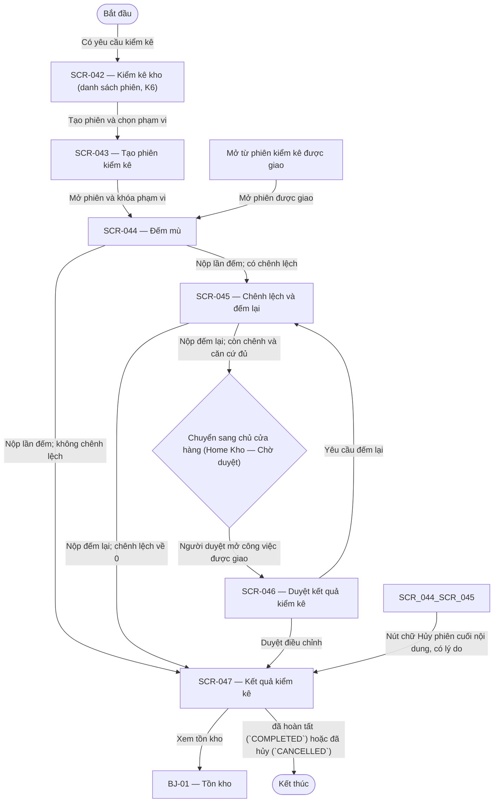

# UIF-08 — Kiểm kê và điều chỉnh chênh lệch

## 1. Mục đích và phạm vi

Mô tả cách mở phiên kiểm kê, đếm mù (gõ số ngay tại dòng, quét / tìm), xử lý chênh lệch và đếm lại chỉ trên các dòng lệch, chủ cửa hàng duyệt và ghi nhận điều chỉnh tồn kho. Danh sách phiên là khuôn K6; việc chờ duyệt hiện ở Home Kho (K2). iPhone và web đều là thiết bị chính.

- **Hành trình nghiệp vụ:** [BJ-08 — Kiểm kê và điều chỉnh chênh lệch](../../02.specification/behavior/journeys/BJ-08-kiem-ke-va-ieu-chinh-chenh-lech.md)
- **Trường hợp sử dụng liên quan:**
  - [UC-08-01 — Mở và khóa phạm vi](../../02.specification/behavior/use-cases/UC-08-01-mo-va-khoa-pham-vi.md)
  - [UC-08-02 — Ghi nhận lần đếm mù](../../02.specification/behavior/use-cases/UC-08-02-ghi-nhan-lan-dem-mu.md)
  - [UC-08-03 — Đếm lại và hoàn thiện căn cứ](../../02.specification/behavior/use-cases/UC-08-03-dem-lai-va-hoan-thien-bang-chung.md)
  - [UC-08-04 — Duyệt và điều chỉnh](../../02.specification/behavior/use-cases/UC-08-04-duyet-va-dieu-chinh.md)
  - [UC-08-05 — Hủy phiên kiểm kê](../../02.specification/behavior/use-cases/UC-08-05-huy-phien-kiem-ke.md)

**Ranh giới:** UIF chỉ mô tả cách người dùng đi qua các màn hình, điều kiện chuyển bước và cách xử lý khi không thể tiếp tục. Quy tắc nghiệp vụ vẫn lấy từ BJ/UC/Behavioral Contract; nội dung và thành phần của từng màn hình vẫn lấy từ Screen Contract.

## 2. Người dùng bắt đầu và kết thúc ở đâu

| Cách vào luồng | Màn hình | Người thực hiện | Đi từ đâu |
|---|---|---|---|
| Vào từ chức năng | `SCR-042` | Người lập kiểm kê | Home Kho → nút nhanh "Kiểm kê"; hoặc Kiểm kê & xử lý → "Kiểm kê kho" |
| Mở từ ngữ cảnh liên quan | `SCR-044` / `SCR-045` | Người đếm được giao | Dòng phiên "Đang đếm" / "Đếm lại" ở `SCR-042` |
| Công việc được giao | `SCR-046` | Chủ cửa hàng (người duyệt) | **Home Kho → "Chờ duyệt" → dòng "{mã phiên} · {phạm vi}"** (K2). Chủ cửa hàng tự đếm thì vẫn gửi rồi tự duyệt từ đây; người đếm / nhân viên khác mở dòng "Chờ duyệt" ở `SCR-042` chỉ xem |

Luồng kết thúc khi người dùng đã nhận được kết quả cuối cùng hoặc công việc được chuyển rõ sang một hành trình khác. Trạng thái `UNKNOWN` không được coi là thành công; phải tiếp tục xác minh với đúng thao tác gốc.

## 3. Luồng màn hình

> Sơ đồ trên để đọc nhanh. Phần “Các bước chuyển màn hình” giải thích điều kiện và cách xử lý; phần “Truy vết kỹ thuật” giữ các mã phục vụ Dev/QA/Harness.

## 4. Các bước chuyển màn hình

| Bước | Từ đâu | Người dùng / hệ thống làm gì | Điều kiện cần | Đi đến | Nếu không thể tiếp tục |
|---|---|---|---|---|---|
| `UIF-08-T01` | Bắt đầu | Có yêu cầu kiểm kê | Có quyền kiểm kê | `SCR-042` — Kiểm kê kho | — |
| `UIF-08-T02` | `SCR-042` — Kiểm kê kho | "Tạo phiên kiểm kê" | Có quyền mở phiên | `SCR-043` — Tạo phiên kiểm kê | — |
| `UIF-08-T03` | `SCR-043` — Tạo phiên kiểm kê | "Mở phiên kiểm kê" → "Mở phiên": chốt phạm vi, số sổ và khoá một lần | Phạm vi hợp lệ và không xung đột với phiên kiểm kê khác; không còn hàng chờ xác lập giá trị | `SCR-044` — Đếm mù | Xung đột → "Mở phiên đang kiểm"; còn hàng chờ giá trị → chủ cửa hàng mở "Hàng chờ xác lập giá trị" (BJ-03) |
| `UIF-08-T04` | `SCR-042` — dòng phiên được giao | Mở phiên "Đang đếm" | Người đếm được phân công | `SCR-044` — Đếm mù | — |
| `UIF-08-T05` | `SCR-044` — Đếm mù | Nộp lần đếm; không chênh lệch | Lần đếm đầu hợp lệ | `SCR-047` — Kết quả kiểm kê | Hệ thống tự hoàn tất và mở khóa phạm vi; không cần phê duyệt |
| `UIF-08-T06` | `SCR-044` — Đếm mù | Nộp lần đếm; có chênh lệch | Lần đếm đầu hợp lệ | `SCR-045` — Chênh lệch và đếm lại | — |
| `UIF-08-T07` | `SCR-045` — Chênh lệch và đếm lại | Nộp đếm lại; chênh lệch về 0 | Lần đếm lại hợp lệ | `SCR-047` — Kết quả kiểm kê | Không phê duyệt |
| `UIF-08-T08` | `SCR-045` — Chênh lệch và đếm lại | Nộp đếm lại; còn chênh và căn cứ đủ | Người đếm có quyền gửi | Chuyển sang chủ cửa hàng (toast "Đã gửi chủ cửa hàng duyệt"; người đếm xem `SCR-046` chờ duyệt) | Thiếu giá vốn hàng thừa → giữ `SCR-045` (`PRICE_BASIS_REQUIRED`), phiên vẫn khoá |
| `UIF-08-T09` | Chuyển sang chủ cửa hàng | Chủ cửa hàng mở dòng "kiểm kê" ở Home "Chờ duyệt" | Người duyệt là chủ cửa hàng (`is_owner` / `store_owner`); chủ tự đếm vẫn tự duyệt | `SCR-046` — Duyệt kết quả kiểm kê | — |
| `UIF-08-T10` | `SCR-046` — Duyệt kết quả kiểm kê | Yêu cầu đếm lại | Người duyệt hợp lệ | `SCR-045` — Chênh lệch và đếm lại | Không ghi điều chỉnh tồn |
| `UIF-08-T11` | `SCR-046` — Duyệt kết quả kiểm kê | Duyệt điều chỉnh | Người duyệt hợp lệ; căn cứ chưa thay đổi | `SCR-047` — Kết quả kiểm kê | Hệ thống ghi nhận điều chỉnh theo quyết định duyệt |
| `UIF-08-T12` | `SCR-044` hoặc `SCR-045` | Nút chữ "Hủy phiên" (cuối nội dung, không ở chân) → lý do bắt buộc | Người lập có quyền hủy; không cho hủy tại màn duyệt | `SCR-047` — Kết quả kiểm kê | Không ghi điều chỉnh tồn; mở khoá phạm vi |
| `UIF-08-T13` | `SCR-047` — Kết quả kiểm kê | đã hoàn tất (`COMPLETED`) hoặc đã hủy (`CANCELLED`) | — | Kết thúc | chưa xác định (`UNKNOWN`) → BJ-17 |
| `UIF-08-T14` | `SCR-047` — Kết quả kiểm kê | "Xem tồn kho" | Hoàn tất (khớp hoặc đã điều chỉnh) | BJ-01 — `SCR-001` | — |

## 5. Các tình huống cần chú ý

Các quy tắc chung về quyền, quay lại, dữ liệu thay đổi và chống ghi nhận lặp vẫn lấy từ UC/Behavioral Contract/Screen Contract. UIF chỉ nhắc lại những điểm ảnh hưởng trực tiếp đến cách đi qua màn hình.

- **Đếm mù:** trước khi nộp lần đầu, người đếm không thấy số theo sổ, chênh lệch hay thứ gì suy ra được. Mỗi lần đếm / đếm lại được lưu riêng, không ghi đè.
- **Mở phiên là khoá:** hàng trong phạm vi tạm không nhận, xuất hay bán được cho tới khi kiểm xong; `SCR-043` nói rõ điều này trước khi mở.
- **Tiền:** chỉ chủ cửa hàng / người duyệt thấy giá trị chênh lệch (`SCR-046`, `SCR-047`); nhân viên không có số tiền trong màn.
- **Sai ở phiếu nguồn** (phiếu nhận ghi thừa…) không xử lý trong phiên: đi sửa sai (BJ-11) sau khi phiên kết thúc, qua hồ sơ đối soát (BJ-16).
- Khi công việc chuyển sang người duyệt hoặc một vai trò khác, phiên làm việc của người hiện tại kết thúc tại trạng thái chờ. Người tiếp theo mở công việc từ danh sách được giao; hệ thống không tự chuyển sang phiên của họ.
- Nếu kết quả chưa xác định (`UNKNOWN`), không thực hiện lại bằng một thao tác mới. Hệ thống giữ nguyên mã thao tác gốc để xác minh; khi chưa đủ bằng chứng, chuyển sang `BJ-17`.
- Nếu dữ liệu nguồn đã thay đổi, phải nạp lại dữ liệu hiện hành và rà soát lại trước khi tiếp tục. Phần người dùng đã nhập chỉ được giữ lại khi còn an toàn.

## 6. Màn hình và Trường hợp sử dụng liên quan

| Trường hợp sử dụng | Màn hình sử dụng |
|---|---|
| [UC-08-01](../../02.specification/behavior/use-cases/UC-08-01-mo-va-khoa-pham-vi.md) — Mở và khóa phạm vi | `SCR-042`, `SCR-043` |
| [UC-08-02](../../02.specification/behavior/use-cases/UC-08-02-ghi-nhan-lan-dem-mu.md) — Ghi nhận lần đếm mù | `SCR-044` |
| [UC-08-03](../../02.specification/behavior/use-cases/UC-08-03-dem-lai-va-hoan-thien-bang-chung.md) — Đếm lại và hoàn thiện căn cứ | `SCR-045` |
| [UC-08-04](../../02.specification/behavior/use-cases/UC-08-04-duyet-va-dieu-chinh.md) — Duyệt và điều chỉnh | `SCR-046`, `SCR-047` |
| [UC-08-05](../../02.specification/behavior/use-cases/UC-08-05-huy-phien-kiem-ke.md) — Hủy phiên kiểm kê | `SCR-044`, `SCR-045`, `SCR-047` |

### Màn hình dùng trong luồng

| Màn hình | Tên | Vai trò trong luồng |
|---|---|---|
| [SCR-042](../screens/SCR-042.md) | Kiểm kê kho | Màn hình chính trong luồng |
| [SCR-043](../screens/SCR-043.md) | Tạo phiên kiểm kê | Màn hình chính trong luồng |
| [SCR-044](../screens/SCR-044.md) | Đếm mù | Màn hình chính trong luồng |
| [SCR-045](../screens/SCR-045.md) | Chênh lệch và đếm lại | Màn hình chính trong luồng |
| [SCR-046](../screens/SCR-046.md) | Duyệt kết quả kiểm kê | Màn hình chính trong luồng |
| [SCR-047](../screens/SCR-047.md) | Kết quả kiểm kê | Màn hình chính trong luồng |

## 7. Truy vết kỹ thuật

> Phần này dành cho Dev/QA/Harness. Các mã kỹ thuật được giữ nguyên để Dev/QA/Harness đối chiếu tự động.

| Transition | From | To | Loại | Action | UC / BC |
|---|---|---|---|---|---|
| `UIF-08-T01` | `BEGIN` | `SCR-042` | `NAVIGATION` | `—` | UC-08-01 |
| `UIF-08-T02` | `SCR-042` | `SCR-043` | `NAVIGATION` | `—` | UC-08-01 |
| `UIF-08-T03` | `SCR-043` | `SCR-044` | `MUTATION` | `ACT-09-OPEN` | UC-08-01 / BC-IC-01 |
| `UIF-08-T04` | `CONTEXT_COUNT` | `SCR-044` | `NAVIGATION` | `—` | UC-08-02 |
| `UIF-08-T05` | `SCR-044` | `SCR-047` | `MUTATION` | `ACT-09-SUBMIT` | UC-08-02 / BC-IC-02 |
| `UIF-08-T06` | `SCR-044` | `SCR-045` | `MUTATION` | `ACT-09-SUBMIT` | UC-08-02 / BC-IC-02 |
| `UIF-08-T07` | `SCR-045` | `SCR-047` | `MUTATION` | `ACT-09-SUBMIT` | UC-08-03 / BC-IC-02 |
| `UIF-08-T08` | `SCR-045` | `HANDOFF_APPROVAL` | `HANDOFF` | `ACT-09-SUBMIT` | UC-08-03, UC-08-04 |
| `UIF-08-T09` | `HANDOFF_APPROVAL` | `SCR-046` | `HANDOFF` | `—` | UC-08-04 / BC-IC-03 |
| `UIF-08-T10` | `SCR-046` | `SCR-045` | `MUTATION` | `ACT-09-APPROVE` | UC-08-04 / BC-IC-03 |
| `UIF-08-T11` | `SCR-046` | `SCR-047` | `MUTATION` | `ACT-09-APPROVE` | UC-08-04 / BC-IC-03 |
| `UIF-08-T12` | `SCR-044/SCR-045` | `SCR-047` | `MUTATION` | `ACT-09-CANCEL` | UC-08-05 / BC-IC-08 |
| `UIF-08-T13` | `SCR-047` | `END` | `TERMINAL` | `—` | UC-08-04, UC-08-05 |
| `UIF-08-T14` | `SCR-047` | `BJ-01:SCR-001` | `NAVIGATION` | `—` | UC-08-04 → BJ-01 |

## 8. Kiểm tra tính đầy đủ và liên kết

- [x] Tất cả Trường hợp sử dụng liên quan đều được liên kết từ UIF.
- [x] Mỗi màn hình đang dùng trong luồng có Screen Contract tương ứng.
- [x] Các bước do hệ thống thực hiện không bị mô tả thành thao tác của người dùng.
- [x] Nếu có phê duyệt hoặc chuyển vai trò, người gửi và người nhận có điểm vào riêng.
- [x] Trạng thái kết thúc và trường hợp `UNKNOWN` có hướng xử lý rõ khi áp dụng.
- [x] Bảng đọc chính và bảng truy vết kỹ thuật dùng cùng một tập transition ID; không đổi topology hoặc hành vi.
- [x] Liên kết BJ ↔ UIF ↔ UC/SCR dùng đường dẫn tương đối và mở đúng tài liệu đích.

**Trạng thái đối chiếu thiết kế:** `REDESIGNED_v5.16.0` — luồng được thiết kế lại theo plan T7-P BJ-08: danh sách phiên K6, mở phiên nói rõ hàng bị khoá, đếm mù với ô số tại dòng, đếm lại chỉ dòng lệch ("Vẫn {n}"), duyệt K2 có tiền cho chủ cửa hàng (từ Home "Chờ duyệt"; chủ tự đếm vẫn tự duyệt), hủy phiên từ nội dung, kết quả K4 / K3 và lối "Xem tồn kho" sang BJ-01. ID transition T01–T13 và liên kết UC/BC của v4.2.0 được giữ; thêm `UIF-08-T14`.

### Liên kết

- [Business Journey](../../02.specification/behavior/journeys/BJ-08-kiem-ke-va-ieu-chinh-chenh-lech.md)
- [Business Journey Map](../../02.specification/behavior/journeys/00-business-journey-map.md)
- [Use Case Map](../../02.specification/behavior/use-cases/00-use-case-map.md)
- [Prototype manifest](../prototype/README.md)
