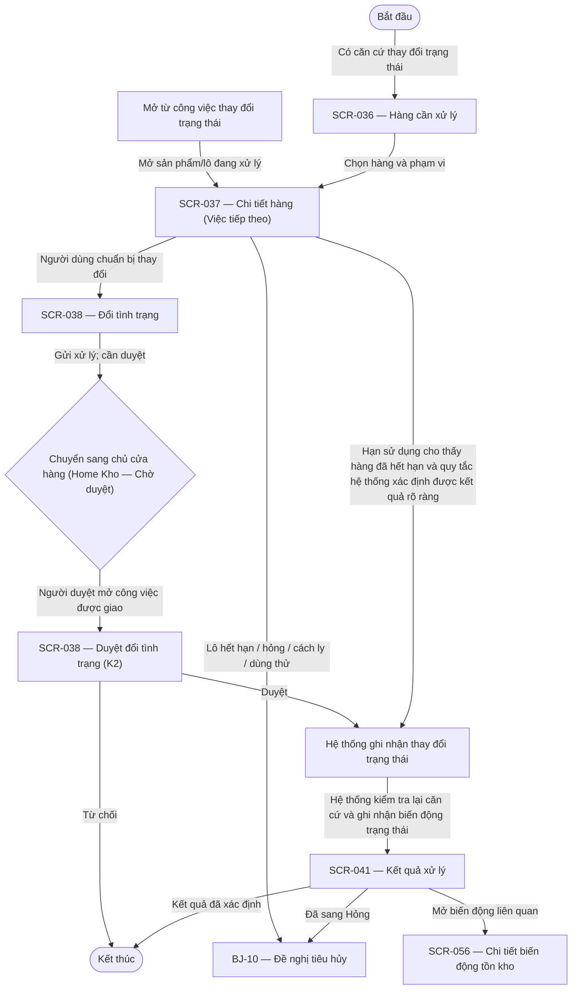

# UIF-09 — Quản lý trạng thái hàng

## 1. Mục đích và phạm vi

Mô tả cách người dùng xem **hàng cần xử lý** và thay đổi trạng thái hàng trong kho, bao gồm các trường hợp cần chủ cửa hàng duyệt trước khi hệ thống ghi nhận biến động trạng thái. `SCR-036` / `SCR-037` là màn dùng chung (khuôn K5) với BJ-07 (trả nhà cung cấp) và BJ-10 (tiêu hủy): từ chi tiết hàng đi tiếp được sang "Đề nghị tiêu hủy".

- **Hành trình nghiệp vụ:** [BJ-09 — Quản lý trạng thái hàng](../../02.specification/behavior/journeys/BJ-09-quan-ly-trang-thai-hang.md)
- **Trường hợp sử dụng liên quan:**
  - [UC-09-01 — Chuẩn bị thay đổi trạng thái](../../02.specification/behavior/use-cases/UC-09-01-chuan-bi-thay-doi-trang-thai.md)
  - [UC-09-02 — Phê duyệt thay đổi trạng thái](../../02.specification/behavior/use-cases/UC-09-02-phe-duyet-thay-doi-trang-thai.md)
  - [UC-09-03 — Xác định hàng hết hạn](../../02.specification/behavior/use-cases/UC-09-03-xac-dinh-hang-het-han.md)
  - [UC-09-04 — Ghi biến động trạng thái](../../02.specification/behavior/use-cases/UC-09-04-ghi-state-movement.md)

**Ranh giới:** UIF chỉ mô tả cách người dùng đi qua các màn hình, điều kiện chuyển bước và cách xử lý khi không thể tiếp tục. Quy tắc nghiệp vụ vẫn lấy từ BJ/UC/Behavioral Contract; nội dung và thành phần của từng màn hình vẫn lấy từ Screen Contract.

## 2. Người dùng bắt đầu và kết thúc ở đâu

| Cách vào luồng | Màn hình | Người thực hiện | Đi từ đâu |
|---|---|---|---|
| Vào từ chức năng | `SCR-036` (K5, danh sách chung cho UIF-07 / 09 / 10) | Thủ kho | Home Kho → Quản lý kho → Kiểm kê & xử lý → Hàng cần xử lý; hoặc Home Kho → **Cần chú ý → "Hàng cần xử lý"** (chip "Cần xử lý") |
| Mở từ ngữ cảnh liên quan | `SCR-037` | Thủ kho | Lô hết hạn ở BJ-01 → "Xử lý lô hết hạn"; hoặc chạm một dòng lô ở `SCR-036` |
| Đổi hàng bán được | `SCR-038` | Thủ kho | BJ-01 → sheet lô → "Đổi tình trạng" |
| Duyệt đổi tình trạng | `SCR-038` | Chủ cửa hàng (người duyệt) | **Home Kho → "Cần chú ý · Chờ duyệt" → dòng "{sản phẩm} · Lô {lô}"** (K2). Chủ cửa hàng tự lập thì vẫn gửi rồi tự duyệt từ đây |

Luồng kết thúc khi người dùng đã nhận được kết quả cuối cùng hoặc công việc được chuyển rõ sang một hành trình khác. Trạng thái `UNKNOWN` không được coi là thành công; phải tiếp tục xác minh với đúng thao tác gốc.

## 3. Luồng màn hình

> Sơ đồ trên để đọc nhanh. Phần “Các bước chuyển màn hình” giải thích điều kiện và cách xử lý; phần “Truy vết kỹ thuật” giữ các mã phục vụ Dev/QA/Harness.

## 4. Các bước chuyển màn hình

| Bước | Từ đâu | Người dùng / hệ thống làm gì | Điều kiện cần | Đi đến | Nếu không thể tiếp tục |
|---|---|---|---|---|---|
| `UIF-09-T01` | Bắt đầu | Có căn cứ thay đổi trạng thái | Có quyền quản lý trạng thái | `SCR-036` — Hàng cần xử lý | — |
| `UIF-09-T02` | Mở từ công việc thay đổi trạng thái | Mở sản phẩm/lô đang xử lý | Có quyền với phạm vi đang xử lý | `SCR-037` — Chi tiết hàng | — |
| `UIF-09-T03` | `SCR-036` — Hàng cần xử lý | Chọn hàng và phạm vi | Trạng thái hiện tại hợp lệ | `SCR-037` — Chi tiết hàng | — |
| `UIF-09-T04` | `SCR-037` — Chi tiết hàng | "Đổi tình trạng" | Trạng thái muốn chuyển đến được chính sách cho phép | `SCR-038` — Chuyển trạng thái — chuẩn bị | — |
| `UIF-09-T05` | `SCR-038` — Đổi tình trạng | "Gửi phê duyệt" (cặp cần duyệt); cặp không cần duyệt "Đổi tình trạng" ghi ngay | Người lập có quyền gửi; đủ đích, số lượng, lý do, ảnh bằng chứng (nếu bắt buộc) | Chuyển sang chủ cửa hàng (toast "Đã gửi chủ cửa hàng duyệt") | Người lập xem `k2Pending`, về "Hàng cần xử lý" |
| `UIF-09-T06` | Chuyển sang chủ cửa hàng | Chủ cửa hàng mở dòng "đổi tình trạng" ở Home "Chờ duyệt" | Người duyệt là chủ cửa hàng (`is_owner` / `store_owner`); chủ tự lập vẫn tự duyệt | `SCR-038` — Chuyển trạng thái — rà soát phê duyệt | — |
| `UIF-09-T07` | `SCR-038` — Chuyển trạng thái — rà soát phê duyệt | Từ chối | Người duyệt hợp lệ | Kết thúc | Không ghi biến động trạng thái tồn kho |
| `UIF-09-T08` | `SCR-038` — Chuyển trạng thái — rà soát phê duyệt | Duyệt | Người duyệt hợp lệ | Hệ thống ghi nhận thay đổi trạng thái | Phê duyệt chưa làm thay đổi trạng thái tồn kho |
| `UIF-09-T09` | `SCR-037` — Chi tiết hàng | Hạn sử dụng cho thấy hàng đã hết hạn và quy tắc hệ thống xác định được kết quả rõ ràng | Hệ thống có đủ căn cứ để tự xác định | Hệ thống ghi nhận thay đổi trạng thái | Người dùng không phải tự chọn trạng thái hết hạn |
| `UIF-09-T10` | Hệ thống ghi nhận thay đổi trạng thái | Hệ thống kiểm tra lại căn cứ và ghi nhận biến động trạng thái | Hệ thống kiểm tra và ghi nhận theo dữ liệu chính thức | `SCR-041` — Kết quả xử lý | Giữ nguyên số lượng và giá trị; nếu kết quả chưa xác định (`UNKNOWN`), chuyển sang BJ-17 |
| `UIF-09-T11` | `SCR-041` — Kết quả xử lý | Mở biến động liên quan | Có quyền xem lịch sử | `SCR-056` — Chi tiết biến động tồn kho | — |
| `UIF-09-T12` | `SCR-041` — Kết quả xử lý | Kết quả đã xác định | — | Kết thúc | chưa xác định (`UNKNOWN`) → BJ-17 |

## 5. Các tình huống cần chú ý

Các quy tắc chung về quyền, quay lại, dữ liệu thay đổi và chống ghi nhận lặp vẫn lấy từ UC/Behavioral Contract/Screen Contract. UIF chỉ nhắc lại những điểm ảnh hưởng trực tiếp đến cách đi qua màn hình.

- Khi công việc chuyển sang người duyệt hoặc một vai trò khác, phiên làm việc của người hiện tại kết thúc tại trạng thái chờ. Người tiếp theo mở công việc từ danh sách được giao; hệ thống không tự chuyển sang phiên của họ.
- Nếu kết quả chưa xác định (`UNKNOWN`), không thực hiện lại bằng một thao tác mới. Hệ thống giữ nguyên mã thao tác gốc để xác minh; khi chưa đủ bằng chứng, chuyển sang `BJ-17`.

## 6. Màn hình và Trường hợp sử dụng liên quan

| Trường hợp sử dụng | Màn hình sử dụng |
|---|---|
| [UC-09-01](../../02.specification/behavior/use-cases/UC-09-01-chuan-bi-thay-doi-trang-thai.md) — Chuẩn bị thay đổi trạng thái | `SCR-036`, `SCR-037`, `SCR-038` |
| [UC-09-02](../../02.specification/behavior/use-cases/UC-09-02-phe-duyet-thay-doi-trang-thai.md) — Phê duyệt thay đổi trạng thái | `SCR-038`, `SCR-041` |
| [UC-09-03](../../02.specification/behavior/use-cases/UC-09-03-xac-dinh-hang-het-han.md) — Xác định hàng hết hạn | `SCR-036`, `SCR-037`, `SCR-041` |
| [UC-09-04](../../02.specification/behavior/use-cases/UC-09-04-ghi-state-movement.md) — Ghi biến động trạng thái | `SCR-038`, `SCR-041`, `SCR-056` |

### Màn hình dùng trong luồng

| Màn hình | Tên | Vai trò trong luồng |
|---|---|---|
| [SCR-036](../screens/SCR-036.md) | Hàng cần xử lý | Màn hình chính trong luồng |
| [SCR-037](../screens/SCR-037.md) | Chi tiết hàng | Màn hình chính trong luồng |
| [SCR-038](../screens/SCR-038.md) | Chuyển trạng thái | Màn hình chính trong luồng |
| [SCR-041](../screens/SCR-041.md) | Kết quả xử lý | Màn hình chính trong luồng |
| [SCR-056](../screens/SCR-056.md) | Chi tiết biến động tồn kho | Màn hình chính trong luồng |

## 7. Truy vết kỹ thuật

> Phần này dành cho Dev/QA/Harness. Các mã kỹ thuật được giữ nguyên để Dev/QA/Harness đối chiếu tự động.

| Transition | From | To | Loại | Action | UC / BC |
|---|---|---|---|---|---|
| `UIF-09-T01` | `BEGIN` | `SCR-036` | `NAVIGATION` | `—` | UC-09-01 |
| `UIF-09-T02` | `CONTEXT_STATE` | `SCR-037` | `NAVIGATION` | `—` | UC-09-01 |
| `UIF-09-T03` | `SCR-036` | `SCR-037` | `NAVIGATION` | `—` | UC-09-01 |
| `UIF-09-T04` | `SCR-037` | `SCR-038:PREPARE` | `NAVIGATION` | `—` | UC-09-01 |
| `UIF-09-T05` | `SCR-038:PREPARE` | `HANDOFF_APPROVAL` | `HANDOFF` | `ACT-COMMON-SUBMIT` | UC-09-01, UC-09-02 / BC-IC-07 |
| `UIF-09-T06` | `HANDOFF_APPROVAL` | `SCR-038:APPROVAL_REVIEW` | `HANDOFF` | `—` | UC-09-02 / BC-IC-06 |
| `UIF-09-T07` | `SCR-038:APPROVAL_REVIEW` | `END` | `MUTATION` | `ACT-COMMON-DECIDE` | UC-09-02 / BC-IC-06 |
| `UIF-09-T08` | `SCR-038:APPROVAL_REVIEW` | `SYSTEM_STATE` | `MUTATION` | `ACT-COMMON-DECIDE` | UC-09-02 / BC-IC-06 |
| `UIF-09-T09` | `SCR-037` | `SYSTEM_STATE` | `SYSTEM` | `—` | UC-09-03 |
| `UIF-09-T10` | `SYSTEM_STATE` | `SCR-041` | `SYSTEM` | `ACT-08-STATE` | UC-09-04 / BC-IO-10 |
| `UIF-09-T11` | `SCR-041` | `SCR-056` | `NAVIGATION` | `—` | UC-09-04 → BJ-15 |
| `UIF-09-T12` | `SCR-041` | `END` | `TERMINAL` | `—` | UC-09-04 |

## 8. Kiểm tra tính đầy đủ và liên kết

- [x] Tất cả Trường hợp sử dụng liên quan đều được liên kết từ UIF.
- [x] Mỗi màn hình đang dùng trong luồng có Screen Contract tương ứng.
- [x] Các bước do hệ thống thực hiện không bị mô tả thành thao tác của người dùng.
- [x] Nếu có phê duyệt hoặc chuyển vai trò, người gửi và người nhận có điểm vào riêng.
- [x] Trạng thái kết thúc và trường hợp `UNKNOWN` có hướng xử lý rõ khi áp dụng.
- [x] Bảng đọc chính và bảng truy vết kỹ thuật dùng cùng một tập transition ID; không đổi topology hoặc hành vi.
- [x] Liên kết BJ ↔ UIF ↔ UC/SCR dùng đường dẫn tương đối và mở đúng tài liệu đích.

**Trạng thái đối chiếu thiết kế:** `REDESIGNED_v5.13.0` — luồng được thiết kế lại theo plan T7-P BJ-09: danh sách chung "Hàng cần xử lý" (K5), lô đi tiếp được sang tiêu hủy, duyệt theo K2 (chủ cửa hàng, từ Home "Chờ duyệt", có thể tự duyệt khi tự lập). ID transition và liên kết UC/BC của v4.2.0 được giữ; nút "Đề nghị tiêu hủy" sang BJ-10 là lối ra mới từ `SCR-037` / `SCR-041` (chưa có ID riêng — BJ-10 đăng ký ở plan BJ-07 + BJ-10).

### Liên kết

- [Business Journey](../../02.specification/behavior/journeys/BJ-09-quan-ly-trang-thai-hang.md)
- [Business Journey Map](../../02.specification/behavior/journeys/00-business-journey-map.md)
- [Use Case Map](../../02.specification/behavior/use-cases/00-use-case-map.md)
- [Prototype manifest](../prototype/README.md)
