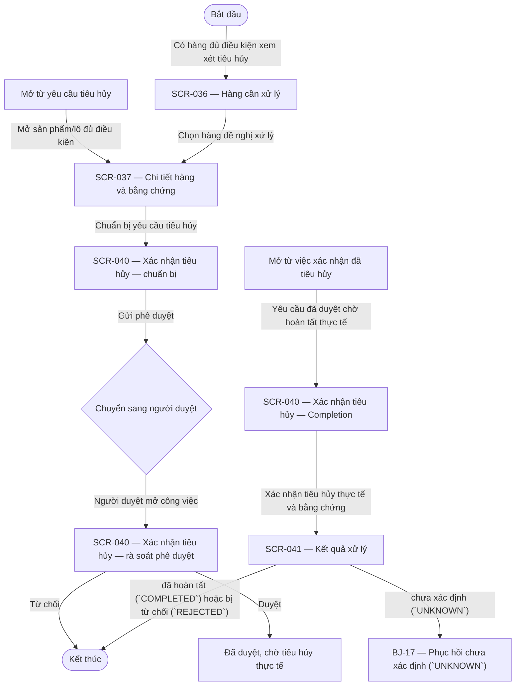

# UIF-10 — Tiêu hủy hàng

## 1. Mục đích và phạm vi

Mô tả cách lập yêu cầu tiêu hủy, phê duyệt, xác nhận tiêu hủy thực tế và ghi giảm hàng trong kho.

- **Hành trình nghiệp vụ:** [BJ-10 — Tiêu hủy hàng](../../02.specification/behavior/journeys/BJ-10-tieu-huy-hang.md)
- **Trường hợp sử dụng liên quan:**
  - [UC-10-01 — Chuẩn bị yêu cầu tiêu hủy](../../02.specification/behavior/use-cases/UC-10-01-chuan-bi-yeu-cau-tieu-huy.md)
  - [UC-10-02 — Phê duyệt tiêu hủy](../../02.specification/behavior/use-cases/UC-10-02-phe-duyet-tieu-huy.md)
  - [UC-10-03 — Xác nhận đã tiêu hủy](../../02.specification/behavior/use-cases/UC-10-03-xac-nhan-da-tieu-huy.md)
  - [UC-10-04 — Ghi giảm hàng tiêu hủy](../../02.specification/behavior/use-cases/UC-10-04-ghi-giam-hang-tieu-huy.md)

**Ranh giới:** UIF chỉ mô tả cách người dùng đi qua các màn hình, điều kiện chuyển bước và cách xử lý khi không thể tiếp tục. Quy tắc nghiệp vụ vẫn lấy từ BJ/UC/Behavioral Contract; nội dung và thành phần của từng màn hình vẫn lấy từ Screen Contract.

## 2. Người dùng bắt đầu và kết thúc ở đâu

| Cách vào luồng | Màn hình | Người thực hiện | Đi từ đâu |
|---|---|---|---|
| Vào từ chức năng | `SCR-036` | Người lập tiêu hủy | Kho > Hàng có thể xử lý |
| Mở từ ngữ cảnh liên quan | `SCR-037` | Người lập tiêu hủy | Sản phẩm hoặc lô đủ điều kiện |
| Công việc được giao | `SCR-040` | Người duyệt độc lập | Công việc duyệt tiêu hủy |
| Mở từ ngữ cảnh liên quan | `SCR-040` | Người xác nhận hoàn tất | Yêu cầu đã duyệt chờ tiêu hủy thực tế |

Luồng kết thúc khi người dùng đã nhận được kết quả cuối cùng hoặc công việc được chuyển rõ sang một hành trình khác. Trạng thái `UNKNOWN` không được coi là thành công; phải tiếp tục xác minh với đúng thao tác gốc.

## 3. Luồng màn hình

> Sơ đồ trên để đọc nhanh. Phần “Các bước chuyển màn hình” giải thích điều kiện và cách xử lý; phần “Truy vết kỹ thuật” giữ các mã phục vụ Dev/QA/Harness.

## 4. Các bước chuyển màn hình

| Bước | Từ đâu | Người dùng / hệ thống làm gì | Điều kiện cần | Đi đến | Nếu không thể tiếp tục |
|---|---|---|---|---|---|
| `UIF-10-T01` | Bắt đầu | Có hàng đủ điều kiện xem xét tiêu hủy | Có quyền lập tiêu hủy | `SCR-036` — Hàng cần xử lý | — |
| `UIF-10-T02` | Mở từ yêu cầu tiêu hủy | Mở sản phẩm/lô đủ điều kiện | Có quyền với phạm vi đang xử lý | `SCR-037` — Chi tiết hàng và bằng chứng | — |
| `UIF-10-T03` | `SCR-036` — Hàng cần xử lý | Chọn hàng đề nghị xử lý | Trạng thái hàng đủ điều kiện xem xét tiêu hủy | `SCR-037` — Chi tiết hàng và bằng chứng | — |
| `UIF-10-T04` | `SCR-037` — Chi tiết hàng và bằng chứng | Chuẩn bị yêu cầu tiêu hủy | Có đủ căn cứ về giá trị, số lượng và bằng chứng cần thiết | `SCR-040` — Xác nhận tiêu hủy — chuẩn bị | Thiếu căn cứ → giữ tại bước hiện tại và nêu rõ lý do chưa thể tiếp tục |
| `UIF-10-T05` | `SCR-040` — Xác nhận tiêu hủy — chuẩn bị | Gửi phê duyệt | Người lập có quyền gửi | Chuyển sang người duyệt | Người lập công việc kết thúc |
| `UIF-10-T06` | Chuyển sang người duyệt | Người duyệt mở công việc | Người duyệt độc lập | `SCR-040` — Xác nhận tiêu hủy — rà soát phê duyệt | — |
| `UIF-10-T07` | `SCR-040` — Xác nhận tiêu hủy — rà soát phê duyệt | Từ chối | Người duyệt hợp lệ | Kết thúc | Không giảm tồn |
| `UIF-10-T08` | `SCR-040` — Xác nhận tiêu hủy — rà soát phê duyệt | Duyệt | Người duyệt hợp lệ | Đã duyệt, chờ tiêu hủy thực tế | Chưa giảm tồn vật lý |
| `UIF-10-T09` | Mở từ việc xác nhận đã tiêu hủy | Yêu cầu đã duyệt chờ hoàn tất thực tế | Người xác nhận hoàn tất có quyền phù hợp | `SCR-040` — Xác nhận tiêu hủy — xác nhận hoàn tất | — |
| `UIF-10-T10` | `SCR-040` — Xác nhận tiêu hủy — xác nhận hoàn tất | Xác nhận tiêu hủy thực tế và bằng chứng | Số lượng tiêu hủy thực tế không vượt phạm vi đã được duyệt | `SCR-041` — Kết quả xử lý | chưa xác định (`UNKNOWN`) → BJ-17 |
| `UIF-10-T11` | `SCR-041` — Kết quả xử lý | đã hoàn tất (`COMPLETED`) hoặc bị từ chối (`REJECTED`) | — | Kết thúc | — |
| `UIF-10-T12` | `SCR-041` — Kết quả xử lý | chưa xác định (`UNKNOWN`) | Giữ mã thao tác gốc | BJ-17 — hành trình liên quan | — |

## 5. Các tình huống cần chú ý

Các quy tắc chung về quyền, quay lại, dữ liệu thay đổi và chống ghi nhận lặp vẫn lấy từ UC/Behavioral Contract/Screen Contract. UIF chỉ nhắc lại những điểm ảnh hưởng trực tiếp đến cách đi qua màn hình.

- Khi công việc chuyển sang người duyệt hoặc một vai trò khác, phiên làm việc của người hiện tại kết thúc tại trạng thái chờ. Người tiếp theo mở công việc từ danh sách được giao; hệ thống không tự chuyển sang phiên của họ.
- Nếu kết quả chưa xác định (`UNKNOWN`), không thực hiện lại bằng một thao tác mới. Hệ thống giữ nguyên mã thao tác gốc để xác minh; khi chưa đủ bằng chứng, chuyển sang `BJ-17`.

## 6. Màn hình và Trường hợp sử dụng liên quan

| Trường hợp sử dụng | Màn hình sử dụng |
|---|---|
| [UC-10-01](../../02.specification/behavior/use-cases/UC-10-01-chuan-bi-yeu-cau-tieu-huy.md) — Chuẩn bị yêu cầu tiêu hủy | `SCR-036`, `SCR-037`, `SCR-040` |
| [UC-10-02](../../02.specification/behavior/use-cases/UC-10-02-phe-duyet-tieu-huy.md) — Phê duyệt tiêu hủy | `SCR-040` |
| [UC-10-03](../../02.specification/behavior/use-cases/UC-10-03-xac-nhan-da-tieu-huy.md) — Xác nhận đã tiêu hủy | `SCR-040` |
| [UC-10-04](../../02.specification/behavior/use-cases/UC-10-04-ghi-giam-hang-tieu-huy.md) — Ghi giảm hàng tiêu hủy | `SCR-041` |

### Màn hình dùng trong luồng

| Màn hình | Tên | Vai trò trong luồng |
|---|---|---|
| [SCR-036](../screens/SCR-036.md) | Hàng cần xử lý | Màn hình chính trong luồng |
| [SCR-037](../screens/SCR-037.md) | Chi tiết hàng và bằng chứng | Màn hình chính trong luồng |
| [SCR-040](../screens/SCR-040.md) | Xác nhận tiêu hủy | Màn hình chính trong luồng |
| [SCR-041](../screens/SCR-041.md) | Kết quả xử lý | Màn hình chính trong luồng |

## 7. Truy vết kỹ thuật

> Phần này dành cho Dev/QA/Harness. Các mã kỹ thuật được giữ nguyên để Dev/QA/Harness đối chiếu tự động.

| Transition | From | To | Loại | Action | UC / BC |
|---|---|---|---|---|---|
| `UIF-10-T01` | `BEGIN` | `SCR-036` | `NAVIGATION` | `—` | UC-10-01 |
| `UIF-10-T02` | `CONTEXT_DISPOSAL` | `SCR-037` | `NAVIGATION` | `—` | UC-10-01 |
| `UIF-10-T03` | `SCR-036` | `SCR-037` | `NAVIGATION` | `—` | UC-10-01 |
| `UIF-10-T04` | `SCR-037` | `SCR-040:PREPARE` | `NAVIGATION` | `—` | UC-10-01 |
| `UIF-10-T05` | `SCR-040:PREPARE` | `HANDOFF_APPROVAL` | `HANDOFF` | `ACT-COMMON-SUBMIT` | UC-10-01, UC-10-02 / BC-IC-07 |
| `UIF-10-T06` | `HANDOFF_APPROVAL` | `SCR-040:APPROVAL_REVIEW` | `HANDOFF` | `—` | UC-10-02 / BC-IC-06 |
| `UIF-10-T07` | `SCR-040:APPROVAL_REVIEW` | `END` | `MUTATION` | `ACT-COMMON-DECIDE` | UC-10-02 / BC-IC-06 |
| `UIF-10-T08` | `SCR-040:APPROVAL_REVIEW` | `APPROVED_PENDING_DISPOSAL` | `MUTATION` | `ACT-COMMON-DECIDE` | UC-10-02 / BC-IC-06 |
| `UIF-10-T09` | `CONTEXT_COMPLETION` | `SCR-040:COMPLETION` | `NAVIGATION` | `—` | UC-10-03 |
| `UIF-10-T10` | `SCR-040:COMPLETION` | `SCR-041` | `MUTATION` | `ACT-08-DISPOSE` | UC-10-03, UC-10-04 / BC-IO-11 |
| `UIF-10-T11` | `SCR-041` | `END` | `TERMINAL` | `—` | UC-10-04 |
| `UIF-10-T12` | `SCR-041` | `BJ-17` | `HANDOFF` | `—` | UC-10-04 → BJ-17 |

## 8. Kiểm tra tính đầy đủ và liên kết

- [x] Tất cả Trường hợp sử dụng liên quan đều được liên kết từ UIF.
- [x] Mỗi màn hình đang dùng trong luồng có Screen Contract tương ứng.
- [x] Các bước do hệ thống thực hiện không bị mô tả thành thao tác của người dùng.
- [x] Nếu có phê duyệt hoặc chuyển vai trò, người gửi và người nhận có điểm vào riêng.
- [x] Trạng thái kết thúc và trường hợp `UNKNOWN` có hướng xử lý rõ khi áp dụng.
- [x] Bảng đọc chính và bảng truy vết kỹ thuật dùng cùng một tập transition ID; không đổi topology hoặc hành vi.
- [x] Liên kết BJ ↔ UIF ↔ UC/SCR dùng đường dẫn tương đối và mở đúng tài liệu đích.

**Trạng thái đối chiếu thiết kế:** `ALIGNED_TO_CURRENT_SCREEN_CONTRACTS` — UIF đã được viết lại theo Plain BA Language; cấu trúc luồng, ID, mã Action, liên kết UC/BC và trạng thái đối chiếu của v4.1.0 được giữ nguyên. HTML và Screen Contract không thay đổi trong lượt này.

### Liên kết

- [Business Journey](../../02.specification/behavior/journeys/BJ-10-tieu-huy-hang.md)
- [Business Journey Map](../../02.specification/behavior/journeys/00-business-journey-map.md)
- [Use Case Map](../../02.specification/behavior/use-cases/00-use-case-map.md)
- [Prototype manifest](../prototype/README.md)
