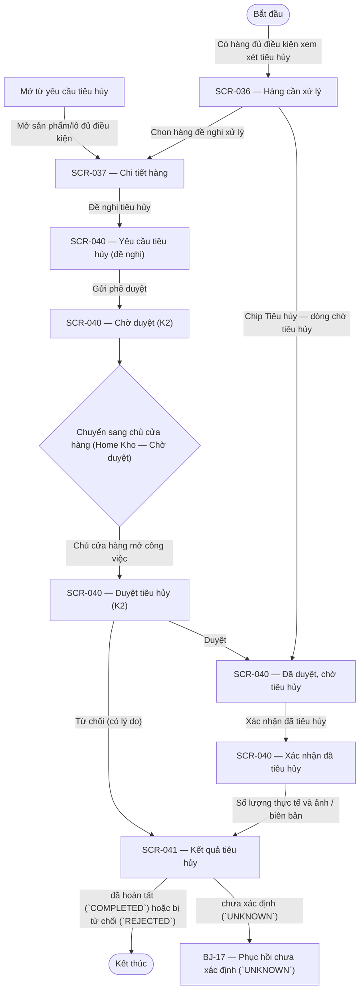

# UIF-10 — Tiêu hủy hàng

## 1. Mục đích và phạm vi

Mô tả cách lập yêu cầu tiêu hủy, chủ cửa hàng duyệt, xác nhận tiêu hủy thực tế (kèm ảnh / biên bản) và ghi giảm hàng trong kho. `SCR-036` / `SCR-037` là màn dùng chung (khuôn K5) với BJ-07 và BJ-09. `SCR-040` là **một mã màn, bốn chế độ dựng khác hẳn**: đề nghị → chờ duyệt → duyệt → đã duyệt, chờ tiêu hủy → xác nhận đã tiêu hủy. Duyệt chưa giảm tồn; chỉ xác nhận đã tiêu hủy mới ghi giảm.

- **Hành trình nghiệp vụ:** [BJ-10 — Tiêu hủy hàng](../../02.specification/behavior/journeys/BJ-10-tieu-huy-hang.md)
- **Trường hợp sử dụng liên quan:**
  - [UC-10-01 — Chuẩn bị yêu cầu tiêu hủy](../../02.specification/behavior/use-cases/UC-10-01-chuan-bi-yeu-cau-tieu-huy.md)
  - [UC-10-02 — Phê duyệt tiêu hủy](../../02.specification/behavior/use-cases/UC-10-02-phe-duyet-tieu-huy.md)
  - [UC-10-03 — Xác nhận đã tiêu hủy](../../02.specification/behavior/use-cases/UC-10-03-xac-nhan-da-tieu-huy.md)
  - [UC-10-04 — Ghi giảm hàng tiêu hủy](../../02.specification/behavior/use-cases/UC-10-04-ghi-giam-hang-tieu-huy.md)

**Ranh giới:** UIF chỉ mô tả cách người dùng đi qua các màn hình, điều kiện chuyển bước và cách xử lý khi không thể tiếp tục. Quy tắc nghiệp vụ vẫn lấy từ BJ/UC/Behavioral Contract; nội dung và thành phần của từng màn hình vẫn lấy từ Screen Contract.

## 2. Người dùng bắt đầu và kết thúc ở đâu

| Cách vào luồng | Màn hình | Người thực hiện | Đi từ đâu |
|---|---|---|---|
| Vào từ chức năng | `SCR-036` (danh sách chung "Hàng cần xử lý") | Người lập tiêu hủy | Home Kho → Hàng cần xử lý (chip "Cần xử lý" / "Tiêu hủy") |
| Mở từ ngữ cảnh liên quan | `SCR-037` → "Đề nghị tiêu hủy" | Người lập tiêu hủy | Lô hết hạn / hỏng / cách ly / dùng thử; hoặc `SCR-041` của BJ-09 khi vừa chuyển sang "Hỏng" |
| Duyệt đề nghị | `SCR-040` (chế độ duyệt, K2) | Chủ cửa hàng (người duyệt) | **Home Kho → "Cần chú ý · Chờ duyệt" → dòng "{sản phẩm} · Lô {lô}" (nguồn "tiêu hủy")**. Chủ cửa hàng tự lập vẫn gửi rồi tự duyệt từ đây |
| Xác nhận đã tiêu hủy | `SCR-040` (chế độ đã duyệt → xác nhận) | Bất kỳ nhân viên có quyền | `SCR-036` chip "Tiêu hủy" → dòng "Chờ tiêu hủy"; hoặc ngay sau khi duyệt |

Luồng kết thúc khi người dùng đã nhận được kết quả cuối cùng hoặc công việc được chuyển rõ sang một hành trình khác. Trạng thái `UNKNOWN` không được coi là thành công; phải tiếp tục xác minh với đúng thao tác gốc.

## 3. Luồng màn hình

> Sơ đồ trên để đọc nhanh. Phần “Các bước chuyển màn hình” giải thích điều kiện và cách xử lý; phần “Truy vết kỹ thuật” giữ các mã phục vụ Dev/QA/Harness.

## 4. Các bước chuyển màn hình

| Bước | Từ đâu | Người dùng / hệ thống làm gì | Điều kiện cần | Đi đến | Nếu không thể tiếp tục |
|---|---|---|---|---|---|
| `UIF-10-T01` | Bắt đầu | Có hàng đủ điều kiện xem xét tiêu hủy | Có quyền lập tiêu hủy | `SCR-036` — Hàng cần xử lý | Không có quyền → "Bạn chưa có quyền tiêu hủy hàng" |
| `UIF-10-T02` | Mở từ yêu cầu tiêu hủy | Mở sản phẩm/lô đủ điều kiện | Có quyền với phạm vi đang xử lý | `SCR-037` — Chi tiết hàng | — |
| `UIF-10-T03` | `SCR-036` — Hàng cần xử lý | Chọn hàng đề nghị xử lý | Hàng không bán được; lô chưa có việc đang chạy | `SCR-037` — Chi tiết hàng | Lô đang chờ duyệt / chờ tiêu hủy → mở đúng bước đang dở |
| `UIF-10-T04` | `SCR-037` — Chi tiết hàng | "Đề nghị tiêu hủy" | Hàng không bán được (hàng bán được phải qua BJ-09 trước) | `SCR-040` — Yêu cầu tiêu hủy (đề nghị) | Lô chưa có giá vốn → "Chưa có căn cứ giá hợp lệ", không gửi được; nháp giữ |
| `UIF-10-T05` | `SCR-040` — Yêu cầu tiêu hủy (đề nghị) | "Gửi phê duyệt" | Đủ số lượng, lý do, cách xử lý, ảnh hiện trạng | `SCR-040` — Chờ duyệt (K2); toast "Đã gửi yêu cầu tiêu hủy" | Nút tắt kèm lý do ("Nhập số lượng", "Chọn cách xử lý", "Thêm ảnh hiện trạng"…) |
| `UIF-10-T06` | Chuyển sang chủ cửa hàng | Chủ cửa hàng mở dòng "tiêu hủy" ở Home "Chờ duyệt" | Người duyệt là chủ cửa hàng (`is_owner` / `store_owner`); chủ tự lập vẫn tự duyệt | `SCR-040` — Duyệt tiêu hủy | Người khác bấm duyệt → "Không thể tự duyệt" |
| `UIF-10-T07` | `SCR-040` — Duyệt tiêu hủy | "Từ chối" (bắt buộc lý do) | Người duyệt hợp lệ | `SCR-041` — Đã từ chối đề nghị tiêu hủy | Không giảm tồn |
| `UIF-10-T08` | `SCR-040` — Duyệt tiêu hủy | "Duyệt" | Người duyệt hợp lệ | `SCR-040` — Đã duyệt, chờ tiêu hủy | Chưa giảm tồn vật lý |
| `UIF-10-T09` | `SCR-036` chip "Tiêu hủy" / `SCR-040` — Đã duyệt | "Xác nhận đã tiêu hủy" | Đề nghị đã duyệt; nhân viên có quyền | `SCR-040` — Xác nhận đã tiêu hủy | — |
| `UIF-10-T10` | `SCR-040` — Xác nhận đã tiêu hủy | "Xác nhận đã tiêu hủy" | Số lượng thực tế không vượt lượng đã duyệt; có ảnh / biên bản | `SCR-041` — Kết quả tiêu hủy | Vượt → "Tối đa {n} đã duyệt. Phần vượt cần đề nghị mới."; chưa xác định (`UNKNOWN`) → BJ-17 |
| `UIF-10-T11` | `SCR-041` — Kết quả tiêu hủy | Đã hoàn tất (`COMPLETED`) hoặc bị từ chối (`REJECTED`) | — | Kết thúc | — |
| `UIF-10-T12` | `SCR-041` — Kết quả tiêu hủy | Chưa xác định (`UNKNOWN`) | Giữ mã thao tác gốc | BJ-17 — hành trình liên quan | — |

## 5. Các tình huống cần chú ý

Các quy tắc chung về quyền, quay lại, dữ liệu thay đổi và chống ghi nhận lặp vẫn lấy từ UC/Behavioral Contract/Screen Contract. UIF chỉ nhắc lại những điểm ảnh hưởng trực tiếp đến cách đi qua màn hình.

- Khi công việc chuyển sang người duyệt hoặc một vai trò khác, phiên làm việc của người hiện tại kết thúc tại trạng thái chờ. Người tiếp theo mở công việc từ danh sách được giao; hệ thống không tự chuyển sang phiên của họ.
- Nếu kết quả chưa xác định (`UNKNOWN`), không thực hiện lại bằng một thao tác mới. Hệ thống giữ nguyên mã thao tác gốc để xác minh; khi chưa đủ bằng chứng, chuyển sang `BJ-17`.

## 6. Màn hình và Trường hợp sử dụng liên quan

| Trường hợp sử dụng | Màn hình sử dụng |
|---|---|
| [UC-10-01](../../02.specification/behavior/use-cases/UC-10-01-chuan-bi-yeu-cau-tieu-huy.md) — Chuẩn bị yêu cầu tiêu hủy | `SCR-036`, `SCR-037`, `SCR-040` |
| [UC-10-02](../../02.specification/behavior/use-cases/UC-10-02-phe-duyet-tieu-huy.md) — Phê duyệt tiêu hủy | `SCR-040` |
| [UC-10-03](../../02.specification/behavior/use-cases/UC-10-03-xac-nhan-da-tieu-huy.md) — Xác nhận đã tiêu hủy | `SCR-040` |
| [UC-10-04](../../02.specification/behavior/use-cases/UC-10-04-ghi-giam-hang-tieu-huy.md) — Ghi giảm hàng tiêu hủy | `SCR-041` |

### Màn hình dùng trong luồng

| Màn hình | Tên | Vai trò trong luồng |
|---|---|---|
| [SCR-036](../screens/SCR-036.md) | Hàng cần xử lý | Màn hình chính trong luồng |
| [SCR-037](../screens/SCR-037.md) | Chi tiết hàng | Màn hình chính trong luồng |
| [SCR-040](../screens/SCR-040.md) | Yêu cầu tiêu hủy | Bốn chế độ: đề nghị / duyệt / đã duyệt / xác nhận |
| [SCR-041](../screens/SCR-041.md) | Kết quả xử lý | Màn hình chính trong luồng |

## 7. Truy vết kỹ thuật

> Phần này dành cho Dev/QA/Harness. Các mã kỹ thuật được giữ nguyên để Dev/QA/Harness đối chiếu tự động.

| Transition | From | To | Loại | Action | UC / BC |
|---|---|---|---|---|---|
| `UIF-10-T01` | `BEGIN` | `SCR-036` | `NAVIGATION` | `—` | UC-10-01 |
| `UIF-10-T02` | `CONTEXT_DISPOSAL` | `SCR-037` | `NAVIGATION` | `—` | UC-10-01 |
| `UIF-10-T03` | `SCR-036` | `SCR-037` | `NAVIGATION` | `—` | UC-10-01 |
| `UIF-10-T04` | `SCR-037` | `SCR-040:PREPARE` | `NAVIGATION` | `—` | UC-10-01 |
| `UIF-10-T05` | `SCR-040:PREPARE` | `SCR-040:PENDING` → `HANDOFF_APPROVAL` | `HANDOFF` | `ACT-COMMON-SUBMIT` | UC-10-01, UC-10-02 / BC-IC-07 |
| `UIF-10-T06` | `HANDOFF_APPROVAL` | `SCR-040:APPROVAL_REVIEW` | `HANDOFF` | `—` | UC-10-02 / BC-IC-06 |
| `UIF-10-T07` | `SCR-040:APPROVAL_REVIEW` | `SCR-041:REJECTED` | `MUTATION` | `ACT-COMMON-DECIDE` | UC-10-02 / BC-IC-06 |
| `UIF-10-T08` | `SCR-040:APPROVAL_REVIEW` | `SCR-040:APPROVED_PENDING_DISPOSAL` | `MUTATION` | `ACT-COMMON-DECIDE` | UC-10-02 / BC-IC-06 |
| `UIF-10-T09` | `SCR-040:APPROVED_PENDING_DISPOSAL` | `SCR-040:COMPLETION` | `NAVIGATION` | `—` | UC-10-03 |
| `UIF-10-T10` | `SCR-040:COMPLETION` | `SCR-041` | `MUTATION` | `ACT-08-DISPOSE` | UC-10-03, UC-10-04 / BC-IO-11 |
| `UIF-10-T11` | `SCR-041` | `END` | `TERMINAL` | `—` | UC-10-04 |
| `UIF-10-T12` | `SCR-041` | `BJ-17` | `HANDOFF` | `—` | UC-10-04 → BJ-17 |

## 8. Kiểm tra tính đầy đủ và liên kết

- [x] Tất cả Trường hợp sử dụng liên quan đều được liên kết từ UIF.
- [x] Mỗi màn hình đang dùng trong luồng có Screen Contract tương ứng.
- [x] Các bước do hệ thống thực hiện không bị mô tả thành thao tác của người dùng.
- [x] Nếu có phê duyệt hoặc chuyển vai trò, người gửi và người nhận có điểm vào riêng.
- [x] Trạng thái kết thúc và trường hợp `UNKNOWN` có hướng xử lý rõ khi áp dụng.
- [x] Bảng đọc chính và bảng truy vết kỹ thuật dùng cùng một tập transition ID; không đổi topology hoặc hành vi.
- [x] Liên kết BJ ↔ UIF ↔ UC/SCR dùng đường dẫn tương đối và mở đúng tài liệu đích.

**Trạng thái đối chiếu thiết kế:** `REDESIGNED_v5.15.0` — luồng được thiết kế lại theo plan T7-P BJ-07 + BJ-10: không còn ngõ cụt sau "Gửi phê duyệt" / "Duyệt"; duyệt theo K2 từ Home "Chờ duyệt" (chủ cửa hàng, có thể tự duyệt khi tự lập); "Cách xử lý" (UC-10-01 BF-03) và ảnh hiện trạng / biên bản bắt buộc; chủ cửa hàng thấy "Giá trị ghi giảm"; từ chối thành trạng thái `REJECTED` riêng của `SCR-041`. ID transition và liên kết UC/BC của v4.2.0 giữ; `UIF-10-T09` nay là bước chuyển từ "Đã duyệt" sang "Xác nhận" (lối vào từ `SCR-036` chip "Tiêu hủy").

### Liên kết

- [Business Journey](../../02.specification/behavior/journeys/BJ-10-tieu-huy-hang.md)
- [Business Journey Map](../../02.specification/behavior/journeys/00-business-journey-map.md)
- [Use Case Map](../../02.specification/behavior/use-cases/00-use-case-map.md)
- [Prototype manifest](../prototype/README.md)
