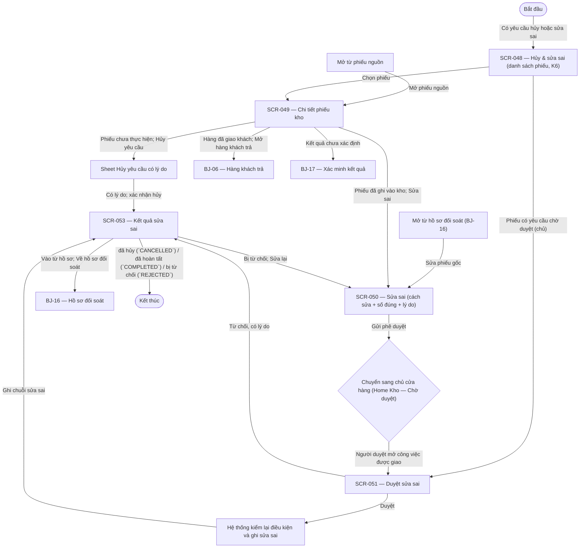

# UIF-11 — Hủy và sửa sai nghiệp vụ kho

## 1. Mục đích và phạm vi

Mô tả cách xử lý một phiếu kho cần hủy hoặc sửa sai: tìm phiếu theo mã phiếu hoặc sản phẩm, biết hủy được hay phải sửa bằng một câu thường, hủy bằng sheet có lý do, sửa sai trong một màn, chủ cửa hàng duyệt và ghi nhận kết quả. Danh sách phiếu là khuôn K6; việc chờ duyệt hiện ở Home Kho (K2). iPhone và web đều là thiết bị chính.

- **Hành trình nghiệp vụ:** [BJ-11 — Hủy và sửa sai nghiệp vụ kho](../../02.specification/behavior/journeys/BJ-11-huy-va-sua-sai-nghiep-vu-kho.md)
- **Trường hợp sử dụng liên quan:**
  - [UC-11-01 — Xác định đường xử lý](../../02.specification/behavior/use-cases/UC-11-01-xac-dinh-duong-xu-ly.md)
  - [UC-11-02 — Hủy nghiệp vụ chưa thực thi](../../02.specification/behavior/use-cases/UC-11-02-huy-operation-chua-thuc-thi.md)
  - [UC-11-03 — Chuẩn bị phương án sửa sai](../../02.specification/behavior/use-cases/UC-11-03-chuan-bi-phuong-an-correction.md)
  - [UC-11-04 — Phê duyệt sửa sai](../../02.specification/behavior/use-cases/UC-11-04-phe-duyet-correction.md)
  - [UC-11-05 — Ghi chuỗi sửa sai](../../02.specification/behavior/use-cases/UC-11-05-ghi-correction-chain.md)

**Ranh giới:** UIF chỉ mô tả cách người dùng đi qua các màn hình, điều kiện chuyển bước và cách xử lý khi không thể tiếp tục. Quy tắc nghiệp vụ vẫn lấy từ BJ/UC/Behavioral Contract; nội dung và thành phần của từng màn hình vẫn lấy từ Screen Contract.

## 2. Người dùng bắt đầu và kết thúc ở đâu

| Cách vào luồng | Màn hình | Người thực hiện | Đi từ đâu |
|---|---|---|---|
| Vào từ chức năng | `SCR-048` | Người phụ trách kho | Kho → Kiểm kê & xử lý → "Hủy & sửa sai nghiệp vụ" |
| Mở từ ngữ cảnh liên quan | `SCR-049` | Người phụ trách kho | Phiếu nguồn (entry `operation-context`) |
| Mở từ hồ sơ đối soát | `SCR-050` | Người lập sửa sai | Hồ sơ BJ-16 "Cần sửa phiếu gốc" → nút mở sửa sai (entry `correction-from-case`): vào thẳng màn sửa sai của đúng phiếu, "Số đúng" điền sẵn theo chứng từ, lý do trống; xong quay về đúng hồ sơ |
| Công việc được giao | `SCR-051` | Chủ cửa hàng (người duyệt) | **Home Kho → "Chờ duyệt" → dòng "{loại} {mã phiếu} · {sản phẩm}"** (K2, nguồn "sửa sai"). Chủ cửa hàng tự lập thì vẫn gửi rồi tự duyệt từ đây |

Luồng kết thúc khi người dùng đã nhận được kết quả cuối cùng hoặc công việc được chuyển rõ sang một hành trình khác. Trạng thái `UNKNOWN` không được coi là thành công; phải tiếp tục xác minh với đúng thao tác gốc.

## 3. Luồng màn hình

> Sơ đồ trên để đọc nhanh. Phần “Các bước chuyển màn hình” giải thích điều kiện và cách xử lý; phần “Truy vết kỹ thuật” giữ các mã phục vụ Dev/QA/Harness.

## 4. Các bước chuyển màn hình

| Bước | Từ đâu | Người dùng / hệ thống làm gì | Điều kiện cần | Đi đến | Nếu không thể tiếp tục |
|---|---|---|---|---|---|
| `UIF-11-T01` | Bắt đầu | Có yêu cầu hủy hoặc sửa sai | Có quyền hủy hoặc sửa sai | `SCR-048` — Hủy & sửa sai | — |
| `UIF-11-T02` | Mở từ phiếu nguồn | Mở phiếu nguồn | Có quyền xem và xử lý sửa sai | `SCR-049` — Chi tiết phiếu kho | — |
| `UIF-11-T03` | `SCR-048` — Hủy & sửa sai | Chọn phiếu | Phiếu thuộc phạm vi người dùng được xử lý | `SCR-049` — Chi tiết phiếu kho (phiếu có yêu cầu sửa sai chờ duyệt: chủ cửa hàng → `SCR-051`, người khác → `SCR-053` chỉ xem) | — |
| `UIF-11-T04` | `SCR-049` — Chi tiết phiếu kho | Phiếu chưa thực hiện; "Hủy yêu cầu" → sheet có lý do | Đã chứng minh chưa thay đổi chính thức; lý do bắt buộc | `SCR-053` — Kết quả sửa sai (`CANCELLED`) | Kết quả chưa xác định → BJ-17; không hủy trực tiếp phiếu đã ghi vào kho |
| `UIF-11-T05` | `SCR-049` — Chi tiết phiếu kho | Phiếu đã ghi vào kho; "Sửa sai" | Phiếu phải xử lý bằng sửa sai | `SCR-050` — Sửa sai | Đã có yêu cầu sửa sai chờ duyệt → `CONFLICT`; có nghiệp vụ phía sau phụ thuộc → `DEPENDENCY_BLOCKED`; không có kỳ mở → `PERIOD_POLICY_VIOLATION` |
| `UIF-11-T06` | `SCR-049` — Chi tiết phiếu kho | Hàng đã giao khách; "Mở hàng khách trả" | Hàng đã bàn giao thực tế | BJ-06 — `SCR-030` | Không xử lý bằng sửa sai |
| `UIF-11-T07` | `SCR-050` — Sửa sai | Chọn cách sửa, nhập số đúng và lý do; "Gửi phê duyệt" | Số đúng khác số đã ghi, có lý do | Chuyển sang chủ cửa hàng (toast "Đã gửi yêu cầu sửa sai"; người lập xem `SCR-053` chờ duyệt) | Tồn chưa đổi cho tới khi được duyệt |
| `UIF-11-T08` | Chuyển sang chủ cửa hàng | Chủ cửa hàng mở dòng "sửa sai" ở Home "Chờ duyệt" | Người duyệt là chủ cửa hàng (`is_owner` / `store_owner`); chủ tự lập vẫn tự duyệt | `SCR-051` — Duyệt sửa sai | — |
| `UIF-11-T09` | `SCR-051` — Duyệt sửa sai | Từ chối | Người duyệt hợp lệ; có lý do | `SCR-053` — Kết quả sửa sai (`REJECTED`) | Không ghi thay đổi sửa sai |
| `UIF-11-T10` | `SCR-051` — Duyệt sửa sai | Duyệt | Người duyệt hợp lệ; yêu cầu còn chờ | Hệ thống ghi nhận sửa sai | Không yêu cầu xác nhận thêm một lần nữa |
| `UIF-11-T11` | Hệ thống ghi nhận sửa sai | Kiểm lại điều kiện rồi ghi chuỗi sửa sai | Nguồn dữ liệu và căn cứ còn đạt | `SCR-053` — Kết quả sửa sai (`COMPLETED`) | Điều kiện không còn phù hợp → `BLOCKED`; chưa xác định (`UNKNOWN`) → BJ-17 |
| `UIF-11-T12` | `SCR-053` — Kết quả sửa sai | Bị từ chối; "Sửa lại" | Người lập hợp lệ | `SCR-050` — Sửa sai (số và lý do cũ được giữ; gửi lại thành yêu cầu mới) | — |
| `UIF-11-T13` | `SCR-053` — Kết quả sửa sai | Vào từ hồ sơ đối soát; "Về hồ sơ đối soát" | Luồng được mở từ BJ-16 | BJ-16 — `SCR-079` (hồ sơ được đánh dấu đã sửa phiếu gốc khi `COMPLETED`) | — |
| `UIF-11-T14` | `SCR-053` — Kết quả sửa sai | đã hủy (`CANCELLED`) / đã hoàn tất (`COMPLETED`) / bị từ chối (`REJECTED`); "Xem tồn kho" → BJ-01 | — | Kết thúc | chưa xác định (`UNKNOWN`) → BJ-17 |
| `UIF-11-T15` | `SCR-049` — Chi tiết phiếu kho | Kết quả của phiếu chưa xác định; "Chuyển sang xác minh" | — | BJ-17 | Giữ nguyên mã nghiệp vụ gốc |
| `UIF-11-T16` | Hồ sơ đối soát (BJ-16) | Sửa phiếu gốc | Hồ sơ kết luận cần sửa phiếu nguồn | `SCR-050` — Sửa sai (đúng phiếu, bỏ qua `SCR-048` / `SCR-049`) | Phiếu đã có yêu cầu chờ duyệt → `CONFLICT` |

## 5. Các tình huống cần chú ý

Các quy tắc chung về quyền, quay lại, dữ liệu thay đổi và chống ghi nhận lặp vẫn lấy từ UC/Behavioral Contract/Screen Contract. UIF chỉ nhắc lại những điểm ảnh hưởng trực tiếp đến cách đi qua màn hình.

- **Hủy chỉ cho phiếu chưa thực hiện** (nháp / chờ duyệt / sẵn sàng); hủy không tạo biến động tồn hay giá trị. Phiếu đã hoàn tất **không sửa tại chỗ**: sửa sai ghi thêm một phiếu liên kết, phiếu gốc giữ nguyên.
- **Hàng đã giao cho khách** chỉ quay về kho qua Hàng khách trả (BJ-06), không qua sửa sai.
- **Kỳ ghi:** sửa sai trong kỳ đã khoá ghi vào kỳ đang mở; không có kỳ mở thì chặn.
- **Tiền:** chủ cửa hàng / người duyệt thấy "Giá trị: {±x} đ" (`SCR-050`, `SCR-051`, `SCR-053`); nhân viên không có số tiền trong màn.
- **Duyệt không tự ghi:** sau khi chủ cửa hàng duyệt, hệ thống kiểm lại điều kiện rồi mới ghi; không còn phù hợp thì báo "Chưa thể ghi sửa sai".
- **BJ-16 → BJ-11:** hồ sơ đối soát kết luận "cần sửa phiếu gốc" thì chuyển sang đây; sửa xong, nút "Về hồ sơ đối soát" đưa về đúng hồ sơ để kiểm lại và đóng. BJ-11 không tự đóng hồ sơ đối soát.
- **Lối "Sửa sai" từ thẻ kho / biến động** (`SCR-056`) để chặng 6 (BJ-15).
- Khi công việc chuyển sang người duyệt hoặc một vai trò khác, phiên làm việc của người hiện tại kết thúc tại trạng thái chờ. Người tiếp theo mở công việc từ danh sách được giao; hệ thống không tự chuyển sang phiên của họ.
- Nếu kết quả chưa xác định (`UNKNOWN`), không thực hiện lại bằng một thao tác mới. Hệ thống giữ nguyên mã thao tác gốc để xác minh; khi chưa đủ bằng chứng, chuyển sang `BJ-17`.

## 6. Màn hình và Trường hợp sử dụng liên quan

| Trường hợp sử dụng | Màn hình sử dụng |
|---|---|
| [UC-11-01](../../02.specification/behavior/use-cases/UC-11-01-xac-dinh-duong-xu-ly.md) — Xác định đường xử lý | `SCR-048`, `SCR-049` |
| [UC-11-02](../../02.specification/behavior/use-cases/UC-11-02-huy-operation-chua-thuc-thi.md) — Hủy nghiệp vụ chưa thực thi | `SCR-049`, `SCR-053` |
| [UC-11-03](../../02.specification/behavior/use-cases/UC-11-03-chuan-bi-phuong-an-correction.md) — Chuẩn bị phương án sửa sai | `SCR-049`, `SCR-050` |
| [UC-11-04](../../02.specification/behavior/use-cases/UC-11-04-phe-duyet-correction.md) — Phê duyệt sửa sai | `SCR-051`, `SCR-053` |
| [UC-11-05](../../02.specification/behavior/use-cases/UC-11-05-ghi-correction-chain.md) — Ghi chuỗi sửa sai | `SCR-049`, `SCR-053` |

### Màn hình dùng trong luồng

| Màn hình | Tên | Vai trò trong luồng |
|---|---|---|
| [SCR-048](../screens/SCR-048.md) | Hủy & sửa sai | Màn hình chính trong luồng |
| [SCR-049](../screens/SCR-049.md) | Chi tiết phiếu kho | Màn hình chính trong luồng |
| [SCR-050](../screens/SCR-050.md) | Sửa sai | Màn hình chính trong luồng (gộp SCR-052) |
| [SCR-051](../screens/SCR-051.md) | Duyệt sửa sai | Màn hình chính trong luồng |
| [SCR-053](../screens/SCR-053.md) | Kết quả sửa sai | Màn hình chính trong luồng |

## 7. Truy vết kỹ thuật

> Phần này dành cho Dev/QA/Harness. Các mã kỹ thuật được giữ nguyên để Dev/QA/Harness đối chiếu tự động.

| Transition | From | To | Loại | Action | UC / BC |
|---|---|---|---|---|---|
| `UIF-11-T01` | `BEGIN` | `SCR-048` | `NAVIGATION` | `—` | UC-11-01 |
| `UIF-11-T02` | `CONTEXT_OPERATION` | `SCR-049` | `NAVIGATION` | `—` | UC-11-01 |
| `UIF-11-T03` | `SCR-048` | `SCR-049` | `NAVIGATION` | `—` | UC-11-01 |
| `UIF-11-T04` | `SCR-049` | `SCR-053` | `MUTATION` | `ACT-10-CANCEL` | UC-11-02 / BC-IO-12 |
| `UIF-11-T05` | `SCR-049` | `SCR-050` | `NAVIGATION` | `—` | UC-11-03 |
| `UIF-11-T06` | `SCR-049` | `BJ-06:SCR-030` | `NAVIGATION` | `—` | UC-11-01 |
| `UIF-11-T07` | `SCR-050` | `HANDOFF_APPROVAL` | `HANDOFF` | `ACT-10-SUBMIT` | UC-11-03, UC-11-04 / BC-IC-07 |
| `UIF-11-T08` | `HANDOFF_APPROVAL` | `SCR-051` | `HANDOFF` | `—` | UC-11-04 / BC-IC-06 |
| `UIF-11-T09` | `SCR-051` | `SCR-053` | `MUTATION` | `ACT-10-DECIDE` | UC-11-04 / BC-IC-06 |
| `UIF-11-T10` | `SCR-051` | `SYSTEM_CORRECTION` | `MUTATION` | `ACT-10-DECIDE` | UC-11-04 / BC-IC-06 |
| `UIF-11-T11` | `SYSTEM_CORRECTION` | `SCR-053` | `SYSTEM` | `ACT-10-CORRECT` | UC-11-05 / BC-IO-13 |
| `UIF-11-T12` | `SCR-053` | `SCR-050` | `NAVIGATION` | `—` | UC-11-03 |
| `UIF-11-T13` | `SCR-053` | `BJ-16:SCR-079` | `NAVIGATION` | `—` | UC-11-05 |
| `UIF-11-T14` | `SCR-053` | `END` | `TERMINAL` | `—` | UC-11-02…UC-11-05 |
| `UIF-11-T15` | `SCR-049` | `BJ-17` | `HANDOFF` | `—` | UC-11-01 |
| `UIF-11-T16` | `CONTEXT_CASE` | `SCR-050` | `NAVIGATION` | `—` | UC-11-03 |

## 8. Kiểm tra tính đầy đủ và liên kết

- [x] Tất cả Trường hợp sử dụng liên quan đều được liên kết từ UIF.
- [x] Mỗi màn hình đang dùng trong luồng có Screen Contract tương ứng.
- [x] Các bước do hệ thống thực hiện không bị mô tả thành thao tác của người dùng.
- [x] Nếu có phê duyệt hoặc chuyển vai trò, người gửi và người nhận có điểm vào riêng.
- [x] Trạng thái kết thúc và trường hợp `UNKNOWN` có hướng xử lý rõ khi áp dụng.
- [x] Bảng đọc chính và bảng truy vết kỹ thuật dùng cùng một tập transition ID.
- [x] Liên kết BJ ↔ UIF ↔ UC/SCR dùng đường dẫn tương đối và mở đúng tài liệu đích.

**Trạng thái đối chiếu thiết kế:** `REDESIGNED_v5.17.0` — danh sách phiếu K6; hủy thành sheet có lý do ở `SCR-049`; `SCR-052` gộp vào `SCR-050`; duyệt theo K2 (Home "Chờ duyệt", chủ cửa hàng tự lập vẫn tự duyệt, có tiền); lối vào và lối về hồ sơ đối soát BJ-16. Chi tiết thay đổi ở `03.design/prototype/html/CHANGELOG.md`.

### Liên kết

- [Business Journey](../../02.specification/behavior/journeys/BJ-11-huy-va-sua-sai-nghiep-vu-kho.md)
- [Business Journey Map](../../02.specification/behavior/journeys/00-business-journey-map.md)
- [Use Case Map](../../02.specification/behavior/use-cases/00-use-case-map.md)
- [Prototype manifest](../prototype/README.md)
