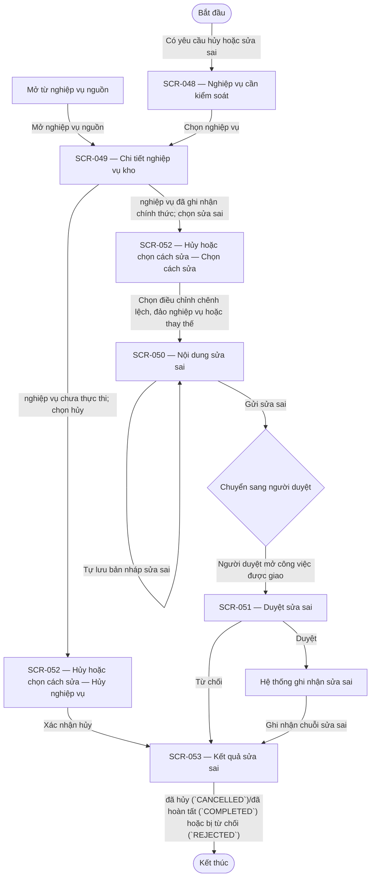

# UIF-11 — Hủy và sửa sai nghiệp vụ kho

## 1. Mục đích và phạm vi

Mô tả cách xử lý một nghiệp vụ kho cần hủy hoặc sửa sai: xác định hướng xử lý, chuẩn bị nội dung sửa, phê duyệt và ghi nhận kết quả.

- **Hành trình nghiệp vụ:** [BJ-11 — Hủy và sửa sai nghiệp vụ kho](../../02.specification/behavior/journeys/BJ-11-huy-va-sua-sai-nghiep-vu-kho.md)
- **Trường hợp sử dụng liên quan:**
  - [UC-11-01 — Xác định đường xử lý](../../02.specification/behavior/use-cases/UC-11-01-xac-dinh-duong-xu-ly.md)
  - [UC-11-02 — Hủy nghiệp vụ chưa thực thi](../../02.specification/behavior/use-cases/UC-11-02-huy-operation-chua-thuc-thi.md)
  - [UC-11-03 — Chuẩn bị phương án sửa sai](../../02.specification/behavior/use-cases/UC-11-03-chuan-bi-phuong-an-correction.md)
  - [UC-11-04 — Phê duyệt sửa sai](../../02.specification/behavior/use-cases/UC-11-04-phe-duyet-correction.md)
  - [UC-11-05 — Ghi chuỗi sửa sai](../../02.specification/behavior/use-cases/UC-11-05-ghi-correction-chain.md)

**Ranh giới:** UIF chỉ mô tả cách người dùng đi qua các màn hình, điều kiện chuyển bước và cách xử lý khi không thể tiếp tục. Quy tắc nghiệp vụ vẫn lấy từ BJ/UC/Behavioral Contract; nội dung và thành phần của từng màn hình vẫn lấy từ Screen Contract.

## 2. Người dùng bắt đầu và kết thúc ở đâu

| Cách vào luồng | Màn hình | Người thực hiện | Đi từ đâu |
|---|---|---|---|
| Vào từ chức năng | `SCR-048` | Người phụ trách kho | Kho > Kiểm soát > Sửa sai |
| Mở từ ngữ cảnh liên quan | `SCR-049` | Người phụ trách kho | Chi tiết nghiệp vụ nguồn |
| Công việc được giao | `SCR-051` | Người duyệt độc lập | Công việc duyệt sửa sai |

Luồng kết thúc khi người dùng đã nhận được kết quả cuối cùng hoặc công việc được chuyển rõ sang một hành trình khác. Trạng thái `UNKNOWN` không được coi là thành công; phải tiếp tục xác minh với đúng thao tác gốc.

## 3. Luồng màn hình

> Sơ đồ trên để đọc nhanh. Phần “Các bước chuyển màn hình” giải thích điều kiện và cách xử lý; phần “Truy vết kỹ thuật” giữ các mã phục vụ Dev/QA/Harness.

## 4. Các bước chuyển màn hình

| Bước | Từ đâu | Người dùng / hệ thống làm gì | Điều kiện cần | Đi đến | Nếu không thể tiếp tục |
|---|---|---|---|---|---|
| `UIF-11-T01` | Bắt đầu | Có yêu cầu hủy hoặc sửa sai | Có quyền kiểm soát | `SCR-048` — Nghiệp vụ cần kiểm soát | — |
| `UIF-11-T02` | Mở từ nghiệp vụ nguồn | Mở nghiệp vụ nguồn | Có quyền xem và xử lý sửa sai | `SCR-049` — Chi tiết nghiệp vụ kho | — |
| `UIF-11-T03` | `SCR-048` — Nghiệp vụ cần kiểm soát | Chọn nghiệp vụ | Nghiệp vụ thuộc phạm vi người dùng được xử lý | `SCR-049` — Chi tiết nghiệp vụ kho | — |
| `UIF-11-T04` | `SCR-049` — Chi tiết nghiệp vụ kho | nghiệp vụ chưa thực thi; chọn hủy | Đã chứng minh chưa thay đổi chính thức | `SCR-052` — Hủy hoặc chọn cách sửa — hủy nghiệp vụ | chưa xác định (`UNKNOWN`) → BJ-17 |
| `UIF-11-T05` | `SCR-052` — Hủy hoặc chọn cách sửa — hủy nghiệp vụ | Xác nhận hủy | Có quyền hủy | `SCR-053` — Kết quả sửa sai | Không hủy trực tiếp một nghiệp vụ đã được ghi nhận chính thức |
| `UIF-11-T06` | `SCR-049` — Chi tiết nghiệp vụ kho | nghiệp vụ đã ghi nhận chính thức; chọn sửa sai | Trường hợp này phải xử lý bằng sửa sai | `SCR-052` — Hủy hoặc chọn cách sửa — chọn cách sửa | — |
| `UIF-11-T07` | `SCR-052` — Hủy hoặc chọn cách sửa — chọn cách sửa | Chọn điều chỉnh chênh lệch, đảo nghiệp vụ hoặc thay thế | Cách sửa đã chọn phù hợp | `SCR-050` — Nội dung sửa sai | — |
| `UIF-11-T08` | `SCR-050` — Nội dung sửa sai | Tự lưu bản nháp sửa sai | bản nháp có thể chỉnh sửa | `SCR-050` — Nội dung sửa sai | Hệ thống tự lưu; không cần nút “Lưu nháp” |
| `UIF-11-T09` | `SCR-050` — Nội dung sửa sai | Gửi sửa sai | Người lập có quyền gửi | Chuyển sang người duyệt | Người lập công việc kết thúc |
| `UIF-11-T10` | Chuyển sang người duyệt | Người duyệt mở công việc được giao | Người duyệt độc lập | `SCR-051` — Duyệt sửa sai | — |
| `UIF-11-T11` | `SCR-051` — Duyệt sửa sai | Từ chối | Người duyệt hợp lệ | `SCR-053` — Kết quả sửa sai | Không ghi thay đổi sửa sai |
| `UIF-11-T12` | `SCR-051` — Duyệt sửa sai | Duyệt | Người duyệt hợp lệ | Hệ thống ghi nhận sửa sai | Không yêu cầu người dùng xác nhận thêm một lần nữa |
| `UIF-11-T13` | Hệ thống ghi nhận sửa sai | Ghi nhận chuỗi sửa sai | Hệ thống kiểm tra lại nguồn dữ liệu và căn cứ | `SCR-053` — Kết quả sửa sai | chưa xác định (`UNKNOWN`) → BJ-17 |
| `UIF-11-T14` | `SCR-053` — Kết quả sửa sai | đã hủy (`CANCELLED`)/đã hoàn tất (`COMPLETED`) hoặc bị từ chối (`REJECTED`) | — | Kết thúc | chưa xác định (`UNKNOWN`) → BJ-17 |

## 5. Các tình huống cần chú ý

Các quy tắc chung về quyền, quay lại, dữ liệu thay đổi và chống ghi nhận lặp vẫn lấy từ UC/Behavioral Contract/Screen Contract. UIF chỉ nhắc lại những điểm ảnh hưởng trực tiếp đến cách đi qua màn hình.

- Khi công việc chuyển sang người duyệt hoặc một vai trò khác, phiên làm việc của người hiện tại kết thúc tại trạng thái chờ. Người tiếp theo mở công việc từ danh sách được giao; hệ thống không tự chuyển sang phiên của họ.
- Nếu kết quả chưa xác định (`UNKNOWN`), không thực hiện lại bằng một thao tác mới. Hệ thống giữ nguyên mã thao tác gốc để xác minh; khi chưa đủ bằng chứng, chuyển sang `BJ-17`.

## 6. Màn hình và Trường hợp sử dụng liên quan

| Trường hợp sử dụng | Màn hình sử dụng |
|---|---|
| [UC-11-01](../../02.specification/behavior/use-cases/UC-11-01-xac-dinh-duong-xu-ly.md) — Xác định đường xử lý | `SCR-048`, `SCR-049`, `SCR-050` |
| [UC-11-02](../../02.specification/behavior/use-cases/UC-11-02-huy-operation-chua-thuc-thi.md) — Hủy nghiệp vụ chưa thực thi | `SCR-052`, `SCR-053` |
| [UC-11-03](../../02.specification/behavior/use-cases/UC-11-03-chuan-bi-phuong-an-correction.md) — Chuẩn bị phương án sửa sai | `SCR-049`, `SCR-052` |
| [UC-11-04](../../02.specification/behavior/use-cases/UC-11-04-phe-duyet-correction.md) — Phê duyệt sửa sai | `SCR-051`, `SCR-053` |
| [UC-11-05](../../02.specification/behavior/use-cases/UC-11-05-ghi-correction-chain.md) — Ghi chuỗi sửa sai | `SCR-049`, `SCR-053` |

### Màn hình dùng trong luồng

| Màn hình | Tên | Vai trò trong luồng |
|---|---|---|
| [SCR-048](../screens/SCR-048.md) | Nghiệp vụ cần kiểm soát | Màn hình chính trong luồng |
| [SCR-049](../screens/SCR-049.md) | Chi tiết nghiệp vụ kho | Màn hình chính trong luồng |
| [SCR-052](../screens/SCR-052.md) | Hủy hoặc chọn cách sửa | Màn hình chính trong luồng |
| [SCR-050](../screens/SCR-050.md) | Nội dung sửa sai | Màn hình chính trong luồng |
| [SCR-051](../screens/SCR-051.md) | Duyệt sửa sai | Màn hình chính trong luồng |
| [SCR-053](../screens/SCR-053.md) | Kết quả sửa sai | Màn hình chính trong luồng |

## 7. Truy vết kỹ thuật

> Phần này dành cho Dev/QA/Harness. Các mã kỹ thuật được giữ nguyên để Dev/QA/Harness đối chiếu tự động.

| Transition | From | To | Loại | Action | UC / BC |
|---|---|---|---|---|---|
| `UIF-11-T01` | `BEGIN` | `SCR-048` | `NAVIGATION` | `—` | UC-11-01 |
| `UIF-11-T02` | `CONTEXT_OPERATION` | `SCR-049` | `NAVIGATION` | `—` | UC-11-01 |
| `UIF-11-T03` | `SCR-048` | `SCR-049` | `NAVIGATION` | `—` | UC-11-01 |
| `UIF-11-T04` | `SCR-049` | `SCR-052:CANCEL` | `NAVIGATION` | `—` | UC-11-02 |
| `UIF-11-T05` | `SCR-052:CANCEL` | `SCR-053` | `MUTATION` | `ACT-10-CANCEL` | UC-11-02 / BC-IO-12 |
| `UIF-11-T06` | `SCR-049` | `SCR-052:STRATEGY` | `NAVIGATION` | `—` | UC-11-03 |
| `UIF-11-T07` | `SCR-052:STRATEGY` | `SCR-050` | `NAVIGATION` | `—` | UC-11-03 |
| `UIF-11-T08` | `SCR-050` | `SCR-050` | `SYSTEM` | `ACT-10-SAVE-DRAFT` | UC-11-03 / BC-IO-16 |
| `UIF-11-T09` | `SCR-050` | `HANDOFF_APPROVAL` | `HANDOFF` | `ACT-10-SUBMIT` | UC-11-03, UC-11-04 / BC-IC-07 |
| `UIF-11-T10` | `HANDOFF_APPROVAL` | `SCR-051` | `HANDOFF` | `—` | UC-11-04 / BC-IC-06 |
| `UIF-11-T11` | `SCR-051` | `SCR-053` | `MUTATION` | `ACT-10-DECIDE` | UC-11-04 / BC-IC-06 |
| `UIF-11-T12` | `SCR-051` | `SYSTEM_CORRECTION` | `MUTATION` | `ACT-10-DECIDE` | UC-11-04 / BC-IC-06 |
| `UIF-11-T13` | `SYSTEM_CORRECTION` | `SCR-053` | `SYSTEM` | `ACT-10-CORRECT` | UC-11-05 / BC-IO-13 |
| `UIF-11-T14` | `SCR-053` | `END` | `TERMINAL` | `—` | UC-11-02…UC-11-05 |

## 8. Kiểm tra tính đầy đủ và liên kết

- [x] Tất cả Trường hợp sử dụng liên quan đều được liên kết từ UIF.
- [x] Mỗi màn hình đang dùng trong luồng có Screen Contract tương ứng.
- [x] Các bước do hệ thống thực hiện không bị mô tả thành thao tác của người dùng.
- [x] Nếu có phê duyệt hoặc chuyển vai trò, người gửi và người nhận có điểm vào riêng.
- [x] Trạng thái kết thúc và trường hợp `UNKNOWN` có hướng xử lý rõ khi áp dụng.
- [x] Bảng đọc chính và bảng truy vết kỹ thuật dùng cùng một tập transition ID; không đổi topology hoặc hành vi.
- [x] Liên kết BJ ↔ UIF ↔ UC/SCR dùng đường dẫn tương đối và mở đúng tài liệu đích.

**Trạng thái đối chiếu thiết kế:** `ALIGNED_TO_CURRENT_SCREEN_CONTRACTS` — UIF đã được viết lại theo Plain BA Language; cấu trúc luồng, ID, mã Action, liên kết UC/BC và trạng thái đối chiếu của v4.1.0 được giữ nguyên. HTML và Screen Contract không thay đổi trong lượt này.

### Liên kết

- [Business Journey](../../02.specification/behavior/journeys/BJ-11-huy-va-sua-sai-nghiep-vu-kho.md)
- [Business Journey Map](../../02.specification/behavior/journeys/00-business-journey-map.md)
- [Use Case Map](../../02.specification/behavior/use-cases/00-use-case-map.md)
- [Prototype manifest](../prototype/README.md)
