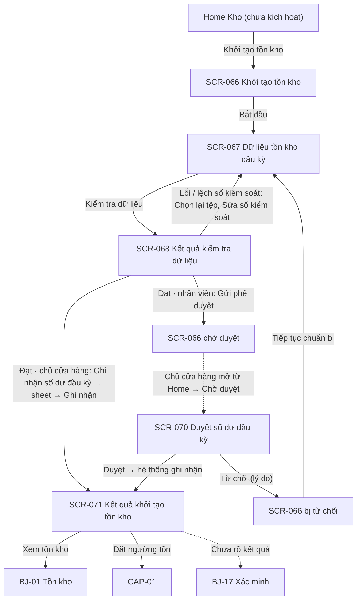

# UIF-12 — Khởi tạo số dư tồn kho đầu kỳ

## 1. Việc thật

Chủ cửa hàng mới (hoặc cửa hàng chuyển từ sổ tay / Excel sang) đưa đúng số tồn hiện có — theo lô, hạn dùng, tình trạng, giá trị — vào hệ thống, khớp với sổ của mình, rồi bắt đầu bán. Thường chính chủ cửa hàng làm một mình trên máy tính, **một lần duy nhất**; đôi khi nhờ nhân viên (kế toán) chuẩn bị tệp rồi chủ cửa hàng duyệt. Khi chưa xong, Kho chưa kích hoạt: chưa nhận hàng, bán, kiểm kê được. Sai sau này sửa bằng điều chỉnh, không làm lại.

Thiết bị chính: web (chủ cửa hàng ngồi máy tính); iPhone vẫn làm được đủ việc.

- BJ: [BJ-12 — Khởi tạo số dư tồn kho đầu kỳ](../../02.specification/behavior/journeys/BJ-12-khoi-tao-so-du-ton-kho-au-ky.md)
- UC: [UC-12-01](../../02.specification/behavior/use-cases/UC-12-01-nap-va-kiem-tra-batch-dau-ky.md), [UC-12-02](../../02.specification/behavior/use-cases/UC-12-02-ra-soat-va-duyet-batch.md), [UC-12-03](../../02.specification/behavior/use-cases/UC-12-03-commit-va-kich-hoat-ton-kho.md)

## 2. Lối vào và lối ra

| Hướng | Từ / đến | Điều kiện |
|---|---|---|
| Vào | Home Kho, khối "Kho chưa kích hoạt" → "Khởi tạo tồn kho" | Kho chưa kích hoạt; chủ cửa hàng (đường tự duyệt) |
| Vào | Thiết lập kho → "Khởi tạo tồn đầu kỳ" | Đường phụ |
| Vào (chỉ prototype) | Chế độ BJ, vai mặc định | Đường nhân viên lập → "Gửi phê duyệt": mọi lối vào từ Hub đặt vai chủ cửa hàng, nên trong chế độ Toàn Theme 7 chỉ demo được bằng `__VET45_QA__.setActor` (`SC_bj12_pending_list`) |
| Vào | Home Kho → Cần chú ý → "Chờ duyệt" → "Số dư đầu kỳ" | Có số dư chờ duyệt; vào thẳng SCR-070 với vai người duyệt |
| Ra | BJ-01 (SCR-001) | "Xem tồn kho" ở kết quả |
| Ra | CAP-01 | "Đặt ngưỡng tồn" ở kết quả (việc tiếp theo của chặng "Mở kho") |
| Ra | BJ-17 | Chưa rõ kết quả → "Chuyển sang xác minh" |
| Ra | Home Kho | "Về Kho" ở chờ duyệt, chưa rõ kết quả, không có quyền |

## 3. Sơ đồ luồng

Hai đường: **chủ cửa hàng tự duyệt** (đường chính của demo: không có trạng thái chờ) và **nhân viên lập → chủ cửa hàng duyệt**.

## 4. Chuyển màn

| Từ | Hành động | Đến | Ghi chú |
|---|---|---|---|
| Home Kho | "Khởi tạo tồn kho" | SCR-066 `READY` | Cho tới khi kích hoạt: 4 nút nhanh của Home tắt; "Cần chú ý" chỉ còn "Chờ duyệt" của số dư đầu kỳ (nếu có), không có lô / sai lệch / nhận hàng |
| SCR-066 | "Bắt đầu" / "Tiếp tục chuẩn bị" | SCR-067 | Giữ dữ liệu đã nhập |
| SCR-067 | "Kiểm tra dữ liệu" | SCR-068 | Thiếu ô: ở lại, lỗi hiện tại ô. Không ghi gì vào kho |
| SCR-068 `VALIDATION_FAILED` | "Chọn lại tệp" | SCR-067 | Mỗi lỗi kèm cách sửa |
| SCR-068 `CONTROL_TOTAL_MISMATCH` | "Sửa số kiểm soát" / "Chọn lại tệp" | SCR-067 | Bảng Theo tệp · Theo sổ · Chênh lệch |
| SCR-068 `READY` · nhân viên | "Gửi phê duyệt" | SCR-066 `PENDING_APPROVAL` | Khoá dữ liệu; người lập không sang người duyệt, "Về Kho" |
| SCR-068 `READY` · chủ cửa hàng | "Ghi nhận số dư đầu kỳ" → "Ghi nhận" | SCR-071 | Sheet xác nhận: "Chỉ ghi nhận một lần. Sai sau này phải sửa bằng điều chỉnh." Số lệch → quay SCR-068 `CONTROL_TOTAL_MISMATCH` |
| Home Kho → Chờ duyệt | Mở "Số dư đầu kỳ" | SCR-070 | Vai người duyệt |
| SCR-070 | "Duyệt" | SCR-071 | "Duyệt" chỉ là quyết định; ghi nhận do hệ thống |
| SCR-070 | "Từ chối" → lý do bắt buộc → "Xác nhận từ chối" | SCR-066 `REJECTED` | Hiện lý do và người từ chối |
| SCR-071 `COMPLETED` | "Xem tồn kho" / "Đặt ngưỡng tồn" | BJ-01 / CAP-01 | Kho được kích hoạt |
| SCR-066, 071 | Chưa rõ kết quả | K3 | Không coi là thất bại, không nạp lại tệp hay gửi lại; "Chuyển sang xác minh" → BJ-17 |

SCR-069 (rà soát) đã gộp vào SCR-068; link cũ mở SCR-068 ở trạng thái mặc định.

## 5. Khuôn dùng chung áp dụng

Luồng này dựng các khuôn (hàm ở `app/shared-patterns.js`): K1 trạng thái chung (đang tải, không có quyền, dữ liệu cũ, khoá, rỗng sau lọc); K2 lập → duyệt → kết quả, gồm nhánh chủ cửa hàng tự duyệt và danh sách "Chờ duyệt" trên Home; K3 kết quả chưa rõ; K4 kết quả xong; K7 bố cục web (hai cột, bảng thay danh sách thẻ).

## 6. Liên kết với BJ khác

| Sang / từ BJ | Ở màn | Cách |
|---|---|---|
| Sang BJ-01 | SCR-071, SCR-066 `ACTIVE_RECONCILED` | "Xem tồn kho"; hàng trong bảng dòng dùng đúng 5 sản phẩm / lô của BJ-01 |
| Sang CAP-01 | SCR-071 | "Đặt ngưỡng tồn" |
| Sang BJ-17 | SCR-066, SCR-071 | "Chuyển sang xác minh" với đúng lần xử lý |
| Từ Hub | Home Kho | Khối "Kho chưa kích hoạt"; dòng "Chờ duyệt" gom mọi BJ |

## 7. Truy vết

BJ-12 · UC-12-01…03 · [SCR-066](../screens/SCR-066.md), [SCR-067](../screens/SCR-067.md), [SCR-068](../screens/SCR-068.md), [SCR-070](../screens/SCR-070.md), [SCR-071](../screens/SCR-071.md) (SCR-069 đã bỏ: [RETIRED](../screens/RETIRED.md)) · hành động `ACT-13-PREPARE` (BC-IC-09), `ACT-COMMON-DECIDE` (BC-IC-06), `ACT-13-COMMIT` (BC-IC-04, hệ thống) · golden: `SC_bj12_owner`, `SC_bj12_prepare`, `SC_bj12_approve`, `SC_bj12_pending_list`, `SC_bj12_reject`, `SC_bj12_mismatch`, `SC_bj12_failed`, `SC_bj12_unknown`, `SC_bj12_template`, `SC_hub_not_activated`.
