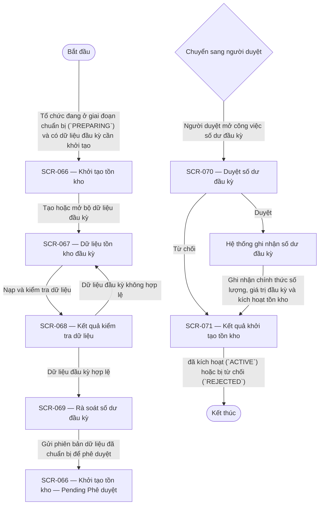

# UIF-12 — Khởi tạo số dư tồn kho đầu kỳ

## 1. Mục đích và phạm vi

Mô tả cách chuẩn bị dữ liệu tồn kho đầu kỳ, kiểm tra, phê duyệt và ghi nhận số dư để kích hoạt tồn kho ban đầu.

- **Hành trình nghiệp vụ:** [BJ-12 — Khởi tạo số dư tồn kho đầu kỳ](../../02.specification/behavior/journeys/BJ-12-khoi-tao-so-du-ton-kho-au-ky.md)
- **Trường hợp sử dụng liên quan:**
  - [UC-12-01 — Nạp và kiểm tra dữ liệu đầu kỳ](../../02.specification/behavior/use-cases/UC-12-01-nap-va-kiem-tra-batch-dau-ky.md)
  - [UC-12-02 — Rà soát và duyệt dữ liệu đầu kỳ](../../02.specification/behavior/use-cases/UC-12-02-ra-soat-va-duyet-batch.md)
  - [UC-12-03 — Ghi nhận và kích hoạt tồn kho](../../02.specification/behavior/use-cases/UC-12-03-commit-va-kich-hoat-ton-kho.md)

**Ranh giới:** UIF chỉ mô tả cách người dùng đi qua các màn hình, điều kiện chuyển bước và cách xử lý khi không thể tiếp tục. Quy tắc nghiệp vụ vẫn lấy từ BJ/UC/Behavioral Contract; nội dung và thành phần của từng màn hình vẫn lấy từ Screen Contract.

## 2. Người dùng bắt đầu và kết thúc ở đâu

| Cách vào luồng | Màn hình | Người thực hiện | Đi từ đâu |
|---|---|---|---|
| Vào từ chức năng | `SCR-066` | Người chuẩn bị số dư | Kho > Khởi tạo tồn kho |
| Công việc được giao | `SCR-070` | Người duyệt độc lập | Công việc duyệt số dư đầu kỳ |

Luồng kết thúc khi người dùng đã nhận được kết quả cuối cùng hoặc công việc được chuyển rõ sang một hành trình khác. Trạng thái `UNKNOWN` không được coi là thành công; phải tiếp tục xác minh với đúng thao tác gốc.

## 3. Luồng màn hình

> Sơ đồ trên để đọc nhanh. Phần “Các bước chuyển màn hình” giải thích điều kiện và cách xử lý; phần “Truy vết kỹ thuật” giữ các mã phục vụ Dev/QA/Harness.

## 4. Các bước chuyển màn hình

| Bước | Từ đâu | Người dùng / hệ thống làm gì | Điều kiện cần | Đi đến | Nếu không thể tiếp tục |
|---|---|---|---|---|---|
| `UIF-12-T01` | Bắt đầu | Tổ chức đang ở giai đoạn chuẩn bị (`PREPARING`) và có dữ liệu đầu kỳ cần khởi tạo | Có quyền khởi tạo | `SCR-066` — Khởi tạo tồn kho | — |
| `UIF-12-T02` | `SCR-066` — Khởi tạo tồn kho | Tạo hoặc mở bộ dữ liệu đầu kỳ | Người lập hợp lệ | `SCR-067` — Dữ liệu tồn kho đầu kỳ | — |
| `UIF-12-T03` | `SCR-067` — Dữ liệu tồn kho đầu kỳ | Nạp và kiểm tra dữ liệu | Tệp và tổng kiểm soát đủ điều kiện để kiểm tra | `SCR-068` — Kết quả kiểm tra dữ liệu | Dữ liệu không hợp lệ → quay lại SCR-067; chưa ghi nhận số dư |
| `UIF-12-T04` | `SCR-068` — Kết quả kiểm tra dữ liệu | Dữ liệu đầu kỳ hợp lệ | Kiểm tra dữ liệu đạt yêu cầu | `SCR-069` — Rà soát số dư đầu kỳ | — |
| `UIF-12-T05` | `SCR-068` — Kết quả kiểm tra dữ liệu | Dữ liệu đầu kỳ không hợp lệ | — | `SCR-067` — Dữ liệu tồn kho đầu kỳ | Chọn lại tệp hoặc sửa dữ liệu |
| `UIF-12-T06` | `SCR-069` — Rà soát số dư đầu kỳ | Gửi phiên bản dữ liệu đã chuẩn bị để phê duyệt | Người lập có quyền gửi | `SCR-066` — Khởi tạo tồn kho — chờ duyệt | Người lập công việc kết thúc; không sang người duyệt |
| `UIF-12-T07` | Chuyển sang người duyệt | Người duyệt mở công việc số dư đầu kỳ | Người duyệt độc lập | `SCR-070` — Duyệt số dư đầu kỳ | Người duyệt vào từ công việc được giao, tách khỏi phiên của người lập |
| `UIF-12-T08` | `SCR-070` — Duyệt số dư đầu kỳ | Từ chối | Người duyệt hợp lệ | `SCR-071` — Kết quả khởi tạo tồn kho | Không ghi nhận số dư và không kích hoạt tồn kho |
| `UIF-12-T09` | `SCR-070` — Duyệt số dư đầu kỳ | Duyệt | Người duyệt hợp lệ | Hệ thống ghi nhận số dư đầu kỳ | Phê duyệt ≠ ghi nhận chính thức |
| `UIF-12-T10` | Hệ thống ghi nhận số dư đầu kỳ | Ghi nhận chính thức số lượng, giá trị đầu kỳ và kích hoạt tồn kho | Hệ thống kiểm tra lại phiên bản dữ liệu đã được chuẩn bị | `SCR-071` — Kết quả khởi tạo tồn kho | chưa xác định (`UNKNOWN`) → BJ-17 |
| `UIF-12-T11` | `SCR-071` — Kết quả khởi tạo tồn kho | đã kích hoạt (`ACTIVE`) hoặc bị từ chối (`REJECTED`) | — | Kết thúc | — |

## 5. Các tình huống cần chú ý

Các quy tắc chung về quyền, quay lại, dữ liệu thay đổi và chống ghi nhận lặp vẫn lấy từ UC/Behavioral Contract/Screen Contract. UIF chỉ nhắc lại những điểm ảnh hưởng trực tiếp đến cách đi qua màn hình.

- Khi công việc chuyển sang người duyệt hoặc một vai trò khác, phiên làm việc của người hiện tại kết thúc tại trạng thái chờ. Người tiếp theo mở công việc từ danh sách được giao; hệ thống không tự chuyển sang phiên của họ.
- Nếu kết quả chưa xác định (`UNKNOWN`), không thực hiện lại bằng một thao tác mới. Hệ thống giữ nguyên mã thao tác gốc để xác minh; khi chưa đủ bằng chứng, chuyển sang `BJ-17`.

## 6. Màn hình và Trường hợp sử dụng liên quan

| Trường hợp sử dụng | Màn hình sử dụng |
|---|---|
| [UC-12-01](../../02.specification/behavior/use-cases/UC-12-01-nap-va-kiem-tra-batch-dau-ky.md) — Nạp và kiểm tra dữ liệu đầu kỳ | `SCR-066`, `SCR-067`, `SCR-068` |
| [UC-12-02](../../02.specification/behavior/use-cases/UC-12-02-ra-soat-va-duyet-batch.md) — Rà soát và duyệt dữ liệu đầu kỳ | `SCR-069`, `SCR-070` |
| [UC-12-03](../../02.specification/behavior/use-cases/UC-12-03-commit-va-kich-hoat-ton-kho.md) — Ghi nhận và kích hoạt tồn kho | `SCR-070`, `SCR-071` |

### Màn hình dùng trong luồng

| Màn hình | Tên | Vai trò trong luồng |
|---|---|---|
| [SCR-066](../screens/SCR-066.md) | Khởi tạo tồn kho | Màn hình chính trong luồng |
| [SCR-067](../screens/SCR-067.md) | Dữ liệu tồn kho đầu kỳ | Màn hình chính trong luồng |
| [SCR-068](../screens/SCR-068.md) | Kết quả kiểm tra dữ liệu | Màn hình chính trong luồng |
| [SCR-069](../screens/SCR-069.md) | Rà soát số dư đầu kỳ | Màn hình chính trong luồng |
| [SCR-070](../screens/SCR-070.md) | Duyệt số dư đầu kỳ | Màn hình chính trong luồng |
| [SCR-071](../screens/SCR-071.md) | Kết quả khởi tạo tồn kho | Màn hình chính trong luồng |

## 7. Truy vết kỹ thuật

> Phần này dành cho Dev/QA/Harness. Các mã kỹ thuật được giữ nguyên để Dev/QA/Harness đối chiếu tự động.

| Transition | From | To | Loại | Action | UC / BC |
|---|---|---|---|---|---|
| `UIF-12-T01` | `BEGIN` | `SCR-066` | `NAVIGATION` | `—` | UC-12-01 |
| `UIF-12-T02` | `SCR-066` | `SCR-067` | `NAVIGATION` | `—` | UC-12-01 |
| `UIF-12-T03` | `SCR-067` | `SCR-068` | `MUTATION` | `ACT-13-PREPARE` | UC-12-01 / BC-IC-09 |
| `UIF-12-T04` | `SCR-068` | `SCR-069` | `NAVIGATION` | `—` | UC-12-02 |
| `UIF-12-T05` | `SCR-068` | `SCR-067` | `NAVIGATION` | `—` | UC-12-01 |
| `UIF-12-T06` | `SCR-069` | `SCR-066:PENDING_APPROVAL` | `MUTATION` | `ACT-13-PREPARE` | UC-12-02 / BC-IC-09 |
| `UIF-12-T07` | `HANDOFF_APPROVAL` | `SCR-070` | `HANDOFF` | `—` | UC-12-02, UC-12-03 / BC-IC-06 |
| `UIF-12-T08` | `SCR-070` | `SCR-071` | `MUTATION` | `ACT-COMMON-DECIDE` | UC-12-02 / BC-IC-06 |
| `UIF-12-T09` | `SCR-070` | `SYSTEM_COMMIT` | `MUTATION` | `ACT-COMMON-DECIDE` | UC-12-02 / BC-IC-06 |
| `UIF-12-T10` | `SYSTEM_COMMIT` | `SCR-071` | `SYSTEM` | `ACT-13-COMMIT` | UC-12-03 / BC-IC-04 |
| `UIF-12-T11` | `SCR-071` | `END` | `TERMINAL` | `—` | UC-12-03 |

## 8. Kiểm tra tính đầy đủ và liên kết

- [x] Tất cả Trường hợp sử dụng liên quan đều được liên kết từ UIF.
- [x] Mỗi màn hình đang dùng trong luồng có Screen Contract tương ứng.
- [x] Các bước do hệ thống thực hiện không bị mô tả thành thao tác của người dùng.
- [x] Nếu có phê duyệt hoặc chuyển vai trò, người gửi và người nhận có điểm vào riêng.
- [x] Trạng thái kết thúc và trường hợp `UNKNOWN` có hướng xử lý rõ khi áp dụng.
- [x] Bảng đọc chính và bảng truy vết kỹ thuật dùng cùng một tập transition ID; không đổi topology hoặc hành vi.
- [x] Liên kết BJ ↔ UIF ↔ UC/SCR dùng đường dẫn tương đối và mở đúng tài liệu đích.

**Trạng thái đối chiếu thiết kế:** `ALIGNED_TO_CURRENT_SCREEN_CONTRACTS` — UIF đã được viết lại theo Plain BA Language; cấu trúc luồng, ID, mã Action, liên kết UC/BC và trạng thái đối chiếu của v4.1.0 được giữ nguyên. HTML và Screen Contract không thay đổi trong lượt này.

### Liên kết

- [Business Journey](../../02.specification/behavior/journeys/BJ-12-khoi-tao-so-du-ton-kho-au-ky.md)
- [Business Journey Map](../../02.specification/behavior/journeys/00-business-journey-map.md)
- [Use Case Map](../../02.specification/behavior/use-cases/00-use-case-map.md)
- [Prototype manifest](../prototype/README.md)
