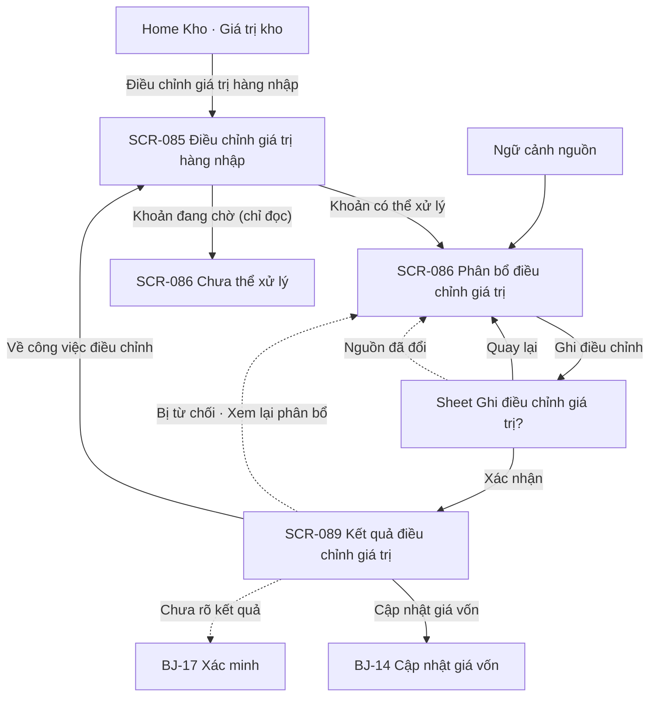

# UIF-13 — Điều chỉnh giá trị hàng nhập

## 1. Việc thật

Sau khi hàng đã xác lập giá (BJ-03), thỉnh thoảng có khoản liên quan đến sau: hoá đơn vận chuyển, phí bảo hiểm, phí kiểm định, chiết khấu nhà cung cấp gửi sau. Chủ cửa hàng (cửa hàng không có kế toán riêng — "kế toán" trong đặc tả là chủ cửa hàng) cần biết khoản này tăng hay giảm bao nhiêu, áp vào những hàng nào, mỗi sản phẩm nhận bao nhiêu, ghi vào kỳ nào; ghi một lần để giá vốn được tính lại (BJ-14). Vài lần một tháng, thường ở máy tính; iPhone và web đều là thiết bị chính.

Khoản **đến từ nguồn** (Mua hàng / nguồn có thẩm quyền) kèm phạm vi và cách phân bổ đã có; chủ cửa hàng không tự gõ khoản. Không có bước duyệt (UC-13-01).

- BJ: [BJ-13 — Điều chỉnh giá trị hàng nhập](../../02.specification/behavior/journeys/BJ-13-dieu-chinh-gia-tri-hang-nhap.md)
- UC: [UC-13-01 — Ghi nhận điều chỉnh giá trị hàng nhập](../../02.specification/behavior/use-cases/UC-13-01-ghi-nhan-dieu-chinh-gia-tri-hang-nhap.md)

## 2. Lối vào và lối ra

| Hướng | Từ / đến | Điều kiện |
|---|---|---|
| Vào | Home Kho → Quản lý kho → Giá trị kho → "Điều chỉnh giá trị hàng nhập" | Chủ cửa hàng → SCR-085 |
| Vào | Ngữ cảnh nguồn (`entry=source-task`) | → SCR-086 của khoản đó |
| Vào | SCR-018 (link cũ của BJ-03) | → SCR-085 |
| Vào (chỉ prototype) | `entry=staff` | SCR-085 với vai nhân viên: thấy "Bạn chưa có quyền điều chỉnh giá trị" |
| Ra | BJ-14 | "Cập nhật giá vốn" ở kết quả (mở màn hiện có; BJ-14 thiết kế lại ở chặng 6) |
| Ra | BJ-17 | Chưa rõ kết quả → "Chuyển sang xác minh" |
| Ra | BJ-11 | Phát hiện đã ghi sai giá ban đầu → sửa sai (không dùng điều chỉnh) |
| Ra | Home Kho | Nút quay lại ở SCR-085 / "Về Kho" (không có quyền, bị từ chối, chưa rõ kết quả) |

SCR-087, SCR-088 đã bỏ: link cũ mở SCR-086 — xem [RETIRED](../screens/RETIRED.md).

## 3. Sơ đồ luồng

Một đường chính: mở khoản → xem phân bổ (một màn) → ghi một lần → kết quả. Không có màn rà soát riêng, không có bước duyệt.

## 4. Chuyển màn

| ID | Từ | Hành động | Đến | Ghi chú |
|---|---|---|---|---|
| UIF-13-T01 | Home Kho | "Điều chỉnh giá trị hàng nhập" | SCR-085 | — |
| UIF-13-T02 | Ngữ cảnh nguồn | Mở khoản | SCR-086 | Nguồn hiện hành |
| UIF-13-T03 | SCR-085 | Mở khoản | SCR-086 | Khoản đang chờ vẫn mở, chỉ đọc: "Chưa thể xử lý" + lý do, không có nút ghi |
| UIF-13-T04 | SCR-086 | "Ghi điều chỉnh" | Sheet xác nhận | Bật khi có phương pháp hợp lệ, tổng phân bổ = giá trị điều chỉnh |
| UIF-13-T05 | Sheet xác nhận | "Quay lại" / Esc | SCR-086 | Không ghi |
| UIF-13-T06 | Sheet xác nhận | "Xác nhận" | SCR-089 | Kiểm lại nguồn / phạm vi / chỉ số / bản xem trước; lệch → SCR-086 `SOURCE_CHANGED` (từ chối cả lệnh) |
| UIF-13-T07 | SCR-089 | "Về công việc điều chỉnh" / "Cập nhật giá vốn" | SCR-085 / BJ-14 | Sản phẩm + kỳ đã đánh dấu cần cập nhật |
| UIF-13-T08 | SCR-089 `REJECTED_EXECUTION` | "Xem lại phân bổ" | SCR-086 | Không có thay đổi |
| UIF-13-T09 | SCR-089 `UNKNOWN` | "Chuyển sang xác minh" | BJ-17 | Đúng lần ghi này, không ghi lại |
| — | SCR-086 | Quay lại | SCR-085 | — |

## 5. Khuôn dùng chung áp dụng

K1 trạng thái chung (đang tải, rỗng, không có quyền); K3 kết quả chưa rõ (SCR-089 `UNKNOWN`); K4 kết quả xong (SCR-089); K7 bố cục web (SCR-085 bảng nguồn; SCR-086 hai cột: trái nguồn + cách phân bổ + kỳ, phải bảng phân bổ có dòng tổng); `dsChoiceRow` khi có nhiều phương pháp; sheet / hộp thoại xác nhận theo khuôn BJ-12 / BJ-03. **Không K2** (UC-13-01 không có bước duyệt).

## 6. Liên kết với BJ khác

| Sang / từ BJ | Ở màn | Cách |
|---|---|---|
| Từ BJ-03 | — | Chỉ hàng đã xác lập giá mới là đích phân bổ; giá trị nhập và số lượng lấy theo số BJ-03 đã ghi |
| Sang BJ-14 | SCR-089 | "Cập nhật giá vốn": ghi xong chỉ đánh dấu sản phẩm + kỳ cần cập nhật, không tự công bố giá vốn |
| Sang BJ-11 | — | Ghi sai fact đã biết → sửa sai, không dùng điều chỉnh |
| Sang BJ-17 | SCR-089 | "Chuyển sang xác minh" |

**Hết chặng 2 "Nhập hàng"** (`SC_journey_2`): Home Kho → nhận hàng PN-260816-04 (Nobivac 121 / 120, vượt +1) → gửi duyệt → duyệt → xác lập giá (Nobivac 9.885.700 đ) → Home → Giá trị kho → "Điều chỉnh giá trị hàng nhập" → VC-8842 (+ 1.200.000 đ, Nobivac "Giá trị nhập 9.885.700 đ") → ghi → Home. Fixture chung chặng 2: Nobivac DHPPi (SP-000184), phiếu PN-260816-04 — cùng bộ với BJ-01, BJ-02, BJ-03.

## 7. Truy vết

BJ-13 · UC-13-01 · [SCR-085](../screens/SCR-085.md), [SCR-086](../screens/SCR-086.md), [SCR-089](../screens/SCR-089.md) (SCR-018, SCR-087, SCR-088 đã bỏ: [RETIRED](../screens/RETIRED.md)) · BC-IV-06 (xem trước), BC-IV-04 (ghi) · hành động `ACT-03-RECORD-LATE-COST` (mã tương thích) · `T7-DR-158…161`, `T7-DR-163`, `T7-DR-191…193`, `T7-DR-195` · golden: `SC_bj13_flow`, `SC_bj13_waiting`, `SC_bj13_decrease`, `SC_bj13_stale`, `SC_bj13_staff`, `SC_bj13_unknown`, `SC_bj13_result`, `SC_journey_2`.
