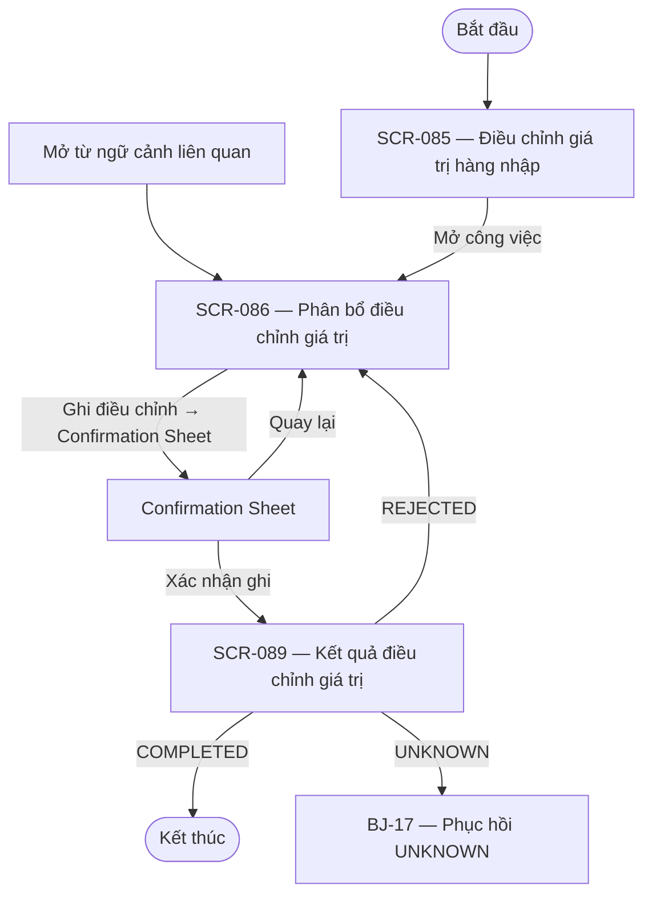

# UIF-13 — Điều chỉnh giá trị hàng nhập

## 1. Mục đích và phạm vi

Mô tả cách kế toán xử lý một business fact làm tăng/giảm giá trị hàng nhập sau BJ03: chọn công việc, xem source-owned scope, chọn/hiểu phương pháp phân bổ, xác nhận và nhận kết quả.

- [BJ-13 — Điều chỉnh giá trị hàng nhập](../../02.specification/behavior/journeys/BJ-13-dieu-chinh-gia-tri-hang-nhap.md)
- [UC-13-01 — Ghi nhận điều chỉnh giá trị hàng nhập](../../02.specification/behavior/use-cases/UC-13-01-ghi-nhan-dieu-chinh-gia-tri-hang-nhap.md)

## 2. Entry / End

- Vào từ chức năng → `SCR-085`.
- Mở source/context cụ thể → `SCR-086`.
- Kết thúc khi `SCR-089` xác nhận finality hoặc handoff BJ17 khi `UNKNOWN`.

## 3. Luồng màn hình

`SCR-087` và `SCR-088` đều đã hợp nhất/retire; không phải active route node.

## 4. Chuyển bước

| ID | Từ | Hành động / điều kiện | Đến | Failure / recovery |
|---|---|---|---|---|
| UIF-13-T01 | BEGIN | Có adjustment task | SCR-085 | — |
| UIF-13-T02 | CONTEXT | Source/context current | SCR-086 | Source stale → refetch |
| UIF-13-T03 | SCR-085 | Mở task | SCR-086 | WAITING vẫn mở read-only |
| UIF-13-T04 | SCR-086 | Preview hợp lệ; metric/method hợp lệ; tổng allocation = signed amount | Confirmation Sheet trên SCR-086 | Invalid/stale → ở SCR-086 |
| UIF-13-T05 | Confirmation Sheet | Quay lại | SCR-086 | Không mutation |
| UIF-13-T06 | Confirmation Sheet | Xác nhận ghi; recheck source/scope/metric/hash | SCR-089 | Mutation theo BC-IV-04 |
| UIF-13-T07 | SCR-089 | COMPLETED | END | BJ14 nhận dirty scope |
| UIF-13-T08 | SCR-089 | REJECTED | SCR-086 | Không mutation |
| UIF-13-T09 | SCR-089 | UNKNOWN | BJ-17 | Không ghi command thứ hai |

## 5. Quy tắc UX quan trọng

- Fixed scope không cho user bỏ target.
- UI chỉ hiển thị normalized VND amount; không hiển thị/nhập tỷ giá.
- Allocation method chỉ xuất hiện nếu BC-IV-06 chứng minh metric hợp lệ. Không có fallback chia đều.
- Nếu chỉ một method hợp lệ, hiển thị read-only; nhiều method thì dùng lựa chọn có mô tả cách tính.
- `SCR-086` là preview + review; confirmation chỉ xác nhận mutation, không lặp lại thành một screen nữa.

## 6. Coverage

| UC | Active screen |
|---|---|
| UC-13-01 | `SCR-085`, `SCR-086`, `SCR-089` |

Retired/migration: `SCR-018`, `SCR-087`, `SCR-088`.

## 7. Truy vết kỹ thuật

| Transition | Type | Action | UC / BC |
|---|---|---|---|
| UIF-13-T01..T03 | NAVIGATION | — | UC-13-01 / BC-IV-06 |
| UIF-13-T04..T05 | UI confirmation | — | UC-13-01 / BC-IV-06 |
| UIF-13-T06 | MUTATION | `ACT-03-RECORD-LATE-COST` compatibility action ID | UC-13-01 / BC-IV-04 / BC-IV-06 |
| UIF-13-T07 | TERMINAL | — | UC-13-01 |
| UIF-13-T08 | SYSTEM | — | UC-13-01 |
| UIF-13-T09 | HANDOFF | — | UC-13-01 → BJ-17 |
