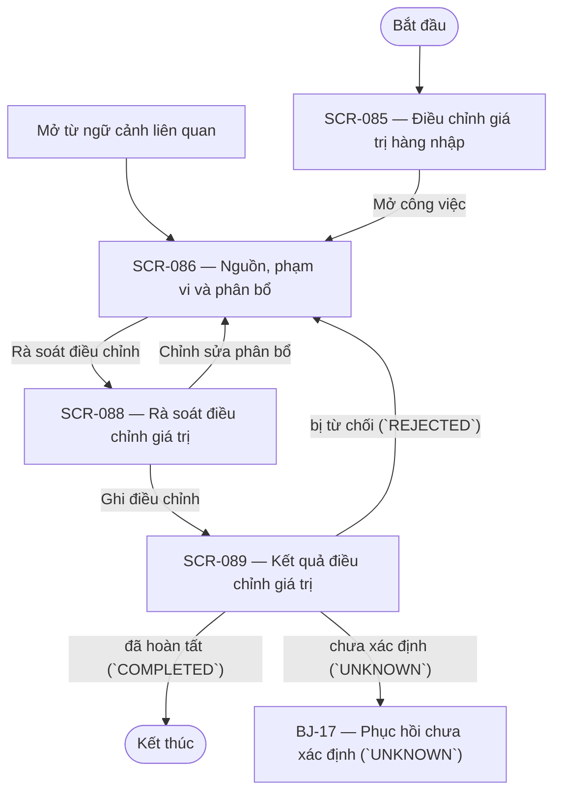

# UIF-13 — Điều chỉnh giá trị hàng nhập

## 1. Mục đích và phạm vi

Mô tả cách ghi nhận chi phí hoặc căn cứ đến muộn làm thay đổi giá trị hàng nhập, từ chọn nguồn và phạm vi đến phân bổ, rà soát và kết quả.

- **Hành trình nghiệp vụ:** [BJ-13 — Điều chỉnh giá trị hàng nhập](../../02.specification/behavior/journeys/BJ-13-dieu-chinh-gia-tri-hang-nhap.md)
- **Trường hợp sử dụng liên quan:**
  - [UC-13-01 — Ghi nhận điều chỉnh giá trị hàng nhập](../../02.specification/behavior/use-cases/UC-13-01-ghi-nhan-dieu-chinh-gia-tri-hang-nhap.md)

**Ranh giới:** UIF chỉ mô tả cách người dùng đi qua các màn hình, điều kiện chuyển bước và cách xử lý khi không thể tiếp tục. Quy tắc nghiệp vụ vẫn lấy từ BJ/UC/Behavioral Contract; nội dung và thành phần của từng màn hình vẫn lấy từ Screen Contract.

## 2. Người dùng bắt đầu và kết thúc ở đâu

| Cách vào luồng | Màn hình | Người thực hiện | Đi từ đâu |
|---|---|---|---|
| Vào từ chức năng | `SCR-085` | Kế toán hoặc người có quyền tài chính | Giá trị & giá vốn > Điều chỉnh giá trị hàng nhập |
| Mở từ ngữ cảnh liên quan | `SCR-086` | Kế toán hoặc người có quyền tài chính | Căn cứ điều chỉnh đã được liên kết |

Luồng kết thúc khi người dùng đã nhận được kết quả cuối cùng hoặc công việc được chuyển rõ sang một hành trình khác. Trạng thái `UNKNOWN` không được coi là thành công; phải tiếp tục xác minh với đúng thao tác gốc.

## 3. Luồng màn hình

`SCR-087` đã retire; chọn phạm vi, cách phân bổ và kết quả xem trước nằm trong `SCR-086`.

> Sơ đồ trên để đọc nhanh. Phần “Các bước chuyển màn hình” giải thích điều kiện và cách xử lý; phần “Truy vết kỹ thuật” giữ các mã phục vụ Dev/QA/Harness.

## 4. Các bước chuyển màn hình

| Bước | Từ đâu | Người dùng / hệ thống làm gì | Điều kiện cần | Đi đến | Nếu không thể tiếp tục |
|---|---|---|---|---|---|
| `UIF-13-T01` | Bắt đầu | Có căn cứ mới hoặc thay đổi sau BJ-03 | Có quyền tài chính | `SCR-085` — Điều chỉnh giá trị hàng nhập | — |
| `UIF-13-T02` | Mở từ ngữ cảnh liên quan | Mở nguồn dữ liệu hoặc ngữ cảnh cụ thể | Nguồn dữ liệu dùng làm căn cứ còn hợp lệ | `SCR-086` — Nguồn, phạm vi và phân bổ | Dữ liệu đã thay đổi → xác định lại |
| `UIF-13-T03` | `SCR-085` — Điều chỉnh giá trị hàng nhập | Mở công việc | Nguồn thuộc phạm vi BJ13 | `SCR-086` — Nguồn, phạm vi và phân bổ | Lỗi dữ liệu gốc → chuyển về nơi sở hữu dữ liệu nguồn hoặc BJ-11 |
| `UIF-13-T04` | `SCR-086` — Nguồn, phạm vi và phân bổ | Phạm vi, cách phân bổ và kết quả xem trước đều hợp lệ | Tổng phân bổ khớp số tiền điều chỉnh có dấu | `SCR-088` — Rà soát điều chỉnh giá trị | Dữ liệu không hợp lệ hoặc nguồn đã thay đổi (`SOURCE_CHANGED`) → ở lại SCR-086 |
| `UIF-13-T05` | `SCR-088` — Rà soát điều chỉnh giá trị | Chỉnh sửa phân bổ | Chưa ghi nhận chính thức | `SCR-086` — Nguồn, phạm vi và phân bổ | Giữ bản nháp khi an toàn |
| `UIF-13-T06` | `SCR-088` — Rà soát điều chỉnh giá trị | Ghi điều chỉnh | Nguồn dữ liệu và phiên bản còn hợp lệ | `SCR-089` — Kết quả điều chỉnh giá trị | Ghi khoản điều chỉnh có dấu và đánh dấu phạm vi cần tính lại |
| `UIF-13-T07` | `SCR-089` — Kết quả điều chỉnh giá trị | đã hoàn tất (`COMPLETED`) | — | Kết thúc | BJ14 nhận phạm vi cần tính lại |
| `UIF-13-T08` | `SCR-089` — Kết quả điều chỉnh giá trị | Bị từ chối (`REJECTED`) hoặc kiểm tra dữ liệu không đạt | — | `SCR-086` — Nguồn, phạm vi và phân bổ | Không ghi thay đổi giá trị |
| `UIF-13-T09` | `SCR-089` — Kết quả điều chỉnh giá trị | chưa xác định (`UNKNOWN`) | Giữ mã thao tác gốc | BJ-17 — hành trình liên quan | Không ghi adjustment lần hai |

## 5. Các tình huống cần chú ý

Các quy tắc chung về quyền, quay lại, dữ liệu thay đổi và chống ghi nhận lặp vẫn lấy từ UC/Behavioral Contract/Screen Contract. UIF chỉ nhắc lại những điểm ảnh hưởng trực tiếp đến cách đi qua màn hình.

- số tiền điều chỉnh có dấu giữ đúng dấu; khoản âm hợp lệ không bị diễn giải thành lỗi/nguy hiểm.
- `nguồn dữ liệu đã thay đổi (`SOURCE_CHANGED`)` bắt buộc tính lại kết quả xem trước và rà soát.
- Nếu kết quả chưa xác định (`UNKNOWN`), không thực hiện lại bằng một thao tác mới. Hệ thống giữ nguyên mã thao tác gốc để xác minh; khi chưa đủ bằng chứng, chuyển sang `BJ-17`.
- Dữ liệu tài chính chỉ hiển thị cho người có quyền phù hợp. UIF mô tả luồng người dùng; cách che dữ liệu chi tiết được quy định tại Screen Contract và Technical Contract.
- Các màn hình đã hợp nhất hoặc chỉ dùng cho tương thích không được xem là một bước điều hướng độc lập của luồng hiện hành.

## 6. Màn hình và Trường hợp sử dụng liên quan

| Trường hợp sử dụng | Màn hình sử dụng |
|---|---|
| [UC-13-01](../../02.specification/behavior/use-cases/UC-13-01-ghi-nhan-dieu-chinh-gia-tri-hang-nhap.md) | `SCR-085`, `SCR-086`, `SCR-088`, `SCR-089` |

### Màn hình dùng trong luồng

| Màn hình | Tên | Vai trò trong luồng |
|---|---|---|
| [SCR-085](../screens/SCR-085.md) | Điều chỉnh giá trị hàng nhập | Danh sách công việc |
| [SCR-086](../screens/SCR-086.md) | Nguồn, phạm vi và phân bổ | Nguồn, phạm vi, cách phân bổ và kết quả xem trước |
| [SCR-088](../screens/SCR-088.md) | Rà soát điều chỉnh giá trị | Rà soát cuối trước khi xác nhận |
| [SCR-089](../screens/SCR-089.md) | Kết quả điều chỉnh giá trị | Kết quả điều chỉnh chính thức |

### Màn hình đã được hợp nhất hoặc ngừng dùng

- `SCR-018` — màn hình cũ, không phải bước đang dùng của UIF-13.
- `SCR-087` — đã hợp nhất vào `SCR-086`.

## 7. Truy vết kỹ thuật

> Phần này dành cho Dev/QA/Harness. Các mã kỹ thuật được giữ nguyên để Dev/QA/Harness đối chiếu tự động.

| Transition | From | To | Loại | Action | UC / BC |
|---|---|---|---|---|---|
| `UIF-13-T01` | `BEGIN` | `SCR-085` | `NAVIGATION` | `—` | UC-13-01 |
| `UIF-13-T02` | `CONTEXT` | `SCR-086` | `NAVIGATION` | `—` | UC-13-01 |
| `UIF-13-T03` | `SCR-085` | `SCR-086` | `NAVIGATION` | `—` | UC-13-01 / BC-IV-06 |
| `UIF-13-T04` | `SCR-086` | `SCR-088` | `NAVIGATION` | `—` | UC-13-01 / BC-IV-06 |
| `UIF-13-T05` | `SCR-088` | `SCR-086` | `NAVIGATION` | `—` | UC-13-01 |
| `UIF-13-T06` | `SCR-088` | `SCR-089` | `MUTATION` | `ACT-03-RECORD-LATE-COST` | UC-13-01 / BC-IV-04 / BC-IV-06 |
| `UIF-13-T07` | `SCR-089` | `END` | `TERMINAL` | `—` | UC-13-01 |
| `UIF-13-T08` | `SCR-089` | `SCR-086` | `SYSTEM` | `—` | UC-13-01 |
| `UIF-13-T09` | `SCR-089` | `BJ-17` | `HANDOFF` | `—` | UC-13-01 → BJ-17 |

## 8. Kiểm tra tính đầy đủ và liên kết

- [x] Tất cả Trường hợp sử dụng liên quan đều được liên kết từ UIF.
- [x] Mỗi màn hình đang dùng trong luồng có Screen Contract tương ứng.
- [x] Các bước do hệ thống thực hiện không bị mô tả thành thao tác của người dùng.
- [x] Nếu có phê duyệt hoặc chuyển vai trò, người gửi và người nhận có điểm vào riêng.
- [x] Trạng thái kết thúc và trường hợp `UNKNOWN` có hướng xử lý rõ khi áp dụng.
- [x] Bảng đọc chính và bảng truy vết kỹ thuật dùng cùng một tập transition ID; không đổi topology hoặc hành vi.
- [x] Liên kết BJ ↔ UIF ↔ UC/SCR dùng đường dẫn tương đối và mở đúng tài liệu đích.

**Trạng thái đối chiếu thiết kế:** `DESIGN_HTML_PARITY_VALIDATED` — UIF đã được viết lại theo Plain BA Language; cấu trúc luồng, ID, mã Action, liên kết UC/BC và trạng thái đối chiếu của v4.1.0 được giữ nguyên. HTML và Screen Contract không thay đổi trong lượt này.

### Liên kết

- [Business Journey](../../02.specification/behavior/journeys/BJ-13-dieu-chinh-gia-tri-hang-nhap.md)
- [Business Journey Map](../../02.specification/behavior/journeys/00-business-journey-map.md)
- [Use Case Map](../../02.specification/behavior/use-cases/00-use-case-map.md)
- [Prototype manifest](../prototype/README.md)
