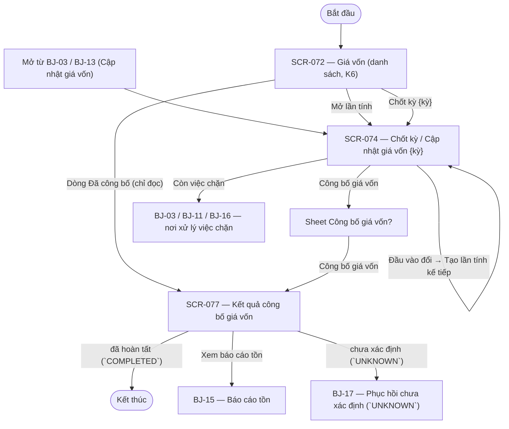

# UIF-14 — Tính và công bố giá vốn

## 1. Mục đích và phạm vi

Mô tả cách chủ cửa hàng chốt giá vốn mỗi kỳ hoặc cập nhật trong kỳ: thấy lần tính nào cần làm, biết còn việc gì chặn và đi xử lý ở đâu, đọc kết quả tính theo một thứ tự cố định (việc chặn → kết quả → thay đổi sẽ ghi → theo sản phẩm → phương pháp), công bố bằng một sheet xác nhận, rồi xem báo cáo tồn. Danh sách là khuôn K6; kết quả là K4 / K3. Chỉ chủ cửa hàng vào được; iPhone và web đều là thiết bị chính.

- **Hành trình nghiệp vụ:** [BJ-14 — Tính và công bố giá vốn](../../02.specification/behavior/journeys/BJ-14-tinh-va-cong-bo-gia-von.md)
- **Trường hợp sử dụng liên quan:**
  - [UC-14-01 — Tính và rà soát giá vốn](../../02.specification/behavior/use-cases/UC-14-01-tinh-va-ra-soat-gia-von.md)
  - [UC-14-04 — Công bố giá vốn](../../02.specification/behavior/use-cases/UC-14-04-cong-bo-gia-von.md)

**Ranh giới:** UIF chỉ mô tả cách người dùng đi qua các màn hình, điều kiện chuyển bước và cách xử lý khi không thể tiếp tục. Quy tắc nghiệp vụ vẫn lấy từ BJ/UC/Behavioral Contract; nội dung và thành phần của từng màn hình vẫn lấy từ Screen Contract.

## 2. Người dùng bắt đầu và kết thúc ở đâu

| Cách vào luồng | Màn hình | Người thực hiện | Đi từ đâu |
|---|---|---|---|
| Vào từ chức năng | `SCR-072` | Chủ cửa hàng | Kho → Giá trị kho → "Giá vốn" (vào bằng vai chủ cửa hàng) |
| Mở từ ngữ cảnh liên quan | `SCR-074` | Chủ cửa hàng | Kết quả BJ-03 / BJ-13 → "Cập nhật giá vốn" (entry `dirty-scope`): mở lần cập nhật trong kỳ đang chờ đúng trạng thái hiện tại; nhân viên bấm vẫn gặp K1 |

Luồng kết thúc khi chủ cửa hàng đã nhận kết quả cuối cùng hoặc việc được chuyển rõ sang một hành trình khác. Trạng thái `UNKNOWN` không được coi là thành công; phải tiếp tục xác minh với đúng thao tác gốc.

## 3. Luồng màn hình

`SCR-073`, `SCR-075`, `SCR-076` đã được hợp nhất. Thiết lập, việc chặn, kết quả và xác nhận công bố đều nằm trong `SCR-074`; sheet xác nhận không phải một bước điều hướng riêng.

> Sơ đồ trên để đọc nhanh. Phần “Các bước chuyển màn hình” giải thích điều kiện và cách xử lý; phần “Truy vết kỹ thuật” giữ các mã phục vụ Dev/QA/Harness.

## 4. Các bước chuyển màn hình

| Bước | Từ đâu | Người dùng / hệ thống làm gì | Điều kiện cần | Đi đến | Nếu không thể tiếp tục |
|---|---|---|---|---|---|
| `UIF-14-T01` | Bắt đầu | Có nhu cầu cập nhật hoặc chốt giá vốn | Chủ cửa hàng | `SCR-072` — Giá vốn | Vai khác: K1 "Bạn chưa có quyền xem giá vốn" |
| `UIF-14-T02` | Mở từ BJ-03 / BJ-13 | "Cập nhật giá vốn" | Có lần cập nhật trong kỳ đang chờ | `SCR-074` — Cập nhật giá vốn {kỳ} | Không còn lần chờ → `SCR-072` |
| `UIF-14-T03` | `SCR-072` | Mở dòng lần tính chưa công bố | — | `SCR-074` đúng trạng thái của lần tính | — |
| `UIF-14-T04` | `SCR-072` | "Chốt kỳ {kỳ}" | Có kỳ đã kết thúc chưa có lần chốt kỳ; phạm vi nằm trong chính sách | `SCR-074` — chưa tính (kỳ + phạm vi) | Một phạm vi thì chỉ đọc; nhiều phạm vi phải chọn mới tính |
| `UIF-14-T05` | `SCR-072` | Mở dòng "Đã công bố" | — | `SCR-077` — chỉ đọc | — |
| `UIF-14-T06` | `SCR-074` | "Tính giá vốn" / "Tính lại" | Phương pháp lấy từ chính sách của cửa hàng; "Tính lại" chỉ khi hết việc chặn | `SCR-074` — đang tính, rồi kết quả | Còn việc chặn (`BLOCKED`): hiện việc ngay trên màn, không công bố được |
| `UIF-14-T07` | `SCR-074` | Đầu vào đã đổi → "Tạo lần tính kế tiếp" | Không sửa lần tính cũ; tạo `{mã}-R{n}` | `SCR-074` | Rà soát lại trước khi công bố |
| `UIF-14-T08` | `SCR-074` | "Công bố giá vốn" (sheet) | Kết quả sẵn sàng, đầu vào không đổi giữa lúc mở sheet và lúc bấm | `SCR-077` | Đầu vào đổi → đóng sheet, `INPUT_CHANGED` |
| `UIF-14-T09` | `SCR-077` | đã hoàn tất (`COMPLETED`) / "Về giá vốn" | — | `SCR-072` / Kết thúc | — |
| `UIF-14-T10` | `SCR-077` | chưa xác định (`UNKNOWN`) | Giữ nguyên mã thao tác công bố | BJ-17 | Không công bố lại khi chưa biết kết quả lần trước |
| `UIF-14-T11` | `SCR-077` | "Xem báo cáo tồn" | `COMPLETED` | BJ-15 — báo cáo tồn kỳ vừa công bố | — |
| `UIF-14-T12` | `SCR-074` | Nút sang nơi xử lý việc chặn | `BLOCKED` | BJ-11 (yêu cầu sửa sai chờ duyệt) · BJ-16 (hồ sơ chưa đóng) · BJ-03 (hàng chưa có giá nhập) | Quay lại bằng Kho; xử lý xong thì "Tính lại" |

## 5. Các tình huống cần chú ý

Các quy tắc chung về quyền, quay lại, dữ liệu thay đổi và chống ghi nhận lặp vẫn lấy từ UC/Behavioral Contract/Screen Contract. UIF chỉ nhắc lại những điểm ảnh hưởng trực tiếp đến cách đi qua màn hình.

- Phương pháp tính giá vốn luôn chỉ đọc từ chính sách của cửa hàng; phương pháp kia chỉ để đối chiếu.
- Phạm vi "cập nhật trong kỳ" do hệ thống xác định (sản phẩm + kỳ + nguyên nhân) và hiện ra chỉ đọc; người dùng không bỏ sản phẩm khỏi phạm vi.
- Việc chặn đọc từ dữ liệu thật của BJ-03 / BJ-11 / BJ-16, chỉ việc thuộc kỳ của lần tính hoặc trước đó mới chặn; mỗi việc có nút sang nơi xử lý. `BLOCKED` không tạo màn mới.
- Lần tính bất biến: dữ liệu đổi hoặc hết việc chặn thì tạo lần tính kế tiếp; lần cũ giữ để truy vết, không hiện ở danh sách.
- Công bố chỉ ghi phần chênh lệch (điều chỉnh giá vốn xuất, điều chỉnh giá trị tồn), không sửa chứng từ gốc; giá vốn chính thức chỉ sinh ở BJ-14.
- Nếu kết quả chưa xác định (`UNKNOWN`), không thực hiện lại bằng một thao tác mới; giữ mã thao tác gốc để xác minh ở BJ-17.
- Chuỗi tiền không có trong màn khi người xem không phải chủ cửa hàng.
- Các màn hình đã hợp nhất không phải một bước điều hướng độc lập của luồng hiện hành.

## 6. Màn hình và Trường hợp sử dụng liên quan

| Trường hợp sử dụng | Màn hình sử dụng |
|---|---|
| [UC-14-01](../../02.specification/behavior/use-cases/UC-14-01-tinh-va-ra-soat-gia-von.md) | `SCR-072`, `SCR-074` |
| [UC-14-04](../../02.specification/behavior/use-cases/UC-14-04-cong-bo-gia-von.md) | `SCR-072`, `SCR-074`, `SCR-077` |

### Màn hình dùng trong luồng

| Màn hình | Tên | Vai trò trong luồng |
|---|---|---|
| [SCR-072](../screens/SCR-072.md) | Giá vốn | Danh sách lần tính (K6) và điểm vào |
| [SCR-074](../screens/SCR-074.md) | Chốt kỳ / Cập nhật giá vốn {kỳ} | Chưa tính, việc chặn, đang tính, kết quả, sheet công bố |
| [SCR-077](../screens/SCR-077.md) | Kết quả công bố giá vốn | Kết quả công bố chính thức (K4 / K3) |

### Màn hình đã được hợp nhất hoặc ngừng dùng

- `SCR-073` — phần thiết lập đã được hợp nhất vào `SCR-074` (trạng thái chưa tính).
- `SCR-075` — điều kiện chặn đã được hợp nhất vào `SCR-074` (khối việc chặn).
- `SCR-076` — bước rà soát trước khi công bố được hợp nhất vào `SCR-074`; xác nhận cuối bằng sheet.

## 7. Truy vết kỹ thuật

> Phần này dành cho Dev/QA/Harness. Các mã kỹ thuật được giữ nguyên để Dev/QA/Harness đối chiếu tự động.

| Transition | From | To | Loại | Action | UC / BC |
|---|---|---|---|---|---|
| `UIF-14-T01` | `BEGIN` | `SCR-072` | `NAVIGATION` | `—` | UC-14-01 |
| `UIF-14-T02` | `CONTEXT` | `SCR-074` | `NAVIGATION` | `—` | UC-14-01 |
| `UIF-14-T03` | `SCR-072` | `SCR-074` | `NAVIGATION` | `—` | UC-14-01 |
| `UIF-14-T04` | `SCR-072` | `SCR-074` | `NAVIGATION` | `—` | UC-14-01 |
| `UIF-14-T05` | `SCR-072` | `SCR-077` | `NAVIGATION` | `—` | UC-14-04 |
| `UIF-14-T06` | `SCR-074` | `SCR-074` | `MUTATION` | `ACT-14-CALCULATE` | UC-14-01 / BC-IV-02 |
| `UIF-14-T07` | `SCR-074` | `SCR-074` | `SYSTEM` | `—` | UC-14-01 |
| `UIF-14-T08` | `SCR-074` | `SCR-077` | `MUTATION` | `ACT-14-PUBLISH` | UC-14-04 / BC-IV-03 |
| `UIF-14-T09` | `SCR-077` | `END` | `TERMINAL` | `—` | UC-14-04 |
| `UIF-14-T10` | `SCR-077` | `BJ-17` | `HANDOFF` | `—` | UC-14-04 → BJ-17 |
| `UIF-14-T11` | `SCR-077` | `BJ-15` | `NAVIGATION` | `—` | UC-14-04 → BJ-15 |
| `UIF-14-T12` | `SCR-074` | `BJ-03` / `BJ-11` / `BJ-16` | `NAVIGATION` | `—` | UC-14-01 |

## 8. Kiểm tra tính đầy đủ và liên kết

- [x] Tất cả Trường hợp sử dụng liên quan đều được liên kết từ UIF.
- [x] Mỗi màn hình đang dùng trong luồng có Screen Contract tương ứng.
- [x] Các bước do hệ thống thực hiện không bị mô tả thành thao tác của người dùng.
- [x] Chỉ chủ cửa hàng vào luồng; vai khác có K1 ở mọi màn.
- [x] Trạng thái kết thúc và trường hợp `UNKNOWN` có hướng xử lý rõ.
- [x] Bảng đọc chính và bảng truy vết kỹ thuật dùng cùng một tập transition ID (T11, T12 thêm ở v5.19.0).
- [x] Liên kết BJ ↔ UIF ↔ UC/SCR dùng đường dẫn tương đối và mở đúng tài liệu đích.

**Trạng thái đối chiếu thiết kế:** `REDESIGNED_v5.19.0` — luồng, bố cục màn và chữ theo thiết kế lại T7-P chặng 6 (plan `docs/refactor/plans/T7/T7-P-bj14-gia-von.md`); quy tắc nghiệp vụ BJ-14 không đổi.

### Liên kết

- [Business Journey](../../02.specification/behavior/journeys/BJ-14-tinh-va-cong-bo-gia-von.md)
- [Business Journey Map](../../02.specification/behavior/journeys/00-business-journey-map.md)
- [Use Case Map](../../02.specification/behavior/use-cases/00-use-case-map.md)
- [Prototype manifest](../prototype/README.md)
