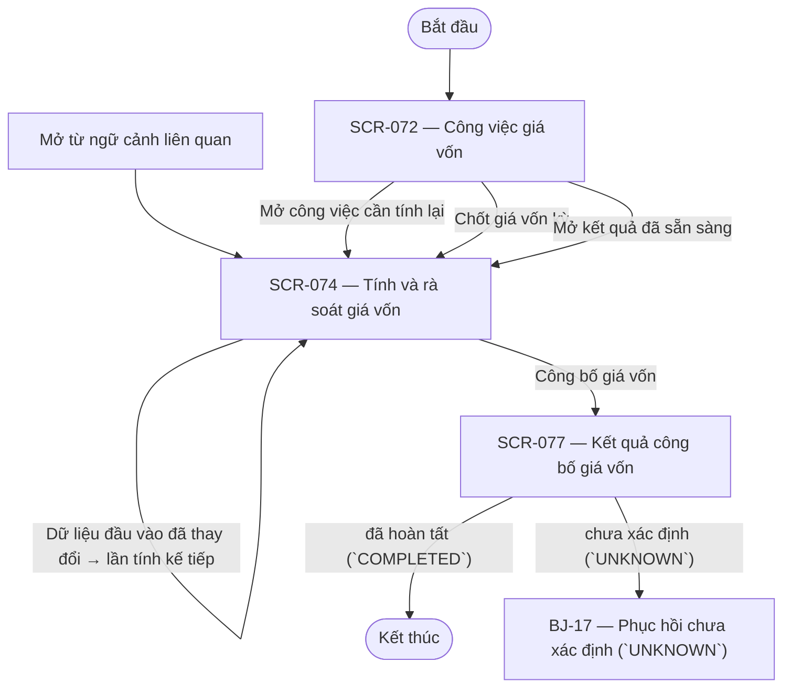

# UIF-14 — Tính và công bố giá vốn

## 1. Mục đích và phạm vi

Mô tả cách người phụ trách giá vốn xử lý các phạm vi cần tính lại, rà soát kết quả và công bố giá vốn chính thức.

- **Hành trình nghiệp vụ:** [BJ-14 — Tính và công bố giá vốn](../../02.specification/behavior/journeys/BJ-14-tinh-va-cong-bo-gia-von.md)
- **Trường hợp sử dụng liên quan:**
  - [UC-14-01 — Tính và rà soát giá vốn](../../02.specification/behavior/use-cases/UC-14-01-tinh-va-ra-soat-gia-von.md)
  - [UC-14-04 — Công bố giá vốn](../../02.specification/behavior/use-cases/UC-14-04-cong-bo-gia-von.md)

**Ranh giới:** UIF chỉ mô tả cách người dùng đi qua các màn hình, điều kiện chuyển bước và cách xử lý khi không thể tiếp tục. Quy tắc nghiệp vụ vẫn lấy từ BJ/UC/Behavioral Contract; nội dung và thành phần của từng màn hình vẫn lấy từ Screen Contract.

## 2. Người dùng bắt đầu và kết thúc ở đâu

| Cách vào luồng | Màn hình | Người thực hiện | Đi từ đâu |
|---|---|---|---|
| Vào từ chức năng | `SCR-072` | Kế toán hoặc người phụ trách giá vốn | Giá trị & giá vốn > Công việc giá vốn |
| Mở từ ngữ cảnh liên quan | `SCR-074` | Kế toán hoặc người phụ trách giá vốn | phạm vi sản phẩm/kỳ cần tính lại |

Luồng kết thúc khi người dùng đã nhận được kết quả cuối cùng hoặc công việc được chuyển rõ sang một hành trình khác. Trạng thái `UNKNOWN` không được coi là thành công; phải tiếp tục xác minh với đúng thao tác gốc.

## 3. Luồng màn hình

`SCR-073`, `SCR-075`, `SCR-076` đã được hợp nhất. Phần thiết lập, điều kiện chặn, rà soát và xác nhận công bố đều nằm trong `SCR-074`; bảng thao tác không tạo một bước điều hướng riêng.

> Sơ đồ trên để đọc nhanh. Phần “Các bước chuyển màn hình” giải thích điều kiện và cách xử lý; phần “Truy vết kỹ thuật” giữ các mã phục vụ Dev/QA/Harness.

## 4. Các bước chuyển màn hình

| Bước | Từ đâu | Người dùng / hệ thống làm gì | Điều kiện cần | Đi đến | Nếu không thể tiếp tục |
|---|---|---|---|---|---|
| `UIF-14-T01` | Bắt đầu | Có nhu cầu cập nhật hoặc chốt giá vốn | Có quyền giá vốn | `SCR-072` — Công việc giá vốn | — |
| `UIF-14-T02` | Mở từ ngữ cảnh liên quan | Mở phạm vi sản phẩm/kỳ cần tính lại | Hệ thống xác định lại phạm vi | `SCR-074` — Tính và rà soát giá vốn | Dữ liệu đã thay đổi → xác định lại |
| `UIF-14-T03` | `SCR-072` — Công việc giá vốn | Mở công việc cần tính lại | phạm vi do hệ thống xác định, chỉ đọc | `SCR-074` — Tính và rà soát giá vốn | — |
| `UIF-14-T04` | `SCR-072` — Công việc giá vốn | Chốt giá vốn kỳ | Kỳ và phạm vi nằm trong chính sách cho phép | `SCR-074` — Tính và rà soát giá vốn | Phương pháp tính giá vốn vẫn chỉ đọc |
| `UIF-14-T05` | `SCR-072` — Công việc giá vốn | Mở kết quả đã sẵn sàng | Lần tính đã sẵn sàng và không còn chỉnh sửa | `SCR-074` — Tính và rà soát giá vốn | — |
| `UIF-14-T06` | `SCR-074` — Tính và rà soát giá vốn | Tính hoặc tính lại | Mốc chốt và phạm vi hợp lệ; phương pháp tính giá vốn lấy từ chính sách của tổ chức | `SCR-074` — Tính và rà soát giá vốn | Nếu chưa đủ điều kiện (`BLOCKED`), hiển thị lý do ngay trên màn hình và không cho công bố |
| `UIF-14-T07` | `SCR-074` — Tính và rà soát giá vốn | Dữ liệu đầu vào đã thay đổi | Không sửa lần tính cũ; tạo ngữ cảnh cho lần tính kế tiếp | `SCR-074` — Tính và rà soát giá vốn | Rà soát lại trước khi công bố |
| `UIF-14-T08` | `SCR-074` — Tính và rà soát giá vốn | Công bố giá vốn sau bước rà soát trước khi công bố | Kết quả đã sẵn sàng, người dùng có quyền công bố và chính sách/phiên bản còn hợp lệ | `SCR-077` — Kết quả công bố giá vốn | Kết quả công bố này là nguồn chính thức của giá vốn |
| `UIF-14-T09` | `SCR-077` — Kết quả công bố giá vốn | đã hoàn tất (`COMPLETED`) | — | Kết thúc | — |
| `UIF-14-T10` | `SCR-077` — Kết quả công bố giá vốn | chưa xác định (`UNKNOWN`) | Giữ nguyên mã thao tác công bố | BJ-17 — hành trình liên quan | Không công bố lại khi chưa biết kết quả lần trước |

## 5. Các tình huống cần chú ý

Các quy tắc chung về quyền, quay lại, dữ liệu thay đổi và chống ghi nhận lặp vẫn lấy từ UC/Behavioral Contract/Screen Contract. UIF chỉ nhắc lại những điểm ảnh hưởng trực tiếp đến cách đi qua màn hình.

- Phương pháp tính giá vốn luôn chỉ đọc từ chính sách của tổ chức.
- phạm vi cần tính lại do hệ thống xác định; người dùng không tùy ý bỏ sản phẩm khỏi phạm vi cập nhật.
- Trạng thái `BLOCKED` không tạo màn hình mới; lý do và cách xử lý được hiển thị ngay trên `SCR-074`.
- Bước xác nhận công bố mở ngay trên `SCR-074` dưới dạng bảng thao tác; không tạo một bước điều hướng riêng.
- Khi dữ liệu đầu vào thay đổi, tạo lần tính kế tiếp; không sửa lần tính cũ.
- Nếu kết quả chưa xác định (`UNKNOWN`), không thực hiện lại bằng một thao tác mới. Hệ thống giữ nguyên mã thao tác gốc để xác minh; khi chưa đủ bằng chứng, chuyển sang `BJ-17`.
- Nếu dữ liệu nguồn đã thay đổi, phải nạp lại dữ liệu hiện hành và rà soát lại trước khi tiếp tục. Phần người dùng đã nhập chỉ được giữ lại khi còn an toàn.
- Dữ liệu tài chính chỉ hiển thị cho người có quyền phù hợp. UIF mô tả luồng người dùng; cách che dữ liệu chi tiết được quy định tại Screen Contract. Contract thực thi thuộc work slice lúc review để implement.
- Các màn hình đã hợp nhất hoặc chỉ dùng cho tương thích không được xem là một bước điều hướng độc lập của luồng hiện hành.

## 6. Màn hình và Trường hợp sử dụng liên quan

| Trường hợp sử dụng | Màn hình sử dụng |
|---|---|
| [UC-14-01](../../02.specification/behavior/use-cases/UC-14-01-tinh-va-ra-soat-gia-von.md) | `SCR-072`, `SCR-074` |
| [UC-14-04](../../02.specification/behavior/use-cases/UC-14-04-cong-bo-gia-von.md) | `SCR-072`, `SCR-074`, `SCR-077` |

### Màn hình dùng trong luồng

| Màn hình | Tên | Vai trò trong luồng |
|---|---|---|
| [SCR-072](../screens/SCR-072.md) | Công việc giá vốn | Danh sách công việc và điểm vào |
| [SCR-074](../screens/SCR-074.md) | Tính và rà soát giá vốn | Thiết lập, tính toán, điều kiện chặn, rà soát và xác nhận công bố |
| [SCR-077](../screens/SCR-077.md) | Kết quả công bố giá vốn | Kết quả công bố chính thức |

### Màn hình đã được hợp nhất hoặc ngừng dùng

- `SCR-073` — phần thiết lập đã được hợp nhất vào `SCR-074`.
- `SCR-075` — điều kiện chặn đã được hợp nhất vào trạng thái sẵn sàng của mặt hàng trên `SCR-074`.
- `SCR-076` — bước rà soát trước khi công bố được hợp nhất vào `SCR-074` dưới dạng bảng thao tác.

## 7. Truy vết kỹ thuật

> Phần này dành cho Dev/QA/Harness. Các mã kỹ thuật được giữ nguyên để Dev/QA/Harness đối chiếu tự động.

| Transition | From | To | Loại | Action | UC / BC |
|---|---|---|---|---|---|
| `UIF-14-T01` | `BEGIN` | `SCR-072` | `NAVIGATION` | `—` | UC-14-01 |
| `UIF-14-T02` | `CONTEXT` | `SCR-074` | `NAVIGATION` | `—` | UC-14-01 |
| `UIF-14-T03` | `SCR-072` | `SCR-074` | `NAVIGATION` | `—` | UC-14-01 |
| `UIF-14-T04` | `SCR-072` | `SCR-074` | `NAVIGATION` | `—` | UC-14-01 |
| `UIF-14-T05` | `SCR-072` | `SCR-074` | `NAVIGATION` | `—` | UC-14-01 / UC-14-04 |
| `UIF-14-T06` | `SCR-074` | `SCR-074` | `MUTATION` | `ACT-14-CALCULATE` | UC-14-01 / BC-IV-02 |
| `UIF-14-T07` | `SCR-074` | `SCR-074` | `SYSTEM` | `—` | UC-14-01 |
| `UIF-14-T08` | `SCR-074` | `SCR-077` | `MUTATION` | `ACT-14-PUBLISH` | UC-14-04 / BC-IV-03 |
| `UIF-14-T09` | `SCR-077` | `END` | `TERMINAL` | `—` | UC-14-04 |
| `UIF-14-T10` | `SCR-077` | `BJ-17` | `HANDOFF` | `—` | UC-14-04 → BJ-17 |

## 8. Kiểm tra tính đầy đủ và liên kết

- [x] Tất cả Trường hợp sử dụng liên quan đều được liên kết từ UIF.
- [x] Mỗi màn hình đang dùng trong luồng có Screen Contract tương ứng.
- [x] Các bước do hệ thống thực hiện không bị mô tả thành thao tác của người dùng.
- [x] Nếu có phê duyệt hoặc chuyển vai trò, người gửi và người nhận có điểm vào riêng.
- [x] Trạng thái kết thúc và trường hợp `UNKNOWN` có hướng xử lý rõ khi áp dụng.
- [x] Bảng đọc chính và bảng truy vết kỹ thuật dùng cùng một tập transition ID; không đổi topology hoặc hành vi.
- [x] Liên kết BJ ↔ UIF ↔ UC/SCR dùng đường dẫn tương đối và mở đúng tài liệu đích.

**Trạng thái đối chiếu thiết kế:** `DESIGN_HTML_PARITY_VALIDATED` — UIF đã được viết lại theo Plain BA Language; cấu trúc luồng, ID, mã Action, liên kết UC/BC và trạng thái đối chiếu của v4.1.0 được giữ nguyên. HTML và Screen Contract không thay đổi trong lượt này.

### Liên kết

- [Business Journey](../../02.specification/behavior/journeys/BJ-14-tinh-va-cong-bo-gia-von.md)
- [Business Journey Map](../../02.specification/behavior/journeys/00-business-journey-map.md)
- [Use Case Map](../../02.specification/behavior/use-cases/00-use-case-map.md)
- [Prototype manifest](../prototype/README.md)
