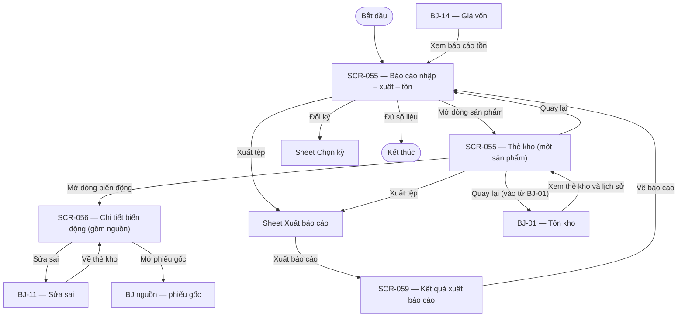

# UIF-15 — Báo cáo nhập – xuất – tồn và thẻ kho

## 1. Mục đích và phạm vi

Mô tả cách chủ cửa hàng xem báo cáo nhập – xuất – tồn theo kỳ và mọi người tra thẻ kho một sản phẩm: vào thẳng số liệu (không biểu mẫu tra cứu trước), đổi kỳ và cách hiểu ngày ở thanh lọc, đi từ dòng sản phẩm sang thẻ kho, từ dòng biến động sang chi tiết (có nguồn nghiệp vụ), rồi sang sửa sai (BJ-11) hoặc phiếu gốc; xuất tệp bằng một sheet. Báo cáo / thẻ kho theo khuôn K6 / K7; kết quả xuất là K4. Chỉ đọc; iPhone và web đều là thiết bị chính.

- **Hành trình nghiệp vụ:** [BJ-15 — Tra cứu báo cáo tồn và thẻ kho](../../02.specification/behavior/journeys/BJ-15-tra-cuu-bao-cao-ton-va-the-kho.md)
- **Trường hợp sử dụng liên quan:**
  - [UC-15-01 — Xác định báo cáo và phạm vi](../../02.specification/behavior/use-cases/UC-15-01-xac-dinh-bao-cao-va-pham-vi.md)
  - [UC-15-02 — Xem báo cáo tồn kho](../../02.specification/behavior/use-cases/UC-15-02-xem-bao-cao-ton-kho.md)
  - [UC-15-03 — Xem thẻ kho và lịch sử](../../02.specification/behavior/use-cases/UC-15-03-xem-the-kho-va-lich-su.md)
  - [UC-15-04 — Xuất báo cáo](../../02.specification/behavior/use-cases/UC-15-04-xuat-bao-cao.md)

**Ranh giới:** UIF chỉ mô tả cách người dùng đi qua các màn hình, điều kiện chuyển bước và cách xử lý khi không thể tiếp tục. Quy tắc nghiệp vụ vẫn lấy từ BJ/UC/Behavioral Contract; nội dung và thành phần của từng màn hình vẫn lấy từ Screen Contract.

## 2. Người dùng bắt đầu và kết thúc ở đâu

| Cách vào luồng | Màn hình | Người thực hiện | Đi từ đâu |
|---|---|---|---|
| Vào từ chức năng | `SCR-055` (báo cáo, tháng này) | Chủ cửa hàng, người xem báo cáo | Kho → Báo cáo & lịch sử → "Báo cáo tồn & thẻ kho" |
| Mở từ ngữ cảnh liên quan | `SCR-055` (báo cáo của kỳ vừa công bố) | Chủ cửa hàng | BJ-14 kết quả công bố → "Xem báo cáo tồn" |
| Mở từ ngữ cảnh liên quan | `SCR-055` (thẻ kho của sản phẩm) | Bất kỳ ai xem được tồn | BJ-01 → "Nguồn và thời điểm cập nhật" → "Xem thẻ kho và lịch sử" |

Luồng kết thúc khi người dùng đã xem xong số liệu / nhận kết quả xuất hoặc việc được chuyển rõ sang một hành trình khác (sửa sai ở BJ-11).

## 3. Luồng màn hình

`SCR-054`, `SCR-057`, `SCR-058` đã được hợp nhất (v5.20.0): biểu mẫu tra cứu bỏ (kỳ và cách hiểu ngày ở thanh lọc), nguồn nghiệp vụ là khối của `SCR-056`, xuất tệp là sheet của `SCR-055`.

> Sơ đồ trên để đọc nhanh. Phần “Các bước chuyển màn hình” giải thích điều kiện và cách xử lý; phần “Truy vết kỹ thuật” giữ các mã phục vụ Dev/QA/Harness.

## 4. Các bước chuyển màn hình

| Bước | Từ đâu | Người dùng / hệ thống làm gì | Điều kiện cần | Đi đến | Nếu không thể tiếp tục |
|---|---|---|---|---|---|
| `UIF-15-T01` | Bắt đầu | Cần xem báo cáo tồn hoặc thẻ kho | Có quyền báo cáo kho | `SCR-055` — báo cáo, kỳ "Tháng 09/2026" | K1 "Bạn chưa có quyền xem báo cáo kho" |
| `UIF-15-T02` | `SCR-055` | Đổi kỳ / cách hiểu ngày / tìm | Kỳ "Tùy chọn" có ngày bắt đầu không sau ngày kết thúc | `SCR-055` | Lỗi tại ô ngày; giữ kỳ cũ |
| `UIF-15-T03` | `SCR-055` (báo cáo) | Mở dòng sản phẩm | — | `SCR-055` — thẻ kho | — |
| `UIF-15-T04` | `SCR-055` (thẻ kho) | Mở dòng biến động | — | `SCR-056` | — |
| `UIF-15-T05` | `SCR-056` | "Sửa sai" | Phiếu có trong BJ-11, sửa được, không `LOCKED` | BJ-11 `SCR-050` của đúng phiếu | Phiếu đã chờ duyệt / có nghiệp vụ phụ thuộc: không hiện nút |
| `UIF-15-T06` | `SCR-056` | "Mở phiếu gốc" | Chứng từ có màn xem ở BJ nguồn | Màn chỉ đọc của BJ nguồn | Không có màn: không hiện nút |
| `UIF-15-T07` | `SCR-055` | "Xuất tệp" → "Xuất báo cáo" | Có quyền xuất | `SCR-059` | `STALE` → `SOURCE_STALE`, không tạo tệp |
| `UIF-15-T08` | `SCR-059` | "Về báo cáo" | — | `SCR-055` | — |
| `UIF-15-T09` | BJ-14 `SCR-077` | "Xem báo cáo tồn" | Đã công bố giá vốn | `SCR-055` — báo cáo của kỳ vừa công bố | — |
| `UIF-15-T10` | BJ-01 | "Xem thẻ kho và lịch sử" | — | `SCR-055` — thẻ kho của sản phẩm; quay lại về BJ-01 | — |
| `UIF-15-T11` | `SCR-055` | Đủ số liệu | — | Kết thúc | — |

## 5. Các tình huống cần chú ý

- Cuối kỳ của thẻ kho, của báo cáo và tồn ở BJ-01 là **một số**; đầu kỳ + nhập − xuất = cuối kỳ.
- Hai cách hiểu ngày (ngày nghiệp vụ / ngày ghi nhận) không trộn trong một kết quả; đổi công tắc thì cột và thứ tự dòng đổi theo.
- Số liệu luôn ghi mốc "Số liệu đến {as-of}"; dữ liệu cũ (`STALE`) thì nói rõ và không cho xuất tệp từ số liệu cũ.
- Sản phẩm không theo lô không có lô giả; lô chỉ lọc cho sản phẩm theo lô.
- Giá trị (tiền) chỉ chủ cửa hàng thấy; vai khác không có chuỗi tiền trong màn và không có báo "đã ẩn".
- Màn chỉ đọc: thấy sai thì chuyển (phiếu nghiệp vụ sai → BJ-11 "Sửa sai"; số trên app lệch sổ → BJ-16, vào từ cảnh báo), không sửa số dư ở đây.

## 6. Màn hình và Trường hợp sử dụng liên quan

| Trường hợp sử dụng | Màn hình sử dụng |
|---|---|
| [UC-15-01](../../02.specification/behavior/use-cases/UC-15-01-xac-dinh-bao-cao-va-pham-vi.md) — Xác định báo cáo và phạm vi | `SCR-055` |
| [UC-15-02](../../02.specification/behavior/use-cases/UC-15-02-xem-bao-cao-ton-kho.md) — Xem báo cáo tồn kho | `SCR-055` |
| [UC-15-03](../../02.specification/behavior/use-cases/UC-15-03-xem-the-kho-va-lich-su.md) — Xem thẻ kho và lịch sử | `SCR-055`, `SCR-056` |
| [UC-15-04](../../02.specification/behavior/use-cases/UC-15-04-xuat-bao-cao.md) — Xuất báo cáo | `SCR-055`, `SCR-059` |

### Màn hình dùng trong luồng

| Màn hình | Tên | Vai trò trong luồng |
|---|---|---|
| [SCR-055](../screens/SCR-055.md) | Báo cáo nhập – xuất – tồn / Thẻ kho | Màn chính: thanh lọc, báo cáo, thẻ kho, sheet kỳ / xuất |
| [SCR-056](../screens/SCR-056.md) | Chi tiết biến động | Một biến động + nguồn; lối "Sửa sai" / "Mở phiếu gốc" |
| [SCR-059](../screens/SCR-059.md) | Kết quả xuất báo cáo | Kết quả xuất (K4) |

### Màn hình đã được hợp nhất hoặc ngừng dùng

- `SCR-054` — biểu mẫu tra cứu bỏ; kỳ và cách hiểu ngày ở thanh lọc `SCR-055`.
- `SCR-057` — gộp thành khối "Nguồn" của `SCR-056`.
- `SCR-058` — thay bằng sheet "Xuất báo cáo" ở `SCR-055`.

## 7. Truy vết kỹ thuật

> Phần này dành cho Dev/QA/Harness. Các mã kỹ thuật được giữ nguyên để Dev/QA/Harness đối chiếu tự động.

| Transition | From | To | Loại | Action | UC / BC |
|---|---|---|---|---|---|
| `UIF-15-T01` | `BEGIN` | `SCR-055` | `NAVIGATION` | `—` | UC-15-01 |
| `UIF-15-T02` | `SCR-055` | `SCR-055` | `QUERY` | `—` | UC-15-01, UC-15-02 / BC-IO-01 |
| `UIF-15-T03` | `SCR-055` | `SCR-055` | `NAVIGATION` | `—` | UC-15-03 |
| `UIF-15-T04` | `SCR-055` | `SCR-056` | `NAVIGATION` | `—` | UC-15-03 |
| `UIF-15-T05` | `SCR-056` | `BJ-11` | `HANDOFF` | `—` | UC-15-03 → BJ-11 |
| `UIF-15-T06` | `SCR-056` | `BJ nguồn` | `NAVIGATION` | `—` | UC-15-03 |
| `UIF-15-T07` | `SCR-055` | `SCR-059` | `QUERY` | `ACT-11-EXPORT` | UC-15-04 / BC-IO-01 |
| `UIF-15-T08` | `SCR-059` | `SCR-055` | `NAVIGATION` | `—` | UC-15-04 |
| `UIF-15-T09` | `BJ-14` | `SCR-055` | `NAVIGATION` | `—` | UC-14-04 → UC-15-02 |
| `UIF-15-T10` | `BJ-01` | `SCR-055` | `NAVIGATION` | `—` | UC-01-03 → UC-15-03 |
| `UIF-15-T11` | `SCR-055` | `END` | `TERMINAL` | `—` | UC-15-02 |

## 8. Kiểm tra tính đầy đủ và liên kết

- [x] Tất cả Trường hợp sử dụng liên quan đều được liên kết từ UIF.
- [x] Mỗi màn hình đang dùng trong luồng có Screen Contract tương ứng.
- [x] Các bước do hệ thống thực hiện không bị mô tả thành thao tác của người dùng.
- [x] Trạng thái kết thúc và trường hợp `UNKNOWN` có hướng xử lý rõ khi áp dụng (luồng chỉ đọc, không có `UNKNOWN`).
- [x] Bảng đọc chính và bảng truy vết kỹ thuật dùng cùng một tập transition ID.
- [x] Liên kết BJ ↔ UIF ↔ UC/SCR dùng đường dẫn tương đối và mở đúng tài liệu đích.

**Trạng thái đối chiếu thiết kế:** `REDESIGNED_v5.20.0` — luồng viết lại theo thiết kế lại T7-P chặng 6 (plan BJ-15); topology đổi: bỏ ba màn, thêm lối vào từ BJ-01 / BJ-14 và lối ra sang BJ-11.

### Liên kết

- [Business Journey](../../02.specification/behavior/journeys/BJ-15-tra-cuu-bao-cao-ton-va-the-kho.md)
- [Business Journey Map](../../02.specification/behavior/journeys/00-business-journey-map.md)
- [Use Case Map](../../02.specification/behavior/use-cases/00-use-case-map.md)
- [Prototype manifest](../prototype/README.md)
