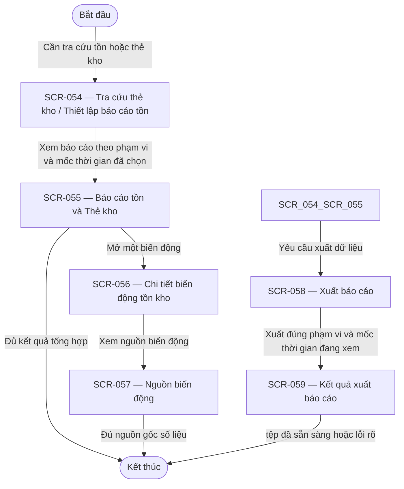

# UIF-15 — Tra cứu báo cáo tồn và thẻ kho

## 1. Mục đích và phạm vi

Mô tả cách người dùng tra cứu báo cáo tồn, xem thẻ kho và nguồn biến động và xuất dữ liệu theo đúng phạm vi đang xem.

- **Hành trình nghiệp vụ:** [BJ-15 — Tra cứu báo cáo tồn và thẻ kho](../../02.specification/behavior/journeys/BJ-15-tra-cuu-bao-cao-ton-va-the-kho.md)
- **Trường hợp sử dụng liên quan:**
  - [UC-15-01 — Xác định báo cáo và phạm vi](../../02.specification/behavior/use-cases/UC-15-01-xac-dinh-bao-cao-va-pham-vi.md)
  - [UC-15-02 — Xem báo cáo tồn kho](../../02.specification/behavior/use-cases/UC-15-02-xem-bao-cao-ton-kho.md)
  - [UC-15-03 — Xem thẻ kho và lịch sử](../../02.specification/behavior/use-cases/UC-15-03-xem-the-kho-va-lich-su.md)
  - [UC-15-04 — Xuất báo cáo](../../02.specification/behavior/use-cases/UC-15-04-xuat-bao-cao.md)

**Ranh giới:** UIF chỉ mô tả cách người dùng đi qua các màn hình, điều kiện chuyển bước và cách xử lý khi không thể tiếp tục. Quy tắc nghiệp vụ vẫn lấy từ BJ/UC/Behavioral Contract; nội dung và thành phần của từng màn hình vẫn lấy từ Screen Contract.

## 2. Người dùng bắt đầu và kết thúc ở đâu

| Cách vào luồng | Màn hình | Người thực hiện | Đi từ đâu |
|---|---|---|---|
| Vào từ chức năng | `SCR-054` | Người xem báo cáo | Kho > Báo cáo và Thẻ kho |

Luồng kết thúc khi người dùng đã nhận được kết quả cuối cùng hoặc công việc được chuyển rõ sang một hành trình khác.

## 3. Luồng màn hình

> Sơ đồ trên để đọc nhanh. Phần “Các bước chuyển màn hình” giải thích điều kiện và cách xử lý; phần “Truy vết kỹ thuật” giữ các mã phục vụ Dev/QA/Harness.

## 4. Các bước chuyển màn hình

| Bước | Từ đâu | Người dùng / hệ thống làm gì | Điều kiện cần | Đi đến | Nếu không thể tiếp tục |
|---|---|---|---|---|---|
| `UIF-15-T01` | Bắt đầu | Cần tra cứu tồn hoặc thẻ kho | Có quyền báo cáo | `SCR-054` — Tra cứu thẻ kho / Thiết lập báo cáo tồn | Không có quyền truy cập → kết thúc |
| `UIF-15-T02` | `SCR-054` — Tra cứu thẻ kho / Thiết lập báo cáo tồn | Xem báo cáo theo phạm vi và mốc thời gian đã chọn | Có quyền xem dữ liệu trong phạm vi đã chọn | `SCR-055` — Báo cáo tồn và Thẻ kho | Dữ liệu đã thay đổi → làm mới cùng phạm vi |
| `UIF-15-T03` | `SCR-055` — Báo cáo tồn và Thẻ kho | Mở một biến động | Có quyền lịch sử | `SCR-056` — Chi tiết biến động tồn kho | — |
| `UIF-15-T04` | `SCR-056` — Chi tiết biến động tồn kho | Xem nguồn biến động | Có quyền xem nguồn của biến động | `SCR-057` — Nguồn biến động | — |
| `UIF-15-T05` | `SCR-054` hoặc `SCR-055` | Yêu cầu xuất dữ liệu | Có quyền xuất dữ liệu | `SCR-058` — Xuất báo cáo | — |
| `UIF-15-T06` | `SCR-058` — Xuất báo cáo | Xuất đúng phạm vi và mốc thời gian đang xem | Có quyền xuất dữ liệu trong phạm vi đã chọn | `SCR-059` — Kết quả xuất báo cáo | Xuất báo cáo thất bại (`FAILED`) hoặc nguồn dữ liệu đã thay đổi → không tạo tệp kết quả không hợp lệ |
| `UIF-15-T07` | `SCR-055` — Báo cáo tồn và Thẻ kho | Đủ kết quả tổng hợp | — | Kết thúc | — |
| `UIF-15-T08` | `SCR-057` — Nguồn biến động | Đủ nguồn gốc số liệu | — | Kết thúc | — |
| `UIF-15-T09` | `SCR-059` — Kết quả xuất báo cáo | tệp đã sẵn sàng hoặc lỗi rõ | — | Kết thúc | — |

## 5. Các tình huống cần chú ý

Các quy tắc chung về quyền, quay lại, dữ liệu thay đổi và chống ghi nhận lặp vẫn lấy từ UC/Behavioral Contract/Screen Contract. UIF chỉ nhắc lại những điểm ảnh hưởng trực tiếp đến cách đi qua màn hình.

- Nếu dữ liệu nguồn đã thay đổi, phải nạp lại dữ liệu hiện hành và rà soát lại trước khi tiếp tục. Phần người dùng đã nhập chỉ được giữ lại khi còn an toàn.

## 6. Màn hình và Trường hợp sử dụng liên quan

| Trường hợp sử dụng | Màn hình sử dụng |
|---|---|
| [UC-15-01](../../02.specification/behavior/use-cases/UC-15-01-xac-dinh-bao-cao-va-pham-vi.md) — Xác định báo cáo và phạm vi | `SCR-054` |
| [UC-15-02](../../02.specification/behavior/use-cases/UC-15-02-xem-bao-cao-ton-kho.md) — Xem báo cáo tồn kho | `SCR-055` |
| [UC-15-03](../../02.specification/behavior/use-cases/UC-15-03-xem-the-kho-va-lich-su.md) — Xem thẻ kho và lịch sử | `SCR-055`, `SCR-056`, `SCR-057` |
| [UC-15-04](../../02.specification/behavior/use-cases/UC-15-04-xuat-bao-cao.md) — Xuất báo cáo | `SCR-058`, `SCR-059` |

### Màn hình dùng trong luồng

| Màn hình | Tên | Vai trò trong luồng |
|---|---|---|
| [SCR-054](../screens/SCR-054.md) | Tra cứu thẻ kho / Thiết lập báo cáo tồn | Màn hình chính trong luồng |
| [SCR-055](../screens/SCR-055.md) | Báo cáo tồn và Thẻ kho | Màn hình chính trong luồng |
| [SCR-056](../screens/SCR-056.md) | Chi tiết biến động tồn kho | Màn hình chính trong luồng |
| [SCR-057](../screens/SCR-057.md) | Nguồn biến động | Màn hình chính trong luồng |
| [SCR-058](../screens/SCR-058.md) | Xuất báo cáo | Màn hình chính trong luồng |
| [SCR-059](../screens/SCR-059.md) | Kết quả xuất báo cáo | Màn hình chính trong luồng |

## 7. Truy vết kỹ thuật

> Phần này dành cho Dev/QA/Harness. Các mã kỹ thuật được giữ nguyên để Dev/QA/Harness đối chiếu tự động.

| Transition | From | To | Loại | Action | UC / BC |
|---|---|---|---|---|---|
| `UIF-15-T01` | `BEGIN` | `SCR-054` | `NAVIGATION` | `—` | UC-15-01 |
| `UIF-15-T02` | `SCR-054` | `SCR-055` | `QUERY` | `—` | UC-15-01, UC-15-02 / BC-IO-01 |
| `UIF-15-T03` | `SCR-055` | `SCR-056` | `NAVIGATION` | `—` | UC-15-03 |
| `UIF-15-T04` | `SCR-056` | `SCR-057` | `NAVIGATION` | `—` | UC-15-03 |
| `UIF-15-T05` | `SCR-054/SCR-055` | `SCR-058` | `NAVIGATION` | `—` | UC-15-04 |
| `UIF-15-T06` | `SCR-058` | `SCR-059` | `QUERY` | `ACT-11-EXPORT` | UC-15-04 / BC-IO-01 |
| `UIF-15-T07` | `SCR-055` | `END` | `TERMINAL` | `—` | UC-15-02 |
| `UIF-15-T08` | `SCR-057` | `END` | `TERMINAL` | `—` | UC-15-03 |
| `UIF-15-T09` | `SCR-059` | `END` | `TERMINAL` | `—` | UC-15-04 |

## 8. Kiểm tra tính đầy đủ và liên kết

- [x] Tất cả Trường hợp sử dụng liên quan đều được liên kết từ UIF.
- [x] Mỗi màn hình đang dùng trong luồng có Screen Contract tương ứng.
- [x] Các bước do hệ thống thực hiện không bị mô tả thành thao tác của người dùng.
- [x] Nếu có phê duyệt hoặc chuyển vai trò, người gửi và người nhận có điểm vào riêng.
- [x] Trạng thái kết thúc và trường hợp `UNKNOWN` có hướng xử lý rõ khi áp dụng.
- [x] Bảng đọc chính và bảng truy vết kỹ thuật dùng cùng một tập transition ID; không đổi topology hoặc hành vi.
- [x] Liên kết BJ ↔ UIF ↔ UC/SCR dùng đường dẫn tương đối và mở đúng tài liệu đích.

**Trạng thái đối chiếu thiết kế:** `ALIGNED_TO_CURRENT_SCREEN_CONTRACTS` — UIF đã được viết lại theo Plain BA Language; cấu trúc luồng, ID, mã Action, liên kết UC/BC và trạng thái đối chiếu của v4.1.0 được giữ nguyên. HTML và Screen Contract không thay đổi trong lượt này.

### Liên kết

- [Business Journey](../../02.specification/behavior/journeys/BJ-15-tra-cuu-bao-cao-ton-va-the-kho.md)
- [Business Journey Map](../../02.specification/behavior/journeys/00-business-journey-map.md)
- [Use Case Map](../../02.specification/behavior/use-cases/00-use-case-map.md)
- [Prototype manifest](../prototype/README.md)
