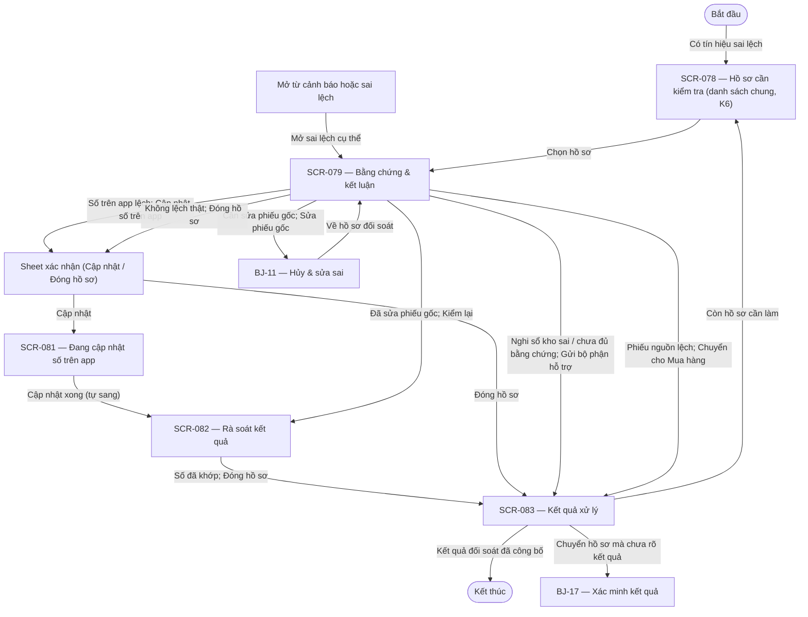

# UIF-16 — Điều tra và đối soát sai lệch

## 1. Mục đích và phạm vi

Mô tả cách xử lý một hồ sơ sai lệch: mở từ danh sách chung "Hồ sơ cần kiểm tra", biết bằng một câu thường lệch gì và hàng nào đang tạm khoá, làm **một** việc tiếp theo (cập nhật số trên app / sửa phiếu gốc / đóng hồ sơ / gửi bộ phận hỗ trợ / chuyển cho Mua hàng), kiểm lại rồi đóng. Xác nhận bằng sheet ngay ở màn bằng chứng. iPhone và web đều là thiết bị chính.

- **Hành trình nghiệp vụ:** [BJ-16 — Điều tra và đối soát sai lệch](../../02.specification/behavior/journeys/BJ-16-ieu-tra-va-oi-soat-sai-lech.md)
- **Trường hợp sử dụng liên quan:**
  - [UC-16-01 — Mở và phân loại hồ sơ đối soát](../../02.specification/behavior/use-cases/UC-16-01-mo-va-phan-loai-ho-so-doi-soat.md)
  - [UC-16-02 — Bảo vệ phạm vi rủi ro](../../02.specification/behavior/use-cases/UC-16-02-bao-ve-pham-vi-rui-ro.md)
  - [UC-16-03 — Điều tra và xác định nguyên nhân](../../02.specification/behavior/use-cases/UC-16-03-dieu-tra-va-xac-dinh-nguyen-nhan.md)
  - [UC-16-04 — Xác minh và cập nhật kết quả đối soát](../../02.specification/behavior/use-cases/UC-16-04-xac-minh-va-cap-nhat-ket-qua-doi-soat.md)

**Ranh giới:** UIF chỉ mô tả cách người dùng đi qua các màn hình, điều kiện chuyển bước và cách xử lý khi không thể tiếp tục. Quy tắc nghiệp vụ vẫn lấy từ BJ/UC/Behavioral Contract; nội dung và thành phần của từng màn hình vẫn lấy từ Screen Contract.

## 2. Người dùng bắt đầu và kết thúc ở đâu

| Cách vào luồng | Màn hình | Người thực hiện | Đi từ đâu |
|---|---|---|---|
| Vào từ chức năng | `SCR-078` | Chủ cửa hàng (hoặc nhân viên được giao) | Kho → Kiểm kê & xử lý → "Đối soát sai lệch" (chip "Sai lệch") |
| Vào từ Home Kho | `SCR-078` | như trên | **Home Kho → "Cần chú ý" → "Hồ sơ cần kiểm tra"** (chip "Tất cả"; một dòng cho cả BJ-16 và BJ-17) |
| Mở từ ngữ cảnh liên quan | `SCR-079` | như trên | Cảnh báo kiểm soát hoặc sai lệch báo cáo (entry `case-context`) |
| Quay về từ sửa phiếu gốc | `SCR-079` | Người lập sửa sai | BJ-11 `SCR-053` → "Về hồ sơ đối soát" |

Luồng kết thúc khi hồ sơ đã đóng, hoặc đã gửi bộ phận hỗ trợ / chuyển cho Mua hàng (hồ sơ "Đang chờ"). Trạng thái `UNKNOWN` không được coi là thành công; phải tiếp tục xác minh với đúng thao tác gốc.

## 3. Luồng màn hình

> Sơ đồ trên để đọc nhanh. Phần “Các bước chuyển màn hình” giải thích điều kiện và cách xử lý; phần “Truy vết kỹ thuật” giữ các mã phục vụ Dev/QA/Harness.

## 4. Các bước chuyển màn hình

| Bước | Từ đâu | Người dùng / hệ thống làm gì | Điều kiện cần | Đi đến | Nếu không thể tiếp tục |
|---|---|---|---|---|---|
| `UIF-16-T01` | Bắt đầu | Có tín hiệu sai lệch | Có quyền đối soát | `SCR-078` — Hồ sơ cần kiểm tra | — |
| `UIF-16-T02` | Mở từ cảnh báo hoặc sai lệch | Mở sai lệch cụ thể | Có quyền với phạm vi đang xử lý | `SCR-079` — Bằng chứng & kết luận | — |
| `UIF-16-T03` | `SCR-078` — Hồ sơ cần kiểm tra | Chọn hồ sơ loại "Sai lệch" (hồ sơ "Chưa rõ kết quả" mở sang BJ-17) | Hồ sơ thuộc phạm vi người dùng được xử lý | `SCR-079` — Bằng chứng & kết luận | — |
| `UIF-16-T04` | `SCR-079` — Bằng chứng & kết luận | Không lệch thật; "Đóng hồ sơ" → sheet xác nhận | Có đủ bằng chứng để kết luận | `SCR-083` — Kết quả xử lý (`COMPLETED`) | Bằng chứng đổi → "Kết luận đã thay đổi"; không dựng lại dữ liệu |
| `UIF-16-T05` | `SCR-079` — Bằng chứng & kết luận | Cần sửa phiếu gốc; "Sửa phiếu gốc" | Đã xác định phiếu nguồn cần sửa | BJ-11 — `SCR-050` (đúng phiếu, số đúng điền sẵn) | BJ-16 không tự sửa phiếu gốc; đang có yêu cầu chờ duyệt → "Xem yêu cầu" |
| `UIF-16-T06` | `SCR-083` — Kết quả xử lý | Chuyển hồ sơ mà chưa rõ kết quả; "Chuyển sang xác minh" | Có mã thao tác gốc | BJ-17 — hành trình liên quan | — |
| `UIF-16-T07` | `SCR-079` — Bằng chứng & kết luận | Nghi sổ kho sai / chưa đủ bằng chứng / phiếu nguồn lệch; "Gửi bộ phận hỗ trợ" / "Chuyển cho Mua hàng" | Không tự dựng lại dữ liệu khi chưa chứng minh được sổ kho đúng | `SCR-083` — Kết quả xử lý (`ESCALATED`) | Hồ sơ vẫn mở ("Đang chờ"); phạm vi rủi ro tiếp tục được bảo vệ |
| `UIF-16-T08` | `SCR-079` — Bằng chứng & kết luận | Số trên app lệch, sổ kho đúng; "Cập nhật số trên app" → sheet "Cập nhật" | Có đủ bằng chứng; phạm vi không do hồ sơ khác giữ (`LOCKED` → "Mở hồ sơ đó") | `SCR-081` — Đang cập nhật số trên app | Không sửa sổ kho hay phiếu gốc; bằng chứng đổi → `CONFLICT` |
| `UIF-16-T09` | `SCR-081` — Đang cập nhật số trên app | Hệ thống cập nhật xong | Cùng hồ sơ, bằng chứng chưa đổi | `SCR-082` — Rà soát kết quả | Bằng chứng đổi → `k1Stale` "Chưa cập nhật được số trên app"; "Về hồ sơ" |
| `UIF-16-T10` | `SCR-079` — Bằng chứng & kết luận | Đã sửa phiếu gốc / đã cập nhật số; "Kiểm lại" | Phiếu sửa sai đã ghi | `SCR-082` — Rà soát kết quả | — |
| `UIF-16-T11` | `SCR-082` — Rà soát kết quả | "Đóng hồ sơ" | Có đủ bằng chứng; số đã khớp | `SCR-083` — Kết quả xử lý (`COMPLETED`) | Sai lệch vẫn còn → giữ hồ sơ mở, "Quay lại bằng chứng" |
| `UIF-16-T12` | `SCR-083` — Kết quả xử lý | "Về hồ sơ cần kiểm tra" | Còn hồ sơ "Cần làm" | `SCR-078` — Hồ sơ cần kiểm tra | Không còn → "Về Kho" |
| `UIF-16-T13` | `SCR-083` — Kết quả xử lý | Kết quả đối soát đã công bố | — | Kết thúc | — |
| `UIF-16-T14` | BJ-11 `SCR-053` | "Về hồ sơ đối soát" | Sửa sai mở từ hồ sơ này | `SCR-079` — Bằng chứng & kết luận ("Đã sửa phiếu gốc · chờ kiểm lại" khi đã ghi) | — |

## 5. Các tình huống cần chú ý

Các quy tắc chung về quyền, quay lại, dữ liệu thay đổi và chống ghi nhận lặp vẫn lấy từ UC/Behavioral Contract/Screen Contract. UIF chỉ nhắc lại những điểm ảnh hưởng trực tiếp đến cách đi qua màn hình.

- **Một danh sách cho hai luồng:** chip và ô tìm của `SCR-078` là trạng thái chung; đổi luồng (BJ-16 → BJ-11 → BJ-16 → BJ-17) không làm mất chip. Dòng "Đang chờ" = đã gửi bộ phận hỗ trợ / chuyển cho Mua hàng hoặc sửa sai chờ duyệt.
- **Chỉ cập nhật số trên app khi đã chứng minh sổ kho đúng** (BR-03). Nghi sổ kho sai thì dừng mọi cập nhật tự động và gửi bộ phận hỗ trợ; không dựng sổ từ báo cáo (BR-06).
- **Khoá đúng phạm vi:** hồ sơ nói rõ hàng nào đang tạm khoá; đóng hồ sơ thì mở khoá. Phạm vi do hồ sơ khác giữ thì chỉ xem và mở hồ sơ đó.
- **Sửa phiếu gốc:** BJ-16 không tự sửa phiếu — chuyển BJ-11; sửa xong về hồ sơ để kiểm lại rồi mới đóng (UC-16-04).
- **Bộ phận hỗ trợ** và **Mua hàng** chỉ là người nhận được ghi ở hồ sơ (không có màn / vai riêng trong app).
- Nếu kết quả chưa xác định (`UNKNOWN`), không thực hiện lại bằng một thao tác mới. Hệ thống giữ nguyên mã thao tác gốc để xác minh; khi chưa đủ bằng chứng, chuyển sang `BJ-17`.

## 6. Màn hình và Trường hợp sử dụng liên quan

| Trường hợp sử dụng | Màn hình sử dụng |
|---|---|
| [UC-16-01](../../02.specification/behavior/use-cases/UC-16-01-mo-va-phan-loai-ho-so-doi-soat.md) — Mở và phân loại hồ sơ đối soát | `SCR-078` |
| [UC-16-02](../../02.specification/behavior/use-cases/UC-16-02-bao-ve-pham-vi-rui-ro.md) — Bảo vệ phạm vi rủi ro | `SCR-079` |
| [UC-16-03](../../02.specification/behavior/use-cases/UC-16-03-dieu-tra-va-xac-dinh-nguyen-nhan.md) — Điều tra và xác định nguyên nhân | `SCR-079`, `SCR-081` |
| [UC-16-04](../../02.specification/behavior/use-cases/UC-16-04-xac-minh-va-cap-nhat-ket-qua-doi-soat.md) — Xác minh và cập nhật kết quả đối soát | `SCR-082`, `SCR-083` |

### Màn hình dùng trong luồng

| Màn hình | Tên | Vai trò trong luồng |
|---|---|---|
| [SCR-078](../screens/SCR-078.md) | Hồ sơ cần kiểm tra | Màn hình chính trong luồng |
| [SCR-079](../screens/SCR-079.md) | Bằng chứng & kết luận | Màn hình chính trong luồng |
| [SCR-081](../screens/SCR-081.md) | Đang cập nhật số trên app | Màn hình chính trong luồng |
| [SCR-082](../screens/SCR-082.md) | Rà soát kết quả | Màn hình chính trong luồng |
| [SCR-083](../screens/SCR-083.md) | Kết quả xử lý | Màn hình chính trong luồng |

## 7. Truy vết kỹ thuật

> Phần này dành cho Dev/QA/Harness. Các mã kỹ thuật được giữ nguyên để Dev/QA/Harness đối chiếu tự động.

| Transition | From | To | Loại | Action | UC / BC |
|---|---|---|---|---|---|
| `UIF-16-T01` | `BEGIN` | `SCR-078` | `NAVIGATION` | `—` | UC-16-01 |
| `UIF-16-T02` | `CONTEXT_RECON` | `SCR-079` | `NAVIGATION` | `—` | UC-16-01 |
| `UIF-16-T03` | `SCR-078` | `SCR-079` | `NAVIGATION` | `—` | UC-16-01 |
| `UIF-16-T04` | `SCR-079` | `SCR-083` | `MUTATION` | `ACT-15-RECONCILE` | UC-16-03, UC-16-04 / BC-IC-05 |
| `UIF-16-T05` | `SCR-079` | `BJ-11` | `HANDOFF` | `—` | UC-16-03 → BJ-11 |
| `UIF-16-T06` | `SCR-083` | `BJ-17` | `HANDOFF` | `—` | UC-16-03 → BJ-17 |
| `UIF-16-T07` | `SCR-079` | `SCR-083` | `HANDOFF` | `—` | UC-16-02, UC-16-03 |
| `UIF-16-T08` | `SCR-079` | `SCR-081` | `MUTATION` | `ACT-15-RECONCILE` | UC-16-03, UC-16-04 / BC-IC-05 |
| `UIF-16-T09` | `SCR-081` | `SCR-082` | `SYSTEM` | `—` | UC-16-04 |
| `UIF-16-T10` | `SCR-079` | `SCR-082` | `NAVIGATION` | `—` | UC-16-04 |
| `UIF-16-T11` | `SCR-082` | `SCR-083` | `MUTATION` | `ACT-15-RECONCILE` | UC-16-04 / BC-IC-05 |
| `UIF-16-T12` | `SCR-083` | `SCR-078` | `NAVIGATION` | `—` | UC-16-01 |
| `UIF-16-T13` | `SCR-083` | `END` | `TERMINAL` | `—` | UC-16-04 |
| `UIF-16-T14` | `BJ-11` | `SCR-079` | `HANDOFF` | `—` | UC-16-04 ← BJ-11 |

## 8. Kiểm tra tính đầy đủ và liên kết

- [x] Tất cả Trường hợp sử dụng liên quan đều được liên kết từ UIF.
- [x] Mỗi màn hình đang dùng trong luồng có Screen Contract tương ứng.
- [x] Các bước do hệ thống thực hiện không bị mô tả thành thao tác của người dùng.
- [x] Nếu có phê duyệt hoặc chuyển vai trò, người gửi và người nhận có điểm vào riêng.
- [x] Trạng thái kết thúc và trường hợp `UNKNOWN` có hướng xử lý rõ khi áp dụng.
- [x] Bảng đọc chính và bảng truy vết kỹ thuật dùng cùng một tập transition ID.
- [x] Liên kết BJ ↔ UIF ↔ UC/SCR dùng đường dẫn tương đối và mở đúng tài liệu đích.

**Trạng thái đối chiếu thiết kế:** `REDESIGNED_v5.18.0` — luồng viết lại theo thiết kế lại T7-P chặng 5: danh sách chung với BJ-17, một dòng Home, bỏ `SCR-080` (sheet xác nhận ở `SCR-079`), `SCR-081` tự sang `SCR-082`, đường đi / về BJ-11 cho sửa phiếu gốc.

### Liên kết

- [Business Journey](../../02.specification/behavior/journeys/BJ-16-ieu-tra-va-oi-soat-sai-lech.md)
- [Business Journey Map](../../02.specification/behavior/journeys/00-business-journey-map.md)
- [Use Case Map](../../02.specification/behavior/use-cases/00-use-case-map.md)
- [Prototype manifest](../prototype/README.md)
