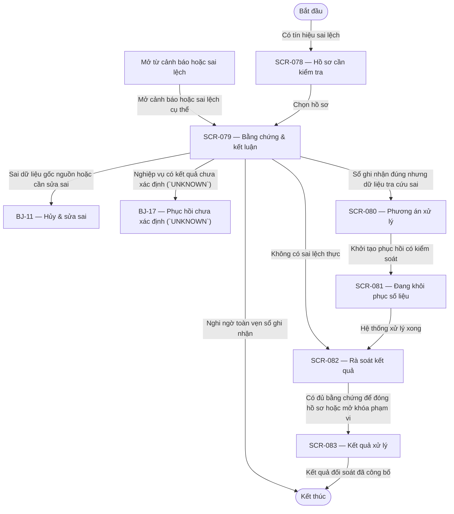

# UIF-16 — Điều tra và đối soát sai lệch

## 1. Mục đích và phạm vi

Mô tả cách điều tra một sai lệch, xác định nguyên nhân, chuyển đúng hành trình xử lý khi cần và chỉ phục hồi dữ liệu tra cứu khi đã chứng minh dữ liệu nguồn là đúng.

- **Hành trình nghiệp vụ:** [BJ-16 — Điều tra và đối soát sai lệch](../../02.specification/behavior/journeys/BJ-16-ieu-tra-va-oi-soat-sai-lech.md)
- **Trường hợp sử dụng liên quan:**
  - [UC-16-01 — Mở và phân loại hồ sơ đối soát](../../02.specification/behavior/use-cases/UC-16-01-mo-va-phan-loai-ho-so-doi-soat.md)
  - [UC-16-02 — Bảo vệ phạm vi rủi ro](../../02.specification/behavior/use-cases/UC-16-02-bao-ve-pham-vi-rui-ro.md)
  - [UC-16-03 — Điều tra và xác định nguyên nhân](../../02.specification/behavior/use-cases/UC-16-03-dieu-tra-va-xac-dinh-nguyen-nhan.md)
  - [UC-16-04 — Xác minh và cập nhật kết quả đối soát](../../02.specification/behavior/use-cases/UC-16-04-xac-minh-va-cap-nhat-ket-qua-doi-soat.md)

**Ranh giới:** UIF chỉ mô tả cách người dùng đi qua các màn hình, điều kiện chuyển bước và cách xử lý khi không thể tiếp tục. Quy tắc nghiệp vụ vẫn lấy từ BJ/UC/Behavioral Contract; nội dung và thành phần của từng màn hình vẫn lấy từ Screen Contract.

## 2. Người dùng bắt đầu và kết thúc ở đâu

| Cách vào luồng | Màn hình | Người thực hiện | Đi từ đâu |
|---|---|---|---|
| Vào từ chức năng | `SCR-078` | Người kiểm soát kho | Kho > Kiểm soát > Đối soát |
| Mở từ ngữ cảnh liên quan | `SCR-079` | Người kiểm soát kho | Cảnh báo kiểm soát hoặc sai lệch báo cáo |

Luồng kết thúc khi người dùng đã nhận được kết quả cuối cùng hoặc công việc được chuyển rõ sang một hành trình khác. Trạng thái `UNKNOWN` không được coi là thành công; phải tiếp tục xác minh với đúng thao tác gốc.

## 3. Luồng màn hình

> Sơ đồ trên để đọc nhanh. Phần “Các bước chuyển màn hình” giải thích điều kiện và cách xử lý; phần “Truy vết kỹ thuật” giữ các mã phục vụ Dev/QA/Harness.

## 4. Các bước chuyển màn hình

| Bước | Từ đâu | Người dùng / hệ thống làm gì | Điều kiện cần | Đi đến | Nếu không thể tiếp tục |
|---|---|---|---|---|---|
| `UIF-16-T01` | Bắt đầu | Có tín hiệu sai lệch | Có quyền kiểm soát | `SCR-078` — Hồ sơ cần kiểm tra | — |
| `UIF-16-T02` | Mở từ cảnh báo hoặc sai lệch | Mở cảnh báo hoặc sai lệch cụ thể | Có quyền với phạm vi đang xử lý | `SCR-079` — Bằng chứng & kết luận | — |
| `UIF-16-T03` | `SCR-078` — Hồ sơ cần kiểm tra | Chọn hồ sơ | Hồ sơ thuộc phạm vi người dùng được xử lý | `SCR-079` — Bằng chứng & kết luận | — |
| `UIF-16-T04` | `SCR-079` — Bằng chứng & kết luận | Không có sai lệch thực | Có đủ bằng chứng để kết luận | `SCR-082` — Rà soát kết quả | Không dựng lại dữ liệu |
| `UIF-16-T05` | `SCR-079` — Bằng chứng & kết luận | Sai dữ liệu gốc nguồn hoặc cần sửa sai | Đã xác định được nơi sở hữu dữ liệu nguồn hoặc hành trình sửa sai cần tiếp tục | BJ-11 — hành trình liên quan | BJ-16 không tự sửa dữ liệu gốc của nghiệp vụ nguồn |
| `UIF-16-T06` | `SCR-079` — Bằng chứng & kết luận | Nghiệp vụ có kết quả chưa xác định (`UNKNOWN`) | Có mã thao tác gốc | BJ-17 — hành trình liên quan | — |
| `UIF-16-T07` | `SCR-079` — Bằng chứng & kết luận | Nghi ngờ toàn vẹn sổ ghi nhận | Không tự dựng lại dữ liệu khi chưa chứng minh được nguồn đúng | Kết thúc | Chuyển cấp xử lý và tiếp tục bảo vệ phạm vi bị ảnh hưởng |
| `UIF-16-T08` | `SCR-079` — Bằng chứng & kết luận | Sổ ghi nhận đúng nhưng dữ liệu tra cứu sai | Có đủ bằng chứng để kết luận | `SCR-080` — Phương án xử lý | — |
| `UIF-16-T09` | `SCR-080` — Phương án xử lý | Khởi tạo phục hồi có kiểm soát | Có quyền xử lý và đã chứng minh sổ ghi nhận là đúng | `SCR-081` — Đang khôi phục số liệu | Không sửa sổ ghi nhận |
| `UIF-16-T10` | `SCR-081` — Đang khôi phục số liệu | Hệ thống xử lý xong | Cùng hồ sơ đối soát | `SCR-082` — Rà soát kết quả | Kiểm tra lại không đạt → quay về SCR-079 |
| `UIF-16-T11` | `SCR-082` — Rà soát kết quả | Có đủ bằng chứng để đóng hồ sơ hoặc mở khóa phạm vi | Có quyền đóng hồ sơ | `SCR-083` — Kết quả xử lý | Sai lệch vẫn còn → giữ hồ sơ ở trạng thái đang xử lý |
| `UIF-16-T12` | `SCR-083` — Kết quả xử lý | Kết quả đối soát đã công bố | — | Kết thúc | — |

## 5. Các tình huống cần chú ý

Các quy tắc chung về quyền, quay lại, dữ liệu thay đổi và chống ghi nhận lặp vẫn lấy từ UC/Behavioral Contract/Screen Contract. UIF chỉ nhắc lại những điểm ảnh hưởng trực tiếp đến cách đi qua màn hình.

- Nếu kết quả chưa xác định (`UNKNOWN`), không thực hiện lại bằng một thao tác mới. Hệ thống giữ nguyên mã thao tác gốc để xác minh; khi chưa đủ bằng chứng, chuyển sang `BJ-17`.

## 6. Màn hình và Trường hợp sử dụng liên quan

| Trường hợp sử dụng | Màn hình sử dụng |
|---|---|
| [UC-16-01](../../02.specification/behavior/use-cases/UC-16-01-mo-va-phan-loai-ho-so-doi-soat.md) — Mở và phân loại hồ sơ đối soát | `SCR-078` |
| [UC-16-02](../../02.specification/behavior/use-cases/UC-16-02-bao-ve-pham-vi-rui-ro.md) — Bảo vệ phạm vi rủi ro | `SCR-079`, `SCR-080` |
| [UC-16-03](../../02.specification/behavior/use-cases/UC-16-03-dieu-tra-va-xac-dinh-nguyen-nhan.md) — Điều tra và xác định nguyên nhân | `SCR-079`, `SCR-080` |
| [UC-16-04](../../02.specification/behavior/use-cases/UC-16-04-xac-minh-va-cap-nhat-ket-qua-doi-soat.md) — Xác minh và cập nhật kết quả đối soát | `SCR-082`, `SCR-083` |

### Màn hình dùng trong luồng

| Màn hình | Tên | Vai trò trong luồng |
|---|---|---|
| [SCR-078](../screens/SCR-078.md) | Hồ sơ cần kiểm tra | Màn hình chính trong luồng |
| [SCR-079](../screens/SCR-079.md) | Bằng chứng & kết luận | Màn hình chính trong luồng |
| [SCR-080](../screens/SCR-080.md) | Phương án xử lý | Màn hình chính trong luồng |
| [SCR-081](../screens/SCR-081.md) | Đang khôi phục số liệu | Màn hình chính trong luồng |
| [SCR-082](../screens/SCR-082.md) | Rà soát kết quả | Màn hình chính trong luồng |
| [SCR-083](../screens/SCR-083.md) | Kết quả xử lý | Màn hình chính trong luồng |

## 7. Truy vết kỹ thuật

> Phần này dành cho Dev/QA/Harness. Các mã kỹ thuật được giữ nguyên để Dev/QA/Harness đối chiếu tự động.

| Transition | From | To | Loại | Action | UC / BC |
|---|---|---|---|---|---|
| `UIF-16-T01` | `BEGIN` | `SCR-078` | `NAVIGATION` | `—` | UC-16-01 |
| `UIF-16-T02` | `CONTEXT_RECON` | `SCR-079` | `NAVIGATION` | `—` | UC-16-01 |
| `UIF-16-T03` | `SCR-078` | `SCR-079` | `NAVIGATION` | `—` | UC-16-01 |
| `UIF-16-T04` | `SCR-079` | `SCR-082` | `SYSTEM` | `—` | UC-16-03 |
| `UIF-16-T05` | `SCR-079` | `BJ-11` | `HANDOFF` | `—` | UC-16-03 → BJ-11 |
| `UIF-16-T06` | `SCR-079` | `BJ-17` | `HANDOFF` | `—` | UC-16-03 → BJ-17 |
| `UIF-16-T07` | `SCR-079` | `END` | `HANDOFF` | `—` | UC-16-02, UC-16-03 |
| `UIF-16-T08` | `SCR-079` | `SCR-080` | `NAVIGATION` | `—` | UC-16-03 |
| `UIF-16-T09` | `SCR-080` | `SCR-081` | `MUTATION` | `ACT-15-RECONCILE` | UC-16-04 / BC-IC-05 |
| `UIF-16-T10` | `SCR-081` | `SCR-082` | `SYSTEM` | `—` | UC-16-04 |
| `UIF-16-T11` | `SCR-082` | `SCR-083` | `MUTATION` | `ACT-15-RECONCILE` | UC-16-04 / BC-IC-05 |
| `UIF-16-T12` | `SCR-083` | `END` | `TERMINAL` | `—` | UC-16-04 |

## 8. Kiểm tra tính đầy đủ và liên kết

- [x] Tất cả Trường hợp sử dụng liên quan đều được liên kết từ UIF.
- [x] Mỗi màn hình đang dùng trong luồng có Screen Contract tương ứng.
- [x] Các bước do hệ thống thực hiện không bị mô tả thành thao tác của người dùng.
- [x] Nếu có phê duyệt hoặc chuyển vai trò, người gửi và người nhận có điểm vào riêng.
- [x] Trạng thái kết thúc và trường hợp `UNKNOWN` có hướng xử lý rõ khi áp dụng.
- [x] Bảng đọc chính và bảng truy vết kỹ thuật dùng cùng một tập transition ID; không đổi topology hoặc hành vi.
- [x] Liên kết BJ ↔ UIF ↔ UC/SCR dùng đường dẫn tương đối và mở đúng tài liệu đích.

**Trạng thái đối chiếu thiết kế:** `ALIGNED_TO_CURRENT_SCREEN_CONTRACTS` — UIF đã được viết lại theo Plain BA Language; cấu trúc luồng, ID, mã Action, liên kết UC/BC và trạng thái đối chiếu của v4.1.0 được giữ nguyên. HTML và Screen Contract không thay đổi trong lượt này.

### Liên kết

- [Business Journey](../../02.specification/behavior/journeys/BJ-16-ieu-tra-va-oi-soat-sai-lech.md)
- [Business Journey Map](../../02.specification/behavior/journeys/00-business-journey-map.md)
- [Use Case Map](../../02.specification/behavior/use-cases/00-use-case-map.md)
- [Prototype manifest](../prototype/README.md)
